# Flashcards — Unit 14: Basic Trigonometry and Vectors

63 cards. Read the question, answer it in your head, then click it to check.

Study guide for this unit: [study-guide.md](../study-guide.md). The raw card data is in [`unit14_flashcards.json`](unit14_flashcards.json) if you want to import the cards into a flashcard app.

---

<b>1.</b> What is a right triangle?
 A triangle with one 90° (right) angle. 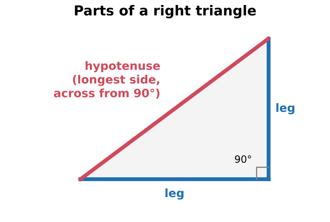  14–1  

<b>2.</b> Which side of a right triangle is the hypotenuse?
 The side across from the 90° angle. It's always the longest side.   Find the 90° corner first; don't go by which side looks slanted  

<b>3.</b> What do the angles of any triangle add up to?
 180°  14–1 / summary  

<b>4.</b> In a right triangle, what do the two non-right angles add up to?
 90°. If you know one, the other is 90° minus it.  Review Q10: Y = 36°, so X = 54°  

<b>5.</b> You solve for a leg and get a length longer than the hypotenuse. What happened?
 You made a mistake. A leg can never be longer than the hypotenuse.  Sanity check every time  

<b>6.</b> State the Pythagorean theorem.
 c² = a² + b², where c is the hypotenuse and a and b are the legs. 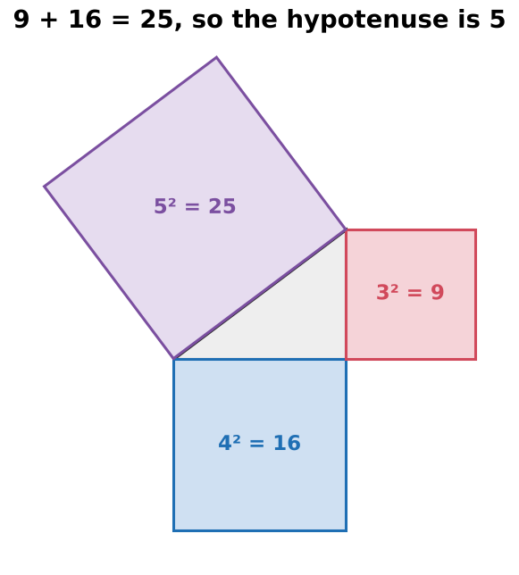  14–2  

<b>7.</b>  What does this picture prove?
 The square on the hypotenuse equals the sum of the squares on the two legs: 9 + 16 = 25, so the hypotenuse is 5.  3-4-5 triangle  

<b>8.</b> Formula for the hypotenuse when you know both legs?
 c = √(a² + b²)  

<b>9.</b> Formula for a leg when you know the hypotenuse and the other leg?
 a = √(c² − b²). Note the minus sign.  

<b>10.</b> Hypotenuse = 18 in., one leg = 7 in. Find the other leg.
 √(18² − 7²) = √275 = <b>16.583 in.</b> 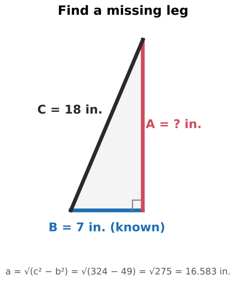  Example 14–1  

<b>11.</b> Legs of 3 and 4. Is the hypotenuse 7?
 No. 5. √(a² + b²) ≠ a + b.  The same mistake as R + Xₗ = Z in AC  

<b>12.</b> Calculator: how should you type the hypotenuse of legs 18 and 7?
 √(18² + 7²), with parentheses around the whole sum. Or square and add first, then take the root last.  √18² + 7² gives the wrong answer  

<b>13.</b> When does the Pythagorean theorem NOT apply?
 On non-right triangles, and for quantities that aren't exactly 90° apart.  R and Xₗ are 90° apart, so it works for impedance  

<b>14.</b> How do you lay out a square corner with a tape measure?
 Mark 3 on one line and 4 on the other. The corner is 90° when the diagonal is exactly 5 (or use 6-8-10). 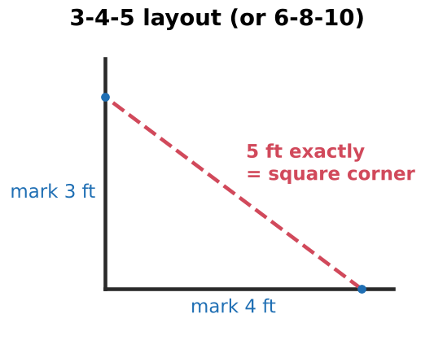  

<b>15.</b> Formula for a rolling offset's true offset?
 True offset = √(rise² + roll²)  Pythagorean theorem in conduit work  

<b>16.</b> 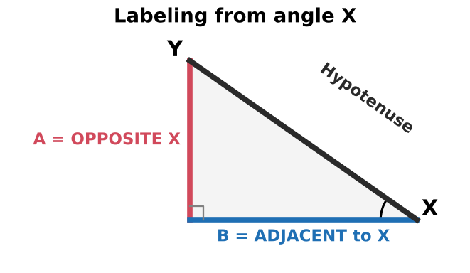 From angle X, which side is opposite and which is adjacent?
 A is opposite X. B is adjacent to X.  Figure 14–22 orientation  

<b>17.</b> 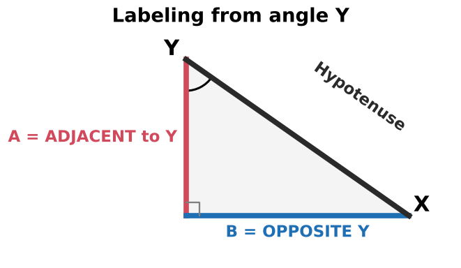 From angle Y, which side is opposite and which is adjacent?
 B is opposite Y. A is adjacent to Y.  Re-label for every question  

<b>18.</b> Does the hypotenuse change when you switch from angle X to angle Y?
 No. Only opposite and adjacent swap.  

<b>19.</b> Book trick for finding the opposite side?
 Draw a line that bisects (splits) the angle. It runs into the opposite side.  

<b>20.</b> sin θ = ?
 Opposite / Hypotenuse 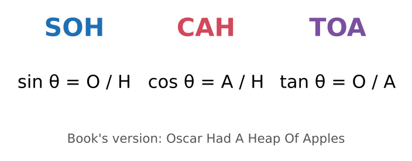  SOH  

<b>21.</b> cos θ = ?
 Adjacent / Hypotenuse   CAH  

<b>22.</b> tan θ = ?
 Opposite / Adjacent   TOA  

<b>23.</b> What does "Oscar Had A Heap Of Apples" stand for?
 sin = O/H, cos = A/H, tan = O/A  Same as SOH-CAH-TOA  

<b>24.</b> You know O and H. Which function do you use?
 Sine  

<b>25.</b> You know A and H. Which function do you use?
 Cosine  Review Q1  

<b>26.</b> You know O and A. Which function do you use?
 Tangent  

<b>27.</b> What do sin⁻¹, cos⁻¹ and tan⁻¹ (arcsin, INV SIN) do?
 Run the ratio backward: you give a ratio and get the angle back.  sin⁻¹ does NOT mean 1/sin  

<b>28.</b> H = 14, O = 9. Find the angle.
 sin θ = 9/14 = 0.643, so θ = sin⁻¹(0.643) = <b>40°</b>  Example 14–2  

<b>29.</b> Same triangle, now find the other angle (A = 9 from that angle, H = 14).
 cos⁻¹(9/14) = <b>50°</b>. Check: 40 + 50 = 90.  Example 14–3  

<b>30.</b> Why does sin X = cos Y in a right triangle?
 The side opposite X is the side adjacent to Y, and X + Y = 90°.  That's why both examples gave 0.643  

<b>31.</b> What range do sin and cos fall in for a right triangle's angles?
 0 to 1, because the hypotenuse is the longest side.  ERROR on sin⁻¹ or cos⁻¹ means the hypotenuse is on top — swap it to the bottom  

<b>32.</b> What happens to tan θ as θ approaches 90°?
 It grows without limit. tan 45° = 1.  

<b>33.</b> Calculator mode for this course: DEG or RAD? How do you check?
 DEG. Test: sin 30 should give 0.5.  RAD gives wrong answers with no warning  

<b>34.</b> The book shows sin(0.643) = 0.0112. What went wrong?
 SIN was pressed instead of SIN⁻¹ (arcsin).  

<b>35.</b> Why shouldn't you round the ratio before taking the inverse?
 Rounding early shifts the angle. Keep full precision until the final answer.  

<b>36.</b> Do SOH-CAH-TOA and the Pythagorean theorem work on any triangle?
 No. Only on right triangles.  

<b>37.</b> O = H × ?
 sin θ  Opp = sin θ × Hyp  

<b>38.</b> A = H × ?
 cos θ  Adj = cos θ × Hyp  

<b>39.</b> H = O ÷ ?   and   H = A ÷ ?
 H = O / sin θ, and H = A / cos θ  

<b>40.</b> O = A × ?   and   A = O ÷ ?
 O = A × tan θ, and A = O / tan θ  

<b>41.</b> Sanity check when solving for the hypotenuse?
 The answer must be bigger than the leg you started with (dividing by sin or cos, which are under 1).  

<b>42.</b> 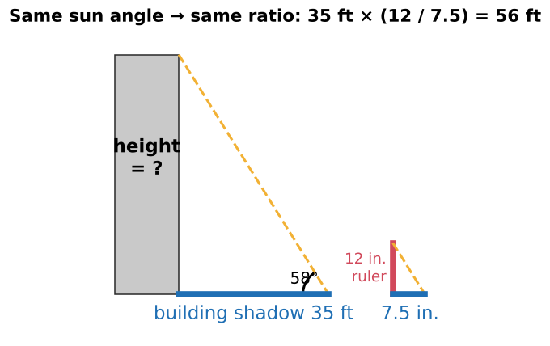 How does the shadow method find a building's height?
 The ruler and its shadow give tan θ = 12/7.5 = 1.6 (θ ≈ 58°). Height = 35 ft × 1.6 = <b>56 ft</b>.  Shortcut: the ratios are equal, so you don't even need the angle  

<b>43.</b> What's the difference between a scalar and a vector?
 A scalar has magnitude only ("walk 3 blocks"). A vector has magnitude and direction ("walk 3 blocks south").  

<b>44.</b> Which way is 0°, and which way do positive angles rotate?
 0° points right (horizontal). Positive angles go counterclockwise. A negative angle goes clockwise: −30° = 330°. 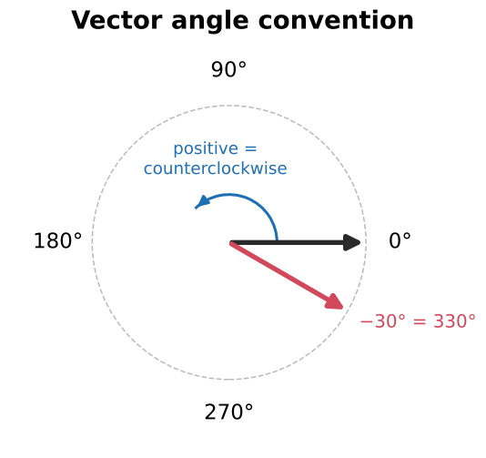  

<b>45.</b> A vector drawn at 120° after one at 45°. Is the 120° measured from the 45° line?
 No. Every angle is measured from 0°. 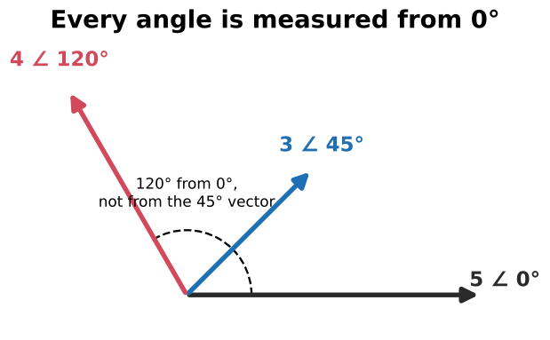  Figure 14–13  

<b>46.</b> What does 5∠30° mean?
 Magnitude 5 at an angle of 30° (polar form).  

<b>47.</b> What is a resultant?
 The single vector equal to the combined effect of the vectors being added.  

<b>48.</b> How do you add vectors pointing in the same direction?
 Add the magnitudes. Example: 6 V + 4 V batteries aiding = 10 V. Series resistors 80 + 50 + 30 = 160 Ω. 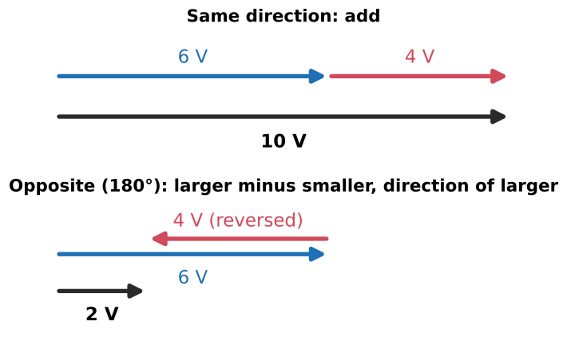  

<b>49.</b> How do you add vectors that are exactly opposite (180°)?
 Larger minus smaller, in the direction of the larger. 6 V − 4 V = 2 V.   The book's wording ("larger from the smaller") is backwards  

<b>50.</b> Describe the tip-to-tail method.
 Put the tail of the 2nd vector at the head of the 1st. The resultant runs from the first tail to the last head. It works for any number of vectors. 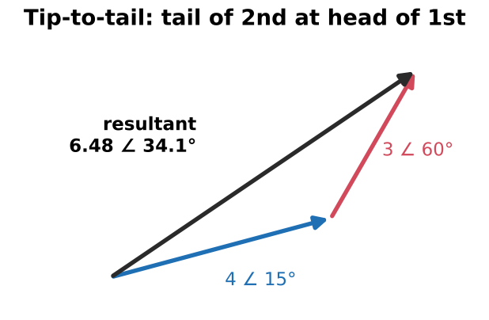  

<b>51.</b> Describe the parallelogram method.
 Both vectors start at the same point. Complete the parallelogram. The resultant is the diagonal from the shared corner. 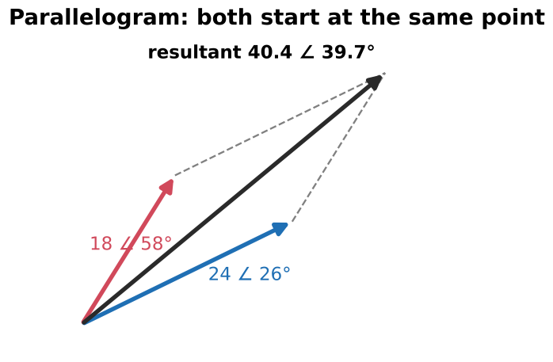  Same answer as tip-to-tail. The book's "tale" is a typo for tail.  

<b>52.</b> 4∠15° + 3∠60° = ?
 <b>6.48∠34.1°</b> (not 7). The book's drawn answer, 6.4832, is slightly off because drawing is approximate.   Vectors at an angle add to less than the straight sum  

<b>53.</b> How do you add vectors exactly using components?
 x = M cos θ, y = M sin θ for each vector. Sum the x's and the y's. Then M = √(x² + y²), θ = tan⁻¹(y/x). 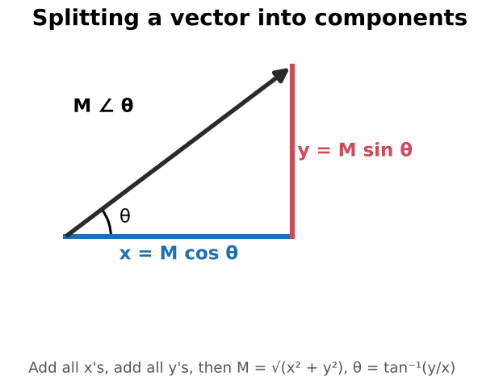  

<b>54.</b> Exception when finding the resultant angle with tan⁻¹?
 tan⁻¹ only returns −90° to +90°. If the total x is negative, add 180°.  Or use the calculator's R→P key  

<b>55.</b> On a 120/240 V split-phase service, why do the legs add to 240 V?
 The legs are 180° apart, so measured leg to leg their magnitudes add. 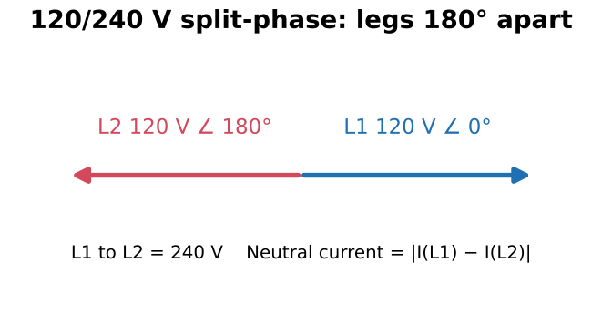  

<b>56.</b> Split-phase: 30 A on L1, 20 A on L2. Neutral current?
 <b>10 A</b>. The neutral carries the difference, because the leg currents oppose.  That's why a lost neutral is dangerous  

<b>57.</b> Why is a 3-phase wye 120/208, not 120/240?
 The phases are 120° apart, not 180°. Vector addition gives 120 × √3 ≈ 208 V. 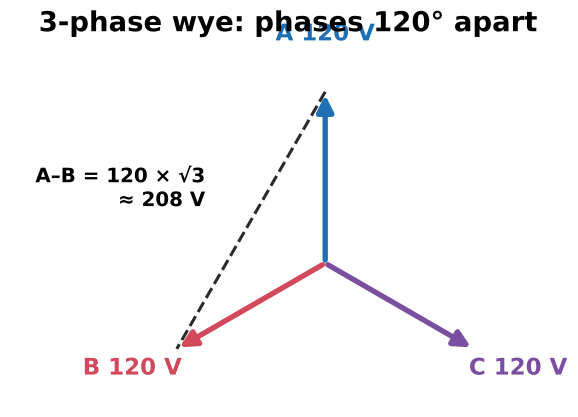  

<b>58.</b> Why is the neutral current zero in a balanced wye?
 Three equal vectors 120° apart cancel out.  

<b>59.</b> High-leg delta (120/240): what does the high leg read to neutral?
 ≈ 208 V (240 × √3/2). It must be marked orange. Never land a 120 V load on it.  

<b>60.</b> Offset multipliers: 10°, 22½°, 30°, 45°, 60°?
 6.0, 2.6, 2.0, 1.4, 1.2 (each is 1/sin θ). 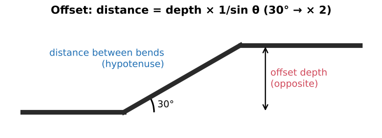  Distance between bends = depth × multiplier  

<b>61.</b> Why is the 30° offset multiplier exactly 2?
 sin 30° = 0.5, and 1/0.5 = 2.  

<b>62.</b> Power factor is the cosine of which angle?
 The phase angle θ between voltage and current (PF = cos θ = W/VA).  Preview of later units  

<b>63.</b> Name the three AC triangles that this chapter's math prepares you for.
 Impedance (Z, R, X), power (VA, W, VAR), and series voltage (E, E_R, E_X).  

