# Flashcards — Unit 15: Alternating Current

75 cards. Read the question, answer it in your head, then click it to check.

Study guide for this unit: [study-guide.md](../study-guide.md). The raw card data is in [`unit15_flashcards.json`](unit15_flashcards.json) if you want to import the cards into a flashcard app.

---

<b>1.</b> What is the single biggest advantage of AC over DC?
 AC can be transformed (stepped up or down with a transformer); DC can't (without electronics).  15–1  

<b>2.</b> Why transmit power at high voltage?
 For the same power, higher voltage means less current. Line loss is I²R, so 1/10 the current gives 1/100 the loss, and smaller wire.  Common transmission voltages: 69, 138, 345 kV  

<b>3.</b> Is "DC can't be transformed" still strictly true?
 Not today. Power electronics convert DC to DC (chargers, solar optimizers, HVDC lines). Give the book's answer on the book's test.  

<b>4.</b> History check: which event is usually credited with settling AC vs DC lighting?
 The 1893 World's Columbian Exposition in Chicago (Westinghouse won). The book says 1904 St. Louis.  Use the book's answer on the book's test  

<b>5.</b> How does AC differ from DC?
 AC reverses its direction of flow at regular intervals; DC flows one way.  Summary  

<b>6.</b> 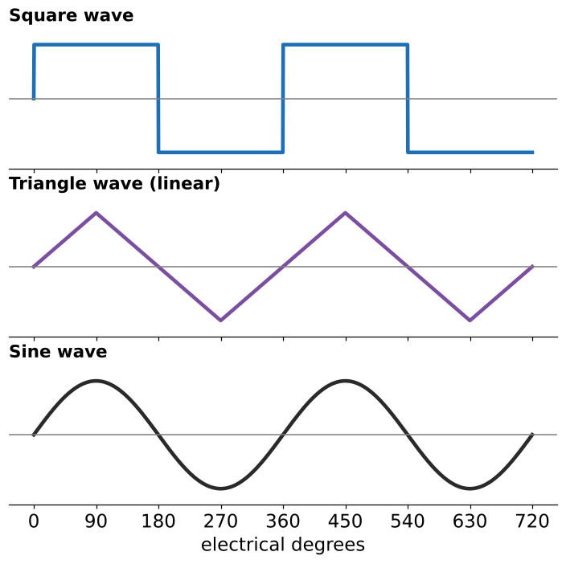 Name the three AC waveforms shown.
 Square, triangle, and sine.  

<b>7.</b> How are square waves usually produced?
 By electronic switching circuits called oscillators.  Cheap inverters/UPS: "modified sine" = stepped square  

<b>8.</b> What is a linear wave?
 One whose voltage changes at a constant rate, so it plots as straight lines (e.g., the triangle wave).  100 V at 2 ms → 50 V at 1 ms  

<b>9.</b> Why is the sine wave the most common AC waveform?
 Every rotating machine (generator or alternator) produces one.  

<b>10.</b> How many electrical degrees are in one sine wave?
 360° 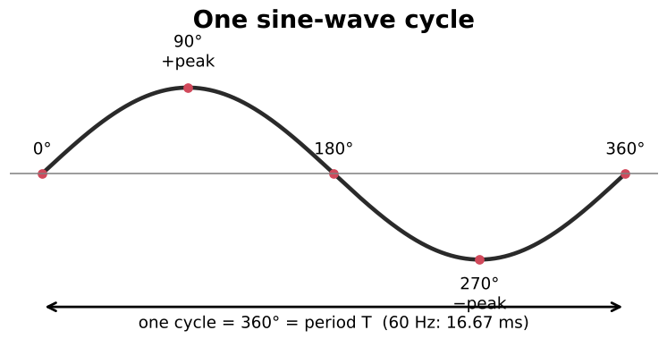  Review Q2  

<b>11.</b> Where does a sine wave hit +peak, zero, and −peak?
 +peak at 90°, zero at 180°, −peak at 270°, back to zero at 360°.   Review Q3: max negative at 270°  

<b>12.</b> What is a cycle?
 One complete waveform: 0 → +peak → 0 → −peak → 0 (360°).  

<b>13.</b> What is frequency, and what is its unit?
 The number of complete cycles per second, measured in hertz (Hz).  60 Hz in US/Canada; 50 Hz most of the world  

<b>14.</b> Formulas linking period and frequency?
 T = 1/f and f = 1/T (T in seconds, f in Hz).  

<b>15.</b> Period of 60 Hz?
 1/60 = <b>16.67 ms</b>; a peak every 8.33 ms.  

<b>16.</b> 1200 Hz: time for one cycle?
 T = 1/1200 = <b>0.833 ms</b>  Example 15–1  

<b>17.</b> A cycle takes 0.04 ms. Frequency?
 0.04 ms = 0.00004 s, so f = 1/0.00004 = <b>25 kHz</b>.  Example 15–2: convert prefixes first  

<b>18.</b> Prefix values: ms, µs, kHz, MHz?
 ms = 10⁻³ s, µs = 10⁻⁶ s, kHz = 10³ Hz, MHz = 10⁶ Hz  

<b>19.</b> Electrical vs mechanical degrees on a 4-pole machine?
 One mechanical revolution = 720 electrical degrees (2 cycles). They're only equal on a 2-pole machine.  Needed later for motor speed  

<b>20.</b> What happens to a 60 Hz motor run on 50 Hz?
 It runs at about 5/6 speed and can overheat. Always check the nameplate frequency.  Aircraft use 400 Hz  

<b>21.</b> Why does generator voltage follow a sine curve?
 The loop cuts flux slowly near 0° (moving almost parallel) and fastest at 90° (moving straight across). The cutting rate follows sin θ.  1 V is induced when flux is cut at 1 Wb/s; 1 Wb = 10⁸ lines  

<b>22.</b> Instantaneous value formula?
 e(inst) = E(max) × sin θ 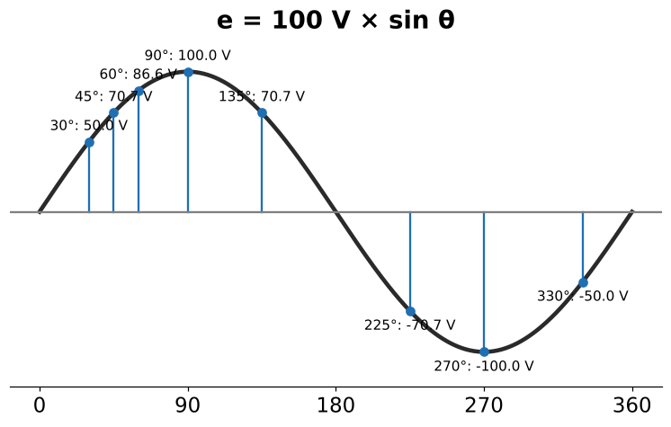  Rearranged: E(max) = e/sin θ; sin θ = e/E(max)  

<b>23.</b> 100 V peak: voltage at 30°? at 45°?
 30°: 100 × 0.5 = <b>50 V</b>. 45°: 100 × 0.707 = <b>70.7 V</b>.   

<b>24.</b> 138 V peak: voltage at 78°?
 138 × sin 78° ≈ <b>135 V</b>  Example 15–3  

<b>25.</b> 246 V at 53°. What's the peak?
 246 / sin 53° ≈ <b>308 V</b>  Example 15–4  

<b>26.</b> 350 V peak. At what angle is it 53 V?
 sin⁻¹(53/350) = <b>8.7°</b>, and also 180° − 8.7° = <b>171.3°</b>. 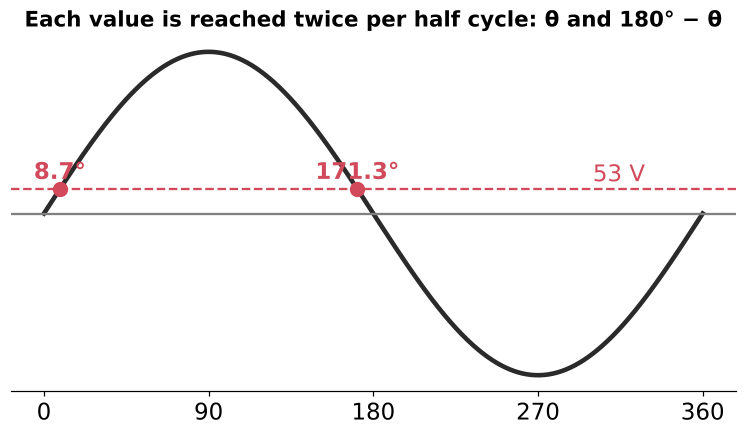  Example 15–5. The book gives 8.685° because it rounded early  

<b>27.</b>  Why does every voltage value occur twice per half-cycle?
 The wave passes it once rising and once falling: at θ and at 180° − θ. sin⁻¹ only gives the first.  

<b>28.</b> What sign is the voltage between 180° and 360°?
 Negative (sine is negative there). sin 225° = −0.707.  

<b>29.</b> How do you handle an angle over 360°?
 Subtract 360°: 400° is the same as 40°.  One practice-table row uses 400°  

<b>30.</b> Angle and time are linked how?
 θ = 360° × f × t  

<b>31.</b> Name the four values used to describe a sine wave.
 Peak-to-peak, peak, RMS, and average. 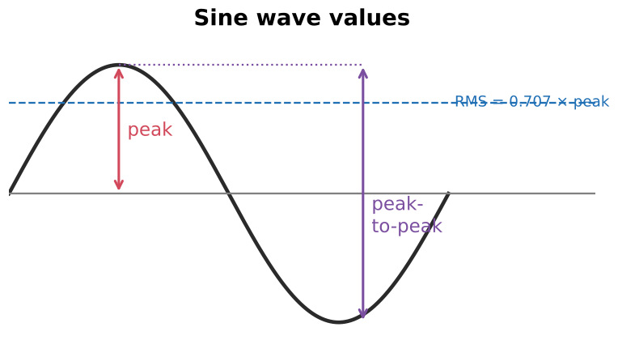  15–3  

<b>32.</b> What is peak (amplitude)?
 From zero to the highest point in either direction.   Peak = ½ p-p  

<b>33.</b> What is peak-to-peak?
 From +peak to −peak (2 × peak). It's the easiest value to read off an oscilloscope.  

<b>34.</b> 100 V peak AC and 100 V DC each across 100 Ω. Same heat?
 No. DC: 100 W. AC at 100 V peak: only 50 W, because it's below 100 V most of the time. 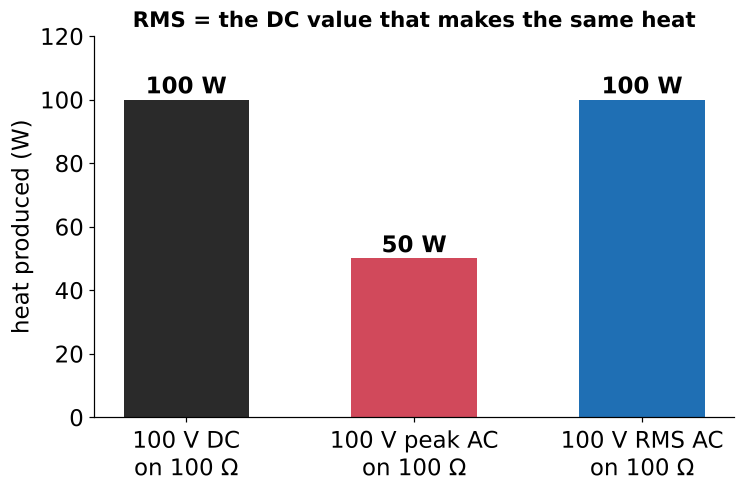  Figure 15–10  

<b>35.</b> What does RMS (effective value) mean?
 The AC value that produces the same heat as that much DC.   Root-Mean-Square: square every value, average them, take the root  

<b>36.</b> RMS ↔ peak conversions (sine wave)?
 RMS = peak × 0.707 (÷ √2) Peak = RMS × 1.414 (× √2)  

<b>37.</b> 354 V peak → RMS?
 354 × 0.707 = <b>250 V</b>  Example 15–6  

<b>38.</b> 120 V RMS → peak? peak-to-peak?
 Peak ≈ <b>170 V</b>; p-p ≈ <b>339 V</b>.  Example 15–7  

<b>39.</b> Peak values of 208, 240, 277, 480 V systems?
 294, 339, 392, 679 V 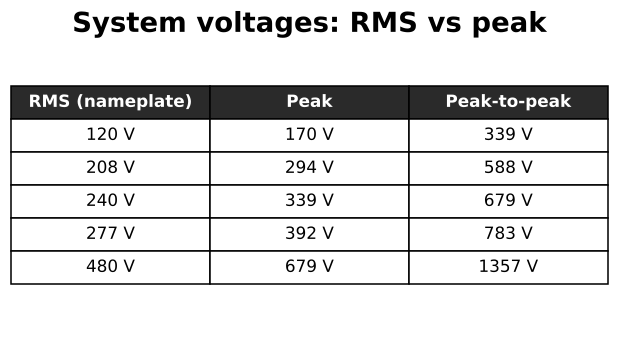  Know these for component ratings  

<b>40.</b> What value do AC voltmeters/ammeters, nameplates and the NEC use?
 RMS, unless stated otherwise.  

<b>41.</b> What value are component voltage ratings (diodes, capacitors, MOVs, ballast maximums) often given in?
 Peak. Convert the system's RMS voltage to peak before comparing.  Practical App 2: 277 V RMS ≈ 392 V peak  

<b>42.</b> Do 0.707 and 1.414 work for every waveform?
 No, only sine waves. Square wave: RMS = peak. Triangle: RMS = 0.577 × peak. 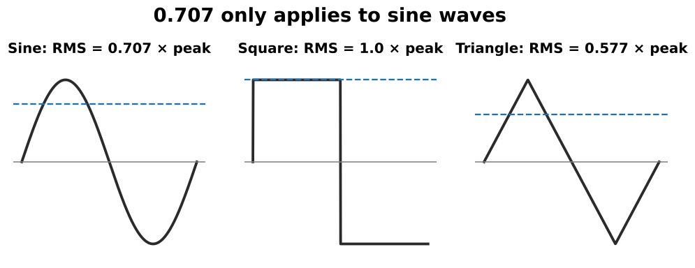  

<b>43.</b> 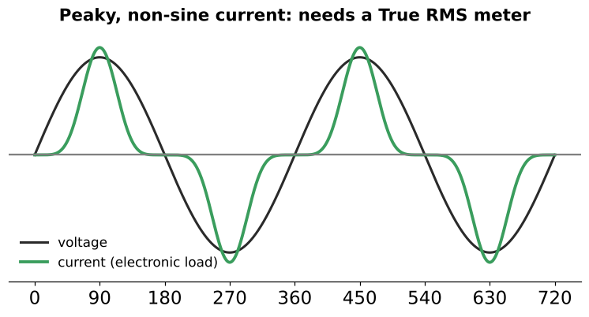 Why use a True RMS meter?
 Average-responding meters assume a sine wave. On distorted loads (VFDs, LED drivers, computers) they can read 20–40% off, usually low.  

<b>44.</b> Book typo: "100 V RMS applied to a 100-V resistor" — fix it.
 It should say a 100-Ω resistor.  

<b>45.</b> "It's only 120 V." What does the insulation actually see?
 About 170 V peak, twice every cycle.  

<b>46.</b> What is the average of a full, unrectified sine wave over one cycle?
 Zero. The + and − halves cancel.  Average values only mean something after rectification  

<b>47.</b> What does a rectifier do?
 Uses diodes to let current flow in one direction only, turning AC into DC. 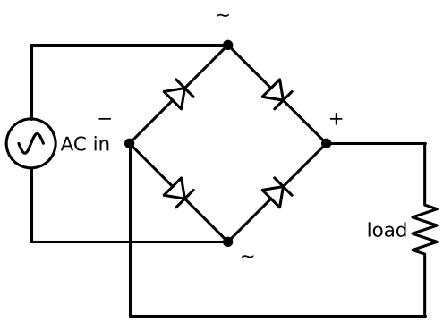  

<b>48.</b> Full-wave vs half-wave rectifier?
 Full-wave (bridge, 4 diodes): both halves flipped positive. Half-wave (1 diode): the negative half is blocked. 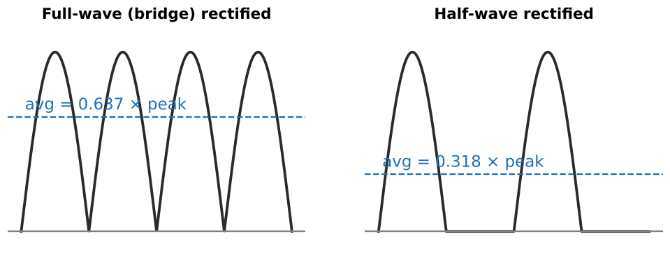  

<b>49.</b> What are pulsating DC and ripple?
 Pulsating DC rises and falls but never reverses. Ripple is the bumps in it.  

<b>50.</b> Full-wave average formulas?
 avg = peak × 0.637 = RMS × 0.9   0.637 × 1.414 = 0.9  

<b>51.</b> Half-wave average formulas?
 avg = peak × 0.318 = RMS × 0.45 (half of full-wave)   

<b>52.</b> 120 V RMS into a full-wave rectifier: average DC?
 120 × 0.9 = <b>108 V</b>  Example 15–8  

<b>53.</b> 277 V into a half-wave rectifier: average DC?
 277 × 0.45 = <b>124.65 V</b>  Example 15–9  

<b>54.</b> 88 V peak-to-peak: average value?
 Halve first: 44 V peak. Then 44 × 0.637 ≈ <b>28 V</b>.  Review Q9: using p-p directly is the classic mistake  

<b>55.</b> 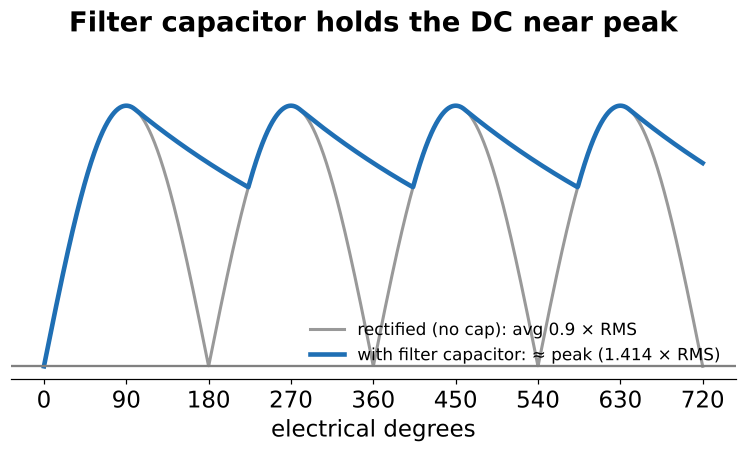 A capacitor is added after the rectifier. What does the DC read now?
 Close to peak (≈ 1.414 × RMS), not 0.9 × RMS.  480 V VFD DC bus ≈ 650–680 VDC. Treat it as live until verified discharged.  

<b>56.</b> What does a DC voltmeter read on pulsating DC?
 The average value.  

<b>57.</b> What is wavelength (λ)?
 The distance a radiated wave travels during one cycle. 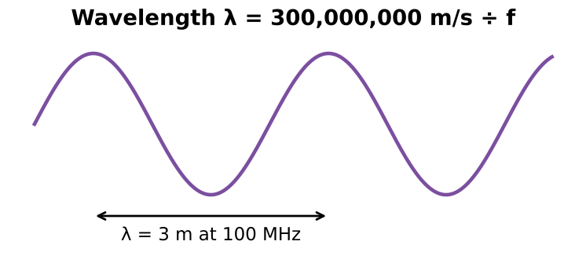  

<b>58.</b> Wavelength formula?
 λ = 300,000,000 m/s ÷ f (answer in meters)  Using 186,000 mi/s gives miles  

<b>59.</b> Wavelength at 100 MHz? At 60 Hz?
 100 MHz: <b>3 m</b>. 60 Hz: about <b>5,000 km</b> (≈3,100 mi), which is why power wiring isn't an antenna.  

<b>60.</b> Two characteristics of a resistive load?
 1. It produces heat. 2. Voltage and current are in phase.  15–4  

<b>61.</b> Examples of resistive loads?
 Heaters, water-heater and range elements, incandescent lamps.  

<b>62.</b> In a pure resistive AC circuit, do the DC Ohm's law and power formulas work?
 Yes, unchanged, as long as every value is RMS.  Never mix peak and RMS  

<b>63.</b> Exception: is an incandescent lamp a constant resistance?
 No. The cold filament is about 1/10 of its hot resistance, so there's a large inrush at switch-on.  

<b>64.</b> Name the three basic types of AC loads.
 Resistive, inductive, capacitive.  Summary  

<b>65.</b> Why is power always positive in a resistive AC circuit?
 Voltage and current always have the same sign: + × + = +, and − × − = +. 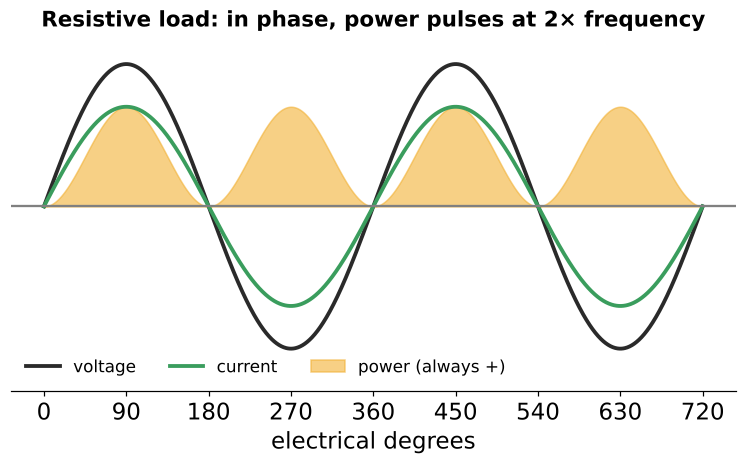  15–5  

<b>66.</b>  At what frequency does power pulse in a 60 Hz resistive circuit?
 120 Hz (twice line frequency), because it peaks on both half-cycles.  Source of 120 Hz lamp flicker  

<b>67.</b> Average power vs peak power (resistive)?
 Average = ½ of peak. W = E(RMS) × I(RMS).  100 V pk × 1 A pk = 100 W pk → 50 W avg  

<b>68.</b> Preview: what happens to power when V and I are out of phase?
 During part of each cycle they have opposite signs, so power is negative and flows back to the source. That's reactive power.  Units 16–17  

<b>69.</b> What is skin effect?
 With AC, current crowds toward the conductor's surface, which raises its effective resistance. 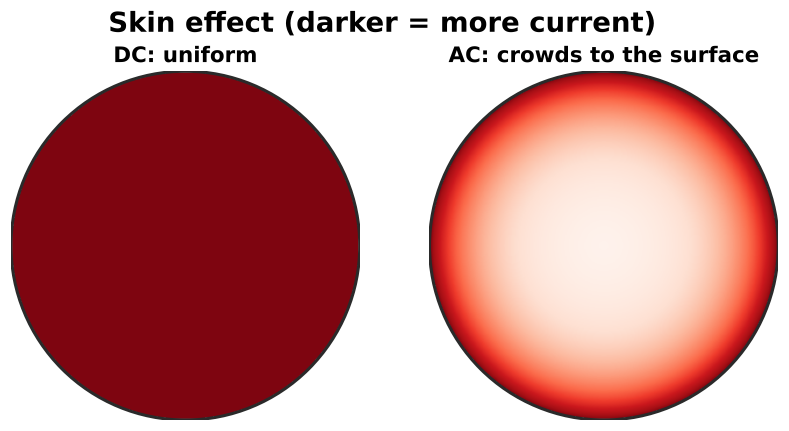  15–6  

<b>70.</b> How does skin effect change with frequency?
 It increases as frequency increases.  

<b>71.</b> Does skin effect matter at 60 Hz?
 For ordinary building wire, no. For large conductors (≈500 kcmil+) and bus bar, yes. That's why NEC Ch. 9 Table 9 lists AC resistance separately.  Skin depth in copper at 60 Hz ≈ 8.5 mm  

<b>72.</b> How do you reduce skin effect for high-frequency grounding?
 Use conductors with a lot of surface area: wide copper strap or flat braid.  Green Tip  

<b>73.</b> Why do harmonics increase conductor heating?
 Harmonic currents (180, 300 Hz…) have stronger skin effect and add I²R losses.  K-rated transformers, oversized neutrals  

<b>74.</b> Why must all conductors of an AC circuit run in the same raceway?
 A lone conductor heats surrounding steel by induction. Grouping them cancels the field. (NEC 300.3(B), 300.20)  Related to, but not the same as, skin effect  

<b>75.</b> 240 V AC bridge feeding a crane magnet with 400 V diodes. What must you compare?
 The diodes' peak rating with the peak of 240 V RMS (≈339 V). Leave margin for high line voltage and spikes.  Practical App 1: then DC out = 240 × 0.9  

