#+TITLE: ELECT 212 — Unit 15: Alternating Current
#+FILETAGS: :drill:
#+STARTUP: overview

# Generated by tools/flashcards/build_decks.py. Study with M-x org-drill.

* What is the single biggest advantage of AC over DC?
   :PROPERTIES:
   :ID: u15-001
   :END:
** Answer
AC can be transformed (stepped up or down with a transformer); DC can't (without electronics). 15–1

* Why transmit power at high voltage?
   :PROPERTIES:
   :ID: u15-002
   :END:
** Answer
For the same power, higher voltage means less current. Line loss is I²R, so 1/10 the current gives 1/100 the loss, and smaller wire. Common transmission voltages: 69, 138, 345 kV

* Is "DC can't be transformed" still strictly true?
   :PROPERTIES:
   :ID: u15-003
   :END:
** Answer
Not today. Power electronics convert DC to DC (chargers, solar optimizers, HVDC lines). Give the book's answer on the book's test.

* History check: which event is usually credited with settling AC vs DC lighting?
   :PROPERTIES:
   :ID: u15-004
   :END:
** Answer
The 1893 World's Columbian Exposition in Chicago (Westinghouse won). The book says 1904 St. Louis. Use the book's answer on the book's test

* How does AC differ from DC?
   :PROPERTIES:
   :ID: u15-005
   :END:
** Answer
AC reverses its direction of flow at regular intervals; DC flows one way. Summary

* Name the three AC waveforms shown.
   :PROPERTIES:
   :ID: u15-006
   :END:
** Answer
Square, triangle, and sine.

* How are square waves usually produced?
   :PROPERTIES:
   :ID: u15-007
   :END:
** Answer
By electronic switching circuits called oscillators. Cheap inverters/UPS: "modified sine" = stepped square

* What is a linear wave?
   :PROPERTIES:
   :ID: u15-008
   :END:
** Answer
One whose voltage changes at a constant rate, so it plots as straight lines (e.g., the triangle wave). 100 V at 2 ms → 50 V at 1 ms

* Why is the sine wave the most common AC waveform?
   :PROPERTIES:
   :ID: u15-009
   :END:
** Answer
Every rotating machine (generator or alternator) produces one.

* How many electrical degrees are in one sine wave?
   :PROPERTIES:
   :ID: u15-010
   :END:
** Answer
360° Review Q2
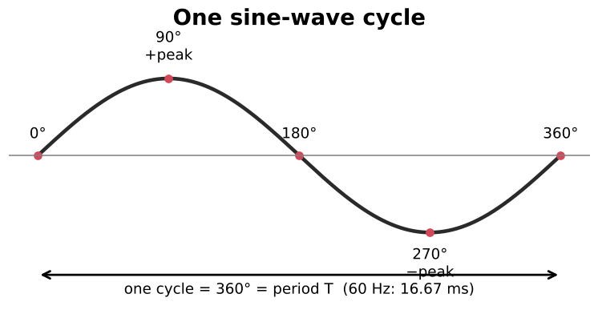

* Where does a sine wave hit +peak, zero, and −peak?
   :PROPERTIES:
   :ID: u15-011
   :END:
** Answer
+peak at 90°, zero at 180°, −peak at 270°, back to zero at 360°. Review Q3: max negative at 270°

* What is a cycle?
   :PROPERTIES:
   :ID: u15-012
   :END:
** Answer
One complete waveform: 0 → +peak → 0 → −peak → 0 (360°).

* What is frequency, and what is its unit?
   :PROPERTIES:
   :ID: u15-013
   :END:
** Answer
The number of complete cycles per second, measured in hertz (Hz). 60 Hz in US/Canada; 50 Hz most of the world

* Formulas linking period and frequency?
   :PROPERTIES:
   :ID: u15-014
   :END:
** Answer
T = 1/f and f = 1/T (T in seconds, f in Hz).

* Period of 60 Hz?
   :PROPERTIES:
   :ID: u15-015
   :END:
** Answer
1/60 = 16.67 ms; a peak every 8.33 ms.

* 1200 Hz: time for one cycle?
   :PROPERTIES:
   :ID: u15-016
   :END:
** Answer
T = 1/1200 = 0.833 ms Example 15–1

* A cycle takes 0.04 ms. Frequency?
   :PROPERTIES:
   :ID: u15-017
   :END:
** Answer
0.04 ms = 0.00004 s, so f = 1/0.00004 = 25 kHz. Example 15–2: convert prefixes first

* Prefix values: ms, µs, kHz, MHz?
   :PROPERTIES:
   :ID: u15-018
   :END:
** Answer
ms = 10⁻³ s, µs = 10⁻⁶ s, kHz = 10³ Hz, MHz = 10⁶ Hz

* Electrical vs mechanical degrees on a 4-pole machine?
   :PROPERTIES:
   :ID: u15-019
   :END:
** Answer
One mechanical revolution = 720 electrical degrees (2 cycles). They're only equal on a 2-pole machine. Needed later for motor speed

* What happens to a 60 Hz motor run on 50 Hz?
   :PROPERTIES:
   :ID: u15-020
   :END:
** Answer
It runs at about 5/6 speed and can overheat. Always check the nameplate frequency. Aircraft use 400 Hz

* Why does generator voltage follow a sine curve?
   :PROPERTIES:
   :ID: u15-021
   :END:
** Answer
The loop cuts flux slowly near 0° (moving almost parallel) and fastest at 90° (moving straight across). The cutting rate follows sin θ. 1 V is induced when flux is cut at 1 Wb/s; 1 Wb = 10⁸ lines

* Instantaneous value formula?
   :PROPERTIES:
   :ID: u15-022
   :END:
** Answer
e(inst) = E(max) × sin θ Rearranged: E(max) = e/sin θ; sin θ = e/E(max)
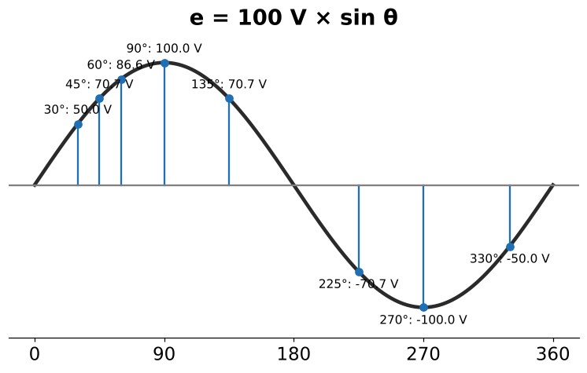

* 100 V peak: voltage at 30°? at 45°?
   :PROPERTIES:
   :ID: u15-023
   :END:
** Answer
30°: 100 × 0.5 = 50 V. 45°: 100 × 0.707 = 70.7 V.

* 138 V peak: voltage at 78°?
   :PROPERTIES:
   :ID: u15-024
   :END:
** Answer
138 × sin 78° ≈ 135 V Example 15–3

* 246 V at 53°. What's the peak?
   :PROPERTIES:
   :ID: u15-025
   :END:
** Answer
246 / sin 53° ≈ 308 V Example 15–4

* 350 V peak. At what angle is it 53 V?
   :PROPERTIES:
   :ID: u15-026
   :END:
** Answer
sin⁻¹(53/350) = 8.7°, and also 180° − 8.7° = 171.3°. Example 15–5. The book gives 8.685° because it rounded early
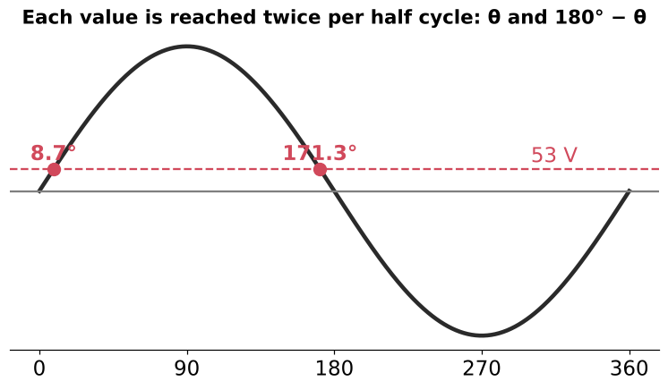

* Why does every voltage value occur twice per half-cycle?
   :PROPERTIES:
   :ID: u15-027
   :END:
** Answer
The wave passes it once rising and once falling: at θ and at 180° − θ. sin⁻¹ only gives the first.

* What sign is the voltage between 180° and 360°?
   :PROPERTIES:
   :ID: u15-028
   :END:
** Answer
Negative (sine is negative there). sin 225° = −0.707.

* How do you handle an angle over 360°?
   :PROPERTIES:
   :ID: u15-029
   :END:
** Answer
Subtract 360°: 400° is the same as 40°. One practice-table row uses 400°

* Angle and time are linked how?
   :PROPERTIES:
   :ID: u15-030
   :END:
** Answer
θ = 360° × f × t

* Name the four values used to describe a sine wave.
   :PROPERTIES:
   :ID: u15-031
   :END:
** Answer
Peak-to-peak, peak, RMS, and average. 15–3
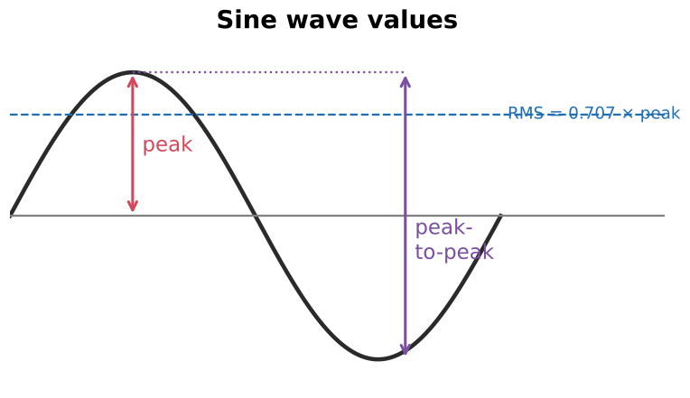

* What is peak (amplitude)?
   :PROPERTIES:
   :ID: u15-032
   :END:
** Answer
From zero to the highest point in either direction. Peak = ½ p-p

* What is peak-to-peak?
   :PROPERTIES:
   :ID: u15-033
   :END:
** Answer
From +peak to −peak (2 × peak). It's the easiest value to read off an oscilloscope.

* 100 V peak AC and 100 V DC each across 100 Ω. Same heat?
   :PROPERTIES:
   :ID: u15-034
   :END:
** Answer
No. DC: 100 W. AC at 100 V peak: only 50 W, because it's below 100 V most of the time. Figure 15–10
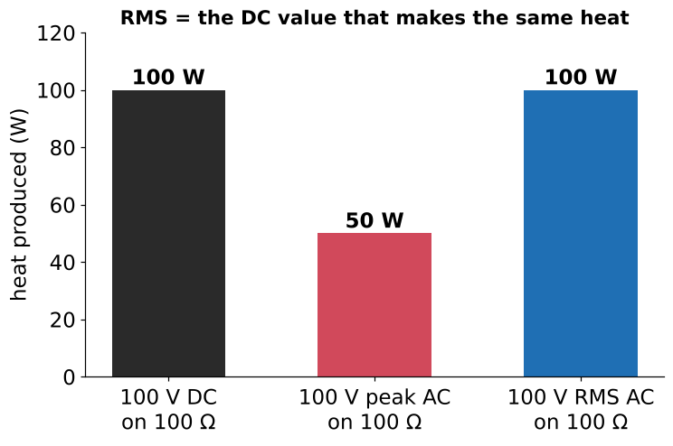

* What does RMS (effective value) mean?
   :PROPERTIES:
   :ID: u15-035
   :END:
** Answer
The AC value that produces the same heat as that much DC. Root-Mean-Square: square every value, average them, take the root

* RMS ↔ peak conversions (sine wave)?
   :PROPERTIES:
   :ID: u15-036
   :END:
** Answer
RMS = peak × 0.707 (÷ √2) Peak = RMS × 1.414 (× √2)

* 354 V peak → RMS?
   :PROPERTIES:
   :ID: u15-037
   :END:
** Answer
354 × 0.707 = 250 V Example 15–6

* 120 V RMS → peak? peak-to-peak?
   :PROPERTIES:
   :ID: u15-038
   :END:
** Answer
Peak ≈ 170 V; p-p ≈ 339 V. Example 15–7

* Peak values of 208, 240, 277, 480 V systems?
   :PROPERTIES:
   :ID: u15-039
   :END:
** Answer
294, 339, 392, 679 V Know these for component ratings
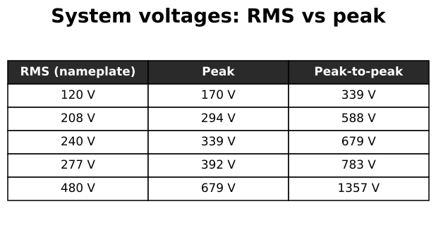

* What value do AC voltmeters/ammeters, nameplates and the NEC use?
   :PROPERTIES:
   :ID: u15-040
   :END:
** Answer
RMS, unless stated otherwise.

* What value are component voltage ratings (diodes, capacitors, MOVs, ballast maximums)...
   :PROPERTIES:
   :ID: u15-041
   :END:
What value are component voltage ratings (diodes, capacitors, MOVs, ballast maximums) often given in?
** Answer
Peak. Convert the system's RMS voltage to peak before comparing. Practical App 2: 277 V RMS ≈ 392 V peak

* Do 0.707 and 1.414 work for every waveform?
   :PROPERTIES:
   :ID: u15-042
   :END:
** Answer
No, only sine waves. Square wave: RMS = peak. Triangle: RMS = 0.577 × peak.
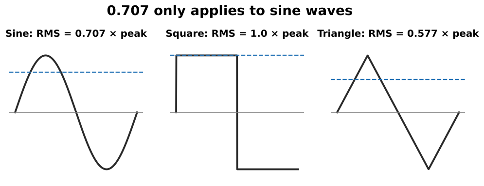

* Why use a True RMS meter?
   :PROPERTIES:
   :ID: u15-043
   :END:
** Answer
Average-responding meters assume a sine wave. On distorted loads (VFDs, LED drivers, computers) they can read 20–40% off, usually low.

* Book typo: "100 V RMS applied to a 100-V resistor" — fix it.
   :PROPERTIES:
   :ID: u15-044
   :END:
** Answer
It should say a 100-Ω resistor.

* "It's only 120 V." What does the insulation actually see?
   :PROPERTIES:
   :ID: u15-045
   :END:
** Answer
About 170 V peak, twice every cycle.

* What is the average of a full, unrectified sine wave over one cycle?
   :PROPERTIES:
   :ID: u15-046
   :END:
** Answer
Zero. The + and − halves cancel. Average values only mean something after rectification

* What does a rectifier do?
   :PROPERTIES:
   :ID: u15-047
   :END:
** Answer
Uses diodes to let current flow in one direction only, turning AC into DC.
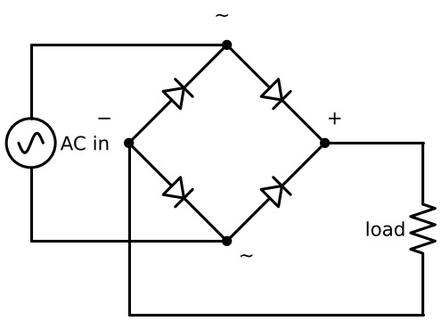

* Full-wave vs half-wave rectifier?
   :PROPERTIES:
   :ID: u15-048
   :END:
** Answer
Full-wave (bridge, 4 diodes): both halves flipped positive. Half-wave (1 diode): the negative half is blocked.
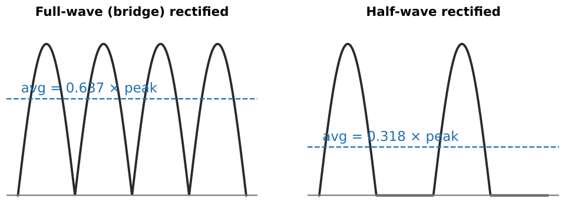

* What are pulsating DC and ripple?
   :PROPERTIES:
   :ID: u15-049
   :END:
** Answer
Pulsating DC rises and falls but never reverses. Ripple is the bumps in it.

* Full-wave average formulas?
   :PROPERTIES:
   :ID: u15-050
   :END:
** Answer
avg = peak × 0.637 = RMS × 0.9 0.637 × 1.414 = 0.9

* Half-wave average formulas?
   :PROPERTIES:
   :ID: u15-051
   :END:
** Answer
avg = peak × 0.318 = RMS × 0.45 (half of full-wave)

* 120 V RMS into a full-wave rectifier: average DC?
   :PROPERTIES:
   :ID: u15-052
   :END:
** Answer
120 × 0.9 = 108 V Example 15–8

* 277 V into a half-wave rectifier: average DC?
   :PROPERTIES:
   :ID: u15-053
   :END:
** Answer
277 × 0.45 = 124.65 V Example 15–9

* 88 V peak-to-peak: average value?
   :PROPERTIES:
   :ID: u15-054
   :END:
** Answer
Halve first: 44 V peak. Then 44 × 0.637 ≈ 28 V. Review Q9: using p-p directly is the classic mistake

* A capacitor is added after the rectifier. What does the DC read now?
   :PROPERTIES:
   :ID: u15-055
   :END:
** Answer
Close to peak (≈ 1.414 × RMS), not 0.9 × RMS. 480 V VFD DC bus ≈ 650–680 VDC. Treat it as live until verified discharged.

* What does a DC voltmeter read on pulsating DC?
   :PROPERTIES:
   :ID: u15-056
   :END:
** Answer
The average value.

* What is wavelength (λ)?
   :PROPERTIES:
   :ID: u15-057
   :END:
** Answer
The distance a radiated wave travels during one cycle.
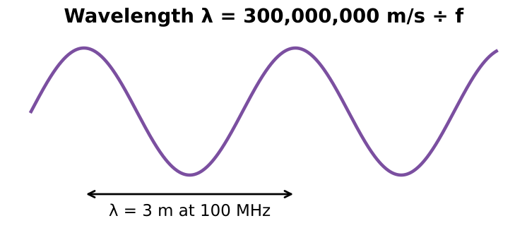

* Wavelength formula?
   :PROPERTIES:
   :ID: u15-058
   :END:
** Answer
λ = 300,000,000 m/s ÷ f (answer in meters) Using 186,000 mi/s gives miles

* Wavelength at 100 MHz? At 60 Hz?
   :PROPERTIES:
   :ID: u15-059
   :END:
** Answer
100 MHz: 3 m. 60 Hz: about 5,000 km (≈3,100 mi), which is why power wiring isn't an antenna.

* Two characteristics of a resistive load?
   :PROPERTIES:
   :ID: u15-060
   :END:
** Answer
1. It produces heat. 2. Voltage and current are in phase. 15–4

* Examples of resistive loads?
   :PROPERTIES:
   :ID: u15-061
   :END:
** Answer
Heaters, water-heater and range elements, incandescent lamps.

* In a pure resistive AC circuit, do the DC Ohm's law and power formulas work?
   :PROPERTIES:
   :ID: u15-062
   :END:
** Answer
Yes, unchanged, as long as every value is RMS. Never mix peak and RMS

* Exception: is an incandescent lamp a constant resistance?
   :PROPERTIES:
   :ID: u15-063
   :END:
** Answer
No. The cold filament is about 1/10 of its hot resistance, so there's a large inrush at switch-on.

* Name the three basic types of AC loads.
   :PROPERTIES:
   :ID: u15-064
   :END:
** Answer
Resistive, inductive, capacitive. Summary

* Why is power always positive in a resistive AC circuit?
   :PROPERTIES:
   :ID: u15-065
   :END:
** Answer
Voltage and current always have the same sign: + × + = +, and − × − = +. 15–5
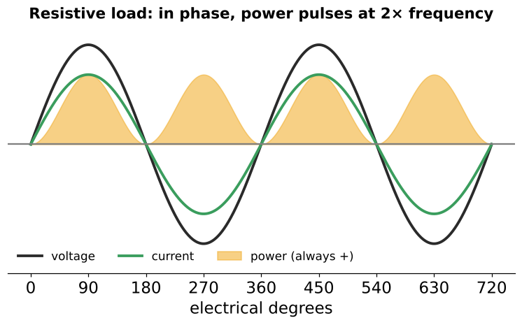

* At what frequency does power pulse in a 60 Hz resistive circuit?
   :PROPERTIES:
   :ID: u15-066
   :END:
** Answer
120 Hz (twice line frequency), because it peaks on both half-cycles. Source of 120 Hz lamp flicker

* Average power vs peak power (resistive)?
   :PROPERTIES:
   :ID: u15-067
   :END:
** Answer
Average = ½ of peak. W = E(RMS) × I(RMS). 100 V pk × 1 A pk = 100 W pk → 50 W avg

* Preview: what happens to power when V and I are out of phase?
   :PROPERTIES:
   :ID: u15-068
   :END:
** Answer
During part of each cycle they have opposite signs, so power is negative and flows back to the source. That's reactive power. Units 16–17

* What is skin effect?
   :PROPERTIES:
   :ID: u15-069
   :END:
** Answer
With AC, current crowds toward the conductor's surface, which raises its effective resistance. 15–6
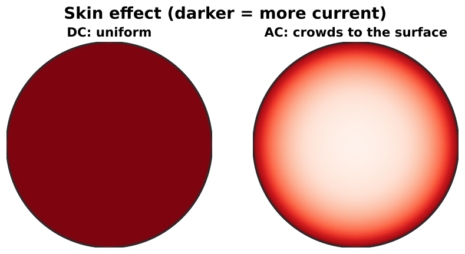

* How does skin effect change with frequency?
   :PROPERTIES:
   :ID: u15-070
   :END:
** Answer
It increases as frequency increases.

* Does skin effect matter at 60 Hz?
   :PROPERTIES:
   :ID: u15-071
   :END:
** Answer
For ordinary building wire, no. For large conductors (≈500 kcmil+) and bus bar, yes. That's why NEC Ch. 9 Table 9 lists AC resistance separately. Skin depth in copper at 60 Hz ≈ 8.5 mm

* How do you reduce skin effect for high-frequency grounding?
   :PROPERTIES:
   :ID: u15-072
   :END:
** Answer
Use conductors with a lot of surface area: wide copper strap or flat braid. Green Tip

* Why do harmonics increase conductor heating?
   :PROPERTIES:
   :ID: u15-073
   :END:
** Answer
Harmonic currents (180, 300 Hz…) have stronger skin effect and add I²R losses. K-rated transformers, oversized neutrals

* Why must all conductors of an AC circuit run in the same raceway?
   :PROPERTIES:
   :ID: u15-074
   :END:
** Answer
A lone conductor heats surrounding steel by induction. Grouping them cancels the field. (NEC 300.3(B), 300.20) Related to, but not the same as, skin effect

* 240 V AC bridge feeding a crane magnet with 400 V diodes. What must you compare?
   :PROPERTIES:
   :ID: u15-075
   :END:
** Answer
The diodes' peak rating with the peak of 240 V RMS (≈339 V). Leave margin for high line voltage and spikes. Practical App 1: then DC out = 240 × 0.9

