# Flashcards — Unit 16: Inductance in AC Circuits

62 cards. Read the question, answer it in your head, then click it to check.

Study guide for this unit: [study-guide.md](../study-guide.md). The raw card data is in [`unit16_flashcards.json`](unit16_flashcards.json) if you want to import the cards into a flashcard app.

---

<b>1.</b> What is inductance (L), and what is its unit?
 A coil's ability to induce voltage in itself, opposing any change in current. Measured in henrys (H).  1 mH = 0.001 H  

<b>2.</b> Which loads are treated as inductive?
 Anything with a coil: motors, transformers, ballasts, chokes, solenoids, contactor/relay coils.  A single conductor's inductance is tiny and usually ignored  

<b>3.</b> When does a magnetic field induce a voltage in a coil?
 Whenever flux cuts the coil, i.e. whenever the current (and its field) changes.  Unit 13 fact 1  

<b>4.</b> What is CEMF?
 Counter-electromotive force: the induced voltage, which always opposes the applied voltage. 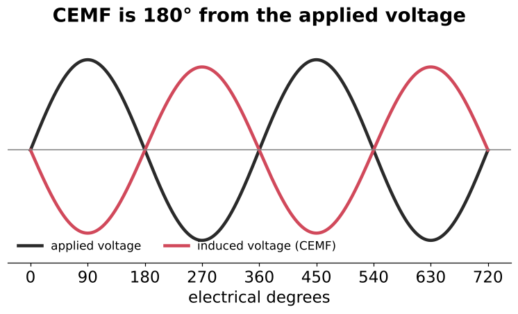  Lenz's law  

<b>5.</b> What is the induced voltage proportional to?
 The RATE OF CHANGE of current, not the amount of current. 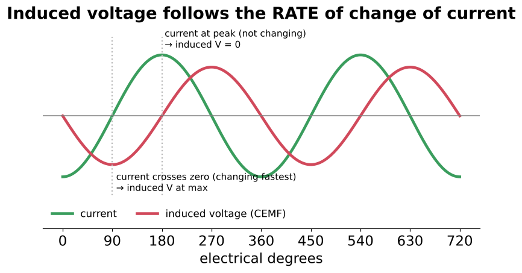  

<b>6.</b> What does an inductor oppose?
 A CHANGE in current.  Like a flywheel for current  

<b>7.</b>  What is the phase relationship between applied voltage and induced voltage?
 180° (exactly opposite).  

<b>8.</b> A coil (6 Ω wire) on 120 VAC draws 0.8 A. How much voltage pushes current through the wire resistance?
 E = 0.8 × 6 = <b>4.8 V</b>. The rest is used overcoming the CEMF.  

<b>9.</b> Same coil: what is the induced voltage? Why not 120 − 4.8?
 √(120² − 4.8²) = <b>119.904 V</b>. The resistive drop and the CEMF are 90° apart, so subtract as vectors. 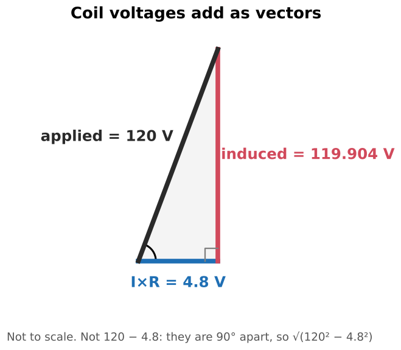  The book's earlier 120 − 116 = 4 example is only a rough illustration  

<b>10.</b> 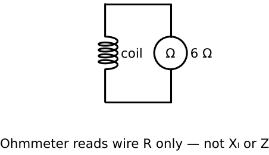 A contactor coil reads 6 Ω on an ohmmeter. Does it draw 120/6 = 20 A on 120 VAC?
 No. The ohmmeter shows only wire resistance. Reactance limits the AC current to far less.  

<b>11.</b> What is inductive reactance (Xₗ)?
 The current-limiting effect of inductance, in ohms. It isn't resistance: it comes from the CEMF and produces no heat.  

<b>12.</b> Formula for Xₗ?
 Xₗ = 2πfL  (f in Hz, L in H, Xₗ in Ω)  

<b>13.</b> Rearranged reactance formulas?
 L = Xₗ / (2πf) and f = Xₗ / (2πL)  

<b>14.</b> What number should you memorize for 60 Hz, and why?
 <b>377</b> (2π × 60 = 376.99). At 60 Hz, Xₗ = 377 × L and L = Xₗ / 377.  Doesn't apply at other frequencies  

<b>15.</b> How does Ohm's law work with reactance?
 Put Xₗ in place of R: I = E / Xₗ, E = I × Xₗ, Xₗ = E / I.  

<b>16.</b> Three factors that set induced voltage (and therefore Xₗ)?
 1. Number of turns 2. Strength of the magnetic field 3. Speed of the cutting action (frequency)  

<b>17.</b> What physical features set a coil's inductance?
 Number of turns, how close together they are, wire/coil size, and core material (iron ≫ air).  

<b>18.</b> 0.8 H on 120 V, 60 Hz. Xₗ and current?
 Xₗ = 377 × 0.8 = <b>301.6 Ω</b>; I = 120 / 301.6 = <b>0.398 A</b>.  Example 16–1  

<b>19.</b> 36 V, 400 Hz, 0.2 A. Find L.
 Xₗ = 36/0.2 = 180 Ω; L = 180 / (2π × 400) = <b>0.0716 H</b>.  Example 16–2: 377 does NOT apply at 400 Hz  

<b>20.</b> A coil draws 24 A on 480 V, 60 Hz. Current at 400 Hz?
 L doesn't change. Current scales with 1/f: 24 × 60/400 = <b>3.6 A</b>. 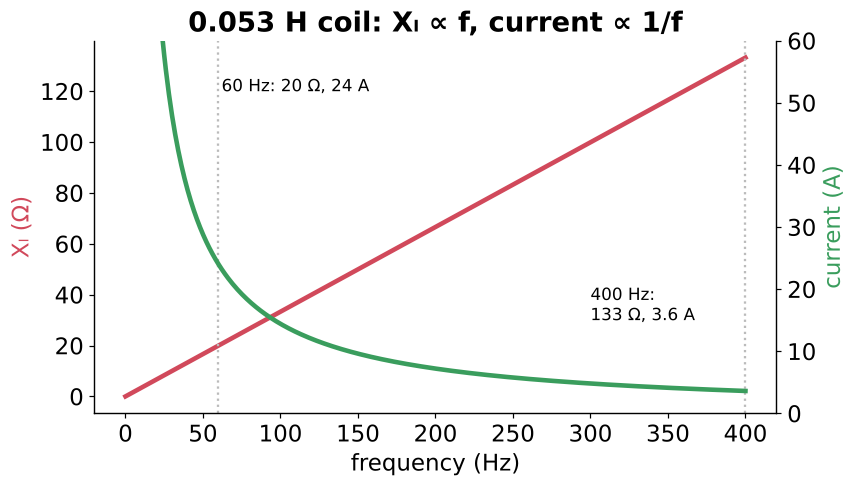  Example 16–3  

<b>21.</b> Does inductance change when the frequency changes?
 No. L is set by construction. Xₗ changes, because Xₗ is proportional to f.  Exception: iron cores saturate at high current  

<b>22.</b> What is a pure inductor's Xₗ at DC (0 Hz)?
 Zero. Only the wire resistance limits current.  An AC coil on DC will burn up  

<b>23.</b> Raise the frequency: what happens to Xₗ and current?
 Xₗ goes up and current goes down (in proportion).   

<b>24.</b> 60 Hz coil or transformer on 50 Hz: what happens?
 Xₗ drops about 17%, so current rises about 20%. It runs hotter, and an iron core may saturate.  

<b>25.</b> 50 Hz magnetic ballast on 60 Hz: overcurrent risk?
 No. Xₗ is higher at 60 Hz, so current is lower. The likely trouble is underpowered or poor lamp starting.  Practical Application 1  

<b>26.</b> What happens to an iron-core inductor at high current?
 The core saturates, inductance drops, and current climbs quickly. Air cores don't saturate.  

<b>27.</b> Unit pitfall: 33 mH in the reactance formula?
 Convert to henrys first: 0.033 H. Likewise kHz → Hz.  Practice Problem 2  

<b>28.</b> 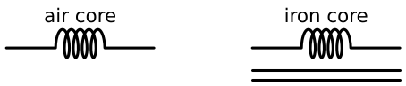 What do these two schematic symbols mean?
 Plain coil = air-core inductor. Coil with parallel lines = iron-core inductor.  16–3  

<b>29.</b> Total inductance of inductors in series?
 Lₜ = L₁ + L₂ + L₃ (likewise Xₗₜ = Xₗ₁ + Xₗ₂ + Xₗ₃) 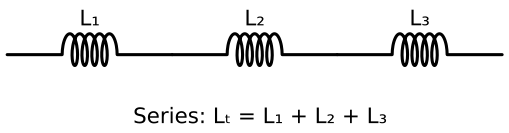  16–4  

<b>30.</b> Three 0.6, 0.4 and 0.5 H inductors in series: Lₜ?
 <b>1.5 H</b>  Example 16–4  

<b>31.</b> Total inductance of inductors in parallel?
 1/Lₜ = 1/L₁ + 1/L₂ + 1/L₃ (product-over-sum for two; L/N for N equal ones) 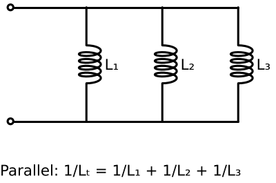  Same forms for Xₗ  

<b>32.</b> 2.5, 1.8 and 1.2 H in parallel: Lₜ?
 1 / (0.4 + 0.556 + 0.833) = <b>0.559 H</b>  Example 16–6  

<b>33.</b> Sanity check for parallel inductance?
 The total must be smaller than the smallest inductor.  Forgetting the final reciprocal is the classic error  

<b>34.</b> When do the simple series/parallel inductor formulas NOT apply?
 When the coils are magnetically coupled (mutual inductance), e.g. close together or sharing a core.  Transformers work this way  

<b>35.</b> In a pure inductor, how are current and voltage related in phase?
 Current LAGS the applied voltage by 90°. 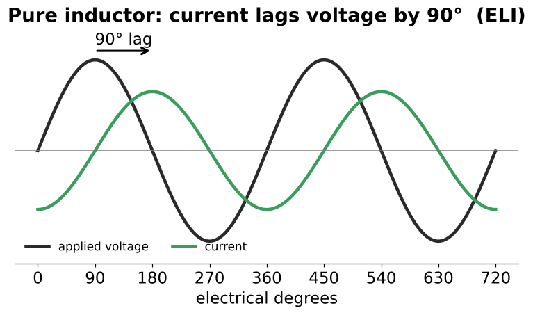  16–6  

<b>36.</b> Explain the 90° lag in three steps.
 1. Induced V is max when current changes fastest (at its zero crossing), so current leads the induced V by 90°. 2. Induced V is 180° from the applied V. 3. So current lags the applied V by 90°.   

<b>37.</b> What does "ELI the ICE man" mean?
 ELI: in an inductor (L), E comes before I (current lags). ICE: in a capacitor (C), I comes before E (current leads).  

<b>38.</b> Is the lag exactly 90° in a real coil?
 No. Wire resistance makes it a bit less. Loaded motors are often 30–40°.  

<b>39.</b> 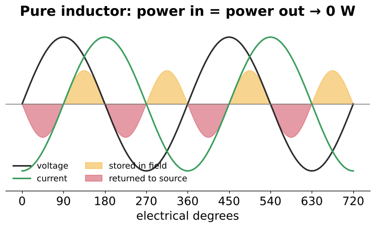 How much true power does a pure inductor use?
 Zero watts. Energy is stored in the field and returned each cycle.  16–7  

<b>40.</b> In a pure inductor, what fraction of the time do V and I have the same sign?
 50%. Same sign: energy goes into the field. Opposite sign: it returns. Net zero.  Figure 16–15 A–D  

<b>41.</b> General power formula for any circuit?
 P = E × I × cos θ  θ = phase angle between voltage and current  

<b>42.</b> cos θ for a resistive vs a pure inductive circuit?
 Resistive: cos 0° = 1 (P = E × I). Pure inductive: cos 90° = 0 (P = 0).  

<b>43.</b> Where does the power an inductor DOES use come from?
 Losses: I²R in the wire, plus eddy-current and hysteresis losses in the iron core.  

<b>44.</b> What are VARs?
 Volt-amperes-reactive: reactive power, the power that charges and returns the magnetic field.  16–8  

<b>45.</b> Formulas for VARs?
 VARs = Eₗ × Iₗ = Eₗ² / Xₗ = Iₗ² × Xₗ  Use the inductor's own voltage and current  

<b>46.</b> Are VARs harmless because they're not true power?
 No. They're real current in real conductors, which heats wires and transformers. That's why reactors carry kVAR ratings.  

<b>47.</b> Inductor on 480 V drawing 125 A: minimum kVAR rating?
 480 × 125 / 1000 = <b>60 kVAR</b>. Less than that and it would likely be destroyed.  Example 16–7  

<b>48.</b> What is the Q of an inductor?
 Quality: the ratio of reactance to resistance. Q = Xₗ / R (no units). 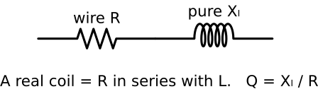  16–9  

<b>49.</b> Q formulas, rearranged?
 Q = Xₗ / R, Xₗ = Q × R, R = Xₗ / Q  Review Q11–13  

<b>50.</b> High Q vs low Q coil construction?
 Large wire → low R → high Q. Many turns of fine wire → high R → low Q.  

<b>51.</b> Above what Q is a coil treated as pure?
 Q ≥ 10. The resistance is then negligible. 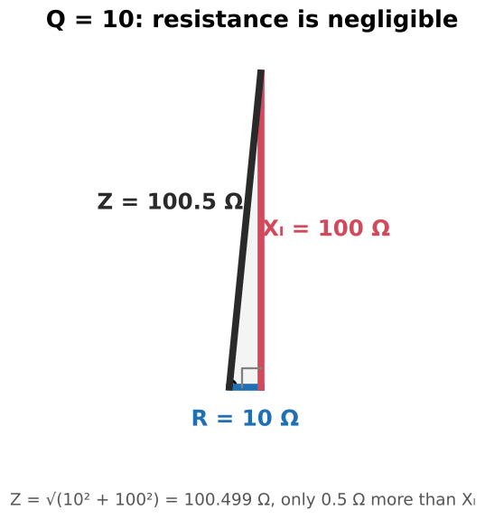  Xₗ 100, R 10 → Z = 100.5 Ω  

<b>52.</b> What is impedance (Z)?
 The total current-limiting effect (R and X combined), in ohms.  

<b>53.</b> Why does Z = √(R² + Xₗ²), not R + Xₗ?
 R and Xₗ are 90° apart, so they form the legs of a right triangle, and Z is the hypotenuse.   

<b>54.</b> 480 V, 60 Hz, 0.6 A, 150 Ω wire resistance. Find L.
 Z = 480/0.6 = 800 Ω. Xₗ = √(800² − 150²) = 785.8 Ω. L = 785.8/377 = <b>2.084 H</b>. 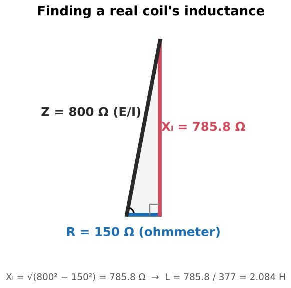  Procedure: Z = E/I → remove R → L = Xₗ/2πf  

<b>55.</b> E/I measured on a coil gives you Xₗ or Z?
 Z. It's only about equal to Xₗ when Q ≥ 10.  

<b>56.</b> 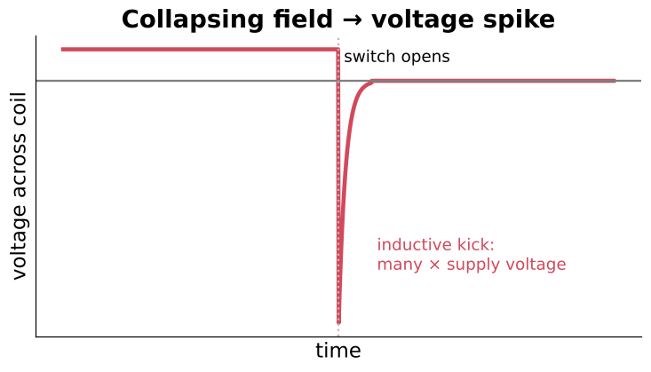 What is inductive kick?
 When a coil's circuit opens, its collapsing field produces a voltage spike many times the supply voltage.  Arcing contacts; it's why coils get diodes, snubbers or MOVs  

<b>57.</b> Why discharge large windings after a DC winding-resistance or DLRO test?
 The DC test current stores energy in the field, and breaking the leads can produce a dangerous kick. Let the test set discharge it.  

<b>58.</b> Why must you never open a loaded CT secondary?
 With nothing to limit it, the secondary voltage can rise to lethal levels. Short the secondary before disconnecting a meter or relay.  

<b>59.</b> Why does a stuck-open contactor armature burn out the coil?
 The air gap lowers L, so Xₗ is low and the coil keeps drawing inrush current (several × sealed current).  

<b>60.</b> Why do inductive loads lower power factor?
 They make current lag voltage, adding reactive current. Utilities surcharge low PF; capacitors correct it.  Preview of later units  

<b>61.</b> What are VFD line reactors?
 Series inductors (rated in % impedance / kVAR) that limit inrush and fault current and smooth harmonics.  

<b>62.</b> Replacement inductor: 324 V across it, 18 A, 1.2 Ω wire resistance, 480 V supply. Which voltage do you use?
 The 324 V measured across the inductor, not the 480 V supply. Z = 324/18, remove R, then L = Xₗ/377. VARs from the inductor's own V and I.  Practical Application 2: compute Q to judge whether R matters  

