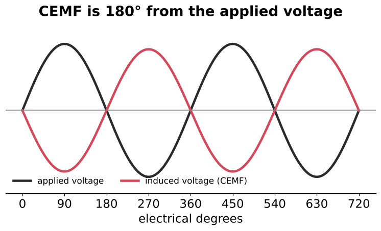
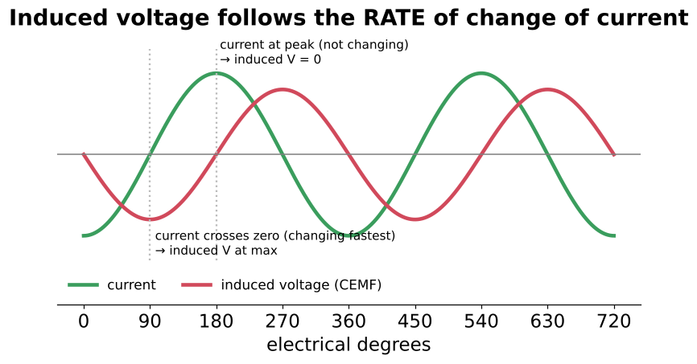
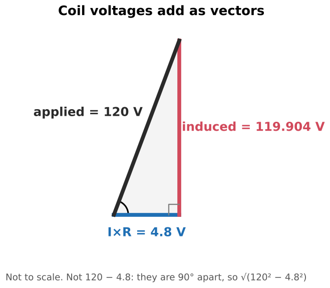
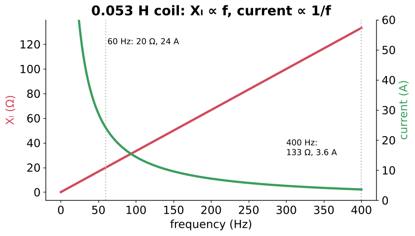
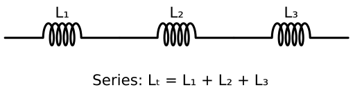
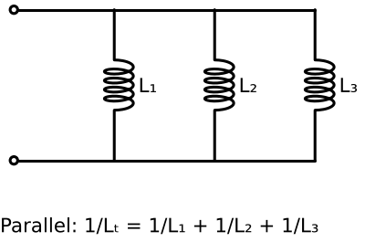
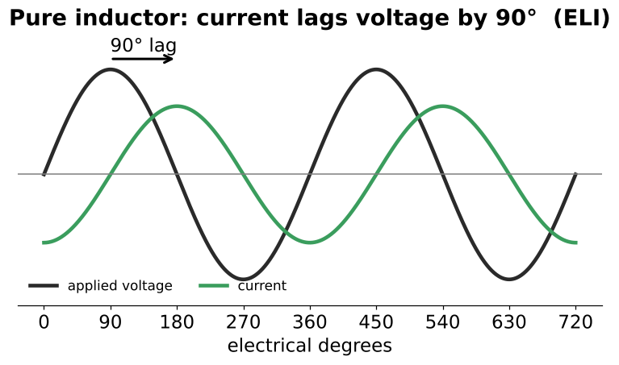
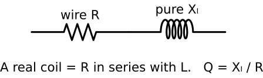
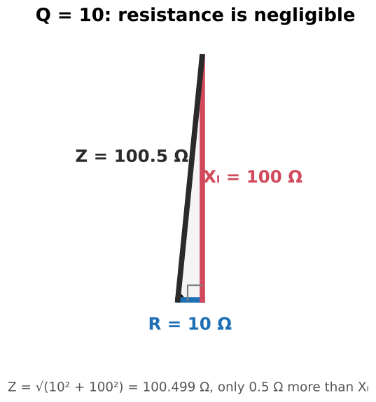
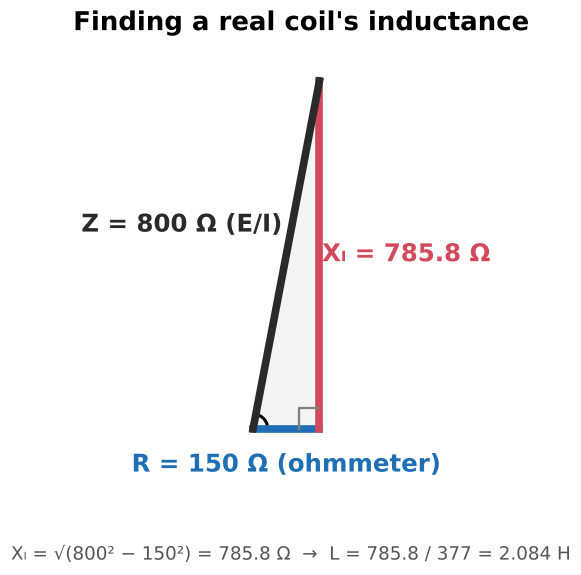

#+TITLE: ELECT 212 — Unit 16: Inductance in AC Circuits
#+FILETAGS: :drill:
#+STARTUP: overview

# Generated by tools/flashcards/build_decks.py. Study with M-x org-drill.

* What is inductance (L), and what is its unit?
   :PROPERTIES:
   :ID: u16-001
   :END:
** Answer
A coil's ability to induce voltage in itself, opposing any change in current. Measured in henrys (H). 1 mH = 0.001 H

* Which loads are treated as inductive?
   :PROPERTIES:
   :ID: u16-002
   :END:
** Answer
Anything with a coil: motors, transformers, ballasts, chokes, solenoids, contactor/relay coils. A single conductor's inductance is tiny and usually ignored

* When does a magnetic field induce a voltage in a coil?
   :PROPERTIES:
   :ID: u16-003
   :END:
** Answer
Whenever flux cuts the coil, i.e. whenever the current (and its field) changes. Unit 13 fact 1

* What is CEMF?
   :PROPERTIES:
   :ID: u16-004
   :END:
** Answer
Counter-electromotive force: the induced voltage, which always opposes the applied voltage. Lenz's law

* What is the induced voltage proportional to?
   :PROPERTIES:
   :ID: u16-005
   :END:
** Answer
The RATE OF CHANGE of current, not the amount of current.

* What does an inductor oppose?
   :PROPERTIES:
   :ID: u16-006
   :END:
** Answer
A CHANGE in current. Like a flywheel for current

* What is the phase relationship between applied voltage and induced voltage?
   :PROPERTIES:
   :ID: u16-007
   :END:
** Answer
180° (exactly opposite).

* A coil (6 Ω wire) on 120 VAC draws 0.8 A. How much voltage pushes current through the...
   :PROPERTIES:
   :ID: u16-008
   :END:
A coil (6 Ω wire) on 120 VAC draws 0.8 A. How much voltage pushes current through the wire resistance?
** Answer
E = 0.8 × 6 = 4.8 V. The rest is used overcoming the CEMF.

* Same coil: what is the induced voltage? Why not 120 − 4.8?
   :PROPERTIES:
   :ID: u16-009
   :END:
** Answer
√(120² − 4.8²) = 119.904 V. The resistive drop and the CEMF are 90° apart, so subtract as vectors. The book's earlier 120 − 116 = 4 example is only a rough illustration

* A contactor coil reads 6 Ω on an ohmmeter. Does it draw 120/6 = 20 A on 120 VAC?
   :PROPERTIES:
   :ID: u16-010
   :END:
** Answer
No. The ohmmeter shows only wire resistance. Reactance limits the AC current to far less.

* What is inductive reactance (Xₗ)?
   :PROPERTIES:
   :ID: u16-011
   :END:
** Answer
The current-limiting effect of inductance, in ohms. It isn't resistance: it comes from the CEMF and produces no heat.

* Formula for Xₗ?
   :PROPERTIES:
   :ID: u16-012
   :END:
** Answer
Xₗ = 2πfL (f in Hz, L in H, Xₗ in Ω)

* Rearranged reactance formulas?
   :PROPERTIES:
   :ID: u16-013
   :END:
** Answer
L = Xₗ / (2πf) and f = Xₗ / (2πL)

* What number should you memorize for 60 Hz, and why?
   :PROPERTIES:
   :ID: u16-014
   :END:
** Answer
377 (2π × 60 = 376.99). At 60 Hz, Xₗ = 377 × L and L = Xₗ / 377. Doesn't apply at other frequencies

* How does Ohm's law work with reactance?
   :PROPERTIES:
   :ID: u16-015
   :END:
** Answer
Put Xₗ in place of R: I = E / Xₗ, E = I × Xₗ, Xₗ = E / I.

* Three factors that set induced voltage (and therefore Xₗ)?
   :PROPERTIES:
   :ID: u16-016
   :END:
** Answer
1. Number of turns 2. Strength of the magnetic field 3. Speed of the cutting action (frequency)

* What physical features set a coil's inductance?
   :PROPERTIES:
   :ID: u16-017
   :END:
** Answer
Number of turns, how close together they are, wire/coil size, and core material (iron ≫ air).

* 0.8 H on 120 V, 60 Hz. Xₗ and current?
   :PROPERTIES:
   :ID: u16-018
   :END:
** Answer
Xₗ = 377 × 0.8 = 301.6 Ω; I = 120 / 301.6 = 0.398 A. Example 16–1

* 36 V, 400 Hz, 0.2 A. Find L.
   :PROPERTIES:
   :ID: u16-019
   :END:
** Answer
Xₗ = 36/0.2 = 180 Ω; L = 180 / (2π × 400) = 0.0716 H. Example 16–2: 377 does NOT apply at 400 Hz

* A coil draws 24 A on 480 V, 60 Hz. Current at 400 Hz?
   :PROPERTIES:
   :ID: u16-020
   :END:
** Answer
L doesn't change. Current scales with 1/f: 24 × 60/400 = 3.6 A. Example 16–3

* Does inductance change when the frequency changes?
   :PROPERTIES:
   :ID: u16-021
   :END:
** Answer
No. L is set by construction. Xₗ changes, because Xₗ is proportional to f. Exception: iron cores saturate at high current

* What is a pure inductor's Xₗ at DC (0 Hz)?
   :PROPERTIES:
   :ID: u16-022
   :END:
** Answer
Zero. Only the wire resistance limits current. An AC coil on DC will burn up

* Raise the frequency: what happens to Xₗ and current?
   :PROPERTIES:
   :ID: u16-023
   :END:
** Answer
Xₗ goes up and current goes down (in proportion).

* 60 Hz coil or transformer on 50 Hz: what happens?
   :PROPERTIES:
   :ID: u16-024
   :END:
** Answer
Xₗ drops about 17%, so current rises about 20%. It runs hotter, and an iron core may saturate.

* 50 Hz magnetic ballast on 60 Hz: overcurrent risk?
   :PROPERTIES:
   :ID: u16-025
   :END:
** Answer
No. Xₗ is higher at 60 Hz, so current is lower. The likely trouble is underpowered or poor lamp starting. Practical Application 1

* What happens to an iron-core inductor at high current?
   :PROPERTIES:
   :ID: u16-026
   :END:
** Answer
The core saturates, inductance drops, and current climbs quickly. Air cores don't saturate.

* Unit pitfall: 33 mH in the reactance formula?
   :PROPERTIES:
   :ID: u16-027
   :END:
** Answer
Convert to henrys first: 0.033 H. Likewise kHz → Hz. Practice Problem 2

* What do these two schematic symbols mean?
   :PROPERTIES:
   :ID: u16-028
   :END:
** Answer
Plain coil = air-core inductor. Coil with parallel lines = iron-core inductor. 16–3

* Total inductance of inductors in series?
   :PROPERTIES:
   :ID: u16-029
   :END:
** Answer
Lₜ = L₁ + L₂ + L₃ (likewise Xₗₜ = Xₗ₁ + Xₗ₂ + Xₗ₃) 16–4

* Three 0.6, 0.4 and 0.5 H inductors in series: Lₜ?
   :PROPERTIES:
   :ID: u16-030
   :END:
** Answer
1.5 H Example 16–4

* Total inductance of inductors in parallel?
   :PROPERTIES:
   :ID: u16-031
   :END:
** Answer
1/Lₜ = 1/L₁ + 1/L₂ + 1/L₃ (product-over-sum for two; L/N for N equal ones) Same forms for Xₗ

* 2.5, 1.8 and 1.2 H in parallel: Lₜ?
   :PROPERTIES:
   :ID: u16-032
   :END:
** Answer
1 / (0.4 + 0.556 + 0.833) = 0.559 H Example 16–6

* Sanity check for parallel inductance?
   :PROPERTIES:
   :ID: u16-033
   :END:
** Answer
The total must be smaller than the smallest inductor. Forgetting the final reciprocal is the classic error

* When do the simple series/parallel inductor formulas NOT apply?
   :PROPERTIES:
   :ID: u16-034
   :END:
** Answer
When the coils are magnetically coupled (mutual inductance), e.g. close together or sharing a core. Transformers work this way

* In a pure inductor, how are current and voltage related in phase?
   :PROPERTIES:
   :ID: u16-035
   :END:
** Answer
Current LAGS the applied voltage by 90°. 16–6

* Explain the 90° lag in three steps.
   :PROPERTIES:
   :ID: u16-036
   :END:
** Answer
1. Induced V is max when current changes fastest (at its zero crossing), so current leads the induced V by 90°. 2. Induced V is 180° from the applied V. 3. So current lags the applied V by 90°.

* What does "ELI the ICE man" mean?
   :PROPERTIES:
   :ID: u16-037
   :END:
** Answer
ELI: in an inductor (L), E comes before I (current lags). ICE: in a capacitor (C), I comes before E (current leads).

* Is the lag exactly 90° in a real coil?
   :PROPERTIES:
   :ID: u16-038
   :END:
** Answer
No. Wire resistance makes it a bit less. Loaded motors are often 30–40°.

* How much true power does a pure inductor use?
   :PROPERTIES:
   :ID: u16-039
   :END:
** Answer
Zero watts. Energy is stored in the field and returned each cycle. 16–7

* In a pure inductor, what fraction of the time do V and I have the same sign?
   :PROPERTIES:
   :ID: u16-040
   :END:
** Answer
50%. Same sign: energy goes into the field. Opposite sign: it returns. Net zero. Figure 16–15 A–D

* General power formula for any circuit?
   :PROPERTIES:
   :ID: u16-041
   :END:
** Answer
P = E × I × cos θ θ = phase angle between voltage and current

* cos θ for a resistive vs a pure inductive circuit?
   :PROPERTIES:
   :ID: u16-042
   :END:
** Answer
Resistive: cos 0° = 1 (P = E × I). Pure inductive: cos 90° = 0 (P = 0).

* Where does the power an inductor DOES use come from?
   :PROPERTIES:
   :ID: u16-043
   :END:
** Answer
Losses: I²R in the wire, plus eddy-current and hysteresis losses in the iron core.

* What are VARs?
   :PROPERTIES:
   :ID: u16-044
   :END:
** Answer
Volt-amperes-reactive: reactive power, the power that charges and returns the magnetic field. 16–8

* Formulas for VARs?
   :PROPERTIES:
   :ID: u16-045
   :END:
** Answer
VARs = Eₗ × Iₗ = Eₗ² / Xₗ = Iₗ² × Xₗ Use the inductor's own voltage and current

* Are VARs harmless because they're not true power?
   :PROPERTIES:
   :ID: u16-046
   :END:
** Answer
No. They're real current in real conductors, which heats wires and transformers. That's why reactors carry kVAR ratings.

* Inductor on 480 V drawing 125 A: minimum kVAR rating?
   :PROPERTIES:
   :ID: u16-047
   :END:
** Answer
480 × 125 / 1000 = 60 kVAR. Less than that and it would likely be destroyed. Example 16–7

* What is the Q of an inductor?
   :PROPERTIES:
   :ID: u16-048
   :END:
** Answer
Quality: the ratio of reactance to resistance. Q = Xₗ / R (no units). 16–9

* Q formulas, rearranged?
   :PROPERTIES:
   :ID: u16-049
   :END:
** Answer
Q = Xₗ / R, Xₗ = Q × R, R = Xₗ / Q Review Q11–13

* High Q vs low Q coil construction?
   :PROPERTIES:
   :ID: u16-050
   :END:
** Answer
Large wire → low R → high Q. Many turns of fine wire → high R → low Q.

* Above what Q is a coil treated as pure?
   :PROPERTIES:
   :ID: u16-051
   :END:
** Answer
Q ≥ 10. The resistance is then negligible. Xₗ 100, R 10 → Z = 100.5 Ω

* What is impedance (Z)?
   :PROPERTIES:
   :ID: u16-052
   :END:
** Answer
The total current-limiting effect (R and X combined), in ohms.

* Why does Z = √(R² + Xₗ²), not R + Xₗ?
   :PROPERTIES:
   :ID: u16-053
   :END:
** Answer
R and Xₗ are 90° apart, so they form the legs of a right triangle, and Z is the hypotenuse.

* 480 V, 60 Hz, 0.6 A, 150 Ω wire resistance. Find L.
   :PROPERTIES:
   :ID: u16-054
   :END:
** Answer
Z = 480/0.6 = 800 Ω. Xₗ = √(800² − 150²) = 785.8 Ω. L = 785.8/377 = 2.084 H. Procedure: Z = E/I → remove R → L = Xₗ/2πf

* E/I measured on a coil gives you Xₗ or Z?
   :PROPERTIES:
   :ID: u16-055
   :END:
** Answer
Z. It's only about equal to Xₗ when Q ≥ 10.

* What is inductive kick?
   :PROPERTIES:
   :ID: u16-056
   :END:
** Answer
When a coil's circuit opens, its collapsing field produces a voltage spike many times the supply voltage. Arcing contacts; it's why coils get diodes, snubbers or MOVs

* Why discharge large windings after a DC winding-resistance or DLRO test?
   :PROPERTIES:
   :ID: u16-057
   :END:
** Answer
The DC test current stores energy in the field, and breaking the leads can produce a dangerous kick. Let the test set discharge it.

* Why must you never open a loaded CT secondary?
   :PROPERTIES:
   :ID: u16-058
   :END:
** Answer
With nothing to limit it, the secondary voltage can rise to lethal levels. Short the secondary before disconnecting a meter or relay.

* Why does a stuck-open contactor armature burn out the coil?
   :PROPERTIES:
   :ID: u16-059
   :END:
** Answer
The air gap lowers L, so Xₗ is low and the coil keeps drawing inrush current (several × sealed current).

* Why do inductive loads lower power factor?
   :PROPERTIES:
   :ID: u16-060
   :END:
** Answer
They make current lag voltage, adding reactive current. Utilities surcharge low PF; capacitors correct it. Preview of later units

* What are VFD line reactors?
   :PROPERTIES:
   :ID: u16-061
   :END:
** Answer
Series inductors (rated in % impedance / kVAR) that limit inrush and fault current and smooth harmonics.

* Replacement inductor: 324 V across it, 18 A, 1.2 Ω wire resistance, 480 V supply....
   :PROPERTIES:
   :ID: u16-062
   :END:
Replacement inductor: 324 V across it, 18 A, 1.2 Ω wire resistance, 480 V supply. Which voltage do you use?
** Answer
The 324 V measured across the inductor, not the 480 V supply. Z = 324/18, remove R, then L = Xₗ/377. VARs from the inductor's own V and I. Practical Application 2: compute Q to judge whether R matters

