# Flashcards — Unit 17: Resistive-Inductive Series Circuits

59 cards. Read the question, answer it in your head, then click it to check.

Study guide for this unit: [study-guide.md](../study-guide.md). The raw card data is in [`unit17_flashcards.json`](unit17_flashcards.json) if you want to import the cards into a flashcard app.

---

<b>1.</b> In a pure resistive AC circuit, what is the phase relationship of voltage and current?
 In phase (0°). 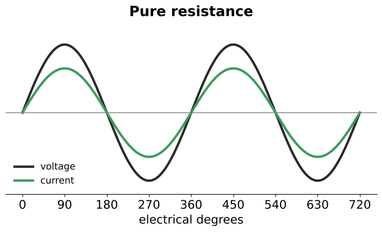  Review Q1  

<b>2.</b> In a pure inductive AC circuit, what is the phase relationship of voltage and current?
 Current lags voltage by 90°. 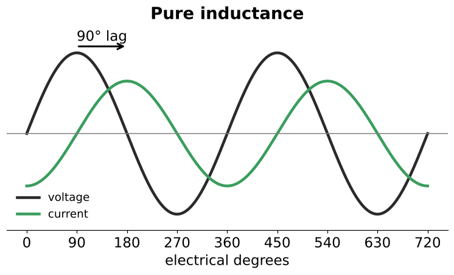  Review Q2 | ELI the ICE man: E before I in an inductor (L)  

<b>3.</b> In an R-L series circuit, by how much are voltage and current out of phase?
 Somewhere between 0° and 90°, with current lagging. 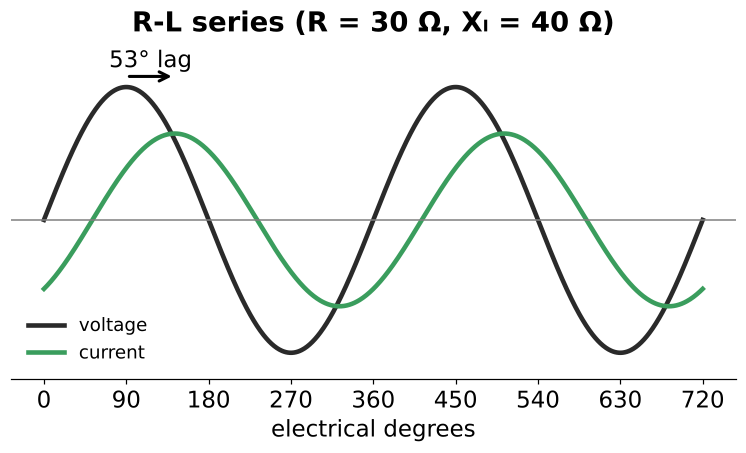  Exactly 0° only if pure R; exactly 90° only if pure L  

<b>4.</b> What determines the exact phase angle in an R-L series circuit?
 The <b>ratio</b> of resistance to inductive reactance (not their sizes alone).  R 30 / Xₗ 40 and R 300 / Xₗ 400 both give 53.13°  

<b>5.</b> In an R-L series circuit, how does the current compare in the resistor, the inductor and the line?
 It is the same everywhere: Iₜ = Iᵣ = Iₗ.  Series rule still holds in AC. Current is the bridge between groups.  

<b>6.</b> 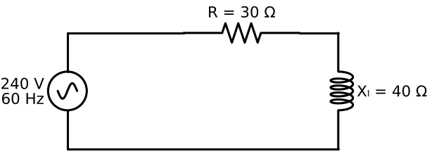 What is this circuit, and what is its total current?
 R-L series circuit. Z = √(30² + 40²) = 50 Ω, so Iₜ = 240 / 50 = <b>4.8 A</b>.  The chapter's main worked example  

<b>7.</b> In a series phasor diagram, which quantity is drawn as the 0° reference, and why?
 Current. It is the one quantity shared by every part of a series circuit. 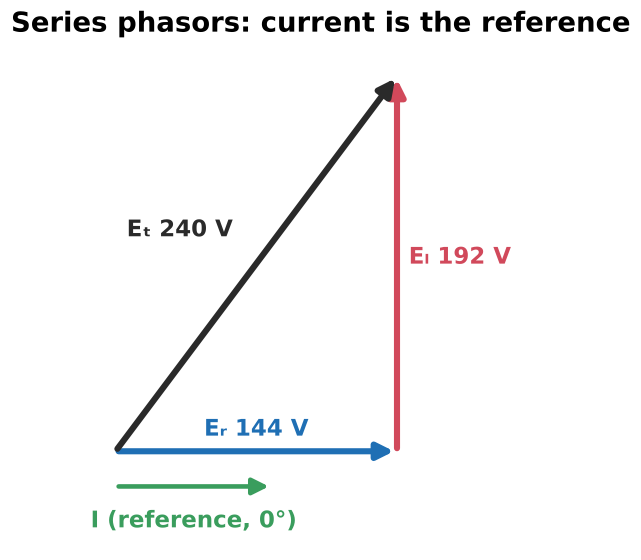  Eᵣ is drawn along it (0°); Eₗ points up (90°)  

<b>8.</b> Relative to the circuit current, where does the resistor's voltage sit, and where does the inductor's?
 Eᵣ is in phase with the current. Eₗ leads the current by 90°.   That 90° gap is why the drops add as a right triangle  

<b>9.</b> What are the three groups of quantities in an R-L series circuit?
 Resistive: R, Eᵣ, Iᵣ, P (W) Inductive: Xₗ, Eₗ, Iₗ, VARs, L Total: Z, Eₜ, Iₜ, VA, PF, θ 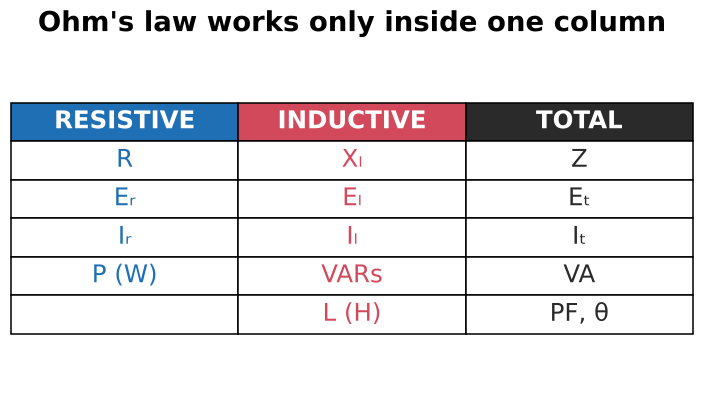  Chapter summary bullets  

<b>10.</b>  What's the rule for using Ohm's law in an R-L circuit?
 Use Ohm's law and the power formulas only <b>inside one group</b> (resistive, inductive or total). To cross groups, use the right triangle (the Pythagorean theorem or trig).  Book: Eᵣ = I × Xₗ and Eᵣ = I × Z are both wrong  

<b>11.</b> In every R-L triangle, which side is the resistive quantity, which is the inductive one, and which is the total?
 Horizontal leg = resistive Vertical leg = inductive Hypotenuse = total θ sits between the resistive leg and the hypotenuse. 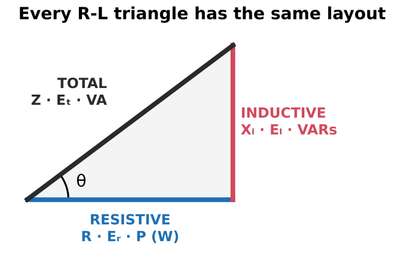  

<b>12.</b> Why do the impedance, voltage and power triangles all have the same angle θ?
 They're similar triangles. Voltage = impedance × I. Power = impedance × I².  30-40-50 Ω → 144-192-240 V → 691.2 W, 921.6 VARs, 1152 VA  

<b>13.</b> Define impedance (Z).
 The total opposition to current in an AC circuit, combining resistance and reactance. Measured in ohms.  

<b>14.</b> Formula for Z in an R-L series circuit?
 Z = √(R² + Xₗ²) 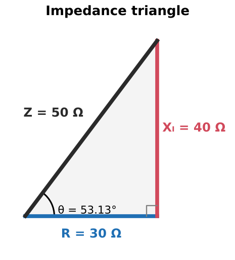  Rearranged: R = √(Z² − Xₗ²), Xₗ = √(Z² − R²)  

<b>15.</b> R = 30 Ω and Xₗ = 40 Ω in series. Why isn't Z = 70 Ω?
 R and Xₗ are 90° apart, so they add as vectors: √(30² + 40²) = 50 Ω.   Adding R + Xₗ is the #1 AC mistake  

<b>16.</b> Name two graphical ways to add R and Xₗ.
 1. Tip-to-tail: start Xₗ at the end of R. 2. Parallelogram: both start at the origin, and the diagonal is Z. Both give the same answer as the right triangle. 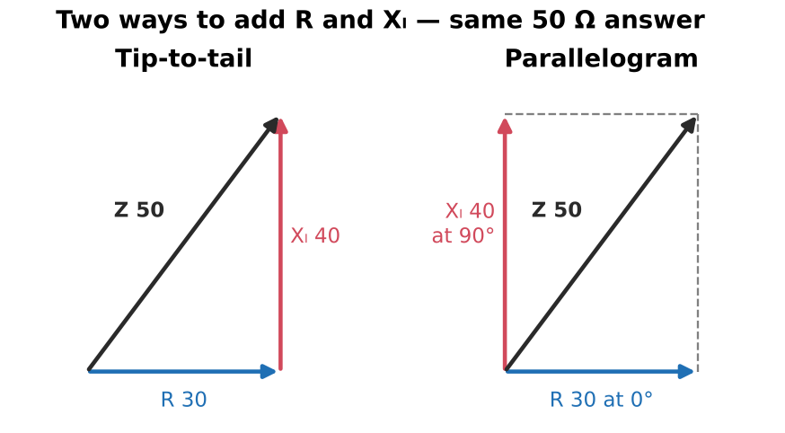  

<b>17.</b> Two resistors and two inductors are in series. How do you find Z?
 Add the R's together and the Xₗ's together first. Then Z = √(Rₜ² + Xₗₜ²).  Like quantities point the same direction, so they add straight. Practice 13  

<b>18.</b> Formula for total current in an R-L series circuit?
 Iₜ = Eₜ / Z  Z replaces R in Ohm's law. Example: 240 / 50 = 4.8 A  

<b>19.</b> Why can't you find total current with Eₜ / R or Eₜ / Xₗ?
 Those mix a total voltage with a single part's ohms. Only total ÷ total (Eₜ / Z) gives Iₜ.  

<b>20.</b> Formula for the voltage drop across the resistor?
 Eᵣ = Iᵣ × R  Example: 4.8 A × 30 Ω = 144 V  

<b>21.</b> Formula for the voltage drop across the inductor?
 Eₗ = Iₗ × Xₗ  Example: 4.8 A × 40 Ω = 192 V  

<b>22.</b> Why is Eᵣ = I × Z wrong?
 Z is a total quantity, so I × Z gives Eₜ, not Eᵣ. Resistive values need resistive ohms (R).  Same reason Eᵣ = I × Xₗ is wrong  

<b>23.</b> Formula for total voltage from the two drops?
 Eₜ = √(Eᵣ² + Eₗ²) 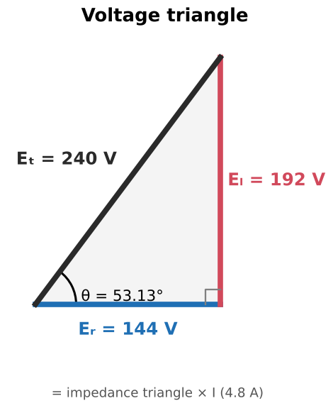  Rearranged: Eᵣ = √(Eₜ² − Eₗ²), Eₗ = √(Eₜ² − Eᵣ²)  

<b>24.</b> 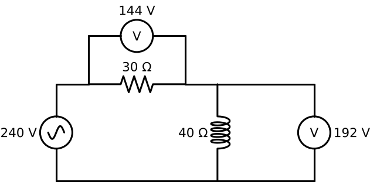 You measure 144 V across the resistor and 192 V across the coil on a 240 V supply. That's 336 V total. Is the meter bad?
 No. The drops are 90° apart, so they add as vectors: √(144² + 192²) = 240 V. A meter shows magnitude only, not timing.  KVL still holds, using vector addition  

<b>25.</b> How do you find the inductance from Xₗ at 60 Hz?
 L = Xₗ / (2πf) = Xₗ / 377  Example: 40 / 377 = 0.106 H. 377 only applies at 60 Hz.  

<b>26.</b> What is true power, and what unit is it in?
 The power actually converted to heat, light or work, in watts (W). Only the resistive part produces it.  P = Eᵣ × Iᵣ = Iᵣ²R = Eᵣ²/R  

<b>27.</b> Compute the watts for the 30 Ω / 40 Ω / 240 V example.
 P = Eᵣ × Iᵣ = 144 × 4.8 = <b>691.2 W</b>  

<b>28.</b> Why can only the resistive part of an R-L circuit produce watts?
 Watts are produced only when voltage and current have the same sign. Eᵣ is in phase with I. Eₗ is 90° off, so its energy is stored and returned. 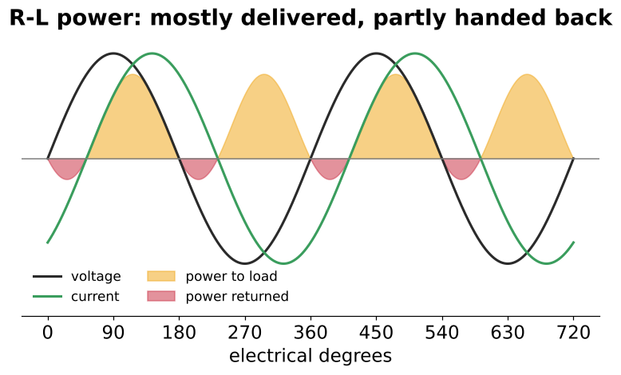  

<b>29.</b> Name two common WRONG ways to calculate watts in an R-L circuit.
 Eₜ × I (that gives VA) and I² × Xₗ (that gives VARs).  

<b>30.</b> What are VARs? Give two other names for them.
 Volt-amperes-reactive: the power that charges and discharges the coil's magnetic field each cycle. Also called <b>quadrature power</b> or <b>wattless power</b>.  

<b>31.</b> Formulas for inductive VARs?
 VARs = Eₗ × Iₗ = Iₗ² × Xₗ = Eₗ² / Xₗ  Example: 4.8² × 40 = 921.6 VARs  

<b>32.</b>  This graph shows power in an R-L circuit. What do the gold and red areas mean?
 Gold: voltage and current have the same sign, so power flows to the load (or is stored in the field). Red: opposite signs, so the stored field energy is returned to the source.  Pure L: gold = red, net 0 W  

<b>33.</b> What is apparent power, and why is it called "apparent"?
 Volt-amperes (VA) = Eₜ × Iₜ. It's what you get by multiplying a voltmeter reading by an ammeter reading. It looks like power, but only part of it is real work.  Example: 240 × 4.8 = 1152 VA  

<b>34.</b> Formula relating watts, VARs and VA?
 VA = √(P² + VARs²) 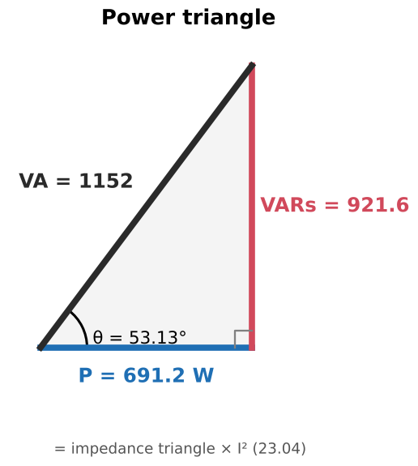  P = √(VA² − VARs²), VARs = √(VA² − P²)  

<b>35.</b> Fill in the missing side: P = 691.2 W, VARs = 921.6. What is VA?
 √(691.2² + 921.6²) = <b>1152 VA</b>   

<b>36.</b> Book error check: Figures 17–12, 17–14 and 17–15 label the VARs as 691.2. What should it be?
 <b>921.6 VARs</b>. 691.2 is the watts value, copied by mistake.  

<b>37.</b> Two resistors (56 W and 44 W) and two inductors (152 and 88 VARs) are in series on 130 V. Find VA and I.
 Watts add: 100 W. VARs add: 240. VA = √(100² + 240²) = 260 VA. I = 260 / 130 = <b>2 A</b>. 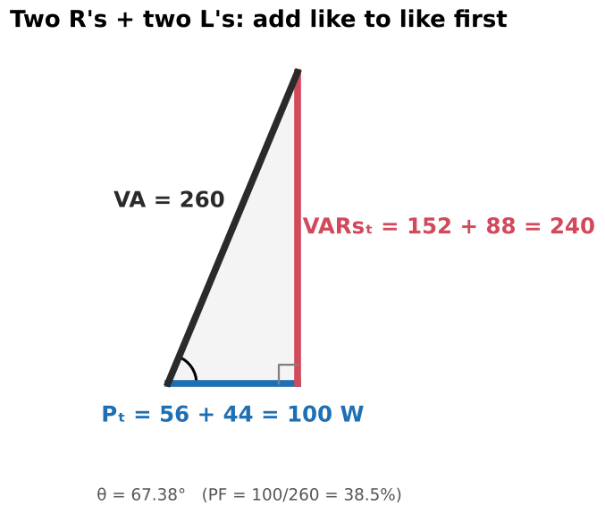  Example 17–1. After that, each part: E = P/I or VARs/I, then R or Xₗ = E/I  

<b>38.</b> Can you add watts to watts and VARs to VARs directly? Can you add VA to VA directly?
 Watts + watts: yes. VARs + VARs: yes (same direction). VA: only if the loads are at the same angle. Otherwise convert to W and VARs first.  

<b>39.</b> Define power factor.
 The ratio of true power to apparent power: PF = P / VA. Usually written as a percent.  Range 0 to 100%; can't exceed 100%  

<b>40.</b> Three ratios that give PF in an R-L series circuit?
 PF = P / VA = R / Z = Eᵣ / Eₜ (any resistive quantity ÷ its matching total)  Example: 0.6 = 60%  

<b>41.</b> Why can't PF be found from current in a series circuit?
 The current is the same in every part, so Iᵣ / Iₜ is always 1.  In parallel circuits it can be  

<b>42.</b> Is an R-L circuit's power factor leading or lagging?
 Lagging (current lags voltage). Capacitive circuits lead.  Write "0.6 lagging" when it matters  

<b>43.</b> A plant uses 5 MW. How much VA must the utility supply at 60% PF, and at 95% PF?
 60%: 5 / 0.6 = <b>8.333 MVA</b> 95%: 5 / 0.95 = <b>5.263 MVA</b> 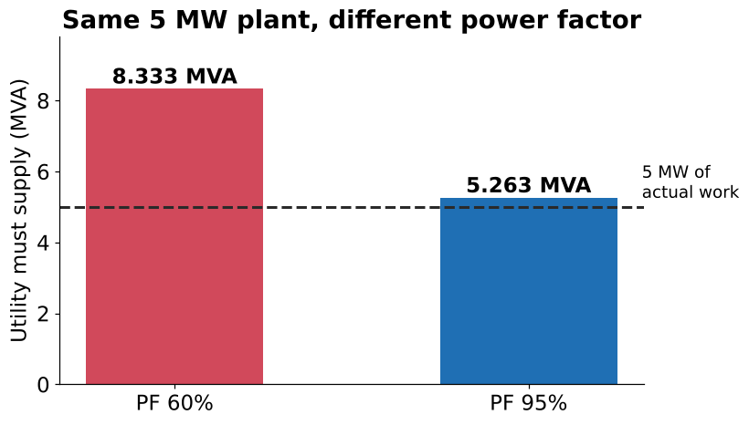  Same work, ~37% less current. That's why low-PF customers pay a surcharge.  

<b>44.</b> Why do utilities charge industrial customers for low power factor?
 They bill for watt-hours, but they have to generate and carry the full VA (current). Low PF means more current, more losses and more equipment capacity for the same billed energy.  

<b>45.</b> 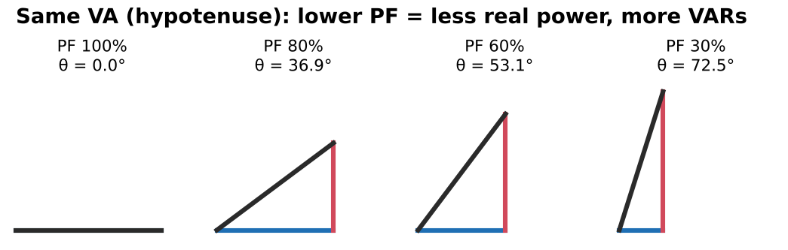 Each triangle has the same VA (hypotenuse). What happens to watts and VARs as PF drops?
 Watts (horizontal leg) shrink and VARs (vertical leg) grow. θ gets larger.  PF 100% → θ 0°; 80% → 36.9°; 60% → 53.1°; 30% → 72.5°  

<b>46.</b> What is angle theta (θ)?
 The phase angle between the applied voltage and the total current.  

<b>47.</b> How are θ and power factor related?
 cos θ = PF, so θ = cos⁻¹(PF).  The book's sentence "θ is the cosine of the PF" is backwards; its math is right  

<b>48.</b> Find θ for the main example (PF = 0.6).
 θ = cos⁻¹(0.6) = <b>53.13°</b>, current lagging.   

<b>49.</b> Besides cosine, what other trig ratios give θ?
 sin θ = VARs / VA (or Xₗ / Z, Eₗ / Eₜ) tan θ = VARs / P (or Xₗ / R, Eₗ / Eᵣ)  

<b>50.</b> PF = 86%. What's the most common calculator mistake when finding θ?
 Typing cos⁻¹(86). Convert to a decimal first: cos⁻¹(0.86) = 30.7°. Also check the calculator is in DEG mode.  Review Q5  

<b>51.</b> Given VARs and VA (but not watts), which function finds θ?
 Sine: VARs is opposite θ and VA is the hypotenuse, so θ = sin⁻¹(VARs / VA).  Review Q8  

<b>52.</b> Given θ = 22° and P = 94 W, how do you find VARs?
 VARs = P × tan θ = 94 × tan 22° ≈ 38 VARs.  Practice 12  

<b>53.</b> 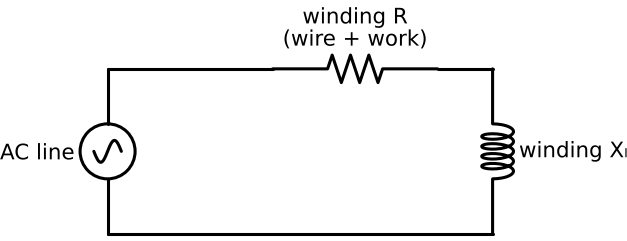 Why does a motor winding act like an R-L series circuit?
 It's a coil (inductance) of wire (resistance) with a single current path.  

<b>54.</b> How does a motor's power factor change from no load to full load?
 No load: mostly inductive, so low PF. As load increases, the mechanical work shows up as extra effective resistance, so PF rises.  Lightly loaded or oversized motors waste capacity  

<b>55.</b> 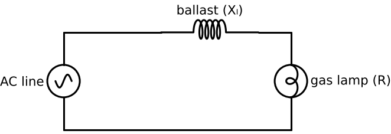 What does the ballast do in a gas-discharge lamp circuit?
 An ionized gas conducts almost like a short. The series ballast's inductive reactance limits the current, with far less loss than a resistor would have.  Fluorescent, mercury vapor, sodium vapor. Lamp ≈ R, ballast ≈ Xₗ  

<b>56.</b> Should feeders and overcurrent devices be sized from watts or from VA/amps? Why?
 From VA (amps). Conductors carry the total current, including the reactive part. Sizing from watts undersizes them when PF is low.  That's why transformers and generators are rated in kVA  

<b>57.</b> Voltmeter × clamp-on ammeter gives you which quantity?
 Apparent power (VA), not watts. You need a wattmeter, PF meter or power analyzer to read true power or PF.  

<b>58.</b> 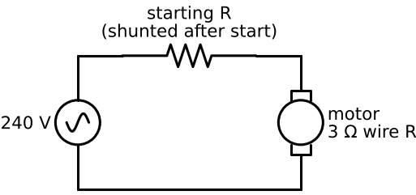 A motor (3 Ω wire R) draws 34 A inrush on 240 V. How do you size a series starting resistor to limit it to 20 A?
 1. Motor Z = 240 / 34 ≈ 7.06 Ω. Xₗ = √(7.06² − 3²). 2. Target Z = 240 / 20 = 12 Ω. Needed Rₜ = √(12² − Xₗ²). 3. Added R = Rₜ − 3 Ω. <b>Don't</b> just subtract 12 − 7.06.  Practical Application 1  

<b>59.</b> A 0.1 H inductor with 10 Ω of wire resistance goes on 480 V, 60 Hz. Can you ignore the 10 Ω?
 No. Xₗ = 37.7 Ω, so Q ≈ 3.8 (well under 10). Use Z = √(10² + 37.7²) and I = E / Z.  Practical Application 2  

