#+TITLE: ELECT 212 — Unit 17: Resistive-Inductive (RL) Series Circuits
#+FILETAGS: :drill:
#+STARTUP: overview

# Generated by tools/flashcards/build_decks.py. Study with M-x org-drill.

* In a pure resistive AC circuit, what is the phase relationship of voltage and current?
   :PROPERTIES:
   :ID: u17-001
   :END:
** Answer
In phase (0°). Review Q1
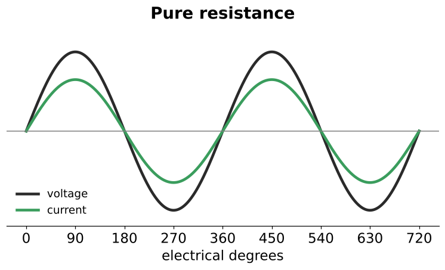

* In a pure inductive AC circuit, what is the phase relationship of voltage and current?
   :PROPERTIES:
   :ID: u17-002
   :END:
** Answer
Current lags voltage by 90°. Review Q2 | ELI the ICE man: E before I in an inductor (L)
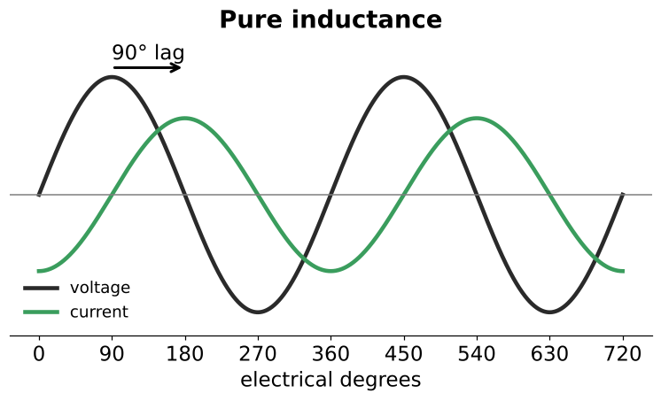

* In an R-L series circuit, by how much are voltage and current out of phase?
   :PROPERTIES:
   :ID: u17-003
   :END:
** Answer
Somewhere between 0° and 90°, with current lagging. Exactly 0° only if pure R; exactly 90° only if pure L
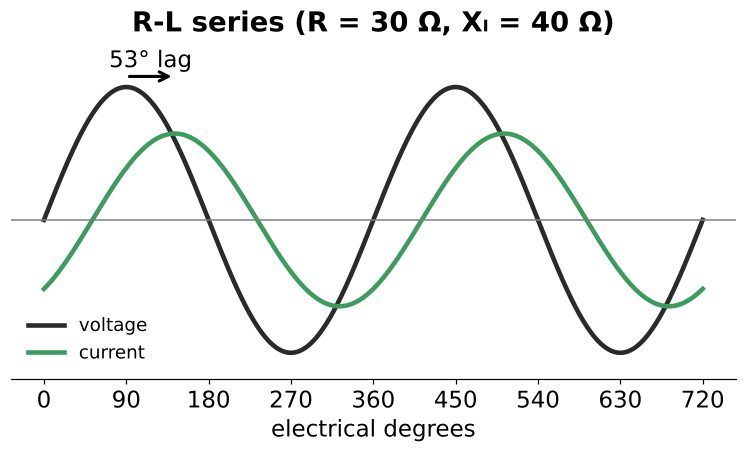

* What determines the exact phase angle in an R-L series circuit?
   :PROPERTIES:
   :ID: u17-004
   :END:
** Answer
The ratio of resistance to inductive reactance (not their sizes alone). R 30 / Xₗ 40 and R 300 / Xₗ 400 both give 53.13°

* In an R-L series circuit, how does the current compare in the resistor, the inductor...
   :PROPERTIES:
   :ID: u17-005
   :END:
In an R-L series circuit, how does the current compare in the resistor, the inductor and the line?
** Answer
It is the same everywhere: Iₜ = Iᵣ = Iₗ. Series rule still holds in AC. Current is the bridge between groups.

* What is this circuit, and what is its total current?
   :PROPERTIES:
   :ID: u17-006
   :END:
** Answer
R-L series circuit. Z = √(30² + 40²) = 50 Ω, so Iₜ = 240 / 50 = 4.8 A. The chapter's main worked example

* In a series phasor diagram, which quantity is drawn as the 0° reference, and why?
   :PROPERTIES:
   :ID: u17-007
   :END:
** Answer
Current. It is the one quantity shared by every part of a series circuit. Eᵣ is drawn along it (0°); Eₗ points up (90°)
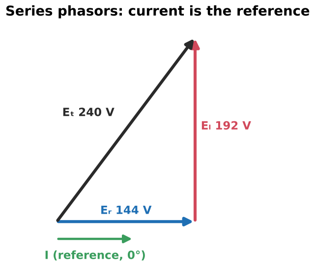

* Relative to the circuit current, where does the resistor's voltage sit, and where does...
   :PROPERTIES:
   :ID: u17-008
   :END:
Relative to the circuit current, where does the resistor's voltage sit, and where does the inductor's?
** Answer
Eᵣ is in phase with the current. Eₗ leads the current by 90°. That 90° gap is why the drops add as a right triangle

* What are the three groups of quantities in an R-L series circuit?
   :PROPERTIES:
   :ID: u17-009
   :END:
** Answer
Resistive: R, Eᵣ, Iᵣ, P (W) Inductive: Xₗ, Eₗ, Iₗ, VARs, L Total: Z, Eₜ, Iₜ, VA, PF, θ Chapter summary bullets
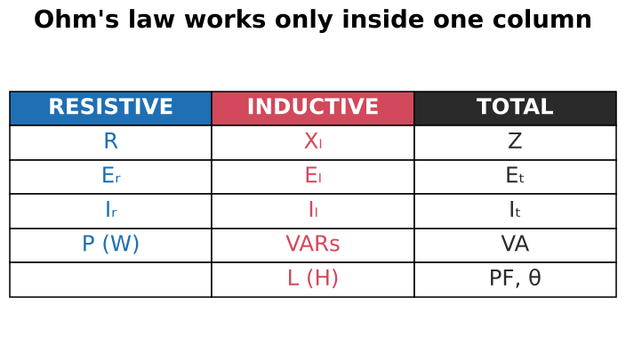

* What's the rule for using Ohm's law in an R-L circuit?
   :PROPERTIES:
   :ID: u17-010
   :END:
** Answer
Use Ohm's law and the power formulas only inside one group (resistive, inductive or total). To cross groups, use the right triangle (the Pythagorean theorem or trig). Book: Eᵣ = I × Xₗ and Eᵣ = I × Z are both wrong

* In every R-L triangle, which side is the resistive quantity, which is the inductive...
   :PROPERTIES:
   :ID: u17-011
   :END:
In every R-L triangle, which side is the resistive quantity, which is the inductive one, and which is the total?
** Answer
Horizontal leg = resistive Vertical leg = inductive Hypotenuse = total θ sits between the resistive leg and the hypotenuse.
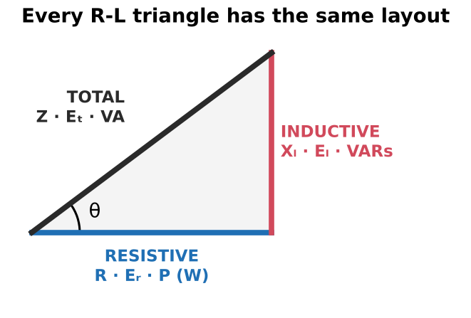

* Why do the impedance, voltage and power triangles all have the same angle θ?
   :PROPERTIES:
   :ID: u17-012
   :END:
** Answer
They're similar triangles. Voltage = impedance × I. Power = impedance × I². 30-40-50 Ω → 144-192-240 V → 691.2 W, 921.6 VARs, 1152 VA

* Define impedance (Z).
   :PROPERTIES:
   :ID: u17-013
   :END:
** Answer
The total opposition to current in an AC circuit, combining resistance and reactance. Measured in ohms.

* Formula for Z in an R-L series circuit?
   :PROPERTIES:
   :ID: u17-014
   :END:
** Answer
Z = √(R² + Xₗ²) Rearranged: R = √(Z² − Xₗ²), Xₗ = √(Z² − R²)
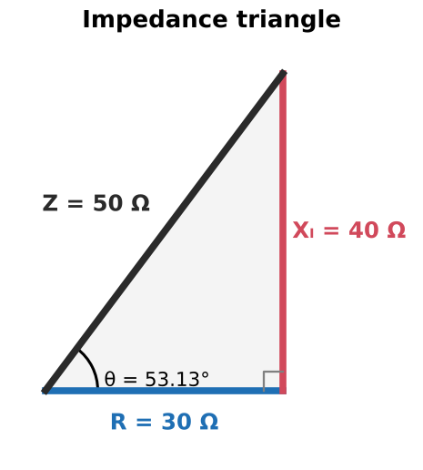

* R = 30 Ω and Xₗ = 40 Ω in series. Why isn't Z = 70 Ω?
   :PROPERTIES:
   :ID: u17-015
   :END:
** Answer
R and Xₗ are 90° apart, so they add as vectors: √(30² + 40²) = 50 Ω. Adding R + Xₗ is the #1 AC mistake

* Name two graphical ways to add R and Xₗ.
   :PROPERTIES:
   :ID: u17-016
   :END:
** Answer
1. Tip-to-tail: start Xₗ at the end of R. 2. Parallelogram: both start at the origin, and the diagonal is Z. Both give the same answer as the right triangle.
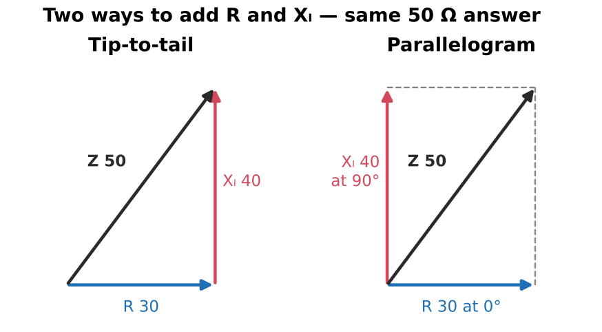

* Two resistors and two inductors are in series. How do you find Z?
   :PROPERTIES:
   :ID: u17-017
   :END:
** Answer
Add the R's together and the Xₗ's together first. Then Z = √(Rₜ² + Xₗₜ²). Like quantities point the same direction, so they add straight. Practice 13

* Formula for total current in an R-L series circuit?
   :PROPERTIES:
   :ID: u17-018
   :END:
** Answer
Iₜ = Eₜ / Z Z replaces R in Ohm's law. Example: 240 / 50 = 4.8 A

* Why can't you find total current with Eₜ / R or Eₜ / Xₗ?
   :PROPERTIES:
   :ID: u17-019
   :END:
** Answer
Those mix a total voltage with a single part's ohms. Only total ÷ total (Eₜ / Z) gives Iₜ.

* Formula for the voltage drop across the resistor?
   :PROPERTIES:
   :ID: u17-020
   :END:
** Answer
Eᵣ = Iᵣ × R Example: 4.8 A × 30 Ω = 144 V

* Formula for the voltage drop across the inductor?
   :PROPERTIES:
   :ID: u17-021
   :END:
** Answer
Eₗ = Iₗ × Xₗ Example: 4.8 A × 40 Ω = 192 V

* Why is Eᵣ = I × Z wrong?
   :PROPERTIES:
   :ID: u17-022
   :END:
** Answer
Z is a total quantity, so I × Z gives Eₜ, not Eᵣ. Resistive values need resistive ohms (R). Same reason Eᵣ = I × Xₗ is wrong

* Formula for total voltage from the two drops?
   :PROPERTIES:
   :ID: u17-023
   :END:
** Answer
Eₜ = √(Eᵣ² + Eₗ²) Rearranged: Eᵣ = √(Eₜ² − Eₗ²), Eₗ = √(Eₜ² − Eᵣ²)
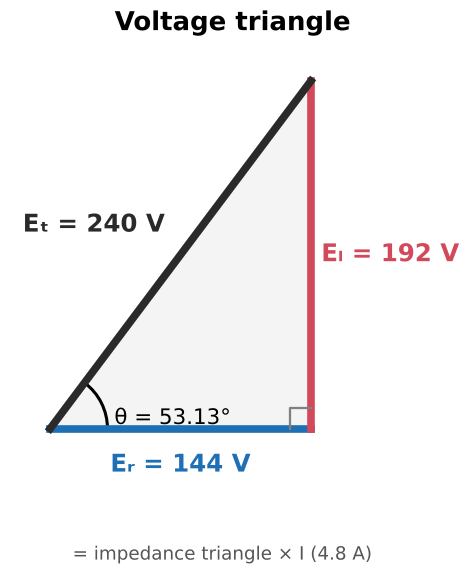

* You measure 144 V across the resistor and 192 V across the coil on a 240 V supply....
   :PROPERTIES:
   :ID: u17-024
   :END:
You measure 144 V across the resistor and 192 V across the coil on a 240 V supply. That's 336 V total. Is the meter bad?
** Answer
No. The drops are 90° apart, so they add as vectors: √(144² + 192²) = 240 V. A meter shows magnitude only, not timing. KVL still holds, using vector addition

* How do you find the inductance from Xₗ at 60 Hz?
   :PROPERTIES:
   :ID: u17-025
   :END:
** Answer
L = Xₗ / (2πf) = Xₗ / 377 Example: 40 / 377 = 0.106 H. 377 only applies at 60 Hz.

* What is true power, and what unit is it in?
   :PROPERTIES:
   :ID: u17-026
   :END:
** Answer
The power actually converted to heat, light or work, in watts (W). Only the resistive part produces it. P = Eᵣ × Iᵣ = Iᵣ²R = Eᵣ²/R

* Compute the watts for the 30 Ω / 40 Ω / 240 V example.
   :PROPERTIES:
   :ID: u17-027
   :END:
** Answer
P = Eᵣ × Iᵣ = 144 × 4.8 = 691.2 W

* Why can only the resistive part of an R-L circuit produce watts?
   :PROPERTIES:
   :ID: u17-028
   :END:
** Answer
Watts are produced only when voltage and current have the same sign. Eᵣ is in phase with I. Eₗ is 90° off, so its energy is stored and returned.
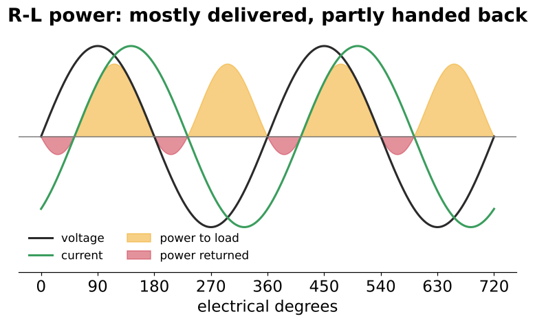

* Name two common WRONG ways to calculate watts in an R-L circuit.
   :PROPERTIES:
   :ID: u17-029
   :END:
** Answer
Eₜ × I (that gives VA) and I² × Xₗ (that gives VARs).

* What are VARs? Give two other names for them.
   :PROPERTIES:
   :ID: u17-030
   :END:
** Answer
Volt-amperes-reactive: the power that charges and discharges the coil's magnetic field each cycle. Also called quadrature power or wattless power.

* Formulas for inductive VARs?
   :PROPERTIES:
   :ID: u17-031
   :END:
** Answer
VARs = Eₗ × Iₗ = Iₗ² × Xₗ = Eₗ² / Xₗ Example: 4.8² × 40 = 921.6 VARs

* This graph shows power in an R-L circuit. What do the gold and red areas mean?
   :PROPERTIES:
   :ID: u17-032
   :END:
** Answer
Gold: voltage and current have the same sign, so power flows to the load (or is stored in the field). Red: opposite signs, so the stored field energy is returned to the source. Pure L: gold = red, net 0 W

* What is apparent power, and why is it called "apparent"?
   :PROPERTIES:
   :ID: u17-033
   :END:
** Answer
Volt-amperes (VA) = Eₜ × Iₜ. It's what you get by multiplying a voltmeter reading by an ammeter reading. It looks like power, but only part of it is real work. Example: 240 × 4.8 = 1152 VA

* Formula relating watts, VARs and VA?
   :PROPERTIES:
   :ID: u17-034
   :END:
** Answer
VA = √(P² + VARs²) P = √(VA² − VARs²), VARs = √(VA² − P²)
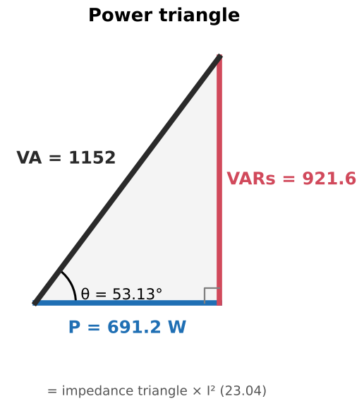

* Fill in the missing side: P = 691.2 W, VARs = 921.6. What is VA?
   :PROPERTIES:
   :ID: u17-035
   :END:
** Answer
√(691.2² + 921.6²) = 1152 VA

* Book error check: Figures 17–12, 17–14 and 17–15 label the VARs as 691.2. What should...
   :PROPERTIES:
   :ID: u17-036
   :END:
Book error check: Figures 17–12, 17–14 and 17–15 label the VARs as 691.2. What should it be?
** Answer
921.6 VARs. 691.2 is the watts value, copied by mistake.

* Two resistors (56 W and 44 W) and two inductors (152 and 88 VARs) are in series on 130...
   :PROPERTIES:
   :ID: u17-037
   :END:
Two resistors (56 W and 44 W) and two inductors (152 and 88 VARs) are in series on 130 V. Find VA and I.
** Answer
Watts add: 100 W. VARs add: 240. VA = √(100² + 240²) = 260 VA. I = 260 / 130 = 2 A. Example 17–1. After that, each part: E = P/I or VARs/I, then R or Xₗ = E/I
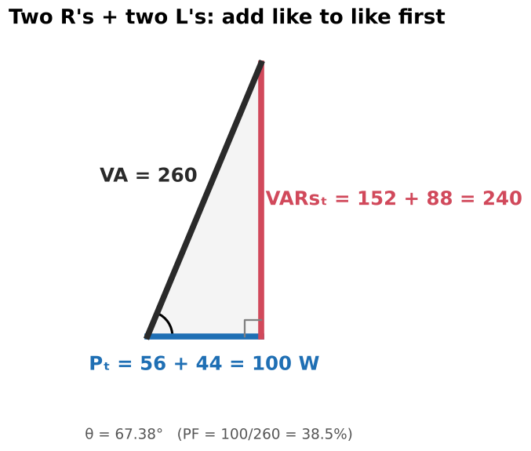

* Can you add watts to watts and VARs to VARs directly? Can you add VA to VA directly?
   :PROPERTIES:
   :ID: u17-038
   :END:
** Answer
Watts + watts: yes. VARs + VARs: yes (same direction). VA: only if the loads are at the same angle. Otherwise convert to W and VARs first.

* Define power factor.
   :PROPERTIES:
   :ID: u17-039
   :END:
** Answer
The ratio of true power to apparent power: PF = P / VA. Usually written as a percent. Range 0 to 100%; can't exceed 100%

* Three ratios that give PF in an R-L series circuit?
   :PROPERTIES:
   :ID: u17-040
   :END:
** Answer
PF = P / VA = R / Z = Eᵣ / Eₜ (any resistive quantity ÷ its matching total) Example: 0.6 = 60%

* Why can't PF be found from current in a series circuit?
   :PROPERTIES:
   :ID: u17-041
   :END:
** Answer
The current is the same in every part, so Iᵣ / Iₜ is always 1. In parallel circuits it can be

* Is an R-L circuit's power factor leading or lagging?
   :PROPERTIES:
   :ID: u17-042
   :END:
** Answer
Lagging (current lags voltage). Capacitive circuits lead. Write "0.6 lagging" when it matters

* A plant uses 5 MW. How much VA must the utility supply at 60% PF, and at 95% PF?
   :PROPERTIES:
   :ID: u17-043
   :END:
** Answer
60%: 5 / 0.6 = 8.333 MVA 95%: 5 / 0.95 = 5.263 MVA Same work, ~37% less current. That's why low-PF customers pay a surcharge.
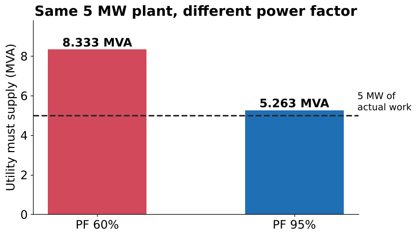

* Why do utilities charge industrial customers for low power factor?
   :PROPERTIES:
   :ID: u17-044
   :END:
** Answer
They bill for watt-hours, but they have to generate and carry the full VA (current). Low PF means more current, more losses and more equipment capacity for the same billed energy.

* Each triangle has the same VA (hypotenuse). What happens to watts and VARs as PF drops?
   :PROPERTIES:
   :ID: u17-045
   :END:
** Answer
Watts (horizontal leg) shrink and VARs (vertical leg) grow. θ gets larger. PF 100% → θ 0°; 80% → 36.9°; 60% → 53.1°; 30% → 72.5°

* What is angle theta (θ)?
   :PROPERTIES:
   :ID: u17-046
   :END:
** Answer
The phase angle between the applied voltage and the total current.

* How are θ and power factor related?
   :PROPERTIES:
   :ID: u17-047
   :END:
** Answer
cos θ = PF, so θ = cos⁻¹(PF). The book's sentence "θ is the cosine of the PF" is backwards; its math is right

* Find θ for the main example (PF = 0.6).
   :PROPERTIES:
   :ID: u17-048
   :END:
** Answer
θ = cos⁻¹(0.6) = 53.13°, current lagging.

* Besides cosine, what other trig ratios give θ?
   :PROPERTIES:
   :ID: u17-049
   :END:
** Answer
sin θ = VARs / VA (or Xₗ / Z, Eₗ / Eₜ) tan θ = VARs / P (or Xₗ / R, Eₗ / Eᵣ)

* PF = 86%. What's the most common calculator mistake when finding θ?
   :PROPERTIES:
   :ID: u17-050
   :END:
** Answer
Typing cos⁻¹(86). Convert to a decimal first: cos⁻¹(0.86) = 30.7°. Also check the calculator is in DEG mode. Review Q5

* Given VARs and VA (but not watts), which function finds θ?
   :PROPERTIES:
   :ID: u17-051
   :END:
** Answer
Sine: VARs is opposite θ and VA is the hypotenuse, so θ = sin⁻¹(VARs / VA). Review Q8

* Given θ = 22° and P = 94 W, how do you find VARs?
   :PROPERTIES:
   :ID: u17-052
   :END:
** Answer
VARs = P × tan θ = 94 × tan 22° ≈ 38 VARs. Practice 12

* Why does a motor winding act like an R-L series circuit?
   :PROPERTIES:
   :ID: u17-053
   :END:
** Answer
It's a coil (inductance) of wire (resistance) with a single current path.

* How does a motor's power factor change from no load to full load?
   :PROPERTIES:
   :ID: u17-054
   :END:
** Answer
No load: mostly inductive, so low PF. As load increases, the mechanical work shows up as extra effective resistance, so PF rises. Lightly loaded or oversized motors waste capacity

* What does the ballast do in a gas-discharge lamp circuit?
   :PROPERTIES:
   :ID: u17-055
   :END:
** Answer
An ionized gas conducts almost like a short. The series ballast's inductive reactance limits the current, with far less loss than a resistor would have. Fluorescent, mercury vapor, sodium vapor. Lamp ≈ R, ballast ≈ Xₗ

* Should feeders and overcurrent devices be sized from watts or from VA/amps? Why?
   :PROPERTIES:
   :ID: u17-056
   :END:
** Answer
From VA (amps). Conductors carry the total current, including the reactive part. Sizing from watts undersizes them when PF is low. That's why transformers and generators are rated in kVA

* Voltmeter × clamp-on ammeter gives you which quantity?
   :PROPERTIES:
   :ID: u17-057
   :END:
** Answer
Apparent power (VA), not watts. You need a wattmeter, PF meter or power analyzer to read true power or PF.

* A motor (3 Ω wire R) draws 34 A inrush on 240 V. How do you size a series starting...
   :PROPERTIES:
   :ID: u17-058
   :END:
A motor (3 Ω wire R) draws 34 A inrush on 240 V. How do you size a series starting resistor to limit it to 20 A?
** Answer
1. Motor Z = 240 / 34 ≈ 7.06 Ω. Xₗ = √(7.06² − 3²). 2. Target Z = 240 / 20 = 12 Ω. Needed Rₜ = √(12² − Xₗ²). 3. Added R = Rₜ − 3 Ω. Don't just subtract 12 − 7.06. Practical Application 1

* A 0.1 H inductor with 10 Ω of wire resistance goes on 480 V, 60 Hz. Can you ignore the...
   :PROPERTIES:
   :ID: u17-059
   :END:
A 0.1 H inductor with 10 Ω of wire resistance goes on 480 V, 60 Hz. Can you ignore the 10 Ω?
** Answer
No. Xₗ = 37.7 Ω, so Q ≈ 3.8 (well under 10). Use Z = √(10² + 37.7²) and I = E / Z. Practical Application 2

