# Flashcards — Unit 18: Resistive-Inductive Parallel Circuits

54 cards. Read the question, answer it in your head, then click it to check.

Study guide for this unit: [study-guide.md](../study-guide.md). The raw card data is in [`unit18_flashcards.json`](unit18_flashcards.json) if you want to import the cards into a flashcard app.

---

<b>1.</b> Why do so many real circuits contain R and L in parallel?
 Every load on a branch circuit is in parallel, and mixed loads are common: lights + fan motor, heat strips + compressor. 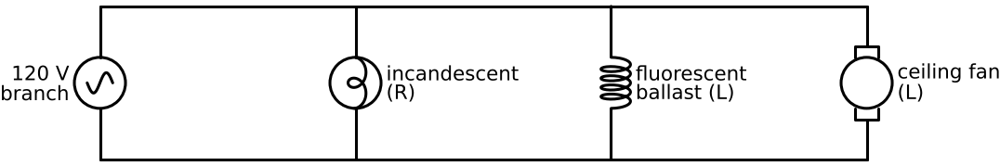  Why You Need to Know  

<b>2.</b> What is the same across every branch of a parallel R-L circuit?
 The voltage, in both magnitude and phase: Eₜ = Eᵣ = Eₗ. 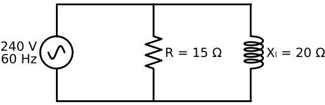  Summary bullet 1  

<b>3.</b> Phase of the resistive branch current?
 In phase with the voltage. 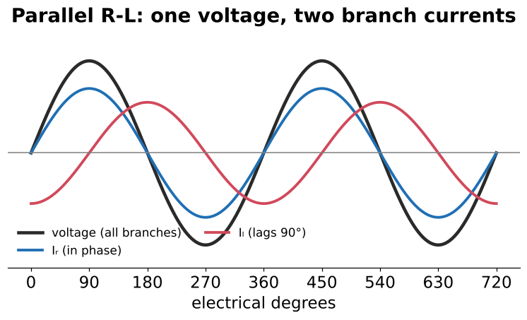  Summary  

<b>4.</b> Phase of the inductive branch current?
 Lags the voltage by 90°.   Summary  

<b>5.</b>  In parallel, how many degrees apart are Iᵣ and Iₗ?
 90°  Review Q1  

<b>6.</b> In a parallel phasor diagram, what is the 0° reference, and why?
 Voltage. It's the one quantity shared by every branch. (In series it was current.) 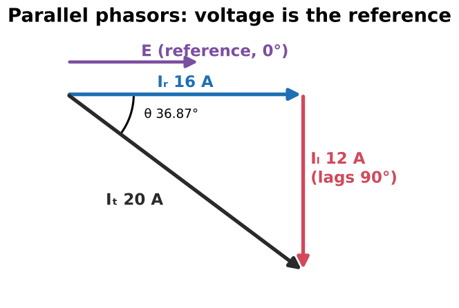  Iᵣ lies along E; Iₗ points down (lagging)  

<b>7.</b> What sets the phase angle between total current and voltage in parallel R-L?
 How the current is split: the ratio of Iᵣ to Iₗ (set by R vs Xₗ).  18–1  

<b>8.</b> In parallel, does a BIGGER resistance make the circuit more or less resistive?
 Less. A bigger R draws less current, so the inductive branch dominates and PF drops. (Opposite of series.)  The branch with more current dominates  

<b>9.</b>  What is this circuit, and what is each branch current?
 R-L parallel. Iᵣ = 240/15 = <b>16 A</b>; Iₗ = 240/20 = <b>12 A</b>.  Figure 18–4  

<b>10.</b> Formula for the resistive branch current?
 Iᵣ = E / R  Voltage is the same as the supply  

<b>11.</b> Formula for the inductive branch current?
 Iₗ = E / Xₗ  

<b>12.</b> Watts in the 15 Ω / 20 Ω / 240 V example?
 P = E × Iᵣ = 240 × 16 = <b>3840 W</b>  

<b>13.</b> VARs in the 15 Ω / 20 Ω / 240 V example?
 VARs = E × Iₗ = 240 × 12 = <b>2880 VARs</b>  

<b>14.</b> Inductance for Xₗ = 20 Ω at 60 Hz?
 L = 20 / 377 = <b>0.0531 H</b>  

<b>15.</b> Formula for total current in parallel R-L?
 Iₜ = √(Iᵣ² + Iₗ²) 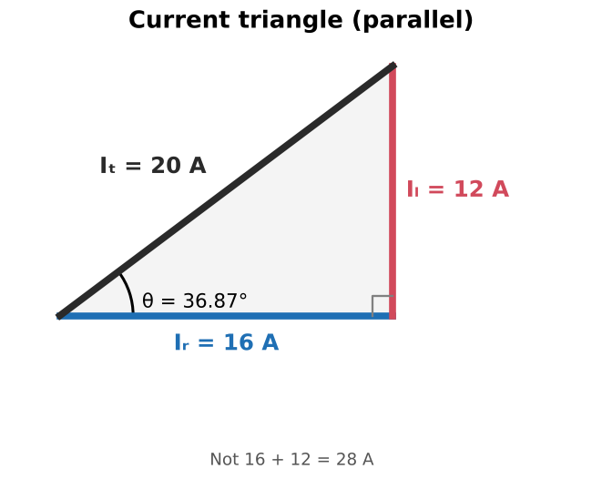  Rearranged: Iᵣ = √(Iₜ² − Iₗ²), Iₗ = √(Iₜ² − Iᵣ²)  

<b>16.</b> Iᵣ = 16 A and Iₗ = 12 A. Total current?
 √(16² + 12²) = <b>20 A</b> (not 28 A)   

<b>17.</b> Why can't you add Iᵣ + Iₗ directly?
 They're 90° apart, so they peak at different times. They add as vectors (Pythagorean theorem).  Summary bullet 4  

<b>18.</b> Iᵣ = 6.5 A, Iₗ = 8 A. Iₜ?
 √(6.5² + 8²) ≈ <b>10.3 A</b>  Review Q6  

<b>19.</b> 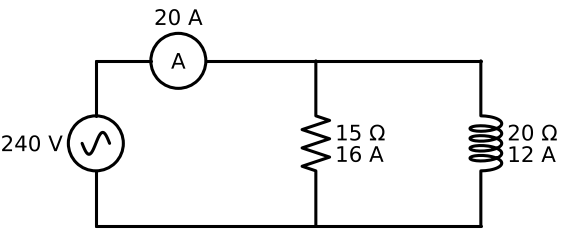 Branch clamps read 16 A and 12 A, feeder reads 20 A. Fault?
 No. Mixed R and L branch currents add as vectors, so the feeder reads less than the straight sum.  

<b>20.</b> Two inductive branches draw 9 A and 6 A. Total inductive current?
 <b>15 A</b>. Same-type currents are in phase, so they add straight. Then combine with Iᵣ by the Pythagorean theorem.  Example 18–2  

<b>21.</b> Easiest way to find Z if you know E and Iₜ?
 Z = Eₜ / Iₜ = 240 / 20 = <b>12 Ω</b>  

<b>22.</b> Reciprocal formula for parallel R-L impedance?
 Z = 1 / √((1/R)² + (1/Xₗ)²)  Square the reciprocals, add, root, then take the reciprocal again  

<b>23.</b> Product-over-vector-sum formula for parallel R-L impedance?
 Z = (R × Xₗ) / √(R² + Xₗ²)  15 × 20 / 25 = 12 Ω  

<b>24.</b> Is parallel Z bigger or smaller than R and Xₗ?
 Smaller than both (12 Ω is less than 15 and 20).  Adding a path lowers total opposition  

<b>25.</b> Can you draw an impedance triangle (R and Xₗ as legs) for a parallel circuit?
 No. That only works in series. In parallel, use the reciprocal formula, product-over-vector-sum, or E/Iₜ. 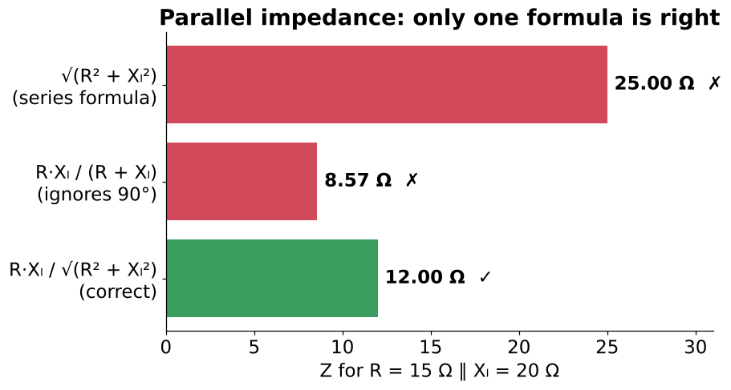  Book's Helpful Hint  

<b>26.</b>  Which of these gives the parallel Z for 15 Ω ∥ 20 Ω?
 Only R·Xₗ / √(R² + Xₗ²) = <b>12 Ω</b>. √(R² + Xₗ²) = 25 Ω is the series answer; R·Xₗ / (R + Xₗ) = 8.57 Ω ignores the 90°.  

<b>27.</b> R = 24 Ω ∥ Xₗ = 20 Ω. Z?
 (24 × 20) / √(24² + 20²) = <b>15.4 Ω</b>  Review Q7. 31.2 Ω would be the series mistake  

<b>28.</b> 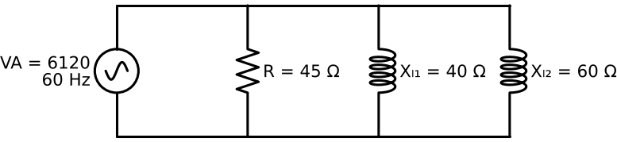 Two inductors (40 Ω and 60 Ω) in parallel with a resistor. First step for Z?
 Combine the inductors first with the ordinary reciprocal formula: 1/(1/40 + 1/60) = <b>24 Ω</b>. Then use the vector formula with R.  Example 18–2  

<b>29.</b> Is the power triangle different for parallel circuits?
 No. Watts, VARs and VA add the same way in any circuit: VA = √(P² + VARs²). 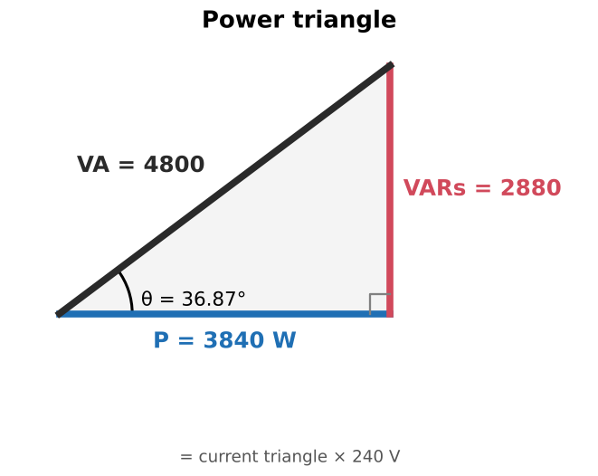  Summary bullet 6  

<b>30.</b> Apparent power in the 240 V, 20 A example?
 VA = E × Iₜ = 240 × 20 = <b>4800 VA</b>  

<b>31.</b> How is the parallel power triangle related to the current triangle?
 It's the current triangle multiplied by E (16/12/20 A × 240 V).  Same shape, same angle  

<b>32.</b> You know VA and Z but not E. How do you find E?
 VA = E²/Z, so E = √(VA × Z).  Example 18–2: √(6120 × 21.176) = 360 V  

<b>33.</b> VA = 325, PF = 66%. True power?
 P = 325 × 0.66 ≈ <b>214.5 W</b>  Review Q8  

<b>34.</b> VA = 465, P = 320 W. VARs?
 √(465² − 320²) ≈ <b>337 VARs</b>  Review Q9  

<b>35.</b> PF formulas for a parallel R-L circuit?
 PF = P / VA = Iᵣ / Iₜ = Z / R  80% in the main example  

<b>36.</b> Why is parallel PF Z/R instead of R/Z?
 Parallel Z is smaller than R, so R/Z would exceed 1, and PF can never exceed 1.  Series uses R/Z  

<b>37.</b> R = 8 Ω, Z = 5 Ω (parallel). PF?
 Z/R = 5/8 = <b>62.5%</b>  Example 18–1  

<b>38.</b> Why can't voltage ratios give PF in a parallel circuit?
 The voltage is the same on every branch, so Eᵣ/Eₜ is always 1. Use currents instead.  Mirror of the series rule  

<b>39.</b> Main example PF and θ?
 PF = 3840/4800 = 16/20 = 12/15 = <b>80%</b>; θ = cos⁻¹(0.8) = <b>36.87°</b>, current lagging. 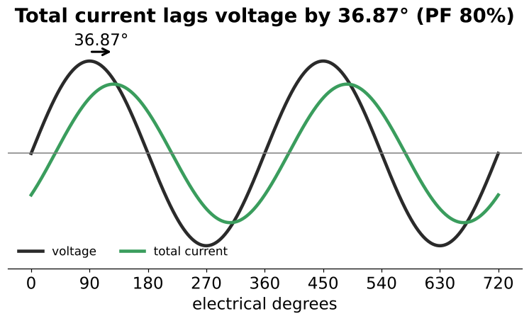  

<b>40.</b> What is the relationship between θ and PF in any AC circuit?
 cos θ = PF  

<b>41.</b> Other trig ratios for θ in parallel R-L?
 tan θ = Iₗ / Iᵣ = VARs / P sin θ = Iₗ / Iₜ = VARs / VA   

<b>42.</b> Book wording check: "PF is the relationship of apparent power to true power." Correct?
 Backwards. PF = true power ÷ apparent power. The book's formulas are right.  

<b>43.</b>  Example 18–2: R 45 Ω, Xₗ 40 and 60 Ω, VA 6120. Find E and Iₜ.
 Xₗₜ = 24 Ω → Z = 21.176 Ω → E = √(6120 × 21.176) = <b>360 V</b> → Iₜ = 360 / 21.176 = <b>17 A</b>.  

<b>44.</b> Example 18–2 branch currents? Check Iₜ.
 Iᵣ = 8 A, Iₗ₁ = 9 A, Iₗ₂ = 6 A. Iₗ = 15 A, √(8² + 15²) = 17 A ✓  

<b>45.</b> Example 18–2 PF and θ?
 P = 2880 W, so PF = 2880/6120 = <b>47.06%</b>; θ = <b>61.93°</b>. 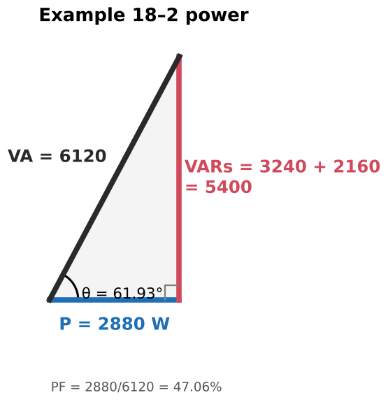  

<b>46.</b> Book typo in Example 18–2: "P = 359.996 V × 8 V"?
 Should be 8 <b>A</b>.  Also Fig 18–13's VARs labels differ slightly from the text (rounding)  

<b>47.</b>  Give real examples of parallel R-L loads.
 Ceiling fan with a light kit; a branch with incandescent lamps, fluorescent fixtures and motors; heat-pump compressor + heat strips.  Figure 18–16  

<b>48.</b> Heat pump: 34 A compressor at 70% PF plus 10 kW strip heat on 240 V. How do you find total current?
 Compressor Iᵣ = 34 × 0.7 = 23.8 A, Iₗ = √(34² − 23.8²) ≈ 24.3 A. Strip = 41.7 A resistive. Iₜ = √((23.8 + 41.7)² + 24.3²) ≈ <b>69.8 A</b>. 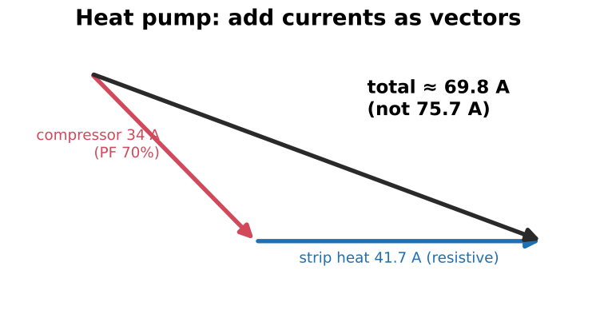  Practical App 2. Not 34 + 41.7 = 75.7 A  

<b>49.</b> 500 W of lamps + an inductive load on 120 V; total 7 A. Steps to find the load's inductance?
 Iᵣ = 500/120 = 4.17 A → Iₗ = √(7² − 4.17²) → Xₗ = 120/Iₗ → L = Xₗ/377.  Practical App 1  

<b>50.</b> Adding resistive load in parallel with a motor does what to the PF?
 Raises it. More resistive current, same VARs, so the angle shrinks. (The VARs don't go away.)  

<b>51.</b> Where are power-factor-correction capacitors connected relative to motors?
 In parallel (across the line), so their leading current cancels the motors' lagging current.  Coming in the capacitance units  

<b>52.</b> Why do NEC load calculations often add amps straight even though the physics says vector sum?
 It's a deliberate, conservative simplification: the straight sum is never smaller than the vector sum.  

<b>53.</b> Series vs parallel R-L: what's shared, and which PF ratios work?
 Series: current shared; PF = R/Z = Eᵣ/Eₜ. Parallel: voltage shared; PF = Z/R = Iᵣ/Iₜ. P/VA works for both. 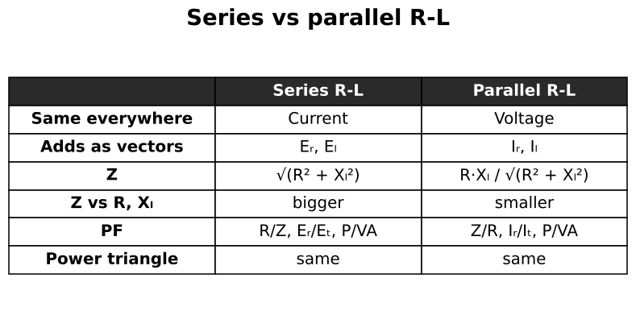  

<b>54.</b> Practice 15 asks for "the reactance" when Xₗ = 48 Ω is given. What does it mean?
 Almost certainly inductance: L = 48 / 377 ≈ 0.127 H.  Likely book typo  

