#+TITLE: ELECT 212 — Unit 18: Resistive-Inductive (RL) Parallel Circuits
#+FILETAGS: :drill:
#+STARTUP: overview

# Generated by tools/flashcards/build_decks.py. Study with M-x org-drill.

* Why do so many real circuits contain R and L in parallel?
   :PROPERTIES:
   :ID: u18-001
   :END:
** Answer
Every load on a branch circuit is in parallel, and mixed loads are common: lights + fan motor, heat strips + compressor. Why You Need to Know
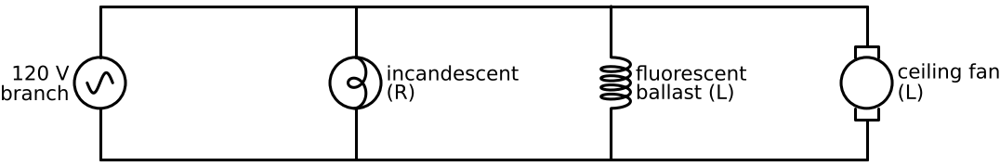

* What is the same across every branch of a parallel R-L circuit?
   :PROPERTIES:
   :ID: u18-002
   :END:
** Answer
The voltage, in both magnitude and phase: Eₜ = Eᵣ = Eₗ. Summary bullet 1
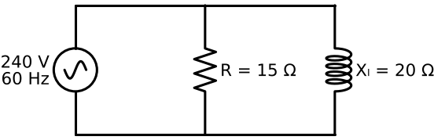

* Phase of the resistive branch current?
   :PROPERTIES:
   :ID: u18-003
   :END:
** Answer
In phase with the voltage. Summary
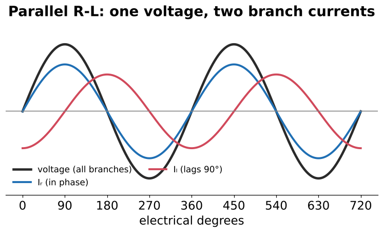

* Phase of the inductive branch current?
   :PROPERTIES:
   :ID: u18-004
   :END:
** Answer
Lags the voltage by 90°. Summary

* In parallel, how many degrees apart are Iᵣ and Iₗ?
   :PROPERTIES:
   :ID: u18-005
   :END:
** Answer
90° Review Q1

* In a parallel phasor diagram, what is the 0° reference, and why?
   :PROPERTIES:
   :ID: u18-006
   :END:
** Answer
Voltage. It's the one quantity shared by every branch. (In series it was current.) Iᵣ lies along E; Iₗ points down (lagging)
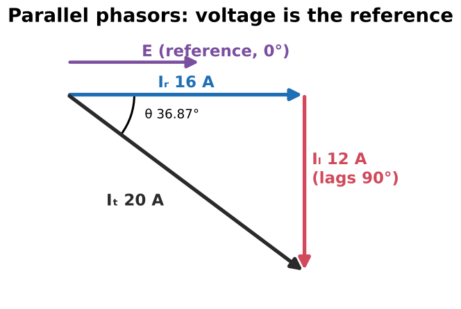

* What sets the phase angle between total current and voltage in parallel R-L?
   :PROPERTIES:
   :ID: u18-007
   :END:
** Answer
How the current is split: the ratio of Iᵣ to Iₗ (set by R vs Xₗ). 18–1

* In parallel, does a BIGGER resistance make the circuit more or less resistive?
   :PROPERTIES:
   :ID: u18-008
   :END:
** Answer
Less. A bigger R draws less current, so the inductive branch dominates and PF drops. (Opposite of series.) The branch with more current dominates

* What is this circuit, and what is each branch current?
   :PROPERTIES:
   :ID: u18-009
   :END:
** Answer
R-L parallel. Iᵣ = 240/15 = 16 A; Iₗ = 240/20 = 12 A. Figure 18–4

* Formula for the resistive branch current?
   :PROPERTIES:
   :ID: u18-010
   :END:
** Answer
Iᵣ = E / R Voltage is the same as the supply

* Formula for the inductive branch current?
   :PROPERTIES:
   :ID: u18-011
   :END:
** Answer
Iₗ = E / Xₗ

* Watts in the 15 Ω / 20 Ω / 240 V example?
   :PROPERTIES:
   :ID: u18-012
   :END:
** Answer
P = E × Iᵣ = 240 × 16 = 3840 W

* VARs in the 15 Ω / 20 Ω / 240 V example?
   :PROPERTIES:
   :ID: u18-013
   :END:
** Answer
VARs = E × Iₗ = 240 × 12 = 2880 VARs

* Inductance for Xₗ = 20 Ω at 60 Hz?
   :PROPERTIES:
   :ID: u18-014
   :END:
** Answer
L = 20 / 377 = 0.0531 H

* Formula for total current in parallel R-L?
   :PROPERTIES:
   :ID: u18-015
   :END:
** Answer
Iₜ = √(Iᵣ² + Iₗ²) Rearranged: Iᵣ = √(Iₜ² − Iₗ²), Iₗ = √(Iₜ² − Iᵣ²)
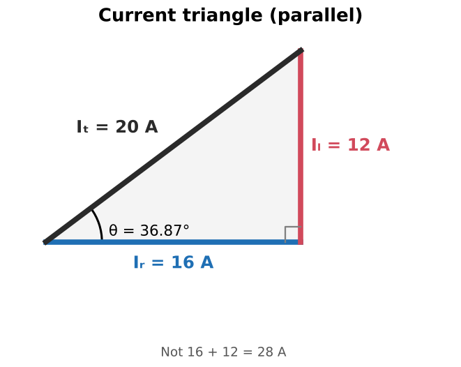

* Iᵣ = 16 A and Iₗ = 12 A. Total current?
   :PROPERTIES:
   :ID: u18-016
   :END:
** Answer
√(16² + 12²) = 20 A (not 28 A)

* Why can't you add Iᵣ + Iₗ directly?
   :PROPERTIES:
   :ID: u18-017
   :END:
** Answer
They're 90° apart, so they peak at different times. They add as vectors (Pythagorean theorem). Summary bullet 4

* Iᵣ = 6.5 A, Iₗ = 8 A. Iₜ?
   :PROPERTIES:
   :ID: u18-018
   :END:
** Answer
√(6.5² + 8²) ≈ 10.3 A Review Q6

* Branch clamps read 16 A and 12 A, feeder reads 20 A. Fault?
   :PROPERTIES:
   :ID: u18-019
   :END:
** Answer
No. Mixed R and L branch currents add as vectors, so the feeder reads less than the straight sum.

* Two inductive branches draw 9 A and 6 A. Total inductive current?
   :PROPERTIES:
   :ID: u18-020
   :END:
** Answer
15 A. Same-type currents are in phase, so they add straight. Then combine with Iᵣ by the Pythagorean theorem. Example 18–2

* Easiest way to find Z if you know E and Iₜ?
   :PROPERTIES:
   :ID: u18-021
   :END:
** Answer
Z = Eₜ / Iₜ = 240 / 20 = 12 Ω

* Reciprocal formula for parallel R-L impedance?
   :PROPERTIES:
   :ID: u18-022
   :END:
** Answer
Z = 1 / √((1/R)² + (1/Xₗ)²) Square the reciprocals, add, root, then take the reciprocal again

* Product-over-vector-sum formula for parallel R-L impedance?
   :PROPERTIES:
   :ID: u18-023
   :END:
** Answer
Z = (R × Xₗ) / √(R² + Xₗ²) 15 × 20 / 25 = 12 Ω

* Is parallel Z bigger or smaller than R and Xₗ?
   :PROPERTIES:
   :ID: u18-024
   :END:
** Answer
Smaller than both (12 Ω is less than 15 and 20). Adding a path lowers total opposition

* Can you draw an impedance triangle (R and Xₗ as legs) for a parallel circuit?
   :PROPERTIES:
   :ID: u18-025
   :END:
** Answer
No. That only works in series. In parallel, use the reciprocal formula, product-over-vector-sum, or E/Iₜ. Book's Helpful Hint
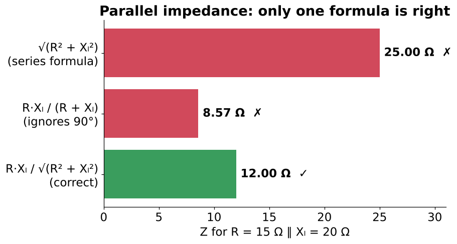

* Which of these gives the parallel Z for 15 Ω ∥ 20 Ω?
   :PROPERTIES:
   :ID: u18-026
   :END:
** Answer
Only R·Xₗ / √(R² + Xₗ²) = 12 Ω. √(R² + Xₗ²) = 25 Ω is the series answer; R·Xₗ / (R + Xₗ) = 8.57 Ω ignores the 90°.

* R = 24 Ω ∥ Xₗ = 20 Ω. Z?
   :PROPERTIES:
   :ID: u18-027
   :END:
** Answer
(24 × 20) / √(24² + 20²) = 15.4 Ω Review Q7. 31.2 Ω would be the series mistake

* Two inductors (40 Ω and 60 Ω) in parallel with a resistor. First step for Z?
   :PROPERTIES:
   :ID: u18-028
   :END:
** Answer
Combine the inductors first with the ordinary reciprocal formula: 1/(1/40 + 1/60) = 24 Ω. Then use the vector formula with R. Example 18–2

* Is the power triangle different for parallel circuits?
   :PROPERTIES:
   :ID: u18-029
   :END:
** Answer
No. Watts, VARs and VA add the same way in any circuit: VA = √(P² + VARs²). Summary bullet 6
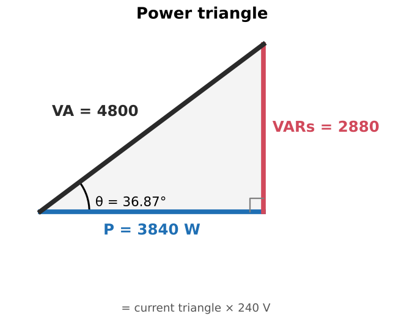

* Apparent power in the 240 V, 20 A example?
   :PROPERTIES:
   :ID: u18-030
   :END:
** Answer
VA = E × Iₜ = 240 × 20 = 4800 VA

* How is the parallel power triangle related to the current triangle?
   :PROPERTIES:
   :ID: u18-031
   :END:
** Answer
It's the current triangle multiplied by E (16/12/20 A × 240 V). Same shape, same angle

* You know VA and Z but not E. How do you find E?
   :PROPERTIES:
   :ID: u18-032
   :END:
** Answer
VA = E²/Z, so E = √(VA × Z). Example 18–2: √(6120 × 21.176) = 360 V

* VA = 325, PF = 66%. True power?
   :PROPERTIES:
   :ID: u18-033
   :END:
** Answer
P = 325 × 0.66 ≈ 214.5 W Review Q8

* VA = 465, P = 320 W. VARs?
   :PROPERTIES:
   :ID: u18-034
   :END:
** Answer
√(465² − 320²) ≈ 337 VARs Review Q9

* PF formulas for a parallel R-L circuit?
   :PROPERTIES:
   :ID: u18-035
   :END:
** Answer
PF = P / VA = Iᵣ / Iₜ = Z / R 80% in the main example

* Why is parallel PF Z/R instead of R/Z?
   :PROPERTIES:
   :ID: u18-036
   :END:
** Answer
Parallel Z is smaller than R, so R/Z would exceed 1, and PF can never exceed 1. Series uses R/Z

* R = 8 Ω, Z = 5 Ω (parallel). PF?
   :PROPERTIES:
   :ID: u18-037
   :END:
** Answer
Z/R = 5/8 = 62.5% Example 18–1

* Why can't voltage ratios give PF in a parallel circuit?
   :PROPERTIES:
   :ID: u18-038
   :END:
** Answer
The voltage is the same on every branch, so Eᵣ/Eₜ is always 1. Use currents instead. Mirror of the series rule

* Main example PF and θ?
   :PROPERTIES:
   :ID: u18-039
   :END:
** Answer
PF = 3840/4800 = 16/20 = 12/15 = 80%; θ = cos⁻¹(0.8) = 36.87°, current lagging.
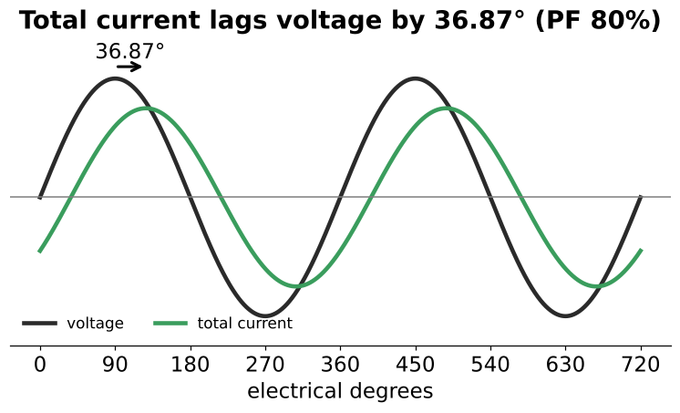

* What is the relationship between θ and PF in any AC circuit?
   :PROPERTIES:
   :ID: u18-040
   :END:
** Answer
cos θ = PF

* Other trig ratios for θ in parallel R-L?
   :PROPERTIES:
   :ID: u18-041
   :END:
** Answer
tan θ = Iₗ / Iᵣ = VARs / P sin θ = Iₗ / Iₜ = VARs / VA

* Book wording check: "PF is the relationship of apparent power to true power." Correct?
   :PROPERTIES:
   :ID: u18-042
   :END:
** Answer
Backwards. PF = true power ÷ apparent power. The book's formulas are right.

* Example 18–2: R 45 Ω, Xₗ 40 and 60 Ω, VA 6120. Find E and Iₜ.
   :PROPERTIES:
   :ID: u18-043
   :END:
** Answer
Xₗₜ = 24 Ω → Z = 21.176 Ω → E = √(6120 × 21.176) = 360 V → Iₜ = 360 / 21.176 = 17 A.

* Example 18–2 branch currents? Check Iₜ.
   :PROPERTIES:
   :ID: u18-044
   :END:
** Answer
Iᵣ = 8 A, Iₗ₁ = 9 A, Iₗ₂ = 6 A. Iₗ = 15 A, √(8² + 15²) = 17 A ✓

* Example 18–2 PF and θ?
   :PROPERTIES:
   :ID: u18-045
   :END:
** Answer
P = 2880 W, so PF = 2880/6120 = 47.06%; θ = 61.93°.
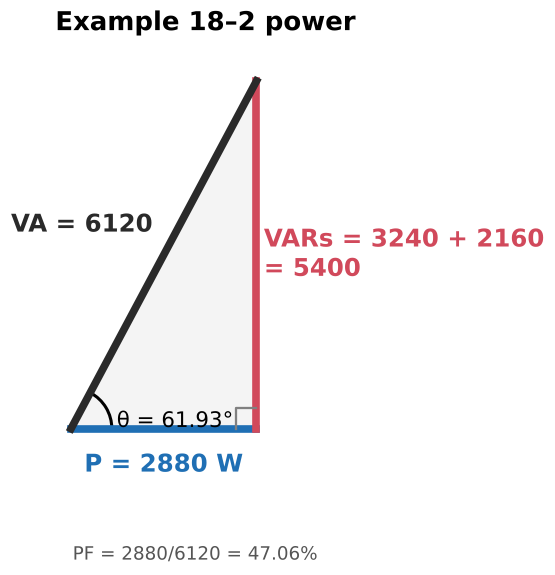

* Book typo in Example 18–2: "P = 359.996 V × 8 V"?
   :PROPERTIES:
   :ID: u18-046
   :END:
** Answer
Should be 8 A. Also Fig 18–13's VARs labels differ slightly from the text (rounding)

* Give real examples of parallel R-L loads.
   :PROPERTIES:
   :ID: u18-047
   :END:
** Answer
Ceiling fan with a light kit; a branch with incandescent lamps, fluorescent fixtures and motors; heat-pump compressor + heat strips. Figure 18–16

* Heat pump: 34 A compressor at 70% PF plus 10 kW strip heat on 240 V. How do you find...
   :PROPERTIES:
   :ID: u18-048
   :END:
Heat pump: 34 A compressor at 70% PF plus 10 kW strip heat on 240 V. How do you find total current?
** Answer
Compressor Iᵣ = 34 × 0.7 = 23.8 A, Iₗ = √(34² − 23.8²) ≈ 24.3 A. Strip = 41.7 A resistive. Iₜ = √((23.8 + 41.7)² + 24.3²) ≈ 69.8 A. Practical App 2. Not 34 + 41.7 = 75.7 A
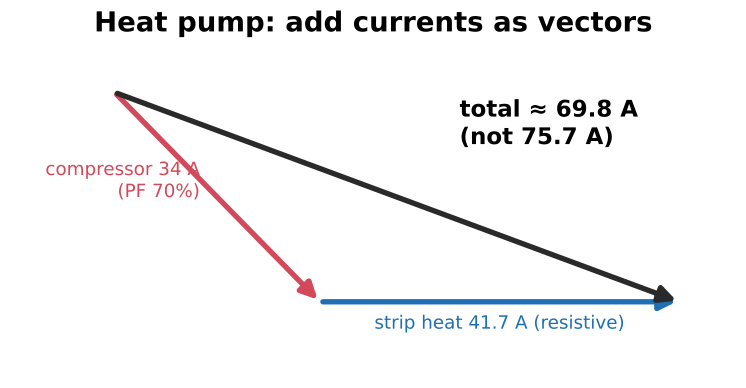

* 500 W of lamps + an inductive load on 120 V; total 7 A. Steps to find the load's...
   :PROPERTIES:
   :ID: u18-049
   :END:
500 W of lamps + an inductive load on 120 V; total 7 A. Steps to find the load's inductance?
** Answer
Iᵣ = 500/120 = 4.17 A → Iₗ = √(7² − 4.17²) → Xₗ = 120/Iₗ → L = Xₗ/377. Practical App 1

* Adding resistive load in parallel with a motor does what to the PF?
   :PROPERTIES:
   :ID: u18-050
   :END:
** Answer
Raises it. More resistive current, same VARs, so the angle shrinks. (The VARs don't go away.)

* Where are power-factor-correction capacitors connected relative to motors?
   :PROPERTIES:
   :ID: u18-051
   :END:
** Answer
In parallel (across the line), so their leading current cancels the motors' lagging current. Coming in the capacitance units

* Why do NEC load calculations often add amps straight even though the physics says...
   :PROPERTIES:
   :ID: u18-052
   :END:
Why do NEC load calculations often add amps straight even though the physics says vector sum?
** Answer
It's a deliberate, conservative simplification: the straight sum is never smaller than the vector sum.

* Series vs parallel R-L: what's shared, and which PF ratios work?
   :PROPERTIES:
   :ID: u18-053
   :END:
** Answer
Series: current shared; PF = R/Z = Eᵣ/Eₜ. Parallel: voltage shared; PF = Z/R = Iᵣ/Iₜ. P/VA works for both.
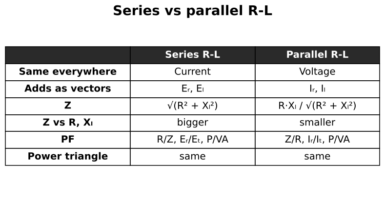

* Practice 15 asks for "the reactance" when Xₗ = 48 Ω is given. What does it mean?
   :PROPERTIES:
   :ID: u18-054
   :END:
** Answer
Almost certainly inductance: L = 48 / 377 ≈ 0.127 H. Likely book typo

