# Flashcards — Unit 19: Capacitors

87 cards. Read the question, answer it in your head, then click it to check.

Study guide for this unit: [study-guide.md](../study-guide.md). The raw card data is in [`unit19_flashcards.json`](unit19_flashcards.json) if you want to import the cards into a flashcard app.

---

<b>1.</b> What does a capacitor oppose?
 A change of <b>voltage</b>. (An inductor opposes a change of current.)  Summary  

<b>2.</b> How is the simplest capacitor built?
 Two metal plates separated by an insulator called the dielectric. 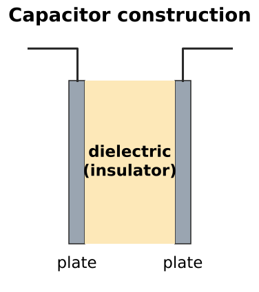  19–1  

<b>3.</b>  What is the dielectric?
 The insulating material between a capacitor's plates.  Review Q1  

<b>4.</b>  Identify these schematic symbols.
 Nonpolarized, polarized (electrolytic), variable, trimmer.  Figures 19–2, 19–29  

<b>5.</b> Three factors that determine capacitance?
 1. Surface area of the plates 2. Distance between the plates 3. Type of dielectric 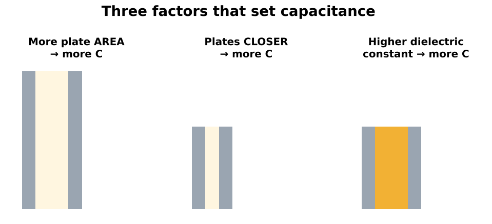  Review Q2  

<b>6.</b>  How does each factor change capacitance?
 More area → more C. Plates closer → more C. Higher dielectric constant → more C.  

<b>7.</b> What happens when a capacitor is connected to a DC source?
 Electrons leave the plate on the + terminal and pile onto the plate on the − terminal. Current flows until the capacitor voltage equals the source, then stops. 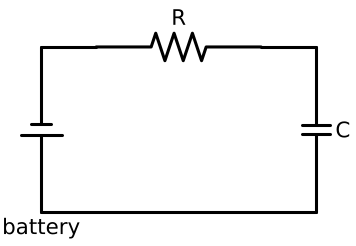  

<b>8.</b> When does current flow in a capacitor circuit?
 Only while the capacitor is charging or discharging.  On AC, it's always charging/discharging, so current flows continuously  

<b>9.</b> What happens when the battery is removed from a charged capacitor?
 It stays charged as long as there's no path for the electrons between the plates.  

<b>10.</b> What is leakage current?
 Current that creeps through the imperfect dielectric and slowly discharges the capacitor. Excessive leakage = a "leaky" capacitor.  

<b>11.</b> Book error: "leakage current is proportional to the resistance of the dielectric." Fix it.
 It's inversely related: higher dielectric resistance means LESS leakage (I = V/R).  

<b>12.</b> In what form does a capacitor store energy?
 In an electrostatic field, in the dielectric.  Review Q4. Inductors use a magnetic field  

<b>13.</b> What does "electrostatic" mean?
 Electric charges that are stationary (not moving).  

<b>14.</b> What is dielectric stress?
 The dielectric's electron orbits stretch toward the positive plate when charged. This is where the energy is stored, like a drawn bowstring. 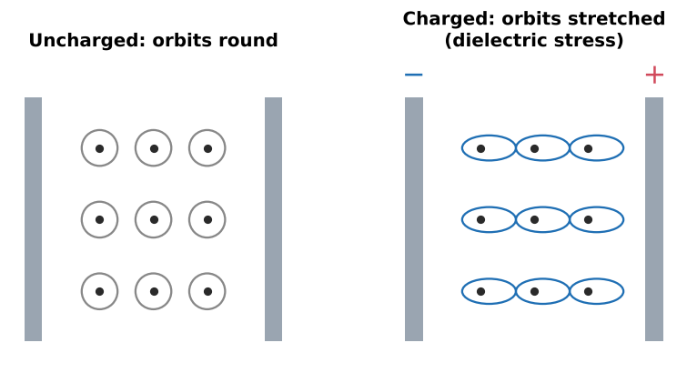  

<b>15.</b>  What is the dielectric stress proportional to?
 The voltage between the plates.  Too much voltage breaks the dielectric down (short)  

<b>16.</b> What does a capacitor's voltage rating mean?
 The maximum voltage the dielectric is designed to withstand without breaking down.  

<b>17.</b> Life-span rule: run a capacitor at half its rated voltage. Result?
 About 8 times longer life than at full rated voltage.  U.S. military study  

<b>18.</b> Why can a capacitor deliver thousands of amps briefly?
 Energy stored slowly is released almost instantly when the leads are shorted.  Camera flash: ~500 V capacitor dumps into a xenon tube  

<b>19.</b> Why is handing someone a charged capacitor dangerous?
 It can deliver enough energy to put a heart into fibrillation.  Book caution  

<b>20.</b> Energy stored in a capacitor (formula)?
 W = ½ × C × V² (joules)  Not in the book. Double V = 4× energy  

<b>21.</b> What is the dielectric constant?
 How many times more capacitance a material gives compared with vacuum (K = 1). Unitless. 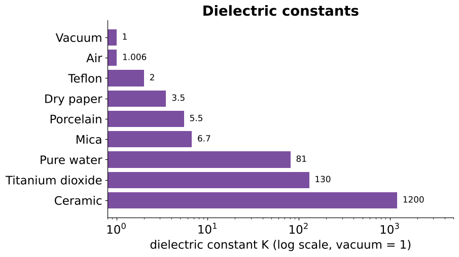  Book labels it F/in. — a typo  

<b>22.</b> Dielectric constants of air, paper, mica, water, ceramic?
 Air ≈ 1.006, paper ≈ 3.5, mica ≈ 6.4–7, pure water 81, ceramic up to ~1200.   

<b>23.</b> Air capacitor = 3 µF. Insert a material (same spacing) and it's 15 µF. K?
 15 / 3 = <b>5</b>  Review Q3  

<b>24.</b> What is the basic unit of capacitance, and who is it named for?
 The farad (F), after Michael Faraday.  

<b>25.</b> Define one farad.
 A change of 1 volt across the plates moves 1 coulomb of charge.  

<b>26.</b> Formula linking charge, capacitance and voltage?
 Q = C × V (coulombs = farads × volts)  

<b>27.</b> Why is the farad rarely used?
 It's enormous. A 1 F air capacitor with plates 1 in. apart would need about 1,108 square miles of plate.  Example 19–1  

<b>28.</b> Values of µF, nF and pF?
 µF = 10⁻⁶ F, nF = 10⁻⁹ F, pF = 10⁻¹² F  pF also written µµF or mmF  

<b>29.</b> An old motor capacitor is marked "35 MFD." What does MFD mean?
 Microfarads (35 µF), not megafarads.  

<b>30.</b> Formula for capacitors in parallel?
 Cₜ = C₁ + C₂ + C₃ 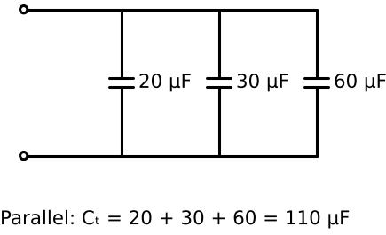  Same effect as bigger plates  

<b>31.</b>  20, 30 and 60 µF in parallel?
 <b>110 µF</b>  Figure 19–12  

<b>32.</b> Formulas for capacitors in series?
 1/Cₜ = 1/C₁ + 1/C₂ + …; two: C₁C₂/(C₁ + C₂); N equal: C/N 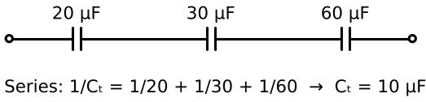  Same effect as wider plate spacing  

<b>33.</b>  20, 30 and 60 µF in series?
 <b>10 µF</b>  Example 19–2  

<b>34.</b> How do capacitor combinations compare with resistors?
 Opposite: capacitors ADD in parallel and use reciprocals in series.  

<b>35.</b> When can you use Cₜ = C/N?
 Only when all the series capacitors are the same value.  

<b>36.</b> Voltage across each capacitor in parallel?
 The full applied voltage. Each must be rated for it.  

<b>37.</b> 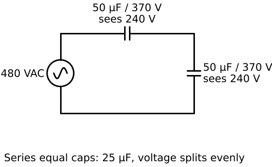 Two equal capacitors in series on 480 V. Voltage on each?
 240 V each (equal capacitors split evenly).  Practical App 3: two 50 µF 370 V caps = 25 µF for a 480 V job  

<b>38.</b> Unequal capacitors in series: which gets the most voltage?
 The SMALLEST capacitance (voltage is inversely proportional to C).  Check each one's rating  

<b>39.</b> 2.2 µF + 280 nF + 470 pF in parallel. First step?
 Convert to one unit: 2.2 µF + 0.28 µF + 0.00047 µF ≈ 2.48 µF.  Practice 4  

<b>40.</b> How do capacitors charge and discharge?
 At an exponential rate: fast at first, slowing as they approach full (or empty). 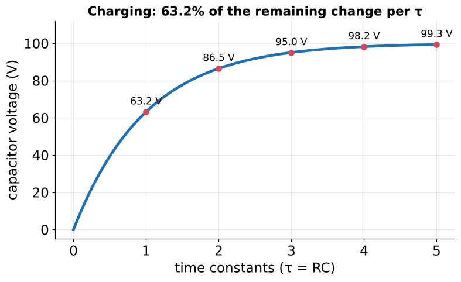  

<b>41.</b> How much does the voltage change in each time constant?
 63.2% of the change still remaining.   

<b>42.</b>  Charging to 100 V: voltage after 1, 2, 3, 4, 5 τ?
 63.2, 86.5, 95, 98.2, ~99.3 V (book rounds 86.4)  

<b>43.</b> 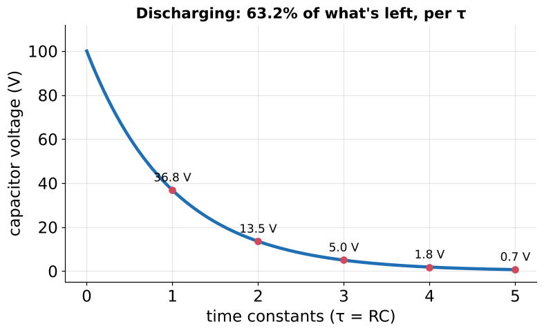 Discharging from 100 V: voltage after 1, 2, 3, 4, 5 τ?
 36.8, 13.5, 5, 1.8, ~0.7 V  

<b>44.</b> How many time constants to fully charge or discharge?
 Five.  Summary  

<b>45.</b> RC time constant formula and units?
 τ = R × C (ohms × farads = seconds)  τ = tau  

<b>46.</b> Rearranged time-constant formulas?
 R = τ / C and C = τ / R. Total time = 5τ.  

<b>47.</b> 50 µF and 100 kΩ: τ and total charge time?
 τ = 0.00005 × 100,000 = <b>5 s</b>; total = <b>25 s</b>.  Example 19–3  

<b>48.</b> 100 pF must fully charge in 0.2 s. What resistance?
 τ = 0.2 / 5 = 0.04 s; R = 0.04 / (100 × 10⁻¹²) = <b>400 MΩ</b>.  Example 19–4: divide total by 5 first  

<b>49.</b> 500 kΩ, total charge time 15 s. Capacitance?
 τ = 3 s; C = 3 / 500,000 = <b>6 µF</b>.  Example 19–5  

<b>50.</b> What are charge and discharge times proportional to?
 Both the capacitance and the resistance in the circuit.  Summary  

<b>51.</b> Name common applications for capacitors.
 PF correction, motor start/run, SCR/Triac phase shift, filtering pulsating DC, RC timing, frequency/pulse circuits.  19–9  

<b>52.</b> Nonpolarized capacitors: other name, and where can they be used?
 "AC capacitors." They work on AC or DC, either way around.  Review Q9: yes on DC  

<b>53.</b> How is an oil-filled paper capacitor built, and where is it used?
 Metal-foil plates separated by oil-soaked paper. Used for motor run/start capacitors and PF correction.  

<b>54.</b> What does the dot, arrow or dash on an oil-filled capacitor mark?
 The terminal connected to the plate nearest the metal case (the one most likely to short to ground on failure).  

<b>55.</b> Which side should the identified terminal connect to, and why?
 The LINE side, not the start winding. A short then goes straight to ground and trips the breaker fast. Via the start winding, reactance limits the fault and the winding can overheat. 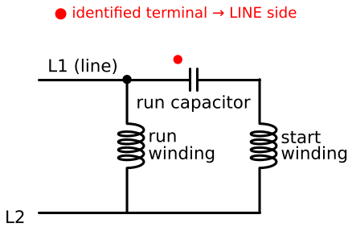  Figures 19–21 / 19–22  

<b>56.</b>  The identified mark is on the compressor's run-winding terminal. Wrong?
 Not necessarily. Trace it: if that terminal is the same node as the line, it's correct. The rule is keep it off the START winding.  Practical App 1  

<b>57.</b> Polarized capacitors: other name, and where can they be used?
 Electrolytic capacitors. DC only, observing the marked polarity.  

<b>58.</b> What happens if a polarized capacitor is reversed?
 It can be damaged and sometimes explodes.  

<b>59.</b> Main advantage of electrolytic capacitors?
 Very high capacitance in a small case (the oxide insulating film is only a few molecules thick).  

<b>60.</b> Wet-type electrolytic: construction and response to reversed polarity?
 Aluminum foil + borax electrolyte forming an oxide film. Reversed, the film dissolves and it shorts — but it REFORMS when polarity is corrected.  

<b>61.</b> Dry-type electrolytic: what's different?
 The electrolyte is held in gauze (leak-proof), but reversed polarity PERMANENTLY damages it.  Review Q11  

<b>62.</b> How is an AC electrolytic capacitor made?
 Two wet-type electrolytics back-to-back (negative to negative) in one case. Each half-cycle one forms while the other shorts. 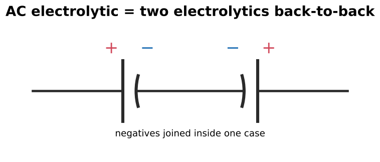  Review Q10. Used as small-motor start caps and ceiling-fan run caps  

<b>63.</b> How does a variable capacitor work?
 Movable plates on a shaft interleave with fixed plates, changing the effective area. Air dielectric, rated in pF.  

<b>64.</b> What is a trimmer capacitor?
 A small variable capacitor: a screw moves one plate closer to or farther from a fixed plate.  

<b>65.</b> How are capacitor color codes read, in which unit?
 Digits, multiplier, tolerance (and voltage/class), with the value in picofarads. There's no single universal standard.  Check manufacturer data  

<b>66.</b> Postage-stamp mica: what does a 6-dot code add over a 5-dot?
 The third dot becomes a third digit.  

<b>67.</b> Mica code: first dot white vs black?
 White = EIA standard (silver = paper dielectric). Black = JAN (Joint Army-Navy, military).  Review Q15 starts with black  

<b>68.</b> On a ceramic capacitor, what does the wide band mean?
 The temperature coefficient.  19–15  

<b>69.</b> What is a temperature coefficient?
 How much capacitance changes with temperature, in ppm/°C. P = increases with heat; N = decreases.  NP0 ≈ zero  

<b>70.</b> What is a dipped tantalum capacitor?
 A match-head-shaped capacitor coded with color bands/dots for value, tolerance and voltage.  19–16  

<b>71.</b> 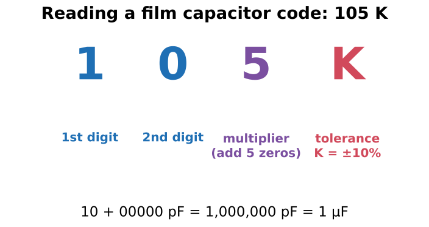 Read the film capacitor code "105 K".
 10 + five zeros = 1,000,000 pF = <b>1 µF</b>; K = ±10%.  19–17  

<b>72.</b> Tolerance letters J, K, M, H?
 J ±5%, K ±10%, M ±20%, H ±3%  

<b>73.</b> Read "253 H".
 25 + 3 zeros = 25,000 pF = <b>0.025 µF</b>, ±3%.  Review Q13  

<b>74.</b> First step before testing any capacitor?
 Discharge it through a resistor/discharge tool and verify zero volts with a meter.  

<b>75.</b> 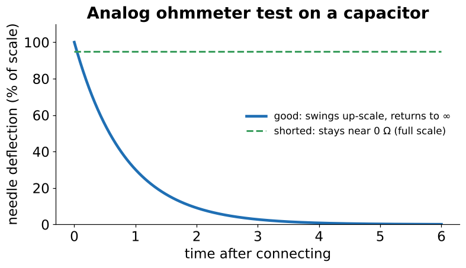 What does a good capacitor do on an analog ohmmeter?
 The needle swings up-scale, then returns to infinity. Reversing the leads swings about twice as far, then returns.  Stays low = shorted  

<b>76.</b> Why does the needle swing twice as far when you reverse the leads?
 The capacitor is already charged to the meter's voltage, so reversing adds that charge to the new one.  

<b>77.</b> 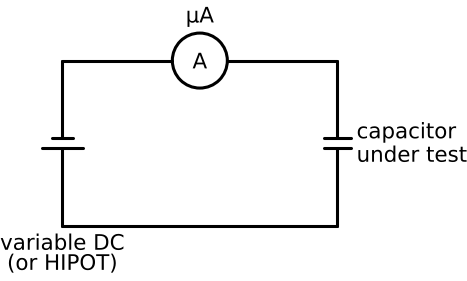 How do you test a capacitor for leakage?
 Apply rated DC through a microammeter in series. Once charged, current should be zero (or near it).  Summary bullet  

<b>78.</b> What is a HIPOT?
 A dielectric test set ("high potential"): variable high voltage, a voltmeter and a microammeter, used to test dielectric strength at rated voltage.  

<b>79.</b> 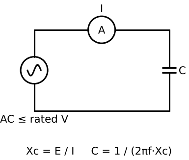 How do you measure actual capacitance with AC?
 Apply AC (≤ rated voltage), measure current. Xc = E / I, then C = 1 / (2πf × Xc).  Finds open plates. At 60 Hz, C(µF) ≈ 2652 × I / E  

<b>80.</b> Two tests needed for a large AC capacitor?
 1. Dielectric strength (short/leakage). 2. Capacitance value (open plates).  

<b>81.</b> Is a capacitor safe once the power is off?
 No. It can stay charged for a long time. Verify zero volts (VFD buses, PF banks, power supplies).  

<b>82.</b> How should you discharge a capacitor?
 Through a properly sized resistor or discharge tool — not a screwdriver.  A dead short can weld tools and throw molten metal  

<b>83.</b> What does the NEC require for PF-correction capacitors?
 A means of discharging stored voltage (bleed resistors) — for low-voltage caps, to 50 V or less within 1 minute (Article 460).  Don't trust it; measure  

<b>84.</b> Replacing a run capacitor: which ratings must match?
 Same µF (within tolerance), same OR HIGHER voltage rating. 440 V can replace 370 V; never the reverse.  

<b>85.</b> Start vs run capacitors: interchangeable?
 No. Start caps (AC electrolytic, high µF) are intermittent duty only. Run caps (oil/film) are continuous duty.  

<b>86.</b> Signs of a failed run capacitor?
 Bulged top, leaking oil, motor hums but won't start, motor runs hot. A dual cap (HERM/FAN/C) can fail on one section.  

<b>87.</b> A 240 VAC circuit needs a 10 µF cap; the spare is 350 WVDC. What must you compare?
 The AC PEAK (240 × 1.414 ≈ 339 V) against the DC rating. It barely fits — and an AC-duty rating is preferred.  Practical App 2  

