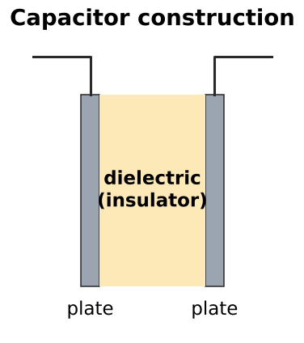
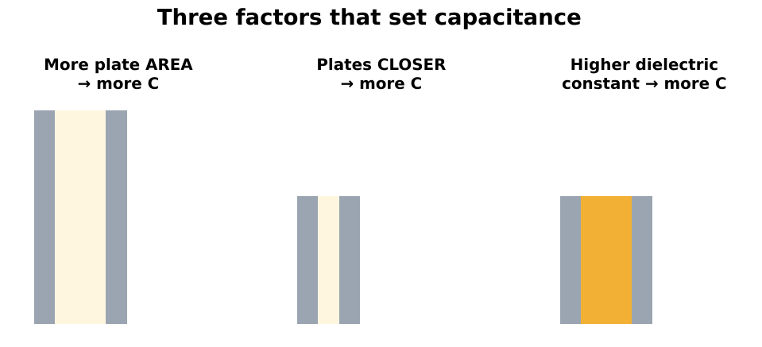
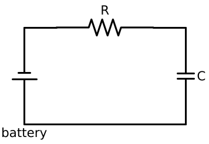
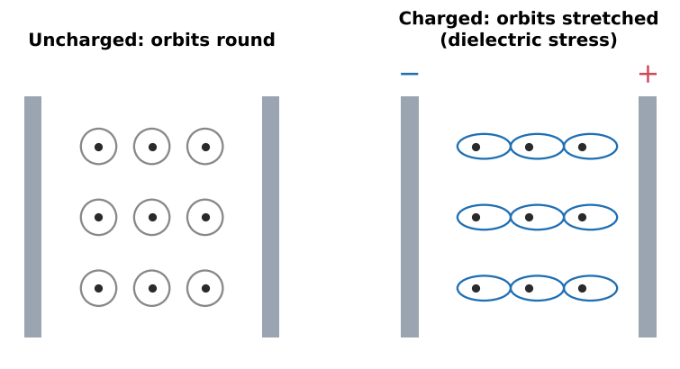
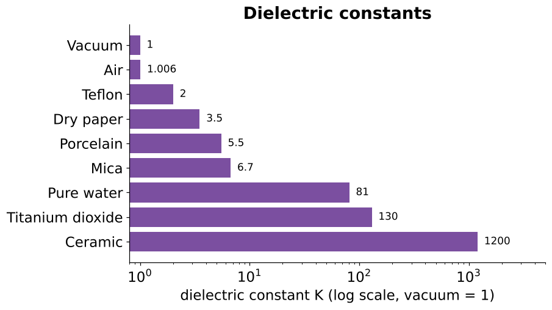
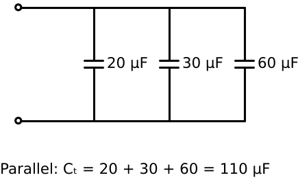
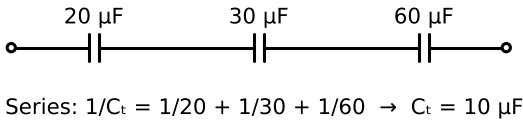
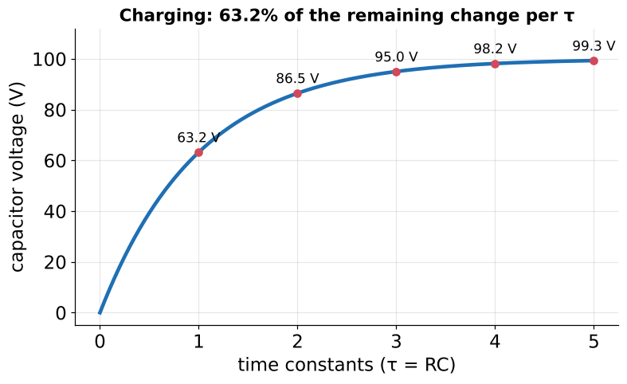
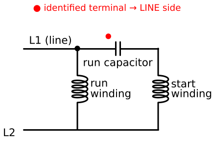
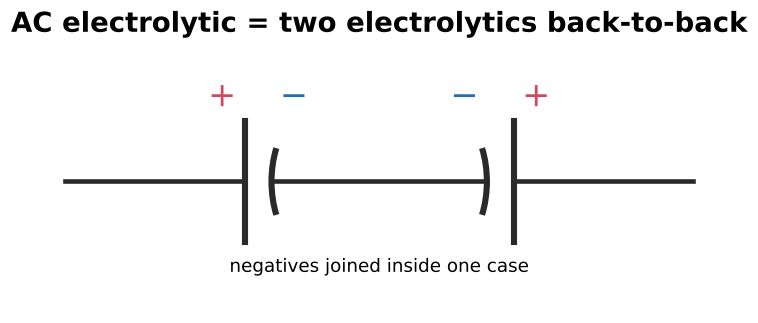

#+TITLE: ELECT 212 — Unit 19: Capacitors
#+FILETAGS: :drill:
#+STARTUP: overview

# Generated by tools/flashcards/build_decks.py. Study with M-x org-drill.

* What does a capacitor oppose?
   :PROPERTIES:
   :ID: u19-001
   :END:
** Answer
A change of voltage. (An inductor opposes a change of current.) Summary

* How is the simplest capacitor built?
   :PROPERTIES:
   :ID: u19-002
   :END:
** Answer
Two metal plates separated by an insulator called the dielectric. 19–1

* What is the dielectric?
   :PROPERTIES:
   :ID: u19-003
   :END:
** Answer
The insulating material between a capacitor's plates. Review Q1

* Identify these schematic symbols.
   :PROPERTIES:
   :ID: u19-004
   :END:
** Answer
Nonpolarized, polarized (electrolytic), variable, trimmer. Figures 19–2, 19–29

* Three factors that determine capacitance?
   :PROPERTIES:
   :ID: u19-005
   :END:
** Answer
1. Surface area of the plates 2. Distance between the plates 3. Type of dielectric Review Q2

* How does each factor change capacitance?
   :PROPERTIES:
   :ID: u19-006
   :END:
** Answer
More area → more C. Plates closer → more C. Higher dielectric constant → more C.

* What happens when a capacitor is connected to a DC source?
   :PROPERTIES:
   :ID: u19-007
   :END:
** Answer
Electrons leave the plate on the + terminal and pile onto the plate on the − terminal. Current flows until the capacitor voltage equals the source, then stops.

* When does current flow in a capacitor circuit?
   :PROPERTIES:
   :ID: u19-008
   :END:
** Answer
Only while the capacitor is charging or discharging. On AC, it's always charging/discharging, so current flows continuously

* What happens when the battery is removed from a charged capacitor?
   :PROPERTIES:
   :ID: u19-009
   :END:
** Answer
It stays charged as long as there's no path for the electrons between the plates.

* What is leakage current?
   :PROPERTIES:
   :ID: u19-010
   :END:
** Answer
Current that creeps through the imperfect dielectric and slowly discharges the capacitor. Excessive leakage = a "leaky" capacitor.

* Book error: "leakage current is proportional to the resistance of the dielectric." Fix it.
   :PROPERTIES:
   :ID: u19-011
   :END:
** Answer
It's inversely related: higher dielectric resistance means LESS leakage (I = V/R).

* In what form does a capacitor store energy?
   :PROPERTIES:
   :ID: u19-012
   :END:
** Answer
In an electrostatic field, in the dielectric. Review Q4. Inductors use a magnetic field

* What does "electrostatic" mean?
   :PROPERTIES:
   :ID: u19-013
   :END:
** Answer
Electric charges that are stationary (not moving).

* What is dielectric stress?
   :PROPERTIES:
   :ID: u19-014
   :END:
** Answer
The dielectric's electron orbits stretch toward the positive plate when charged. This is where the energy is stored, like a drawn bowstring.

* What is the dielectric stress proportional to?
   :PROPERTIES:
   :ID: u19-015
   :END:
** Answer
The voltage between the plates. Too much voltage breaks the dielectric down (short)

* What does a capacitor's voltage rating mean?
   :PROPERTIES:
   :ID: u19-016
   :END:
** Answer
The maximum voltage the dielectric is designed to withstand without breaking down.

* Life-span rule: run a capacitor at half its rated voltage. Result?
   :PROPERTIES:
   :ID: u19-017
   :END:
** Answer
About 8 times longer life than at full rated voltage. U.S. military study

* Why can a capacitor deliver thousands of amps briefly?
   :PROPERTIES:
   :ID: u19-018
   :END:
** Answer
Energy stored slowly is released almost instantly when the leads are shorted. Camera flash: ~500 V capacitor dumps into a xenon tube

* Why is handing someone a charged capacitor dangerous?
   :PROPERTIES:
   :ID: u19-019
   :END:
** Answer
It can deliver enough energy to put a heart into fibrillation. Book caution

* Energy stored in a capacitor (formula)?
   :PROPERTIES:
   :ID: u19-020
   :END:
** Answer
W = ½ × C × V² (joules) Not in the book. Double V = 4× energy

* What is the dielectric constant?
   :PROPERTIES:
   :ID: u19-021
   :END:
** Answer
How many times more capacitance a material gives compared with vacuum (K = 1). Unitless. Book labels it F/in. — a typo

* Dielectric constants of air, paper, mica, water, ceramic?
   :PROPERTIES:
   :ID: u19-022
   :END:
** Answer
Air ≈ 1.006, paper ≈ 3.5, mica ≈ 6.4–7, pure water 81, ceramic up to ~1200.

* Air capacitor = 3 µF. Insert a material (same spacing) and it's 15 µF. K?
   :PROPERTIES:
   :ID: u19-023
   :END:
** Answer
15 / 3 = 5 Review Q3

* What is the basic unit of capacitance, and who is it named for?
   :PROPERTIES:
   :ID: u19-024
   :END:
** Answer
The farad (F), after Michael Faraday.

* Define one farad.
   :PROPERTIES:
   :ID: u19-025
   :END:
** Answer
A change of 1 volt across the plates moves 1 coulomb of charge.

* Formula linking charge, capacitance and voltage?
   :PROPERTIES:
   :ID: u19-026
   :END:
** Answer
Q = C × V (coulombs = farads × volts)

* Why is the farad rarely used?
   :PROPERTIES:
   :ID: u19-027
   :END:
** Answer
It's enormous. A 1 F air capacitor with plates 1 in. apart would need about 1,108 square miles of plate. Example 19–1

* Values of µF, nF and pF?
   :PROPERTIES:
   :ID: u19-028
   :END:
** Answer
µF = 10⁻⁶ F, nF = 10⁻⁹ F, pF = 10⁻¹² F pF also written µµF or mmF

* An old motor capacitor is marked "35 MFD." What does MFD mean?
   :PROPERTIES:
   :ID: u19-029
   :END:
** Answer
Microfarads (35 µF), not megafarads.

* Formula for capacitors in parallel?
   :PROPERTIES:
   :ID: u19-030
   :END:
** Answer
Cₜ = C₁ + C₂ + C₃ Same effect as bigger plates

* 20, 30 and 60 µF in parallel?
   :PROPERTIES:
   :ID: u19-031
   :END:
** Answer
110 µF Figure 19–12

* Formulas for capacitors in series?
   :PROPERTIES:
   :ID: u19-032
   :END:
** Answer
1/Cₜ = 1/C₁ + 1/C₂ + …; two: C₁C₂/(C₁ + C₂); N equal: C/N Same effect as wider plate spacing

* 20, 30 and 60 µF in series?
   :PROPERTIES:
   :ID: u19-033
   :END:
** Answer
10 µF Example 19–2

* How do capacitor combinations compare with resistors?
   :PROPERTIES:
   :ID: u19-034
   :END:
** Answer
Opposite: capacitors ADD in parallel and use reciprocals in series.

* When can you use Cₜ = C/N?
   :PROPERTIES:
   :ID: u19-035
   :END:
** Answer
Only when all the series capacitors are the same value.

* Voltage across each capacitor in parallel?
   :PROPERTIES:
   :ID: u19-036
   :END:
** Answer
The full applied voltage. Each must be rated for it.

* Two equal capacitors in series on 480 V. Voltage on each?
   :PROPERTIES:
   :ID: u19-037
   :END:
** Answer
240 V each (equal capacitors split evenly). Practical App 3: two 50 µF 370 V caps = 25 µF for a 480 V job

* Unequal capacitors in series: which gets the most voltage?
   :PROPERTIES:
   :ID: u19-038
   :END:
** Answer
The SMALLEST capacitance (voltage is inversely proportional to C). Check each one's rating

* 2.2 µF + 280 nF + 470 pF in parallel. First step?
   :PROPERTIES:
   :ID: u19-039
   :END:
** Answer
Convert to one unit: 2.2 µF + 0.28 µF + 0.00047 µF ≈ 2.48 µF. Practice 4

* How do capacitors charge and discharge?
   :PROPERTIES:
   :ID: u19-040
   :END:
** Answer
At an exponential rate: fast at first, slowing as they approach full (or empty).

* How much does the voltage change in each time constant?
   :PROPERTIES:
   :ID: u19-041
   :END:
** Answer
63.2% of the change still remaining.

* Charging to 100 V: voltage after 1, 2, 3, 4, 5 τ?
   :PROPERTIES:
   :ID: u19-042
   :END:
** Answer
63.2, 86.5, 95, 98.2, ~99.3 V (book rounds 86.4)

* Discharging from 100 V: voltage after 1, 2, 3, 4, 5 τ?
   :PROPERTIES:
   :ID: u19-043
   :END:
** Answer
36.8, 13.5, 5, 1.8, ~0.7 V

* How many time constants to fully charge or discharge?
   :PROPERTIES:
   :ID: u19-044
   :END:
** Answer
Five. Summary

* RC time constant formula and units?
   :PROPERTIES:
   :ID: u19-045
   :END:
** Answer
τ = R × C (ohms × farads = seconds) τ = tau

* Rearranged time-constant formulas?
   :PROPERTIES:
   :ID: u19-046
   :END:
** Answer
R = τ / C and C = τ / R. Total time = 5τ.

* 50 µF and 100 kΩ: τ and total charge time?
   :PROPERTIES:
   :ID: u19-047
   :END:
** Answer
τ = 0.00005 × 100,000 = 5 s; total = 25 s. Example 19–3

* 100 pF must fully charge in 0.2 s. What resistance?
   :PROPERTIES:
   :ID: u19-048
   :END:
** Answer
τ = 0.2 / 5 = 0.04 s; R = 0.04 / (100 × 10⁻¹²) = 400 MΩ. Example 19–4: divide total by 5 first

* 500 kΩ, total charge time 15 s. Capacitance?
   :PROPERTIES:
   :ID: u19-049
   :END:
** Answer
τ = 3 s; C = 3 / 500,000 = 6 µF. Example 19–5

* What are charge and discharge times proportional to?
   :PROPERTIES:
   :ID: u19-050
   :END:
** Answer
Both the capacitance and the resistance in the circuit. Summary

* Name common applications for capacitors.
   :PROPERTIES:
   :ID: u19-051
   :END:
** Answer
PF correction, motor start/run, SCR/Triac phase shift, filtering pulsating DC, RC timing, frequency/pulse circuits. 19–9

* Nonpolarized capacitors: other name, and where can they be used?
   :PROPERTIES:
   :ID: u19-052
   :END:
** Answer
"AC capacitors." They work on AC or DC, either way around. Review Q9: yes on DC

* How is an oil-filled paper capacitor built, and where is it used?
   :PROPERTIES:
   :ID: u19-053
   :END:
** Answer
Metal-foil plates separated by oil-soaked paper. Used for motor run/start capacitors and PF correction.

* What does the dot, arrow or dash on an oil-filled capacitor mark?
   :PROPERTIES:
   :ID: u19-054
   :END:
** Answer
The terminal connected to the plate nearest the metal case (the one most likely to short to ground on failure).

* Which side should the identified terminal connect to, and why?
   :PROPERTIES:
   :ID: u19-055
   :END:
** Answer
The LINE side, not the start winding. A short then goes straight to ground and trips the breaker fast. Via the start winding, reactance limits the fault and the winding can overheat. Figures 19–21 / 19–22

* The identified mark is on the compressor's run-winding terminal. Wrong?
   :PROPERTIES:
   :ID: u19-056
   :END:
** Answer
Not necessarily. Trace it: if that terminal is the same node as the line, it's correct. The rule is keep it off the START winding. Practical App 1

* Polarized capacitors: other name, and where can they be used?
   :PROPERTIES:
   :ID: u19-057
   :END:
** Answer
Electrolytic capacitors. DC only, observing the marked polarity.

* What happens if a polarized capacitor is reversed?
   :PROPERTIES:
   :ID: u19-058
   :END:
** Answer
It can be damaged and sometimes explodes.

* Main advantage of electrolytic capacitors?
   :PROPERTIES:
   :ID: u19-059
   :END:
** Answer
Very high capacitance in a small case (the oxide insulating film is only a few molecules thick).

* Wet-type electrolytic: construction and response to reversed polarity?
   :PROPERTIES:
   :ID: u19-060
   :END:
** Answer
Aluminum foil + borax electrolyte forming an oxide film. Reversed, the film dissolves and it shorts — but it REFORMS when polarity is corrected.

* Dry-type electrolytic: what's different?
   :PROPERTIES:
   :ID: u19-061
   :END:
** Answer
The electrolyte is held in gauze (leak-proof), but reversed polarity PERMANENTLY damages it. Review Q11

* How is an AC electrolytic capacitor made?
   :PROPERTIES:
   :ID: u19-062
   :END:
** Answer
Two wet-type electrolytics back-to-back (negative to negative) in one case. Each half-cycle one forms while the other shorts. Review Q10. Used as small-motor start caps and ceiling-fan run caps

* How does a variable capacitor work?
   :PROPERTIES:
   :ID: u19-063
   :END:
** Answer
Movable plates on a shaft interleave with fixed plates, changing the effective area. Air dielectric, rated in pF.

* What is a trimmer capacitor?
   :PROPERTIES:
   :ID: u19-064
   :END:
** Answer
A small variable capacitor: a screw moves one plate closer to or farther from a fixed plate.

* How are capacitor color codes read, in which unit?
   :PROPERTIES:
   :ID: u19-065
   :END:
** Answer
Digits, multiplier, tolerance (and voltage/class), with the value in picofarads. There's no single universal standard. Check manufacturer data

* Postage-stamp mica: what does a 6-dot code add over a 5-dot?
   :PROPERTIES:
   :ID: u19-066
   :END:
** Answer
The third dot becomes a third digit.

* Mica code: first dot white vs black?
   :PROPERTIES:
   :ID: u19-067
   :END:
** Answer
White = EIA standard (silver = paper dielectric). Black = JAN (Joint Army-Navy, military). Review Q15 starts with black

* On a ceramic capacitor, what does the wide band mean?
   :PROPERTIES:
   :ID: u19-068
   :END:
** Answer
The temperature coefficient. 19–15

* What is a temperature coefficient?
   :PROPERTIES:
   :ID: u19-069
   :END:
** Answer
How much capacitance changes with temperature, in ppm/°C. P = increases with heat; N = decreases. NP0 ≈ zero

* What is a dipped tantalum capacitor?
   :PROPERTIES:
   :ID: u19-070
   :END:
** Answer
A match-head-shaped capacitor coded with color bands/dots for value, tolerance and voltage. 19–16

* Read the film capacitor code "105 K".
   :PROPERTIES:
   :ID: u19-071
   :END:
** Answer
10 + five zeros = 1,000,000 pF = 1 µF; K = ±10%. 19–17

* Tolerance letters J, K, M, H?
   :PROPERTIES:
   :ID: u19-072
   :END:
** Answer
J ±5%, K ±10%, M ±20%, H ±3%

* Read "253 H".
   :PROPERTIES:
   :ID: u19-073
   :END:
** Answer
25 + 3 zeros = 25,000 pF = 0.025 µF, ±3%. Review Q13

* First step before testing any capacitor?
   :PROPERTIES:
   :ID: u19-074
   :END:
** Answer
Discharge it through a resistor/discharge tool and verify zero volts with a meter.

* What does a good capacitor do on an analog ohmmeter?
   :PROPERTIES:
   :ID: u19-075
   :END:
** Answer
The needle swings up-scale, then returns to infinity. Reversing the leads swings about twice as far, then returns. Stays low = shorted

* Why does the needle swing twice as far when you reverse the leads?
   :PROPERTIES:
   :ID: u19-076
   :END:
** Answer
The capacitor is already charged to the meter's voltage, so reversing adds that charge to the new one.

* How do you test a capacitor for leakage?
   :PROPERTIES:
   :ID: u19-077
   :END:
** Answer
Apply rated DC through a microammeter in series. Once charged, current should be zero (or near it). Summary bullet

* What is a HIPOT?
   :PROPERTIES:
   :ID: u19-078
   :END:
** Answer
A dielectric test set ("high potential"): variable high voltage, a voltmeter and a microammeter, used to test dielectric strength at rated voltage.

* How do you measure actual capacitance with AC?
   :PROPERTIES:
   :ID: u19-079
   :END:
** Answer
Apply AC (≤ rated voltage), measure current. Xc = E / I, then C = 1 / (2πf × Xc). Finds open plates. At 60 Hz, C(µF) ≈ 2652 × I / E

* Two tests needed for a large AC capacitor?
   :PROPERTIES:
   :ID: u19-080
   :END:
** Answer
1. Dielectric strength (short/leakage). 2. Capacitance value (open plates).

* Is a capacitor safe once the power is off?
   :PROPERTIES:
   :ID: u19-081
   :END:
** Answer
No. It can stay charged for a long time. Verify zero volts (VFD buses, PF banks, power supplies).

* How should you discharge a capacitor?
   :PROPERTIES:
   :ID: u19-082
   :END:
** Answer
Through a properly sized resistor or discharge tool — not a screwdriver. A dead short can weld tools and throw molten metal

* What does the NEC require for PF-correction capacitors?
   :PROPERTIES:
   :ID: u19-083
   :END:
** Answer
A means of discharging stored voltage (bleed resistors) — for low-voltage caps, to 50 V or less within 1 minute (Article 460). Don't trust it; measure

* Replacing a run capacitor: which ratings must match?
   :PROPERTIES:
   :ID: u19-084
   :END:
** Answer
Same µF (within tolerance), same OR HIGHER voltage rating. 440 V can replace 370 V; never the reverse.

* Start vs run capacitors: interchangeable?
   :PROPERTIES:
   :ID: u19-085
   :END:
** Answer
No. Start caps (AC electrolytic, high µF) are intermittent duty only. Run caps (oil/film) are continuous duty.

* Signs of a failed run capacitor?
   :PROPERTIES:
   :ID: u19-086
   :END:
** Answer
Bulged top, leaking oil, motor hums but won't start, motor runs hot. A dual cap (HERM/FAN/C) can fail on one section.

* A 240 VAC circuit needs a 10 µF cap; the spare is 350 WVDC. What must you compare?
   :PROPERTIES:
   :ID: u19-087
   :END:
** Answer
The AC PEAK (240 × 1.414 ≈ 339 V) against the DC rating. It barely fits — and an AC-duty rating is preferred. Practical App 2

