# Flashcards — Unit 20: Capacitance in AC Circuits

56 cards. Read the question, answer it in your head, then click it to check.

Study guide for this unit: [study-guide.md](../study-guide.md). The raw card data is in [`unit20_flashcards.json`](unit20_flashcards.json) if you want to import the cards into a flashcard app.

---

<b>1.</b> Why are capacitors called the opposite of inductors?
 Almost every behaviour is reversed: Xc falls with frequency (Xl rises), current leads (Xl lags), Xc → ∞ at DC (Xl → 0).  Intro  

<b>2.</b> Can current flow THROUGH a capacitor?
 No electrons cross the dielectric. But on AC, current flows continuously in the circuit as the capacitor charges, discharges and recharges — it "appears" to flow through. 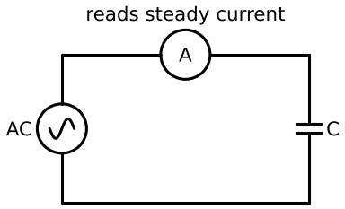  Review Q1  

<b>3.</b> 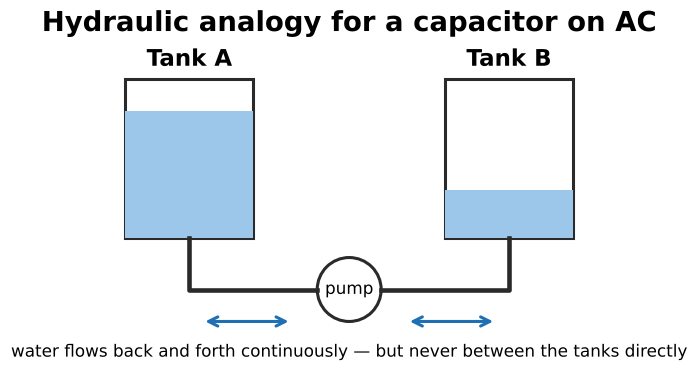 Explain the two-tank analogy.
 A reversing pump moves water back and forth between two tanks: flow never stops, but no water passes directly from tank to tank. Same as electrons charging each plate in turn.  Figure 20–2  

<b>4.</b> Why does current "appear to flow" through a capacitor?
 Because the AC voltage continuously rises, falls and reverses, keeping the capacitor charging and discharging.  Summary  

<b>5.</b> Does a capacitor block AC or DC?
 It blocks steady DC (after charging) and passes AC — more easily at higher frequency.  

<b>6.</b> What is the impressed voltage?
 The voltage built up across the plates by the stored charge. It opposes the applied voltage and limits current. 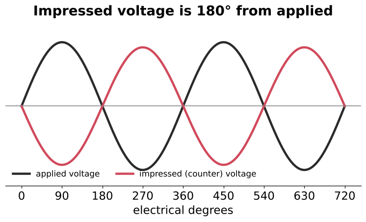  20–2  

<b>7.</b>  Phase relationship of impressed and applied voltage?
 180° apart.  

<b>8.</b> What is capacitive reactance?
 The current-limiting effect of a capacitor (its countervoltage), symbol Xc, measured in ohms.  

<b>9.</b> Formula for Xc?
 Xc = 1 / (2πfC)  (f in Hz, C in farads)  At 60 Hz: Xc = 1/(377C)  

<b>10.</b> Rearranged Xc formulas?
 C = 1 / (2πf·Xc) and f = 1 / (2πC·Xc)  

<b>11.</b> Two factors that determine capacitive reactance?
 Capacitance and frequency — Xc is INVERSELY proportional to both. 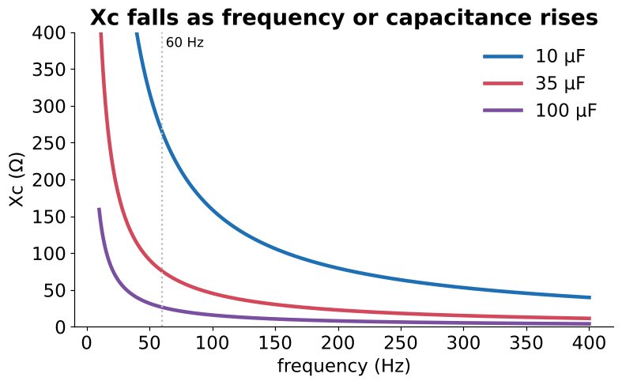  Review Q2  

<b>12.</b> 35 µF on 120 V, 60 Hz: Xc and current?
 Xc = 1/(377 × 0.000035) = <b>75.79 Ω</b>; I = 120/75.79 = <b>1.58 A</b>.  Example 20–1  

<b>13.</b> 480 V, 60 Hz, 2.6 A: capacitance?
 Xc = 480/2.6 = 184.6 Ω; C = 1/(377 × 184.6) = <b>14.37 µF</b>.  Example 20–2  

<b>14.</b> Most common Xc calculation error?
 Leaving C in µF instead of converting to farads (35 µF = 0.000035 F). Also forgetting the reciprocal (1/x).  

<b>15.</b> Xc of a capacitor at DC?
 Infinite — it blocks steady DC (opposite of an inductor, whose Xl = 0 at DC).  

<b>16.</b> Frequency doubles. What happens to Xc and current?
 Xc halves; current doubles.   20–8  

<b>17.</b> 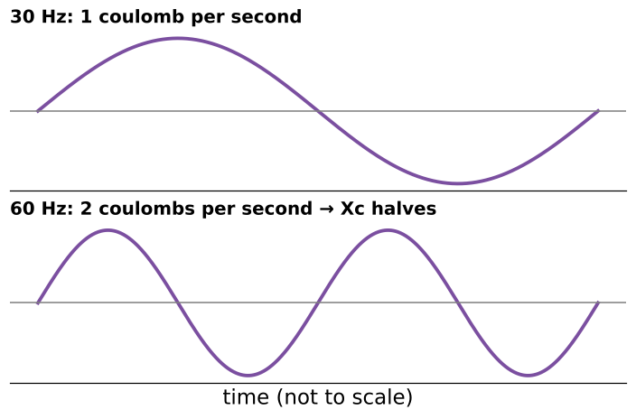 Why does Xc drop as frequency rises?
 Current is charge per second (I = Q/t). At higher frequency the same charge moves in less time, so more current flows for the same voltage.  30 Hz → 1 C/s; 60 Hz → 2 C/s  

<b>18.</b> 300 Ω at 60 Hz. Xc at 100 Hz?
 300 × 60/100 = <b>180 Ω</b>  Practice 6  

<b>19.</b> Book table error check: 470 nF at 400 Hz?
 <b>846.6 Ω</b> (the book's Table 20–1 says kΩ). Also 470 nF @ 1 kHz = 338.6 Ω and 750 nF @ 400 Hz = 530.5 Ω.  

<b>20.</b> Phase of current vs voltage in a pure capacitive circuit?
 Current LEADS the applied voltage by 90°. 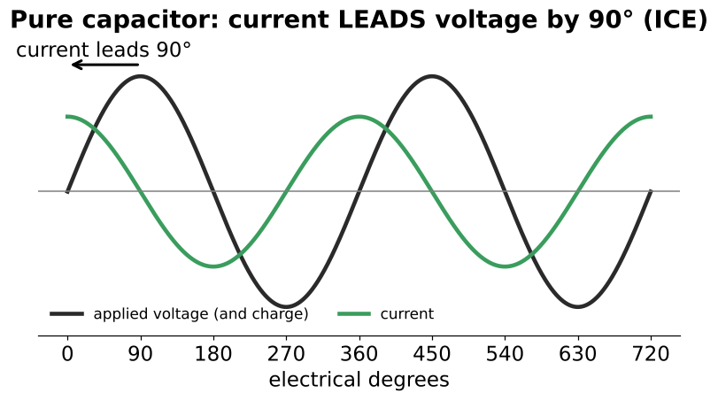  Review Q3/Q4  

<b>21.</b> What does "ELI the ICE man" say about capacitors?
 ICE: in a capacitor (C), current (I) comes before voltage (E). 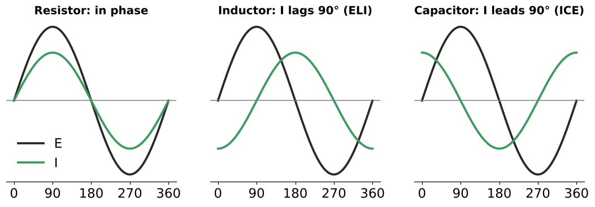  

<b>22.</b>  Why is capacitor current maximum when voltage is zero?
 Current depends on how fast the charge changes. At 0° the voltage (and charge) is changing fastest; at 90° it's at peak and momentarily not changing, so current = 0.  Q = C × V  

<b>23.</b>  Compare phase in R, L and C circuits.
 R: in phase. L: current lags 90°. C: current leads 90°.  

<b>24.</b> Charge on a capacitor vs applied voltage?
 In phase: Q = C × V, so charge is zero when voltage is zero and peaks when voltage peaks.  

<b>25.</b> True power in a pure capacitive circuit?
 Zero watts — energy stored while charging is returned while discharging. 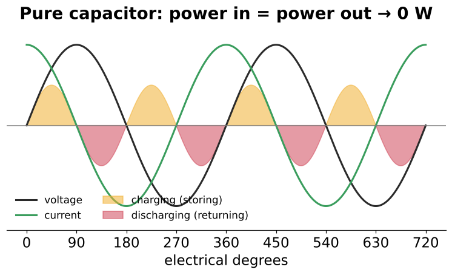  20–5  

<b>26.</b>  What do the gold and red areas represent?
 Gold: V and I same sign — charging, storing energy in the electrostatic field. Red: opposite signs — discharging, returning energy.  

<b>27.</b> Why does P = E × I × cos θ give zero for a pure capacitor?
 θ = 90° and cos 90° = 0.  

<b>28.</b> What unit is capacitor power measured in?
 VARs (volt-amperes-reactive), written VARsC.  

<b>29.</b> Formulas for VARsC?
 VARsC = Ec × Ic = Ic² × Xc = Ec² / Xc  

<b>30.</b> How are capacitive and inductive VARs related?
 180° out of phase — they cancel each other. 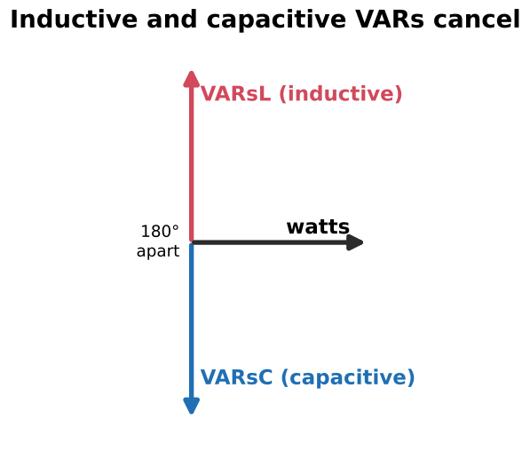  Basis of power-factor correction  

<b>31.</b>  Why do plants install capacitor banks rated in kVAR?
 Their leading (capacitive) VARs cancel the motors' lagging (inductive) VARs, so the utility supplies less current and PF improves.  

<b>32.</b> Q of a capacitor: formula?
 Q = R / Xc, where R is the dielectric's (leakage) resistance. 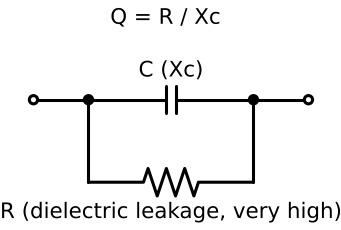  Flipped from an inductor's Q = Xl/R  

<b>33.</b> Other Q formulas for a capacitor?
 Q = VARsC / P, and approximately Q ≈ 1/PF (accurate when Q is high).  

<b>34.</b> Is a capacitor's Q usually high or low? What lowers it?
 Very high. A leaky dielectric (lower R) lowers Q.  

<b>35.</b> What is a capacitor's voltage rating really the rating of?
 The dielectric.  20–7  

<b>36.</b> A nonpolarized capacitor is marked in VAC. What value is that?
 RMS — compare directly with the circuit's RMS voltage.  

<b>37.</b> Marked VDC, WVDC or PEAK. How do you use it on AC?
 It's a PEAK value: compare it with the circuit's RMS × 1.414. 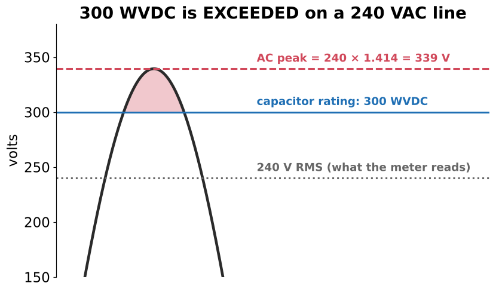  

<b>38.</b> How are electrolytic (polarized) capacitors rated?
 Always in DC volts.  

<b>39.</b>  300 WVDC capacitor on a 240 V line. OK?
 No: 240 × 1.414 = 339 V peak, which exceeds 300 V.  Example 20–3  

<b>40.</b> 600 VDC capacitor on 480 VAC. OK?
 No: 480 × 1.414 ≈ 679 V peak > 600 V.  Review Q7 / Practical App 1  

<b>41.</b> A 350 VAC capacitor is equivalent to what DC rating?
 About 350 × 1.414 ≈ 495 V peak (DC).  Review Q10  

<b>42.</b> Life gain at half the rated voltage?
 About 8×.  Review Q8  

<b>43.</b> Is there a standard for how capacitor voltage ratings are marked?
 No — you'll see VOLTS AC, VOLTS DC, PEAK VOLTS and WVDC. Read the label carefully.  

<b>44.</b> In series, how do capacitive REACTANCES combine?
 They add: Xct = Xc1 + Xc2 + Xc3 (same angle). 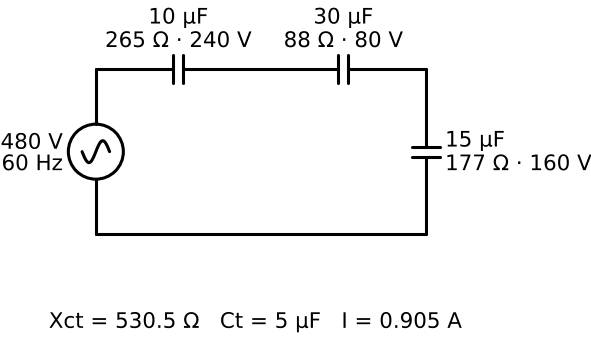  Capacitance uses reciprocals  

<b>45.</b> In parallel, how do capacitive REACTANCES combine?
 Reciprocal formula: 1/Xct = 1/Xc1 + 1/Xc2 + 1/Xc3. 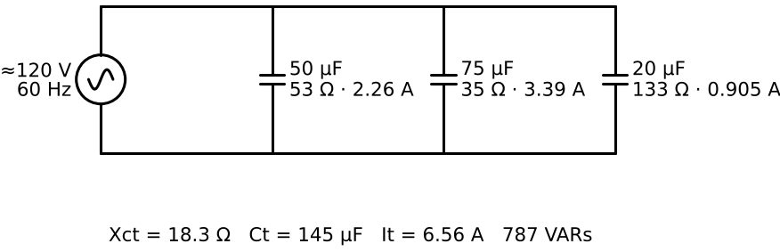  Capacitance adds  

<b>46.</b>  10, 30, 15 µF in series on 480 V, 60 Hz. Xct, Ct and I?
 Xct = 265 + 88 + 177 = <b>530.5 Ω</b>; Ct = <b>5 µF</b>; I = <b>0.905 A</b>.  Example 20–4  

<b>47.</b> In that series circuit, which capacitor has the largest voltage drop?
 The smallest one (10 µF): 240 V. Drops are 240, 80, 160 V.  Check each cap's rating  

<b>48.</b> Do the series capacitor voltage drops add straight?
 Yes — all capacitor drops are in phase with each other (240 + 80 + 160 = 480 V).  Unlike R + L drops  

<b>49.</b>  50, 75, 20 µF in parallel, 787 VARs at 60 Hz. Find E.
 Xct = 18.29 Ω; E = √(VARs × Xct) = √(787 × 18.29) ≈ <b>120 V</b>.  Example 20–5  

<b>50.</b> Formula for E from VARs and reactance?
 E = √(VARs × X)  

<b>51.</b> Do VARs from several capacitors add?
 Yes — same-type VARs add straight in series or parallel.  

<b>52.</b> Capacitor drawn onto a higher voltage than rated: two effects?
 VARs rise with V² (480 → 600 V ≈ +56% kVAR) and the dielectric is overstressed.  

<b>53.</b> Why can PF capacitors overheat on VFD/electronic systems?
 Their Xc drops at harmonic frequencies, so they draw extra harmonic current and can resonate with system inductance.  Detuned PF banks  

<b>54.</b> Field formula to check a run capacitor at 60 Hz?
 C (µF) ≈ 2652 × I ÷ E (current through it, voltage across it).  

<b>55.</b> Add a series capacitor to reduce current from 24 A to 16 A on 480 V. Method?
 Existing Xc = 480/24; needed total = 480/16; series Xc's add, so the new cap supplies the difference in Xc. Convert that Xc to µF.  Practice 7  

<b>56.</b> Four equal capacitors in series must total 20 µF. Value of each?
 C/N = 20 µF → each = 80 µF; each sees ¼ of the line voltage.  Review Q11–12  

