#+TITLE: ELECT 212 — Unit 20: Capacitance in AC Circuits
#+FILETAGS: :drill:
#+STARTUP: overview

# Generated by tools/flashcards/build_decks.py. Study with M-x org-drill.

* Why are capacitors called the opposite of inductors?
   :PROPERTIES:
   :ID: u20-001
   :END:
** Answer
Almost every behaviour is reversed: Xc falls with frequency (Xl rises), current leads (Xl lags), Xc → ∞ at DC (Xl → 0). Intro

* Can current flow THROUGH a capacitor?
   :PROPERTIES:
   :ID: u20-002
   :END:
** Answer
No electrons cross the dielectric. But on AC, current flows continuously in the circuit as the capacitor charges, discharges and recharges — it "appears" to flow through. Review Q1
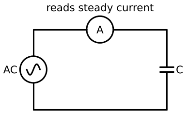

* Explain the two-tank analogy.
   :PROPERTIES:
   :ID: u20-003
   :END:
** Answer
A reversing pump moves water back and forth between two tanks: flow never stops, but no water passes directly from tank to tank. Same as electrons charging each plate in turn. Figure 20–2

* Why does current "appear to flow" through a capacitor?
   :PROPERTIES:
   :ID: u20-004
   :END:
** Answer
Because the AC voltage continuously rises, falls and reverses, keeping the capacitor charging and discharging. Summary

* Does a capacitor block AC or DC?
   :PROPERTIES:
   :ID: u20-005
   :END:
** Answer
It blocks steady DC (after charging) and passes AC — more easily at higher frequency.

* What is the impressed voltage?
   :PROPERTIES:
   :ID: u20-006
   :END:
** Answer
The voltage built up across the plates by the stored charge. It opposes the applied voltage and limits current. 20–2
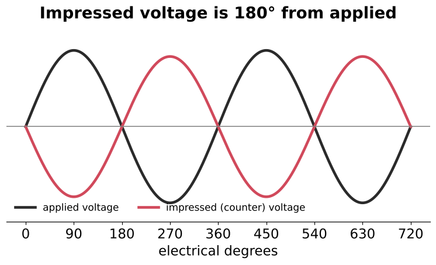

* Phase relationship of impressed and applied voltage?
   :PROPERTIES:
   :ID: u20-007
   :END:
** Answer
180° apart.

* What is capacitive reactance?
   :PROPERTIES:
   :ID: u20-008
   :END:
** Answer
The current-limiting effect of a capacitor (its countervoltage), symbol Xc, measured in ohms.

* Formula for Xc?
   :PROPERTIES:
   :ID: u20-009
   :END:
** Answer
Xc = 1 / (2πfC) (f in Hz, C in farads) At 60 Hz: Xc = 1/(377C)

* Rearranged Xc formulas?
   :PROPERTIES:
   :ID: u20-010
   :END:
** Answer
C = 1 / (2πf·Xc) and f = 1 / (2πC·Xc)

* Two factors that determine capacitive reactance?
   :PROPERTIES:
   :ID: u20-011
   :END:
** Answer
Capacitance and frequency — Xc is INVERSELY proportional to both. Review Q2
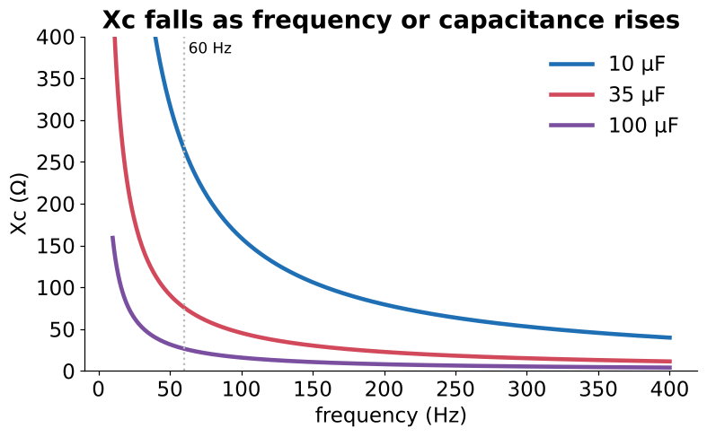

* 35 µF on 120 V, 60 Hz: Xc and current?
   :PROPERTIES:
   :ID: u20-012
   :END:
** Answer
Xc = 1/(377 × 0.000035) = 75.79 Ω; I = 120/75.79 = 1.58 A. Example 20–1

* 480 V, 60 Hz, 2.6 A: capacitance?
   :PROPERTIES:
   :ID: u20-013
   :END:
** Answer
Xc = 480/2.6 = 184.6 Ω; C = 1/(377 × 184.6) = 14.37 µF. Example 20–2

* Most common Xc calculation error?
   :PROPERTIES:
   :ID: u20-014
   :END:
** Answer
Leaving C in µF instead of converting to farads (35 µF = 0.000035 F). Also forgetting the reciprocal (1/x).

* Xc of a capacitor at DC?
   :PROPERTIES:
   :ID: u20-015
   :END:
** Answer
Infinite — it blocks steady DC (opposite of an inductor, whose Xl = 0 at DC).

* Frequency doubles. What happens to Xc and current?
   :PROPERTIES:
   :ID: u20-016
   :END:
** Answer
Xc halves; current doubles. 20–8

* Why does Xc drop as frequency rises?
   :PROPERTIES:
   :ID: u20-017
   :END:
** Answer
Current is charge per second (I = Q/t). At higher frequency the same charge moves in less time, so more current flows for the same voltage. 30 Hz → 1 C/s; 60 Hz → 2 C/s

* 300 Ω at 60 Hz. Xc at 100 Hz?
   :PROPERTIES:
   :ID: u20-018
   :END:
** Answer
300 × 60/100 = 180 Ω Practice 6

* Book table error check: 470 nF at 400 Hz?
   :PROPERTIES:
   :ID: u20-019
   :END:
** Answer
846.6 Ω (the book's Table 20–1 says kΩ). Also 470 nF @ 1 kHz = 338.6 Ω and 750 nF @ 400 Hz = 530.5 Ω.

* Phase of current vs voltage in a pure capacitive circuit?
   :PROPERTIES:
   :ID: u20-020
   :END:
** Answer
Current LEADS the applied voltage by 90°. Review Q3/Q4
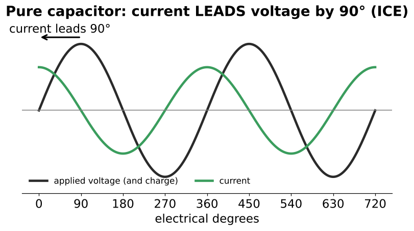

* What does "ELI the ICE man" say about capacitors?
   :PROPERTIES:
   :ID: u20-021
   :END:
** Answer
ICE: in a capacitor (C), current (I) comes before voltage (E).
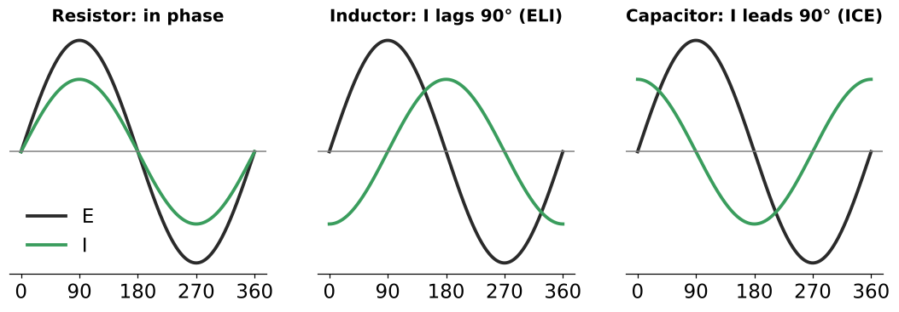

* Why is capacitor current maximum when voltage is zero?
   :PROPERTIES:
   :ID: u20-022
   :END:
** Answer
Current depends on how fast the charge changes. At 0° the voltage (and charge) is changing fastest; at 90° it's at peak and momentarily not changing, so current = 0. Q = C × V

* Compare phase in R, L and C circuits.
   :PROPERTIES:
   :ID: u20-023
   :END:
** Answer
R: in phase. L: current lags 90°. C: current leads 90°.

* Charge on a capacitor vs applied voltage?
   :PROPERTIES:
   :ID: u20-024
   :END:
** Answer
In phase: Q = C × V, so charge is zero when voltage is zero and peaks when voltage peaks.

* True power in a pure capacitive circuit?
   :PROPERTIES:
   :ID: u20-025
   :END:
** Answer
Zero watts — energy stored while charging is returned while discharging. 20–5
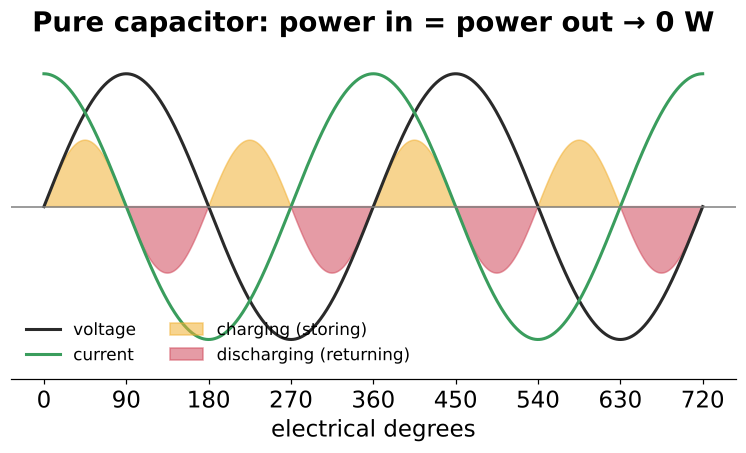

* What do the gold and red areas represent?
   :PROPERTIES:
   :ID: u20-026
   :END:
** Answer
Gold: V and I same sign — charging, storing energy in the electrostatic field. Red: opposite signs — discharging, returning energy.

* Why does P = E × I × cos θ give zero for a pure capacitor?
   :PROPERTIES:
   :ID: u20-027
   :END:
** Answer
θ = 90° and cos 90° = 0.

* What unit is capacitor power measured in?
   :PROPERTIES:
   :ID: u20-028
   :END:
** Answer
VARs (volt-amperes-reactive), written VARsC.

* Formulas for VARsC?
   :PROPERTIES:
   :ID: u20-029
   :END:
** Answer
VARsC = Ec × Ic = Ic² × Xc = Ec² / Xc

* How are capacitive and inductive VARs related?
   :PROPERTIES:
   :ID: u20-030
   :END:
** Answer
180° out of phase — they cancel each other. Basis of power-factor correction
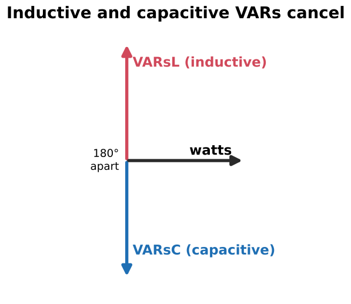

* Why do plants install capacitor banks rated in kVAR?
   :PROPERTIES:
   :ID: u20-031
   :END:
** Answer
Their leading (capacitive) VARs cancel the motors' lagging (inductive) VARs, so the utility supplies less current and PF improves.

* Q of a capacitor: formula?
   :PROPERTIES:
   :ID: u20-032
   :END:
** Answer
Q = R / Xc, where R is the dielectric's (leakage) resistance. Flipped from an inductor's Q = Xl/R
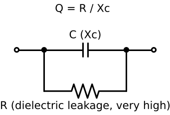

* Other Q formulas for a capacitor?
   :PROPERTIES:
   :ID: u20-033
   :END:
** Answer
Q = VARsC / P, and approximately Q ≈ 1/PF (accurate when Q is high).

* Is a capacitor's Q usually high or low? What lowers it?
   :PROPERTIES:
   :ID: u20-034
   :END:
** Answer
Very high. A leaky dielectric (lower R) lowers Q.

* What is a capacitor's voltage rating really the rating of?
   :PROPERTIES:
   :ID: u20-035
   :END:
** Answer
The dielectric. 20–7

* A nonpolarized capacitor is marked in VAC. What value is that?
   :PROPERTIES:
   :ID: u20-036
   :END:
** Answer
RMS — compare directly with the circuit's RMS voltage.

* Marked VDC, WVDC or PEAK. How do you use it on AC?
   :PROPERTIES:
   :ID: u20-037
   :END:
** Answer
It's a PEAK value: compare it with the circuit's RMS × 1.414.
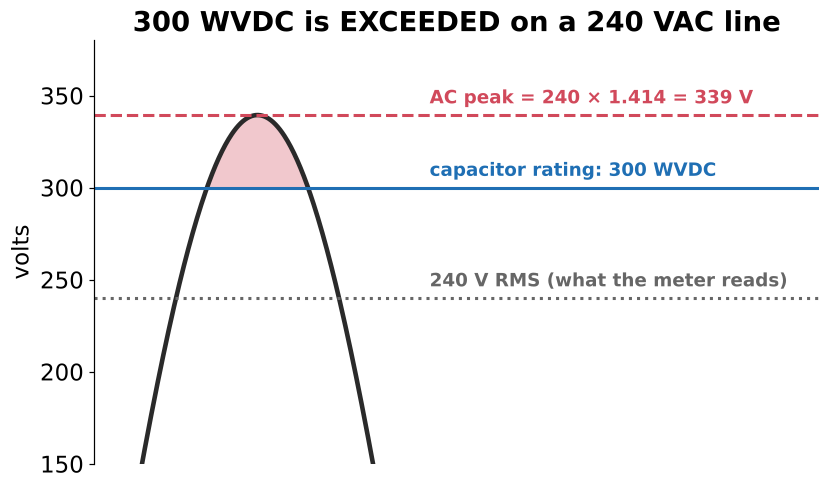

* How are electrolytic (polarized) capacitors rated?
   :PROPERTIES:
   :ID: u20-038
   :END:
** Answer
Always in DC volts.

* 300 WVDC capacitor on a 240 V line. OK?
   :PROPERTIES:
   :ID: u20-039
   :END:
** Answer
No: 240 × 1.414 = 339 V peak, which exceeds 300 V. Example 20–3

* 600 VDC capacitor on 480 VAC. OK?
   :PROPERTIES:
   :ID: u20-040
   :END:
** Answer
No: 480 × 1.414 ≈ 679 V peak > 600 V. Review Q7 / Practical App 1

* A 350 VAC capacitor is equivalent to what DC rating?
   :PROPERTIES:
   :ID: u20-041
   :END:
** Answer
About 350 × 1.414 ≈ 495 V peak (DC). Review Q10

* Life gain at half the rated voltage?
   :PROPERTIES:
   :ID: u20-042
   :END:
** Answer
About 8×. Review Q8

* Is there a standard for how capacitor voltage ratings are marked?
   :PROPERTIES:
   :ID: u20-043
   :END:
** Answer
No — you'll see VOLTS AC, VOLTS DC, PEAK VOLTS and WVDC. Read the label carefully.

* In series, how do capacitive REACTANCES combine?
   :PROPERTIES:
   :ID: u20-044
   :END:
** Answer
They add: Xct = Xc1 + Xc2 + Xc3 (same angle). Capacitance uses reciprocals
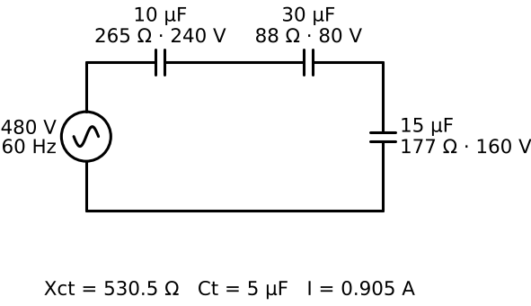

* In parallel, how do capacitive REACTANCES combine?
   :PROPERTIES:
   :ID: u20-045
   :END:
** Answer
Reciprocal formula: 1/Xct = 1/Xc1 + 1/Xc2 + 1/Xc3. Capacitance adds
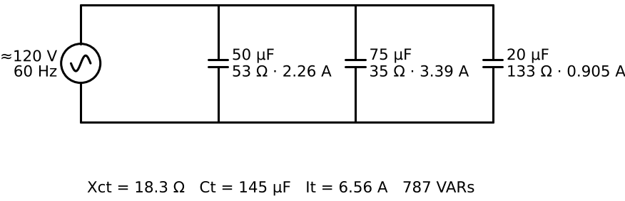

* 10, 30, 15 µF in series on 480 V, 60 Hz. Xct, Ct and I?
   :PROPERTIES:
   :ID: u20-046
   :END:
** Answer
Xct = 265 + 88 + 177 = 530.5 Ω; Ct = 5 µF; I = 0.905 A. Example 20–4

* In that series circuit, which capacitor has the largest voltage drop?
   :PROPERTIES:
   :ID: u20-047
   :END:
** Answer
The smallest one (10 µF): 240 V. Drops are 240, 80, 160 V. Check each cap's rating

* Do the series capacitor voltage drops add straight?
   :PROPERTIES:
   :ID: u20-048
   :END:
** Answer
Yes — all capacitor drops are in phase with each other (240 + 80 + 160 = 480 V). Unlike R + L drops

* 50, 75, 20 µF in parallel, 787 VARs at 60 Hz. Find E.
   :PROPERTIES:
   :ID: u20-049
   :END:
** Answer
Xct = 18.29 Ω; E = √(VARs × Xct) = √(787 × 18.29) ≈ 120 V. Example 20–5

* Formula for E from VARs and reactance?
   :PROPERTIES:
   :ID: u20-050
   :END:
** Answer
E = √(VARs × X)

* Do VARs from several capacitors add?
   :PROPERTIES:
   :ID: u20-051
   :END:
** Answer
Yes — same-type VARs add straight in series or parallel.

* Capacitor drawn onto a higher voltage than rated: two effects?
   :PROPERTIES:
   :ID: u20-052
   :END:
** Answer
VARs rise with V² (480 → 600 V ≈ +56% kVAR) and the dielectric is overstressed.

* Why can PF capacitors overheat on VFD/electronic systems?
   :PROPERTIES:
   :ID: u20-053
   :END:
** Answer
Their Xc drops at harmonic frequencies, so they draw extra harmonic current and can resonate with system inductance. Detuned PF banks

* Field formula to check a run capacitor at 60 Hz?
   :PROPERTIES:
   :ID: u20-054
   :END:
** Answer
C (µF) ≈ 2652 × I ÷ E (current through it, voltage across it).

* Add a series capacitor to reduce current from 24 A to 16 A on 480 V. Method?
   :PROPERTIES:
   :ID: u20-055
   :END:
** Answer
Existing Xc = 480/24; needed total = 480/16; series Xc's add, so the new cap supplies the difference in Xc. Convert that Xc to µF. Practice 7

* Four equal capacitors in series must total 20 µF. Value of each?
   :PROPERTIES:
   :ID: u20-056
   :END:
** Answer
C/N = 20 µF → each = 80 µF; each sees ¼ of the line voltage. Review Q11–12

