# Flashcards — Unit 21: Resistive-Capacitive Series Circuits

42 cards. Read the question, answer it in your head, then click it to check.

Study guide for this unit: [study-guide.md](../study-guide.md). The raw card data is in [`unit21_flashcards.json`](unit21_flashcards.json) if you want to import the cards into a flashcard app.

---

<b>1.</b> How is solving an R-C series circuit different from R-L series?
 Same procedure. Swap Xl→Xc, VARsL→VARsC, and the current LEADS instead of lags.  Intro  

<b>2.</b> In a pure capacitive circuit, does current lead or lag?
 Leads the voltage by 90°.  Review Q1  

<b>3.</b> In an R-C series circuit, by how much are V and I out of phase?
 Between 0° and 90°, with current LEADING. 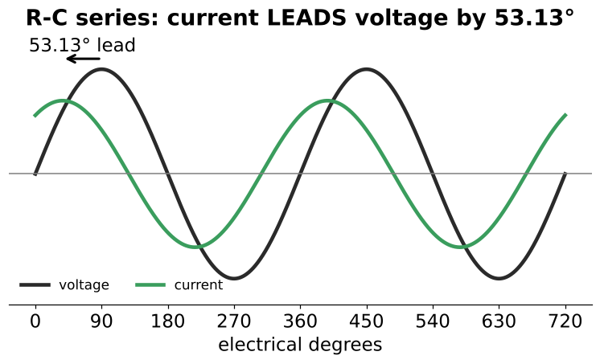  

<b>4.</b> What sets the phase angle in R-C series?
 The ratio of R to Xc (tan θ = Xc/R) — the book says "capacitance", but it's capacitive reactance.  

<b>5.</b> In series R-C, does a bigger capacitor make the circuit more or less resistive?
 MORE resistive — a bigger C has less Xc, so the angle shrinks.  Counter-intuitive  

<b>6.</b> What is the same everywhere in a series R-C circuit?
 The current: Iₜ = Iᵣ = Ic. 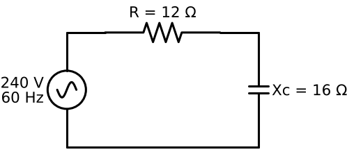  

<b>7.</b> Phase of Eᵣ and Ec relative to the current?
 Eᵣ in phase with I; Ec lags I by 90° (i.e., I leads Ec). 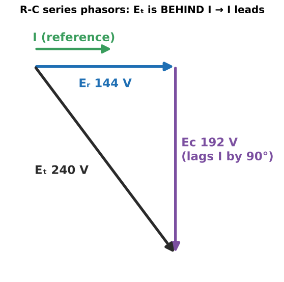  So Eᵣ and Ec are 90° apart  

<b>8.</b> Which three groups organize R-C circuit quantities?
 Resistive (R, Eᵣ, Iᵣ, P), capacitive (Xc, Ec, Ic, VARsc, C), total (Z, Eₜ, Iₜ, VA, PF, θ). 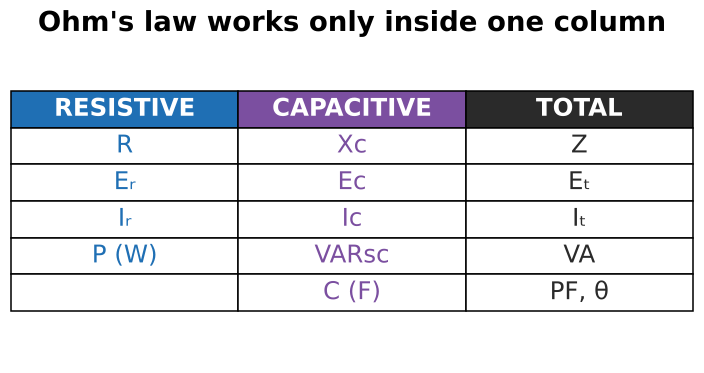  

<b>9.</b>  Golden rule for Ohm's law in R-C circuits?
 Only inside one group; cross groups with the right triangle.  

<b>10.</b> Impedance formula for series R-C?
 Z = √(R² + Xc²) 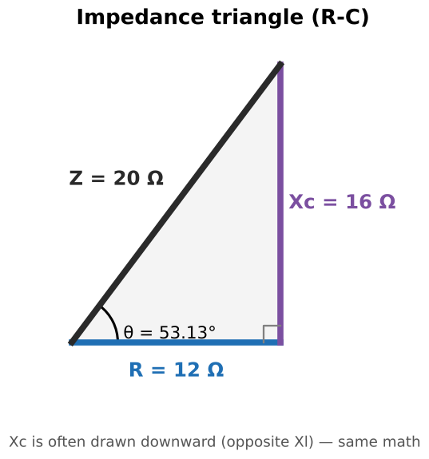  R = √(Z² − Xc²), Xc = √(Z² − R²)  

<b>11.</b>  R = 12 Ω, Xc = 16 Ω. Z and I on 240 V?
 Z = √(144 + 256) = <b>20 Ω</b>; I = 240/20 = <b>12 A</b>.  Main example  

<b>12.</b> Why isn't Z = 12 + 16 = 28 Ω?
 R and Xc are 90° apart, so they add as vectors.  

<b>13.</b> Z = 84 Ω, R = 32 Ω. Xc?
 √(84² − 32²) ≈ <b>77.7 Ω</b>  Review Q4  

<b>14.</b> 20 Ω resistor + 110.5 µF at 60 Hz. First step?
 Convert C to Xc: 1/(377 × 0.0001105) ≈ 24 Ω. Then Z = √(20² + 24²) ≈ 31.2 Ω.  Review Q2  

<b>15.</b> Xc = 50 Ω at 60 Hz. At 1000 Hz?
 50 × 60/1000 = <b>3 Ω</b>  Review Q5  

<b>16.</b> Voltage drop formulas in series R-C?
 Eᵣ = I × R; Ec = I × Xc  Example: 144 V and 192 V  

<b>17.</b> Capacitance from Xc in the main example?
 C = 1/(377 × 16) = <b>165.8 µF</b>  21–6  

<b>18.</b> Total voltage from the drops?
 Eₜ = √(Eᵣ² + Ec²) 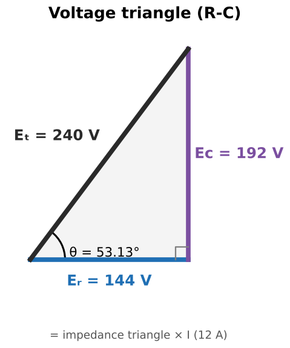  Ec = √(Eₜ² − Eᵣ²)  

<b>19.</b> 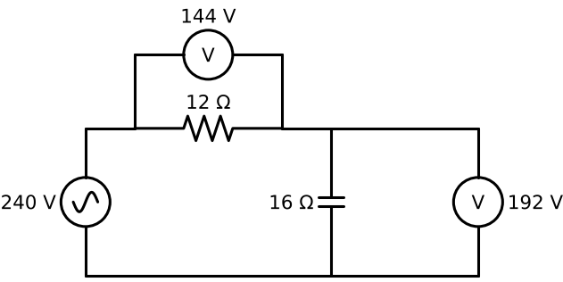 Meters read 144 V on R and 192 V on C on a 240 V supply. Problem?
 No — the drops are 90° apart: √(144² + 192²) = 240 V.  

<b>20.</b> When checking a series capacitor's voltage rating, which voltage do you use?
 The capacitor's own drop Ec (× 1.414 if rated in VDC) — not the supply.  Review Q6  

<b>21.</b> True power formula in R-C series?
 P = Eᵣ × I (resistive values only) = 144 × 12 = <b>1728 W</b>  

<b>22.</b> Reactive power formula?
 VARsc = Ec × I = 192 × 12 = <b>2304 VARs</b>  

<b>23.</b> Apparent power?
 VA = Eₜ × I = 240 × 12 = <b>2880 VA</b>, or √(P² + VARsc²) 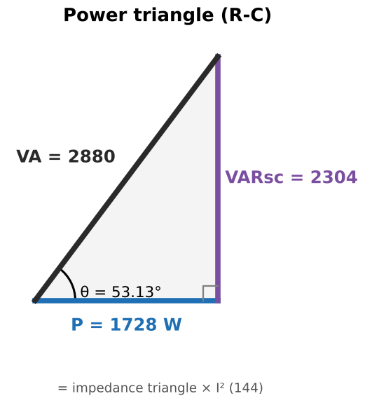  

<b>24.</b> Which part of an R-C circuit produces watts?
 Only the resistor.  Summary  

<b>25.</b> How are the impedance, voltage and power triangles related?
 Similar triangles: voltage = impedance × I; power = impedance × I². Same angle θ.  

<b>26.</b> Power factor formulas for series R-C?
 PF = P/VA = R/Z = Eᵣ/Eₜ  60% in the main example  

<b>27.</b> Main example θ?
 cos⁻¹(0.6) = <b>53.13°</b>, current leading.   

<b>28.</b> Other trig ratios for θ in R-C series?
 tan θ = Xc/R = VARsc/P; sin θ = Xc/Z = Ec/Eₜ  

<b>29.</b> 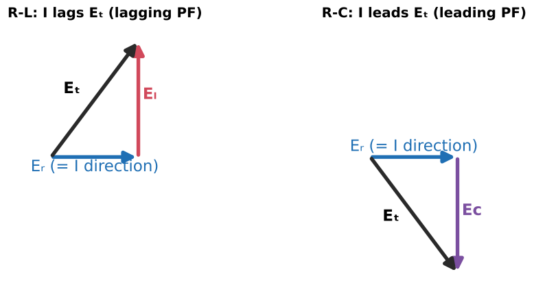 Same numbers, R-L vs R-C: what's different about PF?
 The number is the same; the direction differs — R-L is LAGGING, R-C is LEADING.  

<b>30.</b> PF = 76%. Phase angle?
 cos⁻¹(0.76) ≈ <b>40.5°</b>  Review Q3  

<b>31.</b> Eₜ = 460 V and θ = 44°. Ec?
 Ec = Eₜ × sin θ ≈ 460 × 0.695 ≈ <b>320 V</b>  Practice 8  

<b>32.</b> Example 21–1: R 5 W, C₁ 3.75 VARs, C₂ 5.625 VARs on 42.5 V. VA and I?
 VARs add: 9.375. VA = √(5² + 9.375²) = <b>10.625</b>; I = 10.625/42.5 = <b>0.25 A</b>. 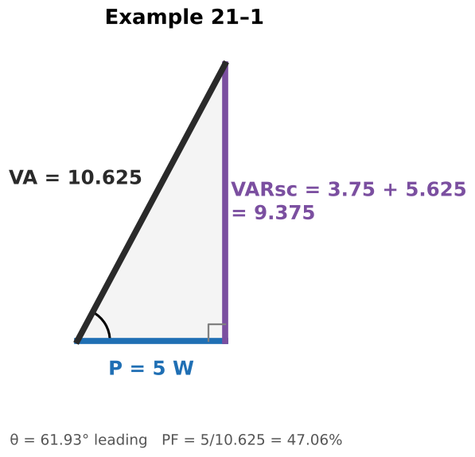  

<b>33.</b> 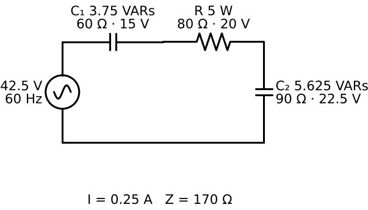 Example 21–1: Xc and C of each capacitor?
 Ec₁ = 15 V → Xc₁ = 60 Ω → 44.2 µF. Ec₂ = 22.5 V → Xc₂ = 90 Ω → 29.5 µF.  

<b>34.</b> Book error: Example 21–1 computes C₁ = 1/(377 × 30 Ω). Fix?
 Should be 60 Ω (the answer 44.2 µF is correct for 60 Ω). Also Figs 21–9/21–10 show 3.73 VARs; it's 3.75.  

<b>35.</b> A 2 W, 120 V lamp must run on 480 V with a series capacitor. Voltage across the cap?
 √(480² − 120²) = <b>464.8 V</b> (not 360 V). 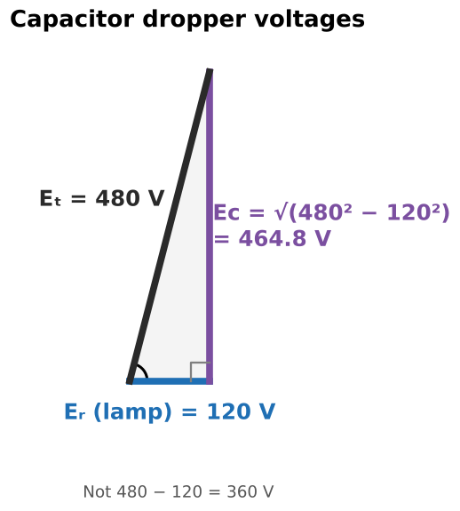  Example 21–2  

<b>36.</b> 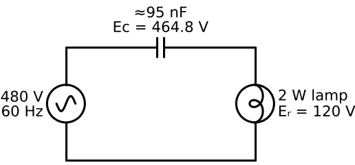 Capacitor value for that lamp dropper?
 I = 2/120 = 0.01667 A → Xc ≈ 27.9 kΩ → C ≈ <b>95 nF</b>.  

<b>37.</b> Why use a capacitor instead of a resistor to drop voltage?
 The capacitor drops voltage with essentially no watts (reactive power); a resistor would waste ~6 W as heat.  

<b>38.</b> Exception to the lamp-dropper calculation?
 It assumes the lamp is a constant resistance; a cold filament or an LED doesn't behave that way.  

<b>39.</b> Why can too much leading PF be a problem?
 Over-correction raises voltage and can upset generators/regulators. Aim for ~0.95–1.0, not as capacitive as possible.  

<b>40.</b> Where do you meet series R-C circuits on the job?
 RC snubbers across contacts/triacs, phase-shift networks, capacitive droppers in pilot lights and small supplies.  

<b>41.</b> RC circuit: 120 V, resistor 25 Ω dropping 65 V. Steps to find C?
 I = 65/25; Ec = √(120² − 65²); Xc = Ec/I; C = 1/(377·Xc).  Review Q7  

<b>42.</b> 240 V, 20 A, 3 kW in a series RC circuit. PF and the route to C?
 PF = 3000/4800 = <b>62.5%</b>. R = P/I², Z = E/I, Xc = √(Z² − R²), C = 1/(377·Xc).  Review Q8  

