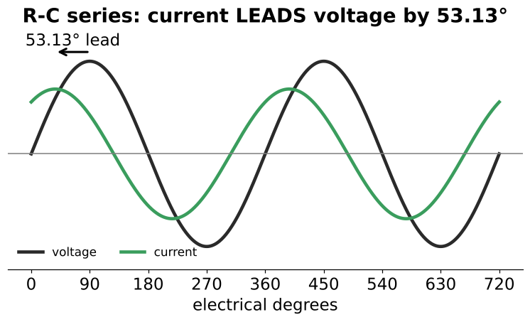
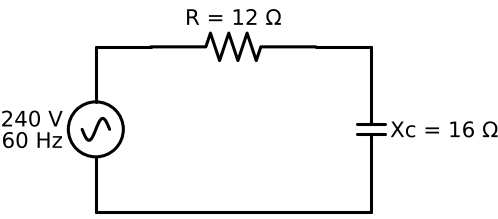
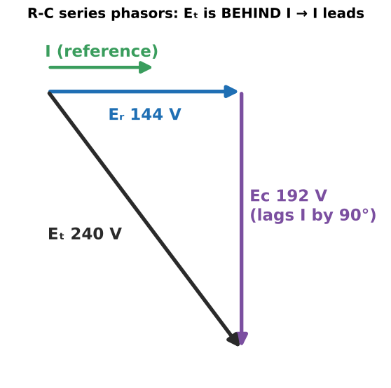
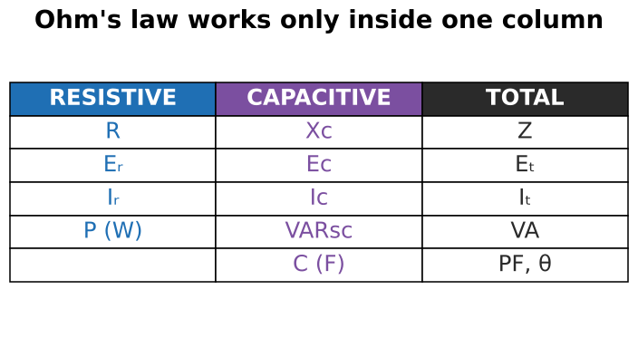
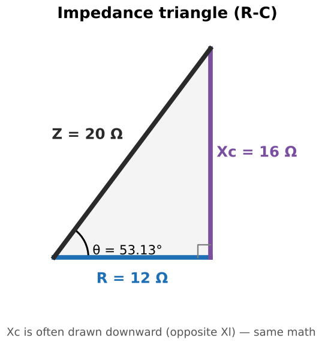
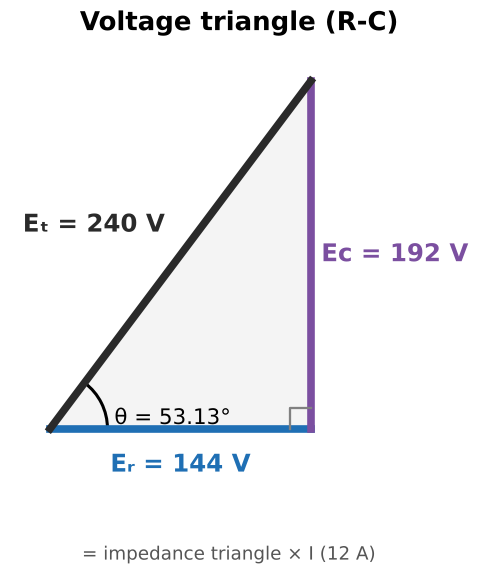
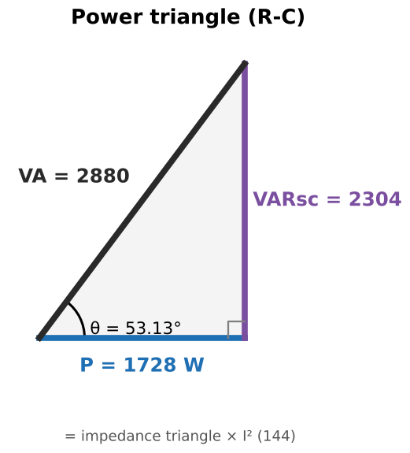
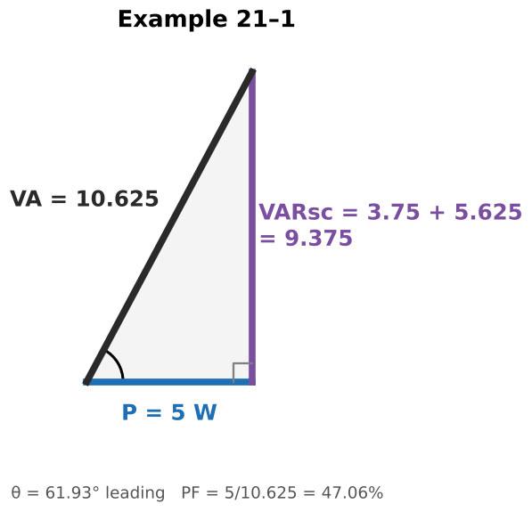
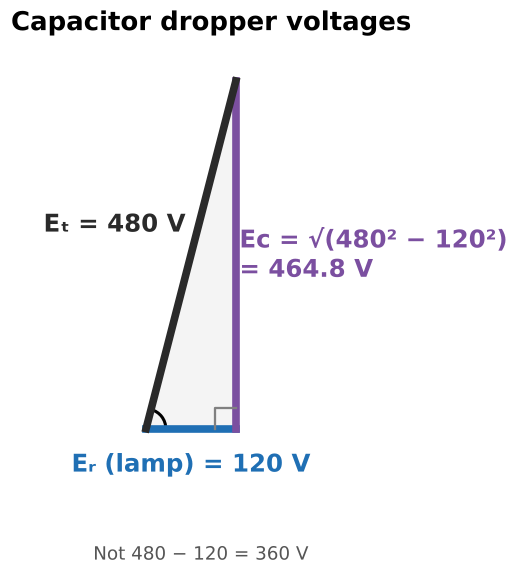

#+TITLE: ELECT 212 — Unit 21: Resistive-Capacitive (RC) Series Circuits
#+FILETAGS: :drill:
#+STARTUP: overview

# Generated by tools/flashcards/build_decks.py. Study with M-x org-drill.

* How is solving an R-C series circuit different from R-L series?
   :PROPERTIES:
   :ID: u21-001
   :END:
** Answer
Same procedure. Swap Xl→Xc, VARsL→VARsC, and the current LEADS instead of lags. Intro

* In a pure capacitive circuit, does current lead or lag?
   :PROPERTIES:
   :ID: u21-002
   :END:
** Answer
Leads the voltage by 90°. Review Q1

* In an R-C series circuit, by how much are V and I out of phase?
   :PROPERTIES:
   :ID: u21-003
   :END:
** Answer
Between 0° and 90°, with current LEADING.

* What sets the phase angle in R-C series?
   :PROPERTIES:
   :ID: u21-004
   :END:
** Answer
The ratio of R to Xc (tan θ = Xc/R) — the book says "capacitance", but it's capacitive reactance.

* In series R-C, does a bigger capacitor make the circuit more or less resistive?
   :PROPERTIES:
   :ID: u21-005
   :END:
** Answer
MORE resistive — a bigger C has less Xc, so the angle shrinks. Counter-intuitive

* What is the same everywhere in a series R-C circuit?
   :PROPERTIES:
   :ID: u21-006
   :END:
** Answer
The current: Iₜ = Iᵣ = Ic.

* Phase of Eᵣ and Ec relative to the current?
   :PROPERTIES:
   :ID: u21-007
   :END:
** Answer
Eᵣ in phase with I; Ec lags I by 90° (i.e., I leads Ec). So Eᵣ and Ec are 90° apart

* Which three groups organize R-C circuit quantities?
   :PROPERTIES:
   :ID: u21-008
   :END:
** Answer
Resistive (R, Eᵣ, Iᵣ, P), capacitive (Xc, Ec, Ic, VARsc, C), total (Z, Eₜ, Iₜ, VA, PF, θ).

* Golden rule for Ohm's law in R-C circuits?
   :PROPERTIES:
   :ID: u21-009
   :END:
** Answer
Only inside one group; cross groups with the right triangle.

* Impedance formula for series R-C?
   :PROPERTIES:
   :ID: u21-010
   :END:
** Answer
Z = √(R² + Xc²) R = √(Z² − Xc²), Xc = √(Z² − R²)

* R = 12 Ω, Xc = 16 Ω. Z and I on 240 V?
   :PROPERTIES:
   :ID: u21-011
   :END:
** Answer
Z = √(144 + 256) = 20 Ω; I = 240/20 = 12 A. Main example

* Why isn't Z = 12 + 16 = 28 Ω?
   :PROPERTIES:
   :ID: u21-012
   :END:
** Answer
R and Xc are 90° apart, so they add as vectors.

* Z = 84 Ω, R = 32 Ω. Xc?
   :PROPERTIES:
   :ID: u21-013
   :END:
** Answer
√(84² − 32²) ≈ 77.7 Ω Review Q4

* 20 Ω resistor + 110.5 µF at 60 Hz. First step?
   :PROPERTIES:
   :ID: u21-014
   :END:
** Answer
Convert C to Xc: 1/(377 × 0.0001105) ≈ 24 Ω. Then Z = √(20² + 24²) ≈ 31.2 Ω. Review Q2

* Xc = 50 Ω at 60 Hz. At 1000 Hz?
   :PROPERTIES:
   :ID: u21-015
   :END:
** Answer
50 × 60/1000 = 3 Ω Review Q5

* Voltage drop formulas in series R-C?
   :PROPERTIES:
   :ID: u21-016
   :END:
** Answer
Eᵣ = I × R; Ec = I × Xc Example: 144 V and 192 V

* Capacitance from Xc in the main example?
   :PROPERTIES:
   :ID: u21-017
   :END:
** Answer
C = 1/(377 × 16) = 165.8 µF 21–6

* Total voltage from the drops?
   :PROPERTIES:
   :ID: u21-018
   :END:
** Answer
Eₜ = √(Eᵣ² + Ec²) Ec = √(Eₜ² − Eᵣ²)

* Meters read 144 V on R and 192 V on C on a 240 V supply. Problem?
   :PROPERTIES:
   :ID: u21-019
   :END:
** Answer
No — the drops are 90° apart: √(144² + 192²) = 240 V.

* When checking a series capacitor's voltage rating, which voltage do you use?
   :PROPERTIES:
   :ID: u21-020
   :END:
** Answer
The capacitor's own drop Ec (× 1.414 if rated in VDC) — not the supply. Review Q6

* True power formula in R-C series?
   :PROPERTIES:
   :ID: u21-021
   :END:
** Answer
P = Eᵣ × I (resistive values only) = 144 × 12 = 1728 W

* Reactive power formula?
   :PROPERTIES:
   :ID: u21-022
   :END:
** Answer
VARsc = Ec × I = 192 × 12 = 2304 VARs

* Apparent power?
   :PROPERTIES:
   :ID: u21-023
   :END:
** Answer
VA = Eₜ × I = 240 × 12 = 2880 VA, or √(P² + VARsc²)

* Which part of an R-C circuit produces watts?
   :PROPERTIES:
   :ID: u21-024
   :END:
** Answer
Only the resistor. Summary

* How are the impedance, voltage and power triangles related?
   :PROPERTIES:
   :ID: u21-025
   :END:
** Answer
Similar triangles: voltage = impedance × I; power = impedance × I². Same angle θ.

* Power factor formulas for series R-C?
   :PROPERTIES:
   :ID: u21-026
   :END:
** Answer
PF = P/VA = R/Z = Eᵣ/Eₜ 60% in the main example

* Main example θ?
   :PROPERTIES:
   :ID: u21-027
   :END:
** Answer
cos⁻¹(0.6) = 53.13°, current leading.

* Other trig ratios for θ in R-C series?
   :PROPERTIES:
   :ID: u21-028
   :END:
** Answer
tan θ = Xc/R = VARsc/P; sin θ = Xc/Z = Ec/Eₜ

* Same numbers, R-L vs R-C: what's different about PF?
   :PROPERTIES:
   :ID: u21-029
   :END:
** Answer
The number is the same; the direction differs — R-L is LAGGING, R-C is LEADING.

* PF = 76%. Phase angle?
   :PROPERTIES:
   :ID: u21-030
   :END:
** Answer
cos⁻¹(0.76) ≈ 40.5° Review Q3

* Eₜ = 460 V and θ = 44°. Ec?
   :PROPERTIES:
   :ID: u21-031
   :END:
** Answer
Ec = Eₜ × sin θ ≈ 460 × 0.695 ≈ 320 V Practice 8

* Example 21–1: R 5 W, C₁ 3.75 VARs, C₂ 5.625 VARs on 42.5 V. VA and I?
   :PROPERTIES:
   :ID: u21-032
   :END:
** Answer
VARs add: 9.375. VA = √(5² + 9.375²) = 10.625; I = 10.625/42.5 = 0.25 A.

* Example 21–1: Xc and C of each capacitor?
   :PROPERTIES:
   :ID: u21-033
   :END:
** Answer
Ec₁ = 15 V → Xc₁ = 60 Ω → 44.2 µF. Ec₂ = 22.5 V → Xc₂ = 90 Ω → 29.5 µF.

* Book error: Example 21–1 computes C₁ = 1/(377 × 30 Ω). Fix?
   :PROPERTIES:
   :ID: u21-034
   :END:
** Answer
Should be 60 Ω (the answer 44.2 µF is correct for 60 Ω). Also Figs 21–9/21–10 show 3.73 VARs; it's 3.75.

* A 2 W, 120 V lamp must run on 480 V with a series capacitor. Voltage across the cap?
   :PROPERTIES:
   :ID: u21-035
   :END:
** Answer
√(480² − 120²) = 464.8 V (not 360 V). Example 21–2

* Capacitor value for that lamp dropper?
   :PROPERTIES:
   :ID: u21-036
   :END:
** Answer
I = 2/120 = 0.01667 A → Xc ≈ 27.9 kΩ → C ≈ 95 nF.

* Why use a capacitor instead of a resistor to drop voltage?
   :PROPERTIES:
   :ID: u21-037
   :END:
** Answer
The capacitor drops voltage with essentially no watts (reactive power); a resistor would waste ~6 W as heat.

* Exception to the lamp-dropper calculation?
   :PROPERTIES:
   :ID: u21-038
   :END:
** Answer
It assumes the lamp is a constant resistance; a cold filament or an LED doesn't behave that way.

* Why can too much leading PF be a problem?
   :PROPERTIES:
   :ID: u21-039
   :END:
** Answer
Over-correction raises voltage and can upset generators/regulators. Aim for ~0.95–1.0, not as capacitive as possible.

* Where do you meet series R-C circuits on the job?
   :PROPERTIES:
   :ID: u21-040
   :END:
** Answer
RC snubbers across contacts/triacs, phase-shift networks, capacitive droppers in pilot lights and small supplies.

* RC circuit: 120 V, resistor 25 Ω dropping 65 V. Steps to find C?
   :PROPERTIES:
   :ID: u21-041
   :END:
** Answer
I = 65/25; Ec = √(120² − 65²); Xc = Ec/I; C = 1/(377·Xc). Review Q7

* 240 V, 20 A, 3 kW in a series RC circuit. PF and the route to C?
   :PROPERTIES:
   :ID: u21-042
   :END:
** Answer
PF = 3000/4800 = 62.5%. R = P/I², Z = E/I, Xc = √(Z² − R²), C = 1/(377·Xc). Review Q8

