# Flashcards — Unit 22: Resistive-Capacitive Parallel Circuits

44 cards. Read the question, answer it in your head, then click it to check.

Study guide for this unit: [study-guide.md](../study-guide.md). The raw card data is in [`unit22_flashcards.json`](unit22_flashcards.json) if you want to import the cards into a flashcard app.

---

<b>1.</b> What is the same across every branch of a parallel R-C circuit?
 The voltage (magnitude and phase). 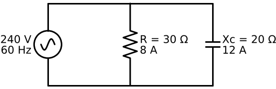  Summary  

<b>2.</b> Phase of the resistive branch current?
 In phase with the voltage. 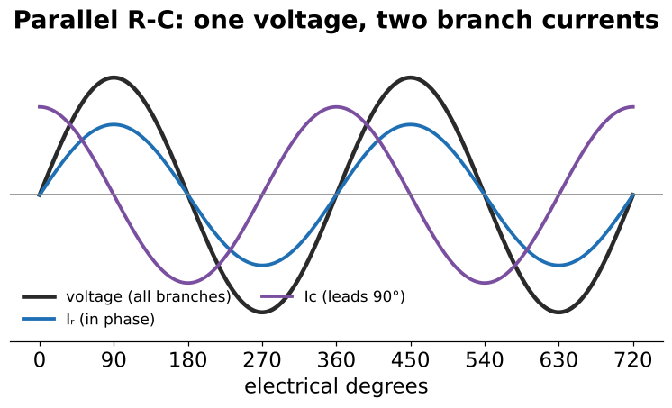  

<b>3.</b> Phase of the capacitive branch current?
 Leads the voltage by 90°.   

<b>4.</b>  How many degrees apart are Iᵣ and Ic in parallel?
 90°  Review Q1  

<b>5.</b> Does total current lead or lag in parallel R-C?
 Leads, by an angle between 0° and 90°. 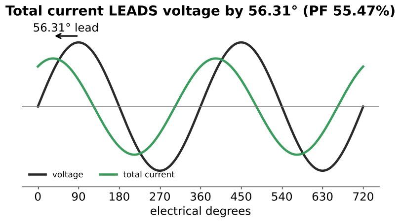  

<b>6.</b> What sets the phase angle in parallel R-C?
 How current splits between branches: tan θ = Ic/Iᵣ = R/Xc.  Book says "resistance to capacitance"  

<b>7.</b> In parallel R-C, does a bigger capacitor make the circuit more or less capacitive?
 MORE capacitive — lower Xc draws more Ic (opposite of series R-C).  Bigger R also makes it more capacitive  

<b>8.</b> In a parallel phasor diagram, what is the reference and which way does Ic point?
 Voltage is the reference (0°). Ic points UP (leading). Iᵣ lies along E. 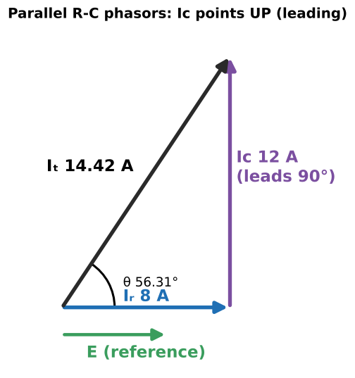  Il pointed down in Unit 18  

<b>9.</b>  30 Ω ∥ Xc 20 Ω on 240 V: branch currents?
 Iᵣ = 240/30 = <b>8 A</b>; Ic = 240/20 = <b>12 A</b>.  Example 22–1  

<b>10.</b> Branch current formulas?
 Iᵣ = E/R; Ic = E/Xc  

<b>11.</b> Capacitance for Xc = 20 Ω at 60 Hz?
 C = 1/(377 × 20) = <b>132.6 µF</b>  

<b>12.</b> Total current formula in parallel R-C?
 Iₜ = √(Iᵣ² + Ic²) 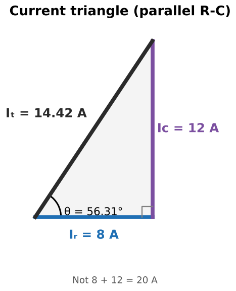  Iᵣ = √(Iₜ² − Ic²), Ic = √(Iₜ² − Iᵣ²)  

<b>13.</b> Iᵣ = 8 A, Ic = 12 A. Iₜ?
 √(64 + 144) = <b>14.42 A</b> (not 20 A)   

<b>14.</b> 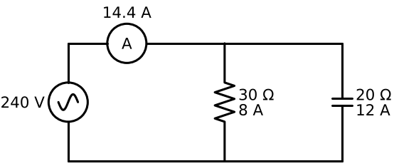 Feeder clamp reads 14.4 A while branches read 8 A and 12 A. Fault?
 No — the branch currents are 90° apart and add as vectors.  

<b>15.</b> Several capacitor branches plus a resistor: how do you get Iₜ?
 Add the capacitor currents straight (same phase), then Iₜ = √(Iᵣ² + Ic total²).  

<b>16.</b> Simplest way to find Z when E and Iₜ are known?
 Z = E/Iₜ = 240/14.422 = <b>16.64 Ω</b>  

<b>17.</b> Product-over-vector-sum formula for parallel R-C?
 Z = R·Xc / √(R² + Xc²)  600/36.06 = 16.64 Ω  

<b>18.</b> Reciprocal formula for parallel R-C impedance?
 Z = 1 / √((1/R)² + (1/Xc)²)  

<b>19.</b> Is parallel Z larger or smaller than R and Xc?
 Smaller than both.  16.64 &lt; 20 &lt; 30  

<b>20.</b> 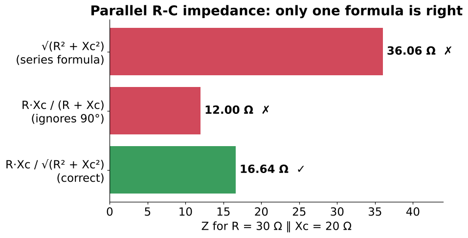 Which formula gives Z for 30 Ω ∥ Xc 20 Ω?
 Only R·Xc/√(R² + Xc²) = <b>16.64 Ω</b>. √(R² + Xc²) = 36.06 is the series answer; R·Xc/(R + Xc) = 12 ignores the 90°.  

<b>21.</b> Can you draw an impedance triangle with R and Xc as legs for a parallel circuit?
 No — draw the current triangle instead.  

<b>22.</b> Power values for the 30 Ω ∥ 20 Ω, 240 V example?
 P = 240 × 8 = <b>1920 W</b>; VARsc = 240 × 12 = <b>2880</b>; VA = 240 × 14.42 = <b>3461</b>. 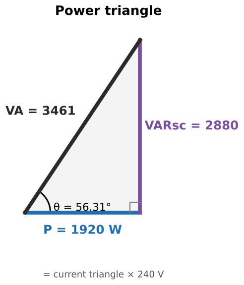  

<b>23.</b> Formula linking P, VARs and VA (any circuit)?
 VA = √(P² + VARs²)  

<b>24.</b> How is the parallel power triangle related to the current triangle?
 It's the current triangle × E.  

<b>25.</b> You know VARs and Xc but not E. Find E.
 E = √(VARs × Xc)  (also √(P × R), √(VA × Z))  From VARs = E²/Xc  

<b>26.</b> PF formulas for parallel R-C?
 PF = P/VA = Iᵣ/Iₜ = Z/R  55.47% in the main example  

<b>27.</b> Why is parallel PF Z/R, not R/Z?
 Parallel Z &lt; R, so R/Z would exceed 1 — impossible for PF.  

<b>28.</b> Why can't voltage ratios give PF in a parallel circuit?
 Voltage is the same on every branch, so Eᵣ/Eₜ is always 1.  

<b>29.</b> Main example θ?
 cos⁻¹(0.5547) = <b>56.31°</b>, current leading.   

<b>30.</b> Other trig ratios for θ in parallel R-C?
 tan θ = Ic/Iᵣ = VARs/P; sin θ = Ic/Iₜ = VARs/VA   

<b>31.</b> Given PF and VA, how do you get P and VARs?
 P = VA × PF; VARs = √(VA² − P²) (or VA × sin θ).  Example 22–2  

<b>32.</b> Example 22–2: PF 47.1%, VA 4086.13, 33.15 µF at 400 Hz. First three steps?
 θ = cos⁻¹(0.471) ≈ 61.9°; P = 4086.13 × 0.471 = 1924.5 W; VARs = √(VA² − P²) = 3604.6. 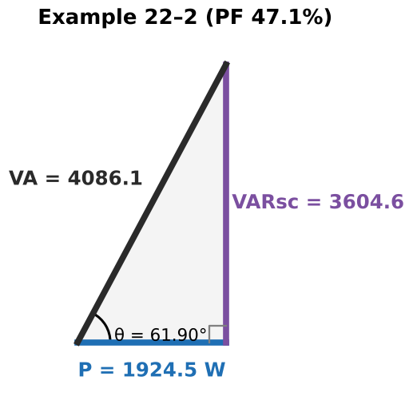  

<b>33.</b> Example 22–2: Xc and voltage?
 Xc = 1/(2π × 400 × 0.00003315) = <b>12 Ω</b> (377 doesn't apply at 400 Hz); E = √(3604.6 × 12) = <b>208 V</b>.  

<b>34.</b> 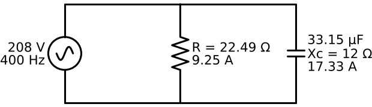 Example 22–2: currents, R and Z?
 Ic = 17.33 A, Iᵣ = 9.25 A, Iₜ = 19.64 A; R = 22.49 Ω; Z = 10.59 Ω.  

<b>35.</b> Key first move in a parallel circuit when E isn't given?
 Find E (it's the bridge into every branch) — e.g., √(VARs × Xc), √(P × R) or √(VA × Z).  Mirror of finding I first in series  

<b>36.</b> Book typos in Example 22–2?
 "1 Hz" on top of the Xc fraction (should be 1); θ shown as 61.9° then 61.93° (rounding).  

<b>37.</b> Wrong-file check: what is this chapter's real title?
 Unit 22: Resistive-Capacitive Parallel Circuits.  The PDF filename said R-L-C series  

<b>38.</b> 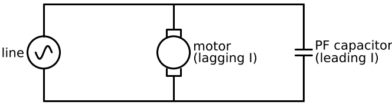 How are power-factor correction capacitors connected?
 In PARALLEL with the load (across the line) — never in series.  

<b>39.</b> 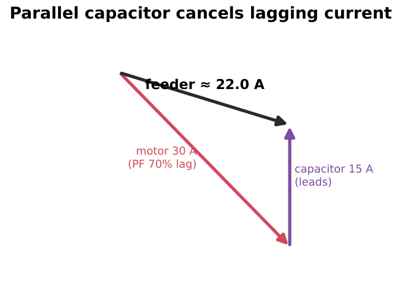 How does a parallel capacitor reduce feeder current on a motor circuit?
 Its leading current cancels part of the motor's lagging current; the feeder carries the smaller vector sum.  

<b>40.</b> A capacitor uses no watts. Does it draw real line current?
 Yes — e.g., 132.6 µF on 240 V draws 12 A. Feeders/disconnects are sized at 135% of capacitor rated current (NEC 460.8).  

<b>41.</b> Motors shut off but PF capacitors stay on. Result?
 The plant goes leading; voltage can rise. Banks are often switched with the load or automatically.  

<b>42.</b> Series vs parallel R-C: what changes?
 Series: current shared, Z = √(R² + Xc²), PF = R/Z, bigger C → more resistive. Parallel: voltage shared, Z = R·Xc/√(R² + Xc²), PF = Z/R, bigger C → more capacitive. 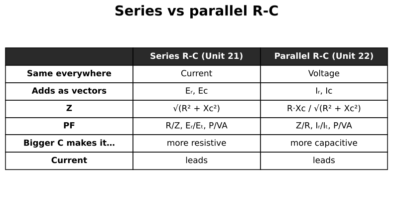  

<b>43.</b> 40 Ω ∥ 132.6 µF on 120 V, 60 Hz: first step?
 Convert C to Xc: 1/(377 × 0.0001326) = 20 Ω. Then Iᵣ = 3 A, Ic = 6 A, Iₜ = √45 ≈ 6.71 A.  Review Q2  

<b>44.</b> 208 V, 46 A, 4975 W (parallel R-C). Route to R and C?
 Iᵣ = 4975/208; R = 208/Iᵣ; Ic = √(46² − Iᵣ²); Xc = 208/Ic; C = 1/(377 Xc).  Review Q6–7  

