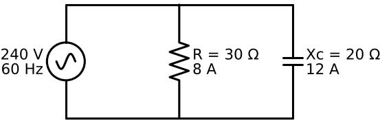
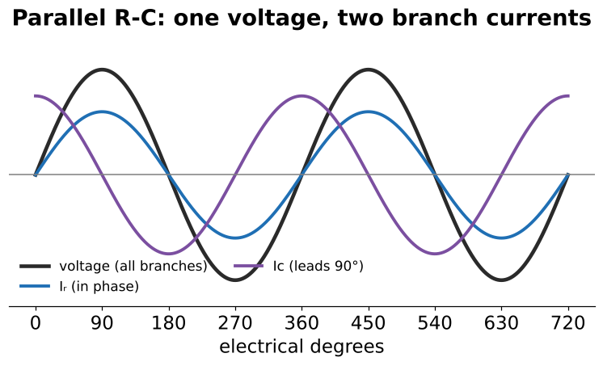
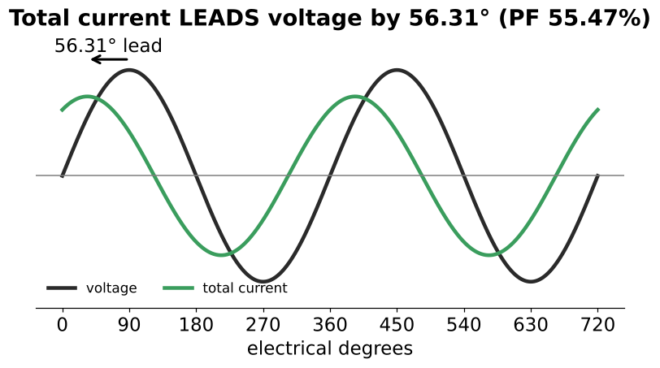
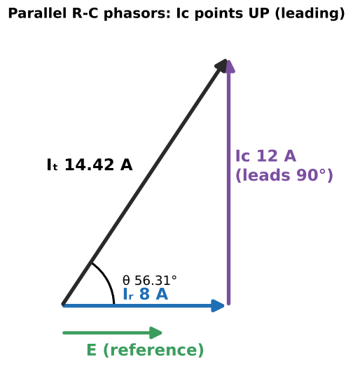
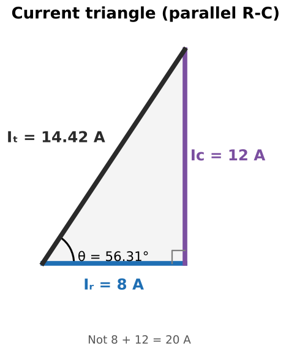
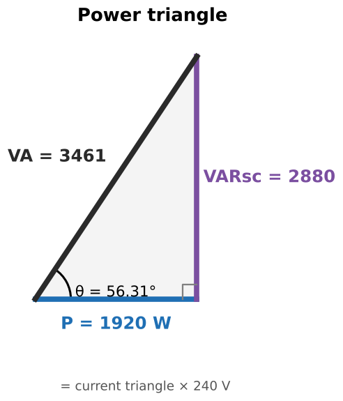
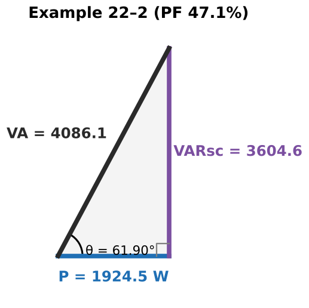
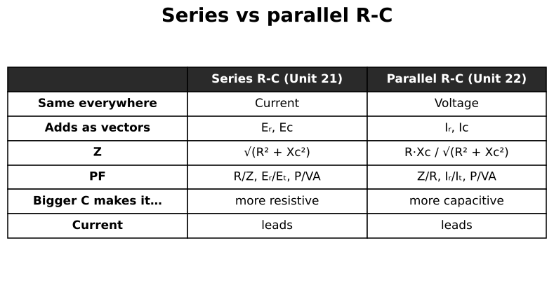

#+TITLE: ELECT 212 — Unit 22: Resistive-Capacitive (RC) Parallel Circuits
#+FILETAGS: :drill:
#+STARTUP: overview

# Generated by tools/flashcards/build_decks.py. Study with M-x org-drill.

* What is the same across every branch of a parallel R-C circuit?
   :PROPERTIES:
   :ID: u22-001
   :END:
** Answer
The voltage (magnitude and phase). Summary

* Phase of the resistive branch current?
   :PROPERTIES:
   :ID: u22-002
   :END:
** Answer
In phase with the voltage.

* Phase of the capacitive branch current?
   :PROPERTIES:
   :ID: u22-003
   :END:
** Answer
Leads the voltage by 90°.

* How many degrees apart are Iᵣ and Ic in parallel?
   :PROPERTIES:
   :ID: u22-004
   :END:
** Answer
90° Review Q1

* Does total current lead or lag in parallel R-C?
   :PROPERTIES:
   :ID: u22-005
   :END:
** Answer
Leads, by an angle between 0° and 90°.

* What sets the phase angle in parallel R-C?
   :PROPERTIES:
   :ID: u22-006
   :END:
** Answer
How current splits between branches: tan θ = Ic/Iᵣ = R/Xc. Book says "resistance to capacitance"

* In parallel R-C, does a bigger capacitor make the circuit more or less capacitive?
   :PROPERTIES:
   :ID: u22-007
   :END:
** Answer
MORE capacitive — lower Xc draws more Ic (opposite of series R-C). Bigger R also makes it more capacitive

* In a parallel phasor diagram, what is the reference and which way does Ic point?
   :PROPERTIES:
   :ID: u22-008
   :END:
** Answer
Voltage is the reference (0°). Ic points UP (leading). Iᵣ lies along E. Il pointed down in Unit 18

* 30 Ω ∥ Xc 20 Ω on 240 V: branch currents?
   :PROPERTIES:
   :ID: u22-009
   :END:
** Answer
Iᵣ = 240/30 = 8 A; Ic = 240/20 = 12 A. Example 22–1

* Branch current formulas?
   :PROPERTIES:
   :ID: u22-010
   :END:
** Answer
Iᵣ = E/R; Ic = E/Xc

* Capacitance for Xc = 20 Ω at 60 Hz?
   :PROPERTIES:
   :ID: u22-011
   :END:
** Answer
C = 1/(377 × 20) = 132.6 µF

* Total current formula in parallel R-C?
   :PROPERTIES:
   :ID: u22-012
   :END:
** Answer
Iₜ = √(Iᵣ² + Ic²) Iᵣ = √(Iₜ² − Ic²), Ic = √(Iₜ² − Iᵣ²)

* Iᵣ = 8 A, Ic = 12 A. Iₜ?
   :PROPERTIES:
   :ID: u22-013
   :END:
** Answer
√(64 + 144) = 14.42 A (not 20 A)

* Feeder clamp reads 14.4 A while branches read 8 A and 12 A. Fault?
   :PROPERTIES:
   :ID: u22-014
   :END:
** Answer
No — the branch currents are 90° apart and add as vectors.

* Several capacitor branches plus a resistor: how do you get Iₜ?
   :PROPERTIES:
   :ID: u22-015
   :END:
** Answer
Add the capacitor currents straight (same phase), then Iₜ = √(Iᵣ² + Ic total²).

* Simplest way to find Z when E and Iₜ are known?
   :PROPERTIES:
   :ID: u22-016
   :END:
** Answer
Z = E/Iₜ = 240/14.422 = 16.64 Ω

* Product-over-vector-sum formula for parallel R-C?
   :PROPERTIES:
   :ID: u22-017
   :END:
** Answer
Z = R·Xc / √(R² + Xc²) 600/36.06 = 16.64 Ω

* Reciprocal formula for parallel R-C impedance?
   :PROPERTIES:
   :ID: u22-018
   :END:
** Answer
Z = 1 / √((1/R)² + (1/Xc)²)

* Is parallel Z larger or smaller than R and Xc?
   :PROPERTIES:
   :ID: u22-019
   :END:
** Answer
Smaller than both. 16.64 < 20 < 30

* Which formula gives Z for 30 Ω ∥ Xc 20 Ω?
   :PROPERTIES:
   :ID: u22-020
   :END:
** Answer
Only R·Xc/√(R² + Xc²) = 16.64 Ω. √(R² + Xc²) = 36.06 is the series answer; R·Xc/(R + Xc) = 12 ignores the 90°.

* Can you draw an impedance triangle with R and Xc as legs for a parallel circuit?
   :PROPERTIES:
   :ID: u22-021
   :END:
** Answer
No — draw the current triangle instead.

* Power values for the 30 Ω ∥ 20 Ω, 240 V example?
   :PROPERTIES:
   :ID: u22-022
   :END:
** Answer
P = 240 × 8 = 1920 W; VARsc = 240 × 12 = 2880; VA = 240 × 14.42 = 3461.

* Formula linking P, VARs and VA (any circuit)?
   :PROPERTIES:
   :ID: u22-023
   :END:
** Answer
VA = √(P² + VARs²)

* How is the parallel power triangle related to the current triangle?
   :PROPERTIES:
   :ID: u22-024
   :END:
** Answer
It's the current triangle × E.

* You know VARs and Xc but not E. Find E.
   :PROPERTIES:
   :ID: u22-025
   :END:
** Answer
E = √(VARs × Xc) (also √(P × R), √(VA × Z)) From VARs = E²/Xc

* PF formulas for parallel R-C?
   :PROPERTIES:
   :ID: u22-026
   :END:
** Answer
PF = P/VA = Iᵣ/Iₜ = Z/R 55.47% in the main example

* Why is parallel PF Z/R, not R/Z?
   :PROPERTIES:
   :ID: u22-027
   :END:
** Answer
Parallel Z < R, so R/Z would exceed 1 — impossible for PF.

* Why can't voltage ratios give PF in a parallel circuit?
   :PROPERTIES:
   :ID: u22-028
   :END:
** Answer
Voltage is the same on every branch, so Eᵣ/Eₜ is always 1.

* Main example θ?
   :PROPERTIES:
   :ID: u22-029
   :END:
** Answer
cos⁻¹(0.5547) = 56.31°, current leading.

* Other trig ratios for θ in parallel R-C?
   :PROPERTIES:
   :ID: u22-030
   :END:
** Answer
tan θ = Ic/Iᵣ = VARs/P; sin θ = Ic/Iₜ = VARs/VA

* Given PF and VA, how do you get P and VARs?
   :PROPERTIES:
   :ID: u22-031
   :END:
** Answer
P = VA × PF; VARs = √(VA² − P²) (or VA × sin θ). Example 22–2

* Example 22–2: PF 47.1%, VA 4086.13, 33.15 µF at 400 Hz. First three steps?
   :PROPERTIES:
   :ID: u22-032
   :END:
** Answer
θ = cos⁻¹(0.471) ≈ 61.9°; P = 4086.13 × 0.471 = 1924.5 W; VARs = √(VA² − P²) = 3604.6.

* Example 22–2: Xc and voltage?
   :PROPERTIES:
   :ID: u22-033
   :END:
** Answer
Xc = 1/(2π × 400 × 0.00003315) = 12 Ω (377 doesn't apply at 400 Hz); E = √(3604.6 × 12) = 208 V.

* Example 22–2: currents, R and Z?
   :PROPERTIES:
   :ID: u22-034
   :END:
** Answer
Ic = 17.33 A, Iᵣ = 9.25 A, Iₜ = 19.64 A; R = 22.49 Ω; Z = 10.59 Ω.

* Key first move in a parallel circuit when E isn't given?
   :PROPERTIES:
   :ID: u22-035
   :END:
** Answer
Find E (it's the bridge into every branch) — e.g., √(VARs × Xc), √(P × R) or √(VA × Z). Mirror of finding I first in series

* Book typos in Example 22–2?
   :PROPERTIES:
   :ID: u22-036
   :END:
** Answer
"1 Hz" on top of the Xc fraction (should be 1); θ shown as 61.9° then 61.93° (rounding).

* Wrong-file check: what is this chapter's real title?
   :PROPERTIES:
   :ID: u22-037
   :END:
** Answer
Unit 22: Resistive-Capacitive Parallel Circuits. The PDF filename said R-L-C series

* How are power-factor correction capacitors connected?
   :PROPERTIES:
   :ID: u22-038
   :END:
** Answer
In PARALLEL with the load (across the line) — never in series.

* How does a parallel capacitor reduce feeder current on a motor circuit?
   :PROPERTIES:
   :ID: u22-039
   :END:
** Answer
Its leading current cancels part of the motor's lagging current; the feeder carries the smaller vector sum.

* A capacitor uses no watts. Does it draw real line current?
   :PROPERTIES:
   :ID: u22-040
   :END:
** Answer
Yes — e.g., 132.6 µF on 240 V draws 12 A. Feeders/disconnects are sized at 135% of capacitor rated current (NEC 460.8).

* Motors shut off but PF capacitors stay on. Result?
   :PROPERTIES:
   :ID: u22-041
   :END:
** Answer
The plant goes leading; voltage can rise. Banks are often switched with the load or automatically.

* Series vs parallel R-C: what changes?
   :PROPERTIES:
   :ID: u22-042
   :END:
** Answer
Series: current shared, Z = √(R² + Xc²), PF = R/Z, bigger C → more resistive. Parallel: voltage shared, Z = R·Xc/√(R² + Xc²), PF = Z/R, bigger C → more capacitive.

* 40 Ω ∥ 132.6 µF on 120 V, 60 Hz: first step?
   :PROPERTIES:
   :ID: u22-043
   :END:
** Answer
Convert C to Xc: 1/(377 × 0.0001326) = 20 Ω. Then Iᵣ = 3 A, Ic = 6 A, Iₜ = √45 ≈ 6.71 A. Review Q2

* 208 V, 46 A, 4975 W (parallel R-C). Route to R and C?
   :PROPERTIES:
   :ID: u22-044
   :END:
** Answer
Iᵣ = 4975/208; R = 208/Iᵣ; Ic = √(46² − Iᵣ²); Xc = 208/Ic; C = 1/(377 Xc). Review Q6–7

