# Flashcards — Unit 23: R-L-C Series Circuits

46 cards. Read the question, answer it in your head, then click it to check.

Study guide for this unit: [study-guide.md](../study-guide.md). The raw card data is in [`unit23_flashcards.json`](unit23_flashcards.json) if you want to import the cards into a flashcard app.

---

<b>1.</b> Phase of the resistor's voltage vs the series current?
 In phase. 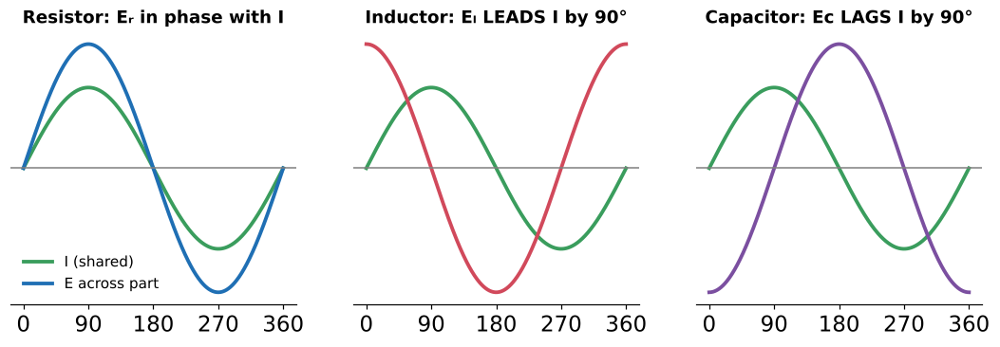  Review Q1  

<b>2.</b> Phase of the inductor's voltage vs the series current?
 Eₗ LEADS the current by 90°.   Review Q2  

<b>3.</b> Phase of the capacitor's voltage vs the series current?
 Ec LAGS the current by 90°.   Review Q3  

<b>4.</b>  What is the phase relationship between Eₗ and Ec in series?
 180° apart — exactly opposite, so they subtract.  

<b>5.</b> What is the same through every part of an RLC series circuit?
 The current. 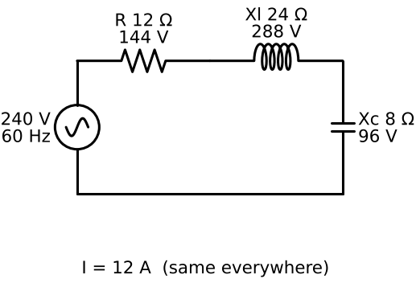  

<b>6.</b> How do Xl and Xc combine in series?
 They subtract: net X = Xl − Xc. The smaller is eliminated, the larger reduced. 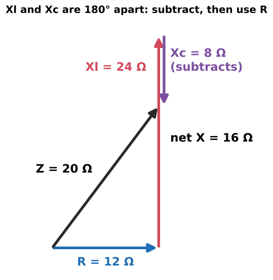  

<b>7.</b> Impedance formula for RLC series?
 Z = √(R² + (Xl − Xc)²) 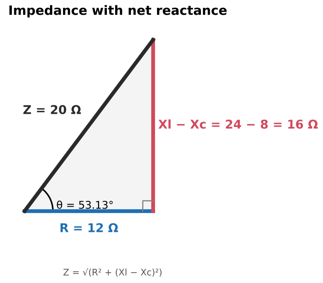  R = √(Z² − (Xl − Xc)²)  

<b>8.</b>  R 12 Ω, Xl 24 Ω, Xc 8 Ω. Z?
 √(12² + 16²) = <b>20 Ω</b>  Example 23–1  

<b>9.</b> Xc is larger than Xl. Does the negative difference matter in Z?
 No — it's squared. R 10, Xl 30, Xc 54 → √(100 + 576) = 26 Ω.  

<b>10.</b> Two common Z mistakes in RLC series?
 Adding Xl + Xc, or putting Xl and Xc separately into √(R² + …). Always subtract first.  

<b>11.</b> Why can RLC series current be surprisingly large?
 Xl and Xc cancel, so Z can be smaller than either reactance.  

<b>12.</b>  RLC example on 240 V: current and drops?
 I = 240/20 = 12 A; Eᵣ = 144 V, Eₗ = 288 V, Ec = 96 V.  

<b>13.</b> 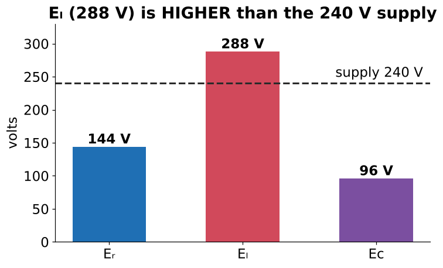 Can a component's voltage exceed the supply in RLC series?
 Yes — Eₗ = 288 V on a 240 V supply. Eₗ and Ec partly cancel, so the supply only provides the difference.  Check capacitor ratings!  

<b>14.</b> Total voltage formula in RLC series?
 Eₜ = √(Eᵣ² + (Eₗ − Ec)²)  √(144² + 192²) = 240 V  

<b>15.</b> L and C values in Example 23–1?
 L = 24/377 = 0.0637 H; C = 1/(377 × 8) = 331.6 µF.  

<b>16.</b> 66.3 µF, 0.0663 H, 8 Ω on 120 V, 60 Hz. Current?
 Xc = 40 Ω, Xl = 25 Ω → Z = √(64 + 225) = 17 Ω → I = <b>7.05 A</b>.  Example 23–2  

<b>17.</b> Xl 62 Ω, Xc 38 Ω on 208 V. What R limits current to 8 A?
 Z = 208/8 = 26 Ω; R = √(26² − 24²) = <b>10 Ω</b>.  Example 23–3  

<b>18.</b> Power quantities in Example 23–1?
 P 1728 W; VARsL 3456; VARsC 1152; net 2304 VARs inductive; VA 2880. 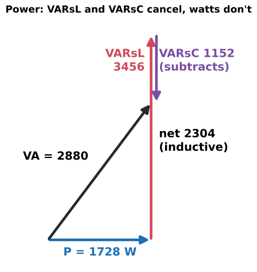  

<b>19.</b> Apparent power formula in RLC circuits?
 VA = √(P² + (VARsL − VARsC)²)  

<b>20.</b>  Why do inductive and capacitive VARs cancel?
 While the coil stores energy the capacitor releases it (and vice versa) — they trade energy locally, so the source supplies only the net.  

<b>21.</b> Book typo in Figure 23–6?
 VARsC shown as 1142; correct value is 1152 (96 V × 12 A). Also "PF = 0.06 × 100" should be 0.6.  

<b>22.</b> When is the RLC series PF lagging?
 When inductive VARs (Xl) exceed capacitive VARs (Xc) — current lags.  

<b>23.</b> When is the RLC series PF leading?
 When capacitive VARs (Xc) exceed inductive — current leads.  

<b>24.</b> Example 23–1 PF and θ?
 PF = 1728/2880 = 60% LAGGING; θ = 53.13°.  

<b>25.</b> 18 W, 24 VARsL, 34 VARsC in series. PF, leading or lagging?
 Net 10 VARs capacitive → PF = 18/√(18² + 10²) ≈ 87.4% LEADING.  Practice 6–7  

<b>26.</b> tan θ in an RLC series circuit?
 tan θ = (Xl − Xc)/R = (VARsL − VARsC)/P  

<b>27.</b> What is resonance?
 The frequency at which Xl = Xc, so they cancel completely. 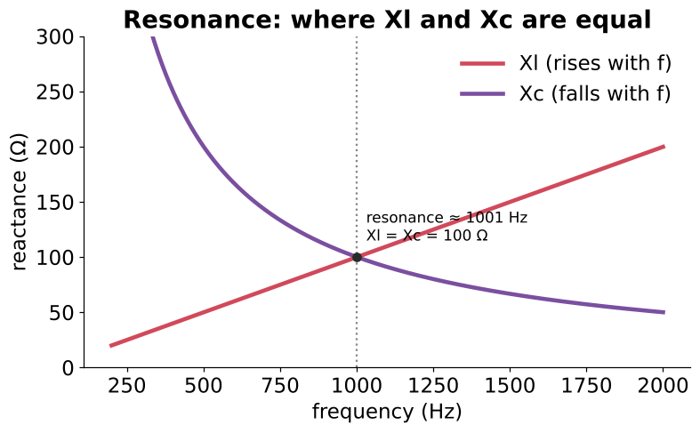  23–2  

<b>28.</b>  Why must Xl and Xc be equal at some frequency?
 Xl rises with frequency and Xc falls — the curves must cross.  

<b>29.</b> Resonant frequency formula?
 fR = 1 / (2π√(LC))  (L in H, C in F)  

<b>30.</b> Formulas for the L or C needed to resonate at fR?
 L = 1/(4π²f²C); C = 1/(4π²f²L) — both π and f squared.  Works for series or parallel  

<b>31.</b> C needed to resonate with 0.2 H at 1200 Hz?
 ≈ <b>88 nF</b>  

<b>32.</b> L needed to resonate with 50 µF at 400 Hz?
 ≈ <b>3.17 mH</b>  

<b>33.</b> At series resonance, what are Z, current and PF?
 Z = R (minimum), current maximum, PF = 100% (θ = 0°). 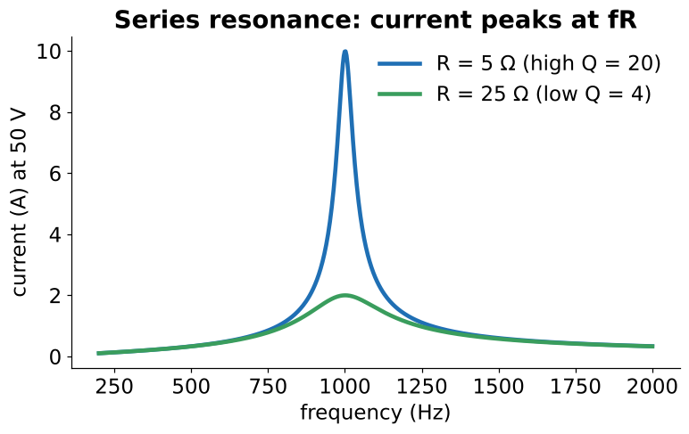  

<b>34.</b>  0.0159 H (5 Ω wire) + 1.59 µF on 50 V: current at resonance (1000 Hz)?
 Only R limits it: 50/5 = <b>10 A</b> (vs ~0.47 A at 600 Hz, ~0.73 A at 1400 Hz).  

<b>35.</b> 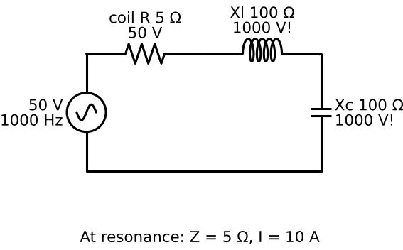 In that circuit, the voltage across L and across C at resonance?
 10 A × 100 Ω = <b>1000 V</b> each — on a 50 V supply.  Magnified by Q = Xl/R = 20  

<b>36.</b> At resonance, do L and C disappear?
 No — they cancel each other's effect on the source, but each carries full current and develops a full (high) voltage.  

<b>37.</b> What is bandwidth?
 The frequency range between the two points where current is 0.707 × maximum: B = f₂ − f₁. 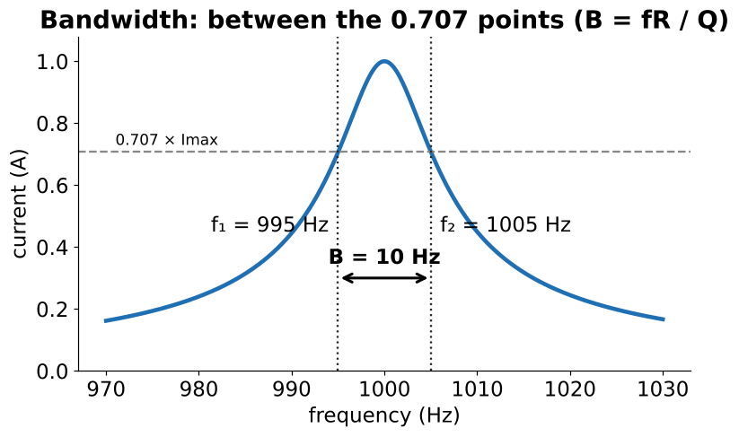  

<b>38.</b> Bandwidth formula using Q?
 B = fR / Q  

<b>39.</b>  High-Q vs low-Q resonant circuit?
 High Q (low R): sharp peak, narrow bandwidth. Low Q: flat peak, wide bandwidth.  Bandwidth is inversely proportional to Q  

<b>40.</b>  Resonance at 1000 Hz, 0.707 points at 995 and 1005 Hz. Bandwidth?
 <b>10 Hz</b> (narrow — high Q)  

<b>41.</b> Resonance at 1200 Hz, 0.707 points at 1150 and 1250 Hz. Bandwidth?
 <b>100 Hz</b> (wide — low Q)  

<b>42.</b> Why can PF capacitor banks cause trouble on systems with VFDs?
 Capacitors + system inductance form a resonant L-C circuit; if it lands near a harmonic (300, 420 Hz…) currents/voltages are magnified — blown fuses, failed caps. Hence detuned banks.  

<b>43.</b> 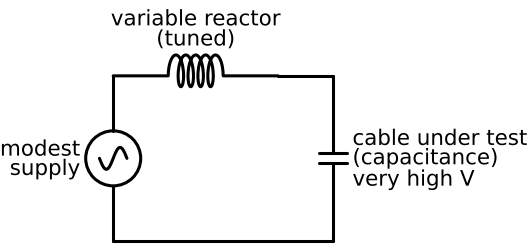 How do resonant AC test sets produce very high test voltages?
 A tuned reactor resonates with the cable's capacitance; at resonance the voltage across the cable is magnified (≈ Q × supply).  

<b>44.</b> What is ferroresonance?
 Resonance between an iron-core transformer's (nonlinear) inductance and cable capacitance — often after single-phase switching — producing erratic overvoltages.  

<b>45.</b> 400 Hz resonant HV source: 15 mH, 2 Ω, 240 V. Capacitor voltage rating?
 At resonance I = 240/2 = 120 A; Ec = I × Xc (= I × Xl ≈ 120 × 37.7 Ω). The rating must exceed THAT (×1.414 if DC-rated), not 240 V.  Practical Application  

<b>46.</b> Review Q4 (400 Hz): what must you NOT use?
 377 — compute 2π × 400 for Xl and Xc.  

