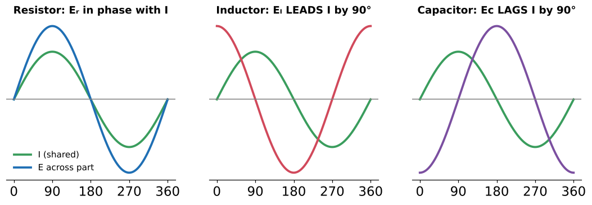
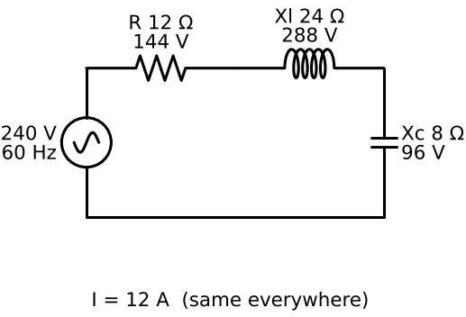
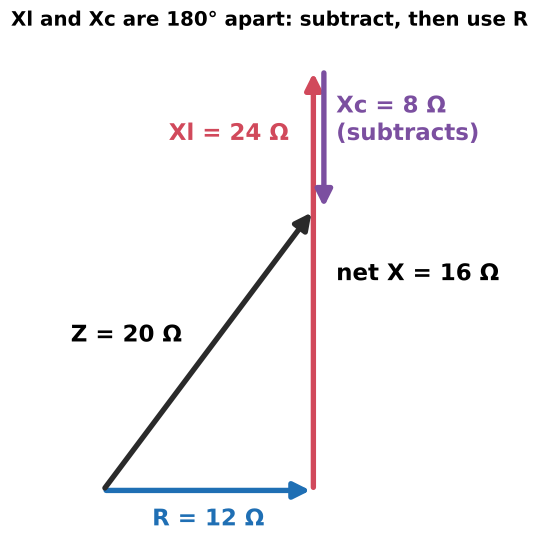
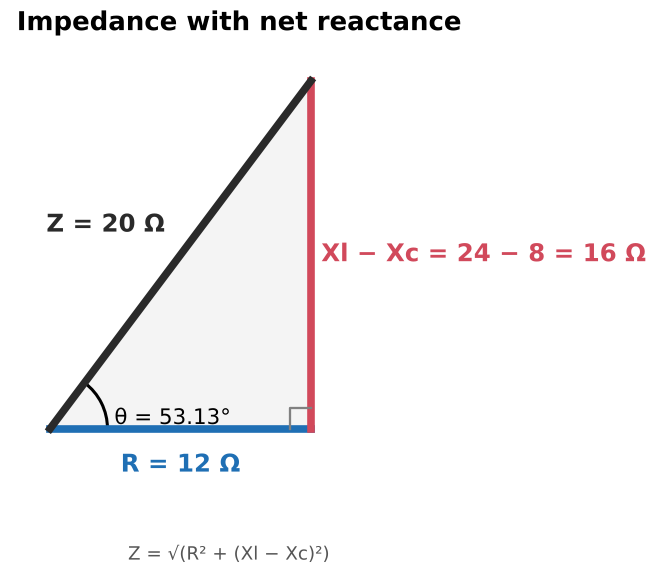
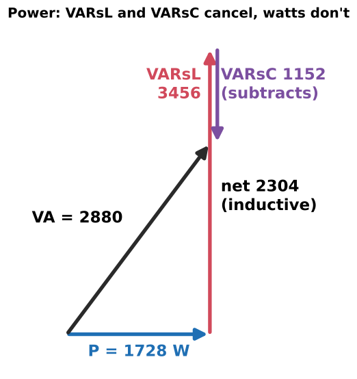
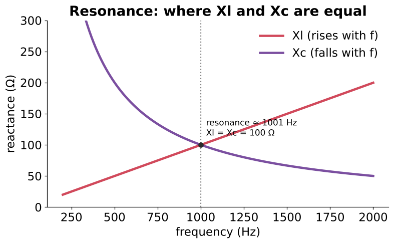
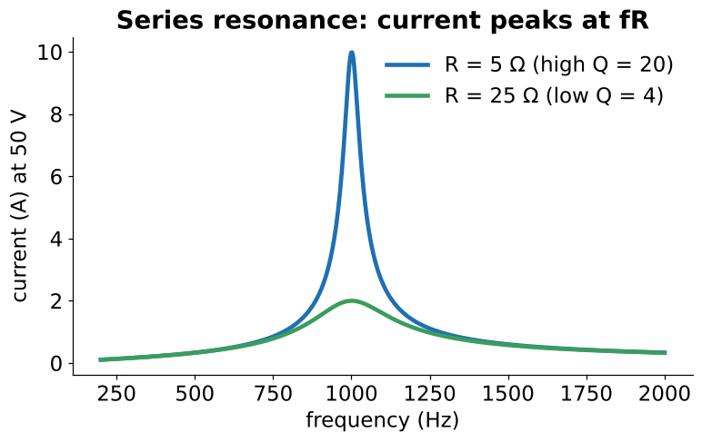
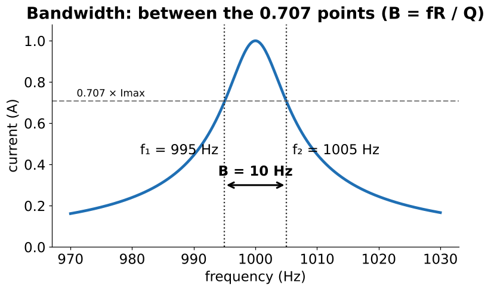

#+TITLE: ELECT 212 — Unit 23: RLC Series Circuits
#+FILETAGS: :drill:
#+STARTUP: overview

# Generated by tools/flashcards/build_decks.py. Study with M-x org-drill.

* Phase of the resistor's voltage vs the series current?
   :PROPERTIES:
   :ID: u23-001
   :END:
** Answer
In phase. Review Q1

* Phase of the inductor's voltage vs the series current?
   :PROPERTIES:
   :ID: u23-002
   :END:
** Answer
Eₗ LEADS the current by 90°. Review Q2

* Phase of the capacitor's voltage vs the series current?
   :PROPERTIES:
   :ID: u23-003
   :END:
** Answer
Ec LAGS the current by 90°. Review Q3

* What is the phase relationship between Eₗ and Ec in series?
   :PROPERTIES:
   :ID: u23-004
   :END:
** Answer
180° apart — exactly opposite, so they subtract.

* What is the same through every part of an RLC series circuit?
   :PROPERTIES:
   :ID: u23-005
   :END:
** Answer
The current.

* How do Xl and Xc combine in series?
   :PROPERTIES:
   :ID: u23-006
   :END:
** Answer
They subtract: net X = Xl − Xc. The smaller is eliminated, the larger reduced.

* Impedance formula for RLC series?
   :PROPERTIES:
   :ID: u23-007
   :END:
** Answer
Z = √(R² + (Xl − Xc)²) R = √(Z² − (Xl − Xc)²)

* R 12 Ω, Xl 24 Ω, Xc 8 Ω. Z?
   :PROPERTIES:
   :ID: u23-008
   :END:
** Answer
√(12² + 16²) = 20 Ω Example 23–1

* Xc is larger than Xl. Does the negative difference matter in Z?
   :PROPERTIES:
   :ID: u23-009
   :END:
** Answer
No — it's squared. R 10, Xl 30, Xc 54 → √(100 + 576) = 26 Ω.

* Two common Z mistakes in RLC series?
   :PROPERTIES:
   :ID: u23-010
   :END:
** Answer
Adding Xl + Xc, or putting Xl and Xc separately into √(R² + …). Always subtract first.

* Why can RLC series current be surprisingly large?
   :PROPERTIES:
   :ID: u23-011
   :END:
** Answer
Xl and Xc cancel, so Z can be smaller than either reactance.

* RLC example on 240 V: current and drops?
   :PROPERTIES:
   :ID: u23-012
   :END:
** Answer
I = 240/20 = 12 A; Eᵣ = 144 V, Eₗ = 288 V, Ec = 96 V.

* Can a component's voltage exceed the supply in RLC series?
   :PROPERTIES:
   :ID: u23-013
   :END:
** Answer
Yes — Eₗ = 288 V on a 240 V supply. Eₗ and Ec partly cancel, so the supply only provides the difference. Check capacitor ratings!

* Total voltage formula in RLC series?
   :PROPERTIES:
   :ID: u23-014
   :END:
** Answer
Eₜ = √(Eᵣ² + (Eₗ − Ec)²) √(144² + 192²) = 240 V

* L and C values in Example 23–1?
   :PROPERTIES:
   :ID: u23-015
   :END:
** Answer
L = 24/377 = 0.0637 H; C = 1/(377 × 8) = 331.6 µF.

* 66.3 µF, 0.0663 H, 8 Ω on 120 V, 60 Hz. Current?
   :PROPERTIES:
   :ID: u23-016
   :END:
** Answer
Xc = 40 Ω, Xl = 25 Ω → Z = √(64 + 225) = 17 Ω → I = 7.05 A. Example 23–2

* Xl 62 Ω, Xc 38 Ω on 208 V. What R limits current to 8 A?
   :PROPERTIES:
   :ID: u23-017
   :END:
** Answer
Z = 208/8 = 26 Ω; R = √(26² − 24²) = 10 Ω. Example 23–3

* Power quantities in Example 23–1?
   :PROPERTIES:
   :ID: u23-018
   :END:
** Answer
P 1728 W; VARsL 3456; VARsC 1152; net 2304 VARs inductive; VA 2880.

* Apparent power formula in RLC circuits?
   :PROPERTIES:
   :ID: u23-019
   :END:
** Answer
VA = √(P² + (VARsL − VARsC)²)

* Why do inductive and capacitive VARs cancel?
   :PROPERTIES:
   :ID: u23-020
   :END:
** Answer
While the coil stores energy the capacitor releases it (and vice versa) — they trade energy locally, so the source supplies only the net.

* Book typo in Figure 23–6?
   :PROPERTIES:
   :ID: u23-021
   :END:
** Answer
VARsC shown as 1142; correct value is 1152 (96 V × 12 A). Also "PF = 0.06 × 100" should be 0.6.

* When is the RLC series PF lagging?
   :PROPERTIES:
   :ID: u23-022
   :END:
** Answer
When inductive VARs (Xl) exceed capacitive VARs (Xc) — current lags.

* When is the RLC series PF leading?
   :PROPERTIES:
   :ID: u23-023
   :END:
** Answer
When capacitive VARs (Xc) exceed inductive — current leads.

* Example 23–1 PF and θ?
   :PROPERTIES:
   :ID: u23-024
   :END:
** Answer
PF = 1728/2880 = 60% LAGGING; θ = 53.13°.

* 18 W, 24 VARsL, 34 VARsC in series. PF, leading or lagging?
   :PROPERTIES:
   :ID: u23-025
   :END:
** Answer
Net 10 VARs capacitive → PF = 18/√(18² + 10²) ≈ 87.4% LEADING. Practice 6–7

* tan θ in an RLC series circuit?
   :PROPERTIES:
   :ID: u23-026
   :END:
** Answer
tan θ = (Xl − Xc)/R = (VARsL − VARsC)/P

* What is resonance?
   :PROPERTIES:
   :ID: u23-027
   :END:
** Answer
The frequency at which Xl = Xc, so they cancel completely. 23–2

* Why must Xl and Xc be equal at some frequency?
   :PROPERTIES:
   :ID: u23-028
   :END:
** Answer
Xl rises with frequency and Xc falls — the curves must cross.

* Resonant frequency formula?
   :PROPERTIES:
   :ID: u23-029
   :END:
** Answer
fR = 1 / (2π√(LC)) (L in H, C in F)

* Formulas for the L or C needed to resonate at fR?
   :PROPERTIES:
   :ID: u23-030
   :END:
** Answer
L = 1/(4π²f²C); C = 1/(4π²f²L) — both π and f squared. Works for series or parallel

* C needed to resonate with 0.2 H at 1200 Hz?
   :PROPERTIES:
   :ID: u23-031
   :END:
** Answer
≈ 88 nF

* L needed to resonate with 50 µF at 400 Hz?
   :PROPERTIES:
   :ID: u23-032
   :END:
** Answer
≈ 3.17 mH

* At series resonance, what are Z, current and PF?
   :PROPERTIES:
   :ID: u23-033
   :END:
** Answer
Z = R (minimum), current maximum, PF = 100% (θ = 0°).

* 0.0159 H (5 Ω wire) + 1.59 µF on 50 V: current at resonance (1000 Hz)?
   :PROPERTIES:
   :ID: u23-034
   :END:
** Answer
Only R limits it: 50/5 = 10 A (vs ~0.47 A at 600 Hz, ~0.73 A at 1400 Hz).

* In that circuit, the voltage across L and across C at resonance?
   :PROPERTIES:
   :ID: u23-035
   :END:
** Answer
10 A × 100 Ω = 1000 V each — on a 50 V supply. Magnified by Q = Xl/R = 20

* At resonance, do L and C disappear?
   :PROPERTIES:
   :ID: u23-036
   :END:
** Answer
No — they cancel each other's effect on the source, but each carries full current and develops a full (high) voltage.

* What is bandwidth?
   :PROPERTIES:
   :ID: u23-037
   :END:
** Answer
The frequency range between the two points where current is 0.707 × maximum: B = f₂ − f₁.

* Bandwidth formula using Q?
   :PROPERTIES:
   :ID: u23-038
   :END:
** Answer
B = fR / Q

* High-Q vs low-Q resonant circuit?
   :PROPERTIES:
   :ID: u23-039
   :END:
** Answer
High Q (low R): sharp peak, narrow bandwidth. Low Q: flat peak, wide bandwidth. Bandwidth is inversely proportional to Q

* Resonance at 1000 Hz, 0.707 points at 995 and 1005 Hz. Bandwidth?
   :PROPERTIES:
   :ID: u23-040
   :END:
** Answer
10 Hz (narrow — high Q)

* Resonance at 1200 Hz, 0.707 points at 1150 and 1250 Hz. Bandwidth?
   :PROPERTIES:
   :ID: u23-041
   :END:
** Answer
100 Hz (wide — low Q)

* Why can PF capacitor banks cause trouble on systems with VFDs?
   :PROPERTIES:
   :ID: u23-042
   :END:
** Answer
Capacitors + system inductance form a resonant L-C circuit; if it lands near a harmonic (300, 420 Hz…) currents/voltages are magnified — blown fuses, failed caps. Hence detuned banks.

* How do resonant AC test sets produce very high test voltages?
   :PROPERTIES:
   :ID: u23-043
   :END:
** Answer
A tuned reactor resonates with the cable's capacitance; at resonance the voltage across the cable is magnified (≈ Q × supply).

* What is ferroresonance?
   :PROPERTIES:
   :ID: u23-044
   :END:
** Answer
Resonance between an iron-core transformer's (nonlinear) inductance and cable capacitance — often after single-phase switching — producing erratic overvoltages.

* 400 Hz resonant HV source: 15 mH, 2 Ω, 240 V. Capacitor voltage rating?
   :PROPERTIES:
   :ID: u23-045
   :END:
** Answer
At resonance I = 240/2 = 120 A; Ec = I × Xc (= I × Xl ≈ 120 × 37.7 Ω). The rating must exceed THAT (×1.414 if DC-rated), not 240 V. Practical Application

* Review Q4 (400 Hz): what must you NOT use?
   :PROPERTIES:
   :ID: u23-046
   :END:
** Answer
377 — compute 2π × 400 for Xl and Xc.

