# Flashcards — Unit 24: R-L-C Parallel Circuits

49 cards. Read the question, answer it in your head, then click it to check.

Study guide for this unit: [study-guide.md](../study-guide.md). The raw card data is in [`unit24_flashcards.json`](unit24_flashcards.json) if you want to import the cards into a flashcard app.

---

<b>1.</b> What is shared by all branches of an RLC parallel circuit?
 The voltage. 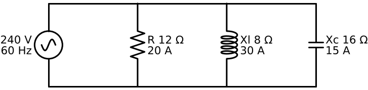  Summary  

<b>2.</b> Phase of each branch current vs voltage?
 Resistor: in phase. Inductor: lags 90°. Capacitor: leads 90°. 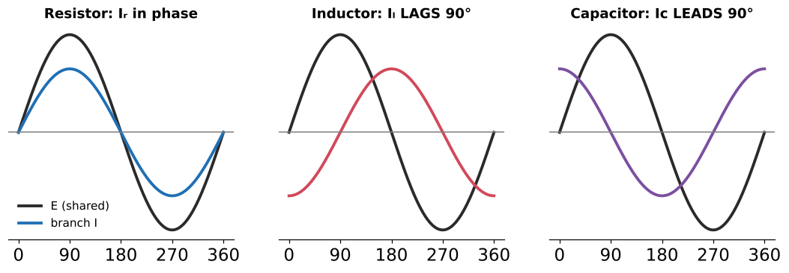  Summary  

<b>3.</b>  How are Iₗ and Ic related in parallel?
 180° apart — they subtract (cancel).  

<b>4.</b> When is a parallel RLC circuit lagging vs leading?
 More inductive VARs/current → lagging. More capacitive → leading.  

<b>5.</b> In parallel, does the bigger or smaller reactance win?
 The SMALLER reactance draws more current and dominates (reverse of series).  Xl 8 Ω vs Xc 16 Ω → inductive  

<b>6.</b>  Branch currents for 12 Ω ∥ Xl 8 Ω ∥ Xc 16 Ω on 240 V?
 Iᵣ 20 A, Iₗ 30 A, Ic 15 A.  Example 24–1  

<b>7.</b> Total current formula for RLC parallel?
 Iₜ = √(Iᵣ² + (Iₗ − Ic)²) 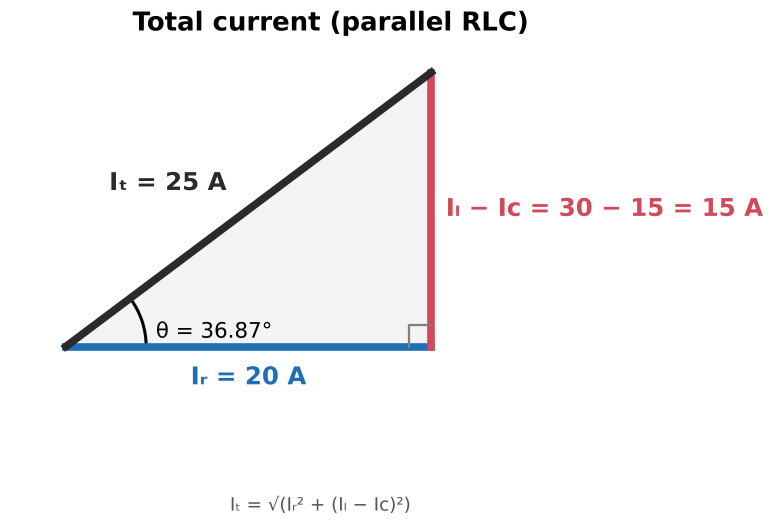  

<b>8.</b> 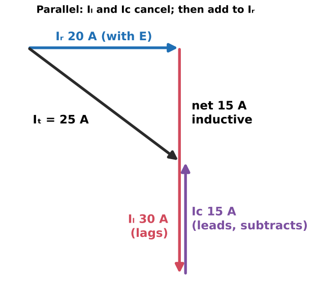 Iᵣ 20, Iₗ 30, Ic 15 A. Iₜ?
 √(20² + 15²) = <b>25 A</b>  

<b>9.</b> 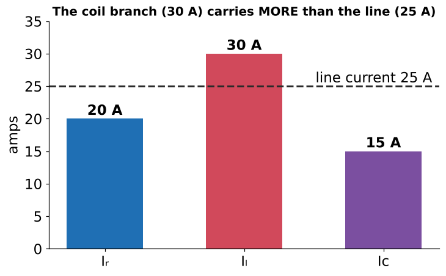 Can a branch carry more current than the line?
 Yes — the 30 A coil branch exceeds the 25 A line current, because Ic cancels part of Iₗ.  

<b>10.</b> Iᵣ 38, Iₗ 22, Ic 7 A. Iₜ?
 √(38² + 15²) ≈ <b>40.9 A</b>  Review Q3  

<b>11.</b> Simplest way to find Z in RLC parallel?
 Z = E / Iₜ = 240 / 25 = <b>9.6 Ω</b>  

<b>12.</b> Reciprocal formula for RLC parallel impedance?
 Z = 1 / √((1/R)² + (1/Xl − 1/Xc)²)  Subtract the RECIPROCALS of Xl and Xc  

<b>13.</b> Second impedance method (combine reactances first)?
 X = Xl·Xc / (Xl + Xc) with Xc NEGATIVE; then Z = R·X/√(R² + X²). 8×(−16)/(8−16) = 16 Ω → Z = 9.6 Ω.  Positive X = inductive  

<b>14.</b> Example 24–2: R 18 Ω, 9.76 mH, 5.5 µF at 1200 Hz. First step and Z?
 Xl = 73.59 Ω, Xc = 24.11 Ω (377 doesn't apply); Z ≈ <b>16.1 Ω</b>.  Book's substitution shows a 74.589 typo  

<b>15.</b> Power values in Example 24–1?
 P 4800 W; VARsL 7200; VARsC 3600; VA 6000.  

<b>16.</b> Apparent power formula for RLC parallel?
 VA = √(P² + (VARsL − VARsC)²)  

<b>17.</b> Example 24–1 PF and θ?
 PF = 4800/6000 = 80% LAGGING; θ = 36.87°.  

<b>18.</b> PF formulas in parallel RLC?
 P/VA, Iᵣ/Iₜ, Z/R  Not R/Z, not voltage ratios  

<b>19.</b> L and C in Example 24–1?
 L = 8/377 = 0.0212 H; C = 1/(377 × 16) = 165.8 µF.  

<b>20.</b> What is a tank circuit?
 An L-C parallel (resonant) circuit, in which energy swings back and forth between the coil and capacitor. 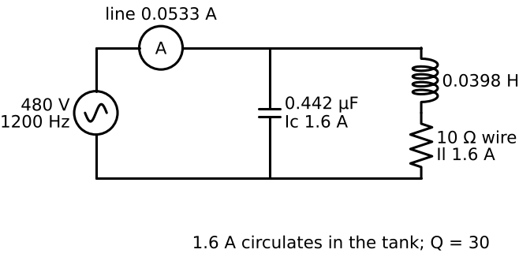  

<b>21.</b> At parallel resonance, what happens to impedance and line current?
 Impedance is MAXIMUM; line current is MINIMUM. 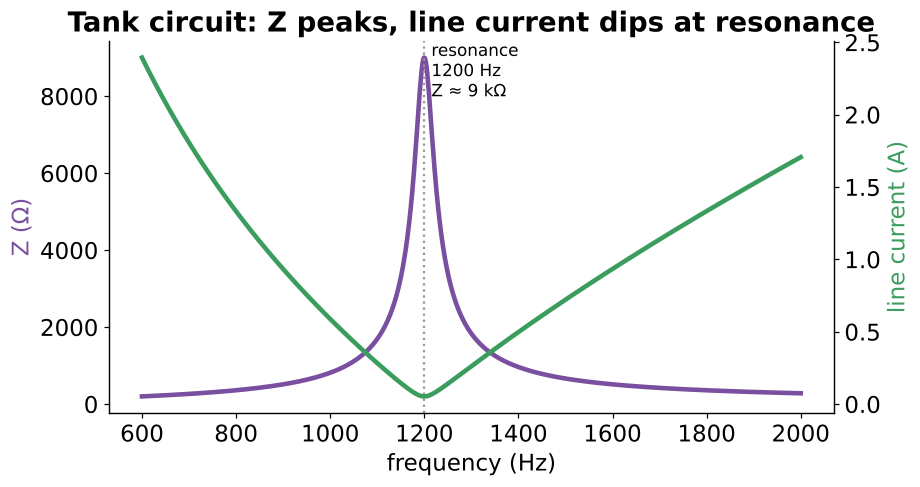  Opposite of series resonance  

<b>22.</b> 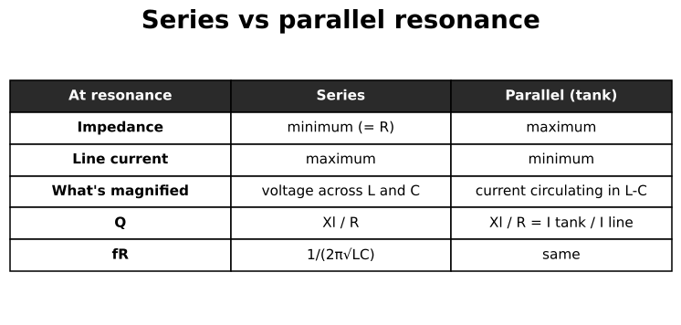 Compare series and parallel resonance.
 Series: Z min, current max, voltage magnified. Parallel: Z max, line current min, circulating current magnified.  

<b>23.</b> What limits the line current of a real tank circuit?
 The resistance (Q) of the coil — capacitors have very high Q.  Ideal: zero line current, infinite Z  

<b>24.</b> Q of a tank circuit — two formulas?
 Q = Xl/R = I(tank)/I(line)  

<b>25.</b>  0.0398 H (10 Ω), 0.442 µF on 480 V at 1200 Hz: tank current, Q and line current?
 Xl = Xc = 300 Ω → 1.6 A each; Q = 30; line = 1.6/30 = <b>0.0533 A</b>.  

<b>26.</b> Check the tank line current using power.
 P = 1.6² × 10 = 25.6 W; I = 25.6/480 = 0.0533 A.  

<b>27.</b> Impedance of that tank at resonance?
 480/0.0533 ≈ <b>9000 Ω</b> (book's 9006 comes from rounding).  

<b>28.</b> Tank Xl = Xc = 30 Ω, coil Q = 15, 277 V. Line current?
 Tank = 277/30 ≈ 9.23 A; line = 9.23/15 ≈ <b>0.62 A</b>.  Review Q4  

<b>29.</b> Bandwidth of a parallel resonant circuit?
 Frequency range where impedance is ≥ 0.707 × maximum; high Q = narrow, low Q = wide.  

<b>30.</b> Pitfall: "tiny line current, so L and C are lightly loaded"?
 Wrong — each carries the full circulating tank current (Q × line current).  

<b>31.</b> 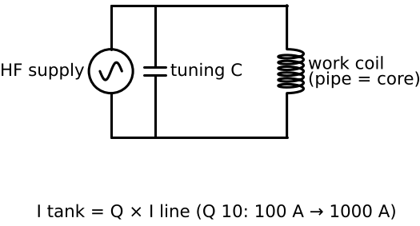 How does an induction heater use a tank circuit?
 The work coil (with the pipe as core) and a capacitor resonate; I(tank) = Q × I(line) — Q 10: 100 A line → 1000 A heating current.  

<b>32.</b> 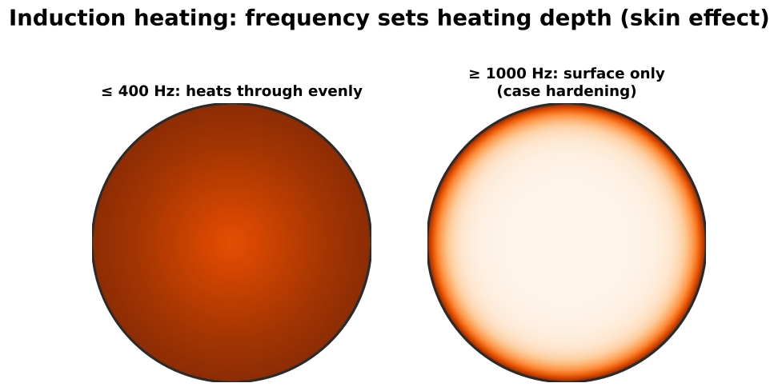 Induction heating: low vs high frequency?
 ≤ 400 Hz heats evenly through; ≥ 1000 Hz skin effect heats the surface (case hardening).  

<b>33.</b> Why is an induction heater only resonant with the part in the coil?
 The part acts as the coil's core, so it changes L.  

<b>34.</b> How does an inductive proximity sensor use a tank circuit?
 Metal near the face adds eddy-current losses, Q collapses, the oscillation stops, and the sensor switches.  

<b>35.</b> C to resonate with 0.796 mH (Xl 50 Ω) at 10 kHz?
 Xc must = 50 Ω: C = 1/(2π × 10,000 × 50) ≈ <b>0.318 µF</b>.  Review Q5  

<b>36.</b> 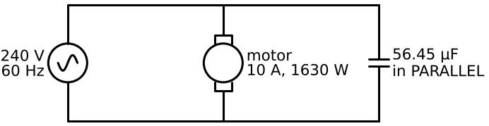 Why can a capacitor correct a motor's power factor?
 In parallel, its leading current cancels much of the motor's lagging magnetizing current, so the line carries less.  

<b>37.</b> 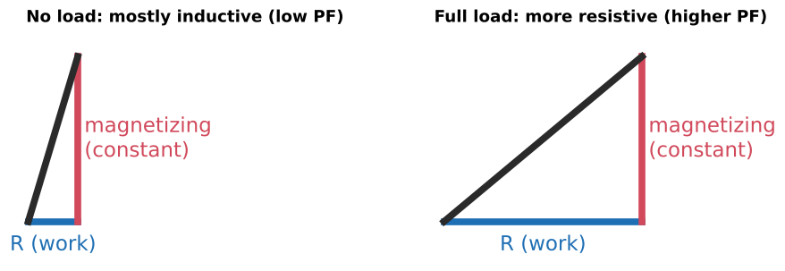 How does a motor look electrically at no load vs full load?
 R in series with L; L (magnetizing) stays ~constant, R grows with load → low PF at no load, higher at full load.  

<b>38.</b> PF correction step 1–2 (240 V, 10 A, 1630 W)?
 VA = 2400; PF = 67.9%; VARsL = √(2400² − 1630²) = 1761.6.  

<b>39.</b> PF correction step 3–4 (target 95%)?
 New VA = 1630/0.95 = 1715.8; allowed VARs = √(1715.8² − 1630²) = 535.8.  Watts don't change  

<b>40.</b> PF correction step 5–7?
 VARsC = 1761.6 − 535.8 = 1225.8; Xc = 240²/1225.8 = 46.99 Ω; C = 1/(377 × 46.99) = <b>56.45 µF</b> in parallel. 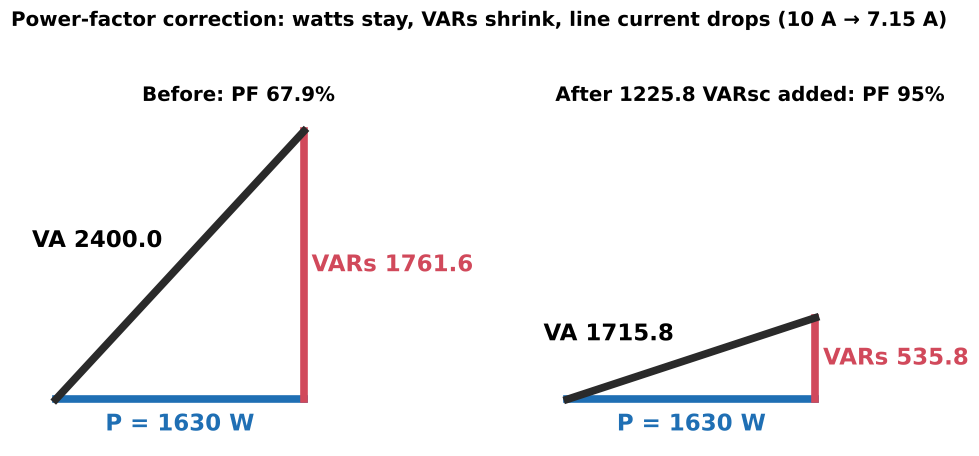  

<b>41.</b>  After correcting that motor to 95%, what's the line current?
 ≈ 1715.8/240 = <b>7.15 A</b> (down from 10 A). The motor's own current is unchanged.  

<b>42.</b> Formula for Xc from required capacitive VARs?
 Xc = E² / VARsC  

<b>43.</b> To correct to unity (100%), how many VARsC?
 Equal to all the existing inductive VARs.  Review Q6  

<b>44.</b> Why correct to ~95% rather than 100%?
 Diminishing returns — each extra point needs more kVAR; overshooting makes PF leading and raises voltage.  

<b>45.</b> Does corrected PF stay constant at all motor loads?
 No (despite the book). Watts drop at light load, so PF falls; an oversized capacitor can overcorrect.  

<b>46.</b> Book error in PF correction step 5?
 It says reduce VARs "from 1715.789" — that's VA. The existing VARs are 1761.562. Also "PF = 0679" should be 0.679.  

<b>47.</b> NEC limits for a capacitor on the load side of a motor overload?
 kVAR ≤ the amount to raise no-load PF to unity (460.7, avoids self-excitation); set overloads on the reduced current (460.9).  

<b>48.</b> Why can PF banks cause harmonic problems in plants with drives?
 Bank + system inductance form a tank circuit; near a harmonic its high impedance magnifies harmonic voltage/current. Use detuned banks.  

<b>49.</b> Practical: 240 V, 15 A, 2.2 kW motor to 95%. Method?
 VA = 3600 → PF ≈ 61%; VARs now = √(3600² − 2200²); target VA = 2200/0.95; VARs target; difference = VARsC; Xc = 240²/VARsC; C = 1/(377·Xc).  

