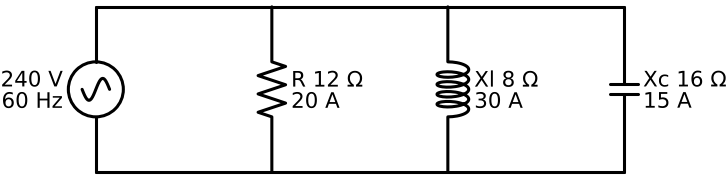
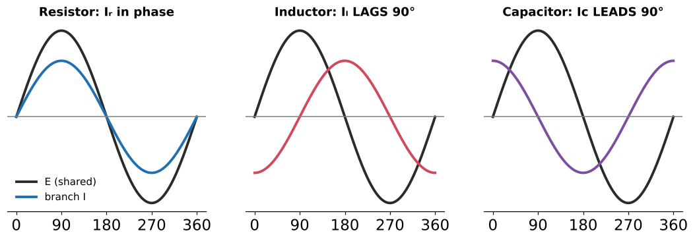
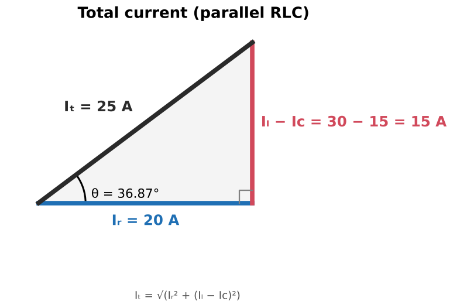
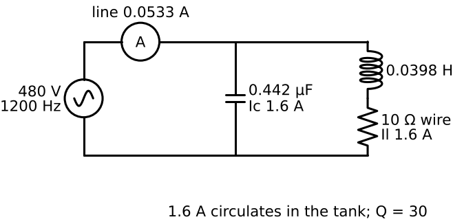
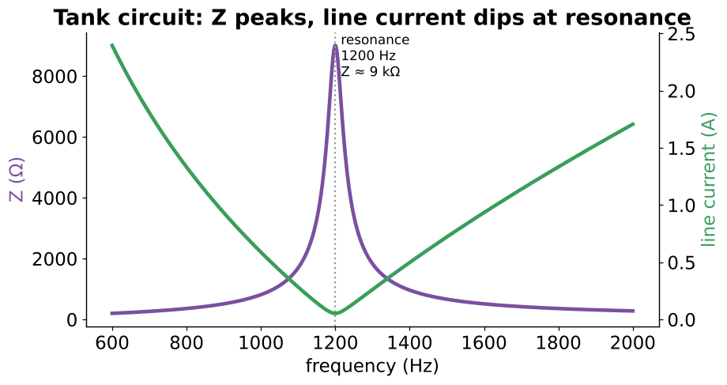
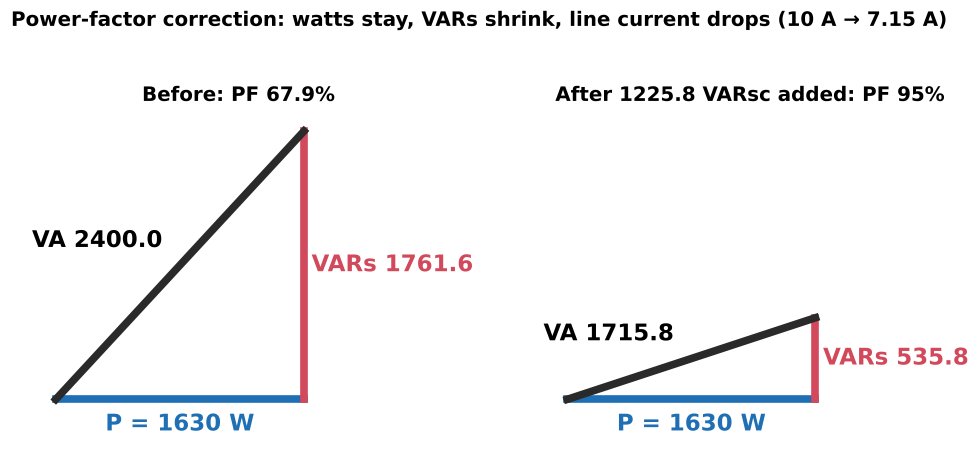

#+TITLE: ELECT 212 — Unit 24: RLC Parallel Circuits
#+FILETAGS: :drill:
#+STARTUP: overview

# Generated by tools/flashcards/build_decks.py. Study with M-x org-drill.

* What is shared by all branches of an RLC parallel circuit?
   :PROPERTIES:
   :ID: u24-001
   :END:
** Answer
The voltage. Summary

* Phase of each branch current vs voltage?
   :PROPERTIES:
   :ID: u24-002
   :END:
** Answer
Resistor: in phase. Inductor: lags 90°. Capacitor: leads 90°. Summary

* How are Iₗ and Ic related in parallel?
   :PROPERTIES:
   :ID: u24-003
   :END:
** Answer
180° apart — they subtract (cancel).

* When is a parallel RLC circuit lagging vs leading?
   :PROPERTIES:
   :ID: u24-004
   :END:
** Answer
More inductive VARs/current → lagging. More capacitive → leading.

* In parallel, does the bigger or smaller reactance win?
   :PROPERTIES:
   :ID: u24-005
   :END:
** Answer
The SMALLER reactance draws more current and dominates (reverse of series). Xl 8 Ω vs Xc 16 Ω → inductive

* Branch currents for 12 Ω ∥ Xl 8 Ω ∥ Xc 16 Ω on 240 V?
   :PROPERTIES:
   :ID: u24-006
   :END:
** Answer
Iᵣ 20 A, Iₗ 30 A, Ic 15 A. Example 24–1

* Total current formula for RLC parallel?
   :PROPERTIES:
   :ID: u24-007
   :END:
** Answer
Iₜ = √(Iᵣ² + (Iₗ − Ic)²)

* Iᵣ 20, Iₗ 30, Ic 15 A. Iₜ?
   :PROPERTIES:
   :ID: u24-008
   :END:
** Answer
√(20² + 15²) = 25 A

* Can a branch carry more current than the line?
   :PROPERTIES:
   :ID: u24-009
   :END:
** Answer
Yes — the 30 A coil branch exceeds the 25 A line current, because Ic cancels part of Iₗ.

* Iᵣ 38, Iₗ 22, Ic 7 A. Iₜ?
   :PROPERTIES:
   :ID: u24-010
   :END:
** Answer
√(38² + 15²) ≈ 40.9 A Review Q3

* Simplest way to find Z in RLC parallel?
   :PROPERTIES:
   :ID: u24-011
   :END:
** Answer
Z = E / Iₜ = 240 / 25 = 9.6 Ω

* Reciprocal formula for RLC parallel impedance?
   :PROPERTIES:
   :ID: u24-012
   :END:
** Answer
Z = 1 / √((1/R)² + (1/Xl − 1/Xc)²) Subtract the RECIPROCALS of Xl and Xc

* Second impedance method (combine reactances first)?
   :PROPERTIES:
   :ID: u24-013
   :END:
** Answer
X = Xl·Xc / (Xl + Xc) with Xc NEGATIVE; then Z = R·X/√(R² + X²). 8×(−16)/(8−16) = 16 Ω → Z = 9.6 Ω. Positive X = inductive

* Example 24–2: R 18 Ω, 9.76 mH, 5.5 µF at 1200 Hz. First step and Z?
   :PROPERTIES:
   :ID: u24-014
   :END:
** Answer
Xl = 73.59 Ω, Xc = 24.11 Ω (377 doesn't apply); Z ≈ 16.1 Ω. Book's substitution shows a 74.589 typo

* Power values in Example 24–1?
   :PROPERTIES:
   :ID: u24-015
   :END:
** Answer
P 4800 W; VARsL 7200; VARsC 3600; VA 6000.

* Apparent power formula for RLC parallel?
   :PROPERTIES:
   :ID: u24-016
   :END:
** Answer
VA = √(P² + (VARsL − VARsC)²)

* Example 24–1 PF and θ?
   :PROPERTIES:
   :ID: u24-017
   :END:
** Answer
PF = 4800/6000 = 80% LAGGING; θ = 36.87°.

* PF formulas in parallel RLC?
   :PROPERTIES:
   :ID: u24-018
   :END:
** Answer
P/VA, Iᵣ/Iₜ, Z/R Not R/Z, not voltage ratios

* L and C in Example 24–1?
   :PROPERTIES:
   :ID: u24-019
   :END:
** Answer
L = 8/377 = 0.0212 H; C = 1/(377 × 16) = 165.8 µF.

* What is a tank circuit?
   :PROPERTIES:
   :ID: u24-020
   :END:
** Answer
An L-C parallel (resonant) circuit, in which energy swings back and forth between the coil and capacitor.

* At parallel resonance, what happens to impedance and line current?
   :PROPERTIES:
   :ID: u24-021
   :END:
** Answer
Impedance is MAXIMUM; line current is MINIMUM. Opposite of series resonance

* Compare series and parallel resonance.
   :PROPERTIES:
   :ID: u24-022
   :END:
** Answer
Series: Z min, current max, voltage magnified. Parallel: Z max, line current min, circulating current magnified.

* What limits the line current of a real tank circuit?
   :PROPERTIES:
   :ID: u24-023
   :END:
** Answer
The resistance (Q) of the coil — capacitors have very high Q. Ideal: zero line current, infinite Z

* Q of a tank circuit — two formulas?
   :PROPERTIES:
   :ID: u24-024
   :END:
** Answer
Q = Xl/R = I(tank)/I(line)

* 0.0398 H (10 Ω), 0.442 µF on 480 V at 1200 Hz: tank current, Q and line current?
   :PROPERTIES:
   :ID: u24-025
   :END:
** Answer
Xl = Xc = 300 Ω → 1.6 A each; Q = 30; line = 1.6/30 = 0.0533 A.

* Check the tank line current using power.
   :PROPERTIES:
   :ID: u24-026
   :END:
** Answer
P = 1.6² × 10 = 25.6 W; I = 25.6/480 = 0.0533 A.

* Impedance of that tank at resonance?
   :PROPERTIES:
   :ID: u24-027
   :END:
** Answer
480/0.0533 ≈ 9000 Ω (book's 9006 comes from rounding).

* Tank Xl = Xc = 30 Ω, coil Q = 15, 277 V. Line current?
   :PROPERTIES:
   :ID: u24-028
   :END:
** Answer
Tank = 277/30 ≈ 9.23 A; line = 9.23/15 ≈ 0.62 A. Review Q4

* Bandwidth of a parallel resonant circuit?
   :PROPERTIES:
   :ID: u24-029
   :END:
** Answer
Frequency range where impedance is ≥ 0.707 × maximum; high Q = narrow, low Q = wide.

* Pitfall: "tiny line current, so L and C are lightly loaded"?
   :PROPERTIES:
   :ID: u24-030
   :END:
** Answer
Wrong — each carries the full circulating tank current (Q × line current).

* How does an induction heater use a tank circuit?
   :PROPERTIES:
   :ID: u24-031
   :END:
** Answer
The work coil (with the pipe as core) and a capacitor resonate; I(tank) = Q × I(line) — Q 10: 100 A line → 1000 A heating current.

* Induction heating: low vs high frequency?
   :PROPERTIES:
   :ID: u24-032
   :END:
** Answer
≤ 400 Hz heats evenly through; ≥ 1000 Hz skin effect heats the surface (case hardening).

* Why is an induction heater only resonant with the part in the coil?
   :PROPERTIES:
   :ID: u24-033
   :END:
** Answer
The part acts as the coil's core, so it changes L.

* How does an inductive proximity sensor use a tank circuit?
   :PROPERTIES:
   :ID: u24-034
   :END:
** Answer
Metal near the face adds eddy-current losses, Q collapses, the oscillation stops, and the sensor switches.

* C to resonate with 0.796 mH (Xl 50 Ω) at 10 kHz?
   :PROPERTIES:
   :ID: u24-035
   :END:
** Answer
Xc must = 50 Ω: C = 1/(2π × 10,000 × 50) ≈ 0.318 µF. Review Q5

* Why can a capacitor correct a motor's power factor?
   :PROPERTIES:
   :ID: u24-036
   :END:
** Answer
In parallel, its leading current cancels much of the motor's lagging magnetizing current, so the line carries less.

* How does a motor look electrically at no load vs full load?
   :PROPERTIES:
   :ID: u24-037
   :END:
** Answer
R in series with L; L (magnetizing) stays ~constant, R grows with load → low PF at no load, higher at full load.

* PF correction step 1–2 (240 V, 10 A, 1630 W)?
   :PROPERTIES:
   :ID: u24-038
   :END:
** Answer
VA = 2400; PF = 67.9%; VARsL = √(2400² − 1630²) = 1761.6.

* PF correction step 3–4 (target 95%)?
   :PROPERTIES:
   :ID: u24-039
   :END:
** Answer
New VA = 1630/0.95 = 1715.8; allowed VARs = √(1715.8² − 1630²) = 535.8. Watts don't change

* PF correction step 5–7?
   :PROPERTIES:
   :ID: u24-040
   :END:
** Answer
VARsC = 1761.6 − 535.8 = 1225.8; Xc = 240²/1225.8 = 46.99 Ω; C = 1/(377 × 46.99) = 56.45 µF in parallel.

* After correcting that motor to 95%, what's the line current?
   :PROPERTIES:
   :ID: u24-041
   :END:
** Answer
≈ 1715.8/240 = 7.15 A (down from 10 A). The motor's own current is unchanged.

* Formula for Xc from required capacitive VARs?
   :PROPERTIES:
   :ID: u24-042
   :END:
** Answer
Xc = E² / VARsC

* To correct to unity (100%), how many VARsC?
   :PROPERTIES:
   :ID: u24-043
   :END:
** Answer
Equal to all the existing inductive VARs. Review Q6

* Why correct to ~95% rather than 100%?
   :PROPERTIES:
   :ID: u24-044
   :END:
** Answer
Diminishing returns — each extra point needs more kVAR; overshooting makes PF leading and raises voltage.

* Does corrected PF stay constant at all motor loads?
   :PROPERTIES:
   :ID: u24-045
   :END:
** Answer
No (despite the book). Watts drop at light load, so PF falls; an oversized capacitor can overcorrect.

* Book error in PF correction step 5?
   :PROPERTIES:
   :ID: u24-046
   :END:
** Answer
It says reduce VARs "from 1715.789" — that's VA. The existing VARs are 1761.562. Also "PF = 0679" should be 0.679.

* NEC limits for a capacitor on the load side of a motor overload?
   :PROPERTIES:
   :ID: u24-047
   :END:
** Answer
kVAR ≤ the amount to raise no-load PF to unity (460.7, avoids self-excitation); set overloads on the reduced current (460.9).

* Why can PF banks cause harmonic problems in plants with drives?
   :PROPERTIES:
   :ID: u24-048
   :END:
** Answer
Bank + system inductance form a tank circuit; near a harmonic its high impedance magnifies harmonic voltage/current. Use detuned banks.

* Practical: 240 V, 15 A, 2.2 kW motor to 95%. Method?
   :PROPERTIES:
   :ID: u24-049
   :END:
** Answer
VA = 3600 → PF ≈ 61%; VARs now = √(3600² − 2200²); target VA = 2200/0.95; VARs target; difference = VARsC; Xc = 240²/VARsC; C = 1/(377·Xc).

