# Flashcards — Unit 27: Single-Phase Transformers

211 cards. Read the question, answer it in your head, then click it to check.

Study guide for this unit: [study-guide.md](../study-guide.md). The raw card data is in [`unit27_flashcards.json`](unit27_flashcards.json) if you want to import the cards into a flashcard app.

---

<b>1.</b> Why is AC (not DC) used for power distribution?
 AC can be transformed. Stepping voltage up cuts current, so power travels long distances on smaller wire with less I²R loss. 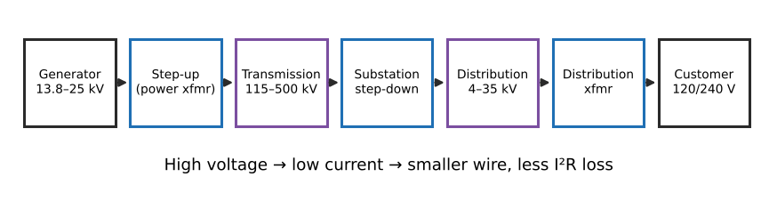  Doubling voltage halves current and cuts line loss to 1/4.  

<b>2.</b> Why won't a transformer work on steady DC?
 Only a CHANGING flux induces voltage. Steady DC makes constant flux, so nothing is induced, and the winding only sees its low resistance (it can overheat).  Faraday's law: induced voltage depends on rate of change of flux.  

<b>3.</b> How is energy transferred from primary to secondary in a conventional transformer?
 Magnetically, through a shared changing flux in the iron core. There is no electrical connection between windings. 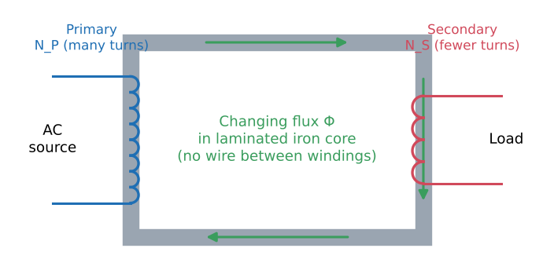  Exception: the autotransformer, which shares one winding.  

<b>4.</b> In the slide demo, what happens to the lamp as the coils move closer, and when an iron core is added?
 It gets brighter both times. More of the primary's flux links the secondary (better coupling). Iron carries flux far more easily than air.  Iron has high permeability.  

<b>5.</b> What mechanical device is a transformer most like?
 A gearbox. Gears trade speed for torque; a transformer trades voltage for current. Turns ratio = gear ratio, and power stays (almost) the same.  Friction in gears ≈ core and copper losses.  

<b>6.</b> State the power rule that solves most transformer problems.
 Power in ≈ power out:  EP × IP = ES × IS (VA in = VA out). 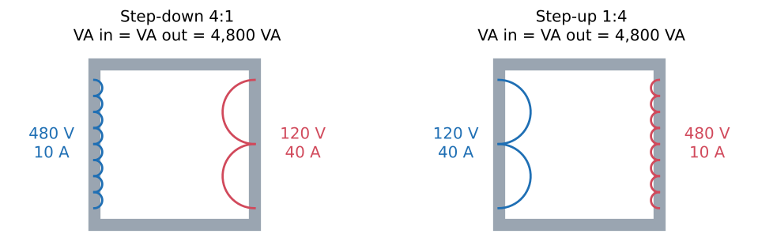  If more VA comes out than goes in, your math is wrong.  

<b>7.</b> Which side of a transformer carries the higher current?
 The low-voltage side. High voltage side = low current.  Check every current answer with a VA check.  

<b>8.</b> Higher voltage lets you use smaller conductors. What is the trade-off?
 Insulation and clearances. Higher voltage needs thicker insulation and more spacing.  Conductor area needed for a given loss goes as 1/V².  

<b>9.</b> Power transformer vs distribution transformer?
 Power transformer: between generator and primary distribution (substations, large). Distribution transformer: from primary distribution (4–35 kV) to the customer's service (e.g., 120/240 V).  

<b>10.</b> Are 'primary' and 'secondary' fixed labels?
 No. Primary = the side the power enters. Feed a step-down unit from its low side and it becomes a step-up unit.  H/X marks voltage level; primary/secondary marks power direction.  

<b>11.</b> Write the transformer EMF equation and define each term.
 Erms = 4.44 × f × N × Φmax. f = frequency (Hz), N = turns, Φmax = peak core flux (Wb).  Every turn sees the same flux, so voltage per turn is the same on both windings.  

<b>12.</b> What happens if a 60 Hz transformer is run on 50 Hz at the same voltage?
 Flux rises about 20% (E = 4.44 f N Φ). The core can saturate, magnetizing current jumps, and it overheats.  Overvoltage has the same effect.  

<b>13.</b> What is excitation (magnetizing) current?
 The small current the primary draws with no load, to magnetize the core. Typically a few percent of FLC or less, lagging voltage by nearly 90°.  An unloaded transformer looks like an inductor.  

<b>14.</b> How does the primary 'know' that load was added to the secondary?
 Secondary current makes an opposing flux. The primary automatically draws more current to cancel it and keep core flux constant.  The load sets the current; the transformer just passes it through.  

<b>15.</b> Why are transformer cores laminated?
 Thin, insulated silicon-steel sheets break up eddy-current paths, so the circulating currents (and their heat) stay small. 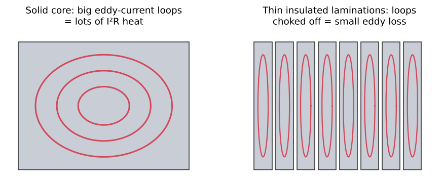  Solid iron would act like a shorted turn.  

<b>16.</b> What are eddy currents?
 Circulating currents induced in the core iron itself by the changing flux. They waste power as heat.  Reduced by thin insulated laminations.  

<b>17.</b> What is hysteresis loss, and how is it reduced?
 Energy lost each cycle re-magnetizing the iron. Reduced by using silicon steel with a narrow hysteresis loop.  Hysteresis + eddy = core (iron) loss.  

<b>18.</b> Core loss vs copper loss: which changes with load?
 Core (iron) loss is roughly constant whenever energized. Copper (I²R) loss rises with the square of load current. 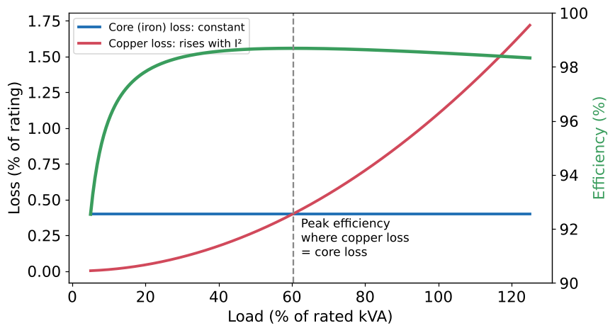  Max efficiency occurs where they're equal.  

<b>19.</b> Core form vs shell form construction?
 Core form: windings surround the core legs. Shell form: the core surrounds the windings. 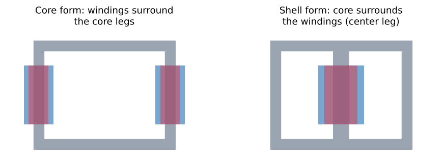  Core form is common on HV/large units; shell form on small units.  

<b>20.</b> The slides say core air gaps increase efficiency. Is that right?
 No. Air gaps raise magnetizing current and lower efficiency. They're used deliberately in reactors, ballasts, neon and flyback transformers to store energy or limit current.  Slide 48 error.  

<b>21.</b> Transformer efficiency formula and typical range?
 %Eff = Pout ÷ Pin × 100. Typically 96–99%.  Among the most efficient machines made.  

<b>22.</b> Why does oversizing a transformer 'for safety' waste energy?
 Core loss is paid 24/7 whether loaded or not. A lightly loaded big unit runs at low efficiency.  

<b>23.</b> Write the turns, voltage and current ratio equation.
 NP/NS = EP/ES = IS/IP  Voltage goes WITH turns; current goes AGAINST turns.  

<b>24.</b> What is TTR?
 Transformer turns ratio: primary turns to secondary turns, usually written high side to low side (e.g., 10:1).  Also the name of the field test that measures it.  

<b>25.</b> What is 'ampere-turns balance'?
 IP × NP = IS × NS. Primary ampere-turns equal secondary ampere-turns.  Same as saying current ratio is the inverse of turns ratio.  

<b>26.</b> 1Ø 2,400–480 V transformer, IP = 15 A. Find TTR and IS.
 TTR = 2,400 ÷ 480 = 5:1. IS = 5 × 15 = 75 A. Check: 2,400×15 = 480×75 = 36,000 VA.  Slides 59–60.  

<b>27.</b> 480–120 V (4:1) transformer. 240 V is applied to the primary. Secondary voltage?
 240 ÷ 4 = 60 V.  The output is always proportional to the input.  

<b>28.</b> 480–120 V (4:1) transformer. 240 V is applied to the SECONDARY. What appears on the primary?
 240 × 4 = 960 V.  The ratio is fixed and works both directions. That's how backfeed happens.  

<b>29.</b> What is reflected impedance?
 The primary sees the load impedance times the turns ratio squared: ZP = (NP/NS)² × ZS.  A 2 Ω load on a 10:1 transformer looks like 200 Ω from the primary.  

<b>30.</b> A winding is tapped. Which turns do you use to compute TTR?
 The whole winding, unless the problem says which tap is used. E.g., 2,400 V to a center-tapped 240 V winding = 10:1.  

<b>31.</b> Primary taps: 1,200 turns (240 V), 1,040 turns (208 V), 600 turns (120 V); secondary 120 turns, 24 V. Using the 1,040 tap, what is the ratio and primary voltage?
 1,040 ÷ 120 = 8.67:1; 8.67 × 24 V = 208 V.  Slide 239.  

<b>32.</b> A 2:1 transformer is fed 438 V instead of 480 V. Output?
 219 V (not 240 V). A transformer can't correct low supply voltage; pick a tap that matches the actual supply.  Slide 240.  

<b>33.</b> The slides say more primary turns makes a stronger field and more secondary current. What's actually true?
 At a fixed supply voltage, more primary turns means LESS flux and LOWER secondary voltage. Secondary current is set by the load.  Slide 53 error.  

<b>34.</b> What is backfeeding a transformer?
 Energizing it from the 'wrong' side, usually the secondary. It steps the voltage up to full primary voltage on lines thought to be dead. 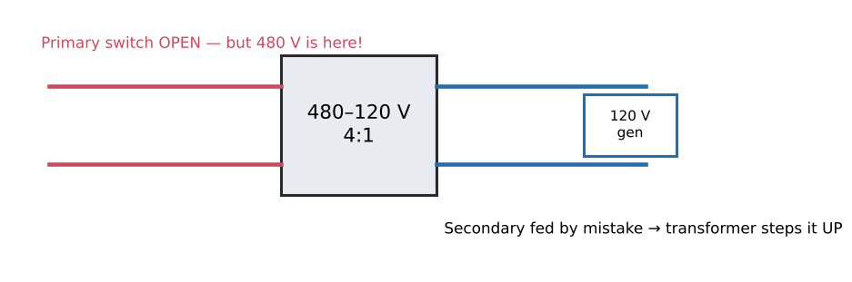  Classic case: a generator plugged into a house without a transfer switch.  

<b>35.</b> Before working on a transformer, which sides must be disconnected?
 BOTH primary and secondary. LOTO, test, and ground as necessary (work between grounds).  Any transformer can be backfed.  

<b>36.</b> When removing an installed transformer, which leads come off first?
 The secondary (low-voltage) leads, to remove the backfeed path.  

<b>37.</b> Why are transformers rated in VA, not watts?
 Heating depends on current, and current depends on VA regardless of power factor. A watt rating would let low-PF loads overheat the unit. 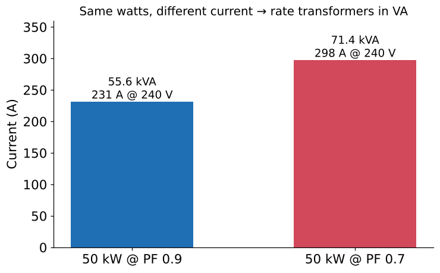  Slide 78: 50 kW at PF 0.7 = 71.4 kVA vs 55.6 kVA at PF 0.9.  

<b>38.</b> FLC vs FLA?
 Same thing: full-load current/amps, the current the transformer can carry continuously at rated conditions.  

<b>39.</b> Single-phase full-load current formula?
 IFL = VA ÷ E = kVA × 1,000 ÷ E.  Three-phase: divide by E × 1.732.  

<b>40.</b> 1Ø 25 kVA, 240–120 V. Primary and secondary FLC?
 Primary: 25,000 ÷ 240 = 104.2 A. Secondary: 25,000 ÷ 120 = 208.3 A.  kVA primary = kVA secondary.  

<b>41.</b> 1Ø 2,000 kVA, 12 kV–2.4 kV. Primary and secondary FLC?
 Primary: 2,000,000 ÷ 12,000 = 166.7 A. Secondary: 2,000,000 ÷ 2,400 = 833.3 A.  833.3 ÷ 166.7 = 5 = TTR.  

<b>42.</b> How can you get the TTR from the full-load currents?
 Divide the secondary FLC by the primary FLC (high current ÷ low current).  

<b>43.</b> Single-phase amps-per-kVA rule of thumb?
 Amps per kVA = 1,000 ÷ V. 120 V → 8.33, 240 V → 4.17, 480 V → 2.08, 2,400 V → 0.42. 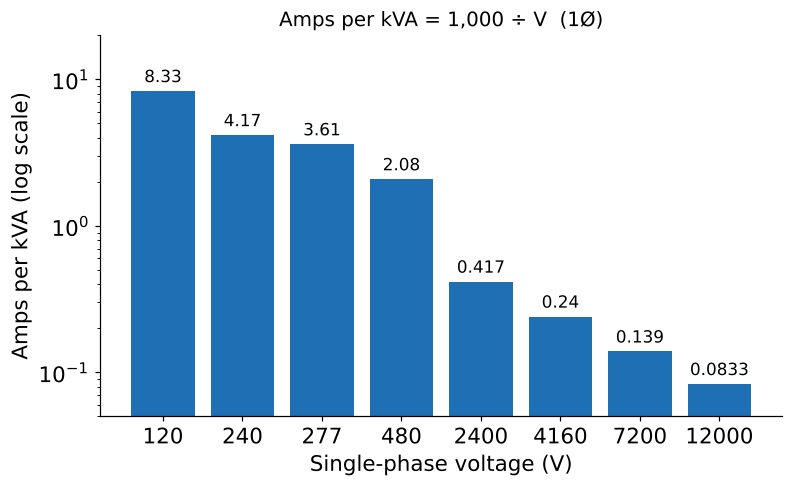  The slide's rounded chart (4, 2, 0.4) reads a few percent low.  

<b>44.</b> Name the common single-phase distribution transformer sizes.
 10, 15, 25, 37.5, 50, 75, 100, 150, 167 kVA.  

<b>45.</b> A 50 kW load at PF 0.85 needs what size transformer?
 VA = W ÷ PF = 50,000 ÷ 0.85 = 58.8 kVA → next standard size up: 75 kVA.  Never round down.  

<b>46.</b> Clamp-on: 200 A on each leg of a 240 V single-phase 60 kVA transformer. Load and % loaded?
 200 × 240 = 48 kVA. 48 ÷ 60 = 80% loaded.  Slides 86–87.  

<b>47.</b> Unbalanced 120/240 V: L1 = 20 A, L2 = 30 A, N = 10 A. kVA load?
 (20 + 30) × 120 V = 6 kVA. Ignore the neutral current.  Each 120 V half delivers its line current at 120 V.  

<b>48.</b> What is the limitation of a load check with a clamp meter?
 It's a snapshot. Peak demand (hot afternoon, evening) matters more than a single reading.  

<b>49.</b> What is BIL?
 Basic Impulse Insulation Level: the peak lightning-type surge voltage (kV crest) the insulation can withstand without damage.  Much higher than operating voltage, e.g., ~95 kV BIL for 15 kV-class gear.  

<b>50.</b> Name 8 items found on a transformer nameplate.
 Any 8: manufacturer, serial no., kVA, phases, frequency, HV and LV voltages, FLCs, temperature rise, %Z, polarity, connection diagram, tap table, cooling/insulation type, BIL, weight, oil volume.  NEC 450.11 requires marking. The nameplate is a formal document.  

<b>51.</b> In '12,470 – 240', what does the dash mean?
 It separates the windings. First voltage = the side receiving power (primary), second = secondary.  

<b>52.</b> 120/240 vs 240/120: what's the difference?
 120/240 = two separate 120 V coils (can be series for 3-wire or parallel). 240/120 = one 240 V coil with a center tap (3-wire only; can't parallel). 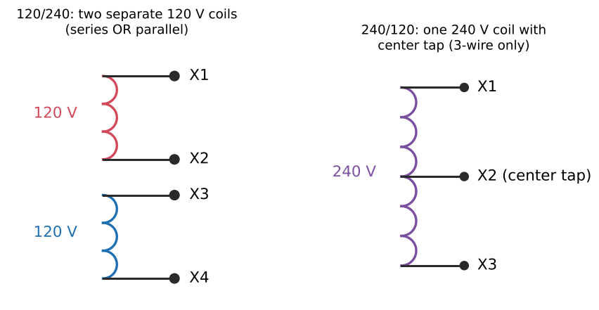  Order matters!  

<b>53.</b> What is a dry-type transformer?
 A self air-cooled transformer: air circulates through vents in a sheet-metal case. Most indoor building transformers.  

<b>54.</b> Two jobs of oil in an oil-immersed transformer?
 Cooling (carries heat to tank and fins by convection) and insulation. It also keeps paper insulation from drying out and oxidizing.  Mineral oil is flammable, so NEC Art. 450 Part II has stricter rules for it.  

<b>55.</b> How does natural convection cool an oil-filled transformer?
 Hot oil near the core rises (less dense), carries heat to the tank and radiators, cools, sinks, and returns.  

<b>56.</b> What is Askarel, and what precautions apply?
 A nonflammable synthetic insulating liquid made of PCBs. Banned from new manufacture since the late 1970s. Toxic: avoid contact and fumes; it's hazardous waste.  Less fire hazard than oil, but a health hazard.  

<b>57.</b> What ambient temperature are transformer ratings based on?
 40 °C maximum (30 °C average over 24 h).  

<b>58.</b> A 65 °C rise transformer in a 40 °C ambient: average max winding temperature?
 40 + 65 = 105 °C. The hot spot runs higher still (insulation class covers it). 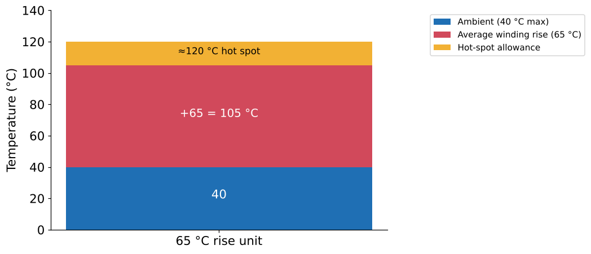  Slide 106.  

<b>59.</b> Same kVA: 55 °C rise vs 65 °C rise unit. Which has more overload headroom?
 The 55 °C (lower-rise) unit. More copper/iron and better cooling: the 'young, healthy runner'.  

<b>60.</b> Besides load current, name 4 factors that limit transformer loading.
 Cooling medium, ambient temperature, duration of overloads, rated temperature rise, altitude (also harmonics, blocked vents, low oil).  

<b>61.</b> Overload vs fault?
 Overload: more than rated current through the normal path; damage is slow, from heat. Fault: current through an abnormal path, often many times rated; protection must clear it fast.  An overload is NOT a fault.  

<b>62.</b> Why can a transformer tolerate short overloads?
 Thermal mass: temperature lags load by minutes to hours. Long overloads still age insulation fast (rule of thumb: life halves per ~8–10 °C over rating).  

<b>63.</b> NEC 450.3(B) (≤1,000 V): what are the two overcurrent protection options?
 1) Primary only at ≤125% of primary FLC. 2) Primary up to 250% WITH secondary protection at ≤125% of secondary FLC.  Next standard size up allowed when ≥9 A. Check your enforced NEC edition.  

<b>64.</b> Why is transformer primary protection sized well above 100% of FLC?
 Inrush: energizing can draw roughly 8–12× FLC for a few cycles while the core magnetizes.  Time-delay fuses are common on primaries.  

<b>65.</b> Does protecting the transformer protect the secondary conductors?
 No. Secondary conductors need their own protection under NEC 240.21(C) (10 ft / 25 ft rules, etc.).  

<b>66.</b> What do H and X terminal markings mean?
 H = high-voltage terminals (H1, H2, H0...). X = low-voltage terminals (X1, X2, X0...).  H/X is about voltage level, not which side is the primary.  

<b>67.</b> The basic polarity rule?
 H1 and X1 are positive at the same instant (H2 and X2 negative).  

<b>68.</b> Facing the low-voltage side, where is H1 normally?
 On your left (back-left bushing).  

<b>69.</b> Additive vs subtractive: where is X1?
 Subtractive: X1 on the SAME side as H1 ('same side subtractive'). Additive: X1 diagonally opposite H1. 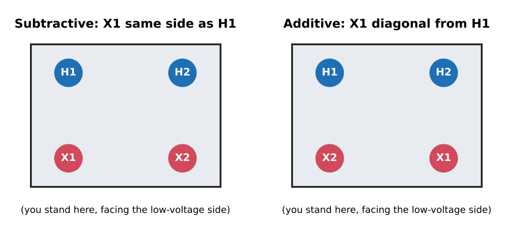  

<b>70.</b> Can polarity be changed from outside the transformer?
 No. It's set by winding direction and how the leads are brought out. You connect to suit it.  

<b>71.</b> Which single-phase transformers are normally additive?
 Units of 200 kVA or less with HV of 8,660 V or less (ANSI C57.12.00). Larger or higher-voltage units are subtractive.  Most pole-top distribution transformers are additive.  

<b>72.</b> Why is subtractive polarity preferred on large/HV units?
 Lower voltage stress between adjacent HV and LV leads: half the DIFFERENCE of the voltages vs half the SUM for additive.  Slide 472.  

<b>73.</b> Can an additive and a subtractive transformer be paralleled?
 Yes, if you connect by H1/X1 markings (polarity), not by physical bushing position.  

<b>74.</b> Describe the AC polarity test.
 Jumper H1 to the adjacent LV terminal. Apply low AC across H1–H2. Measure H2 to the other adjacent LV terminal. Higher than applied = additive; lower = subtractive. 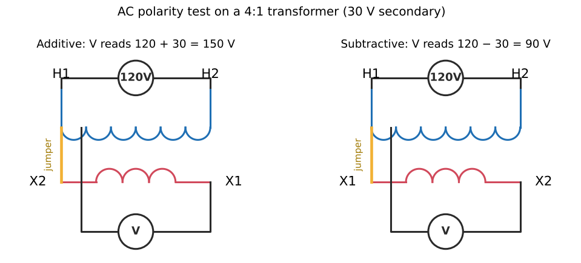  

<b>75.</b> Polarity test on a 4:1 unit with 120 V applied. What do additive and subtractive read?
 Secondary = 30 V. Additive: 120 + 30 = 150 V. Subtractive: 120 − 30 = 90 V.  

<b>76.</b> Describe the DC 'kick' polarity test.
 Analog DC voltmeter on the LV winding. Briefly connect a battery to the HV winding (+ on the lead you call H1). Up-scale kick on MAKE → the LV lead on meter + is X1. 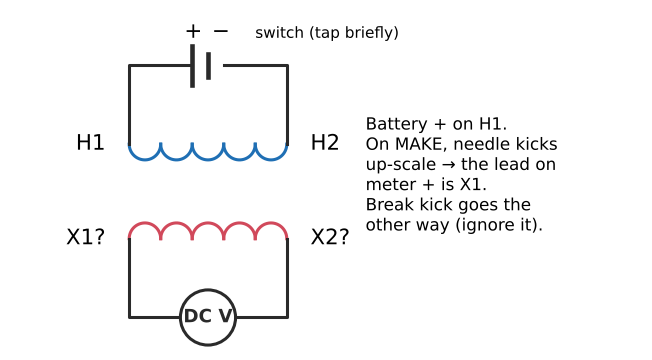  The break kick goes the other way; ignore it. Keep hands off: breaking DC on a winding makes a voltage spike.  

<b>77.</b> Why does the kick test only deflect momentarily?
 Voltage is induced only while flux is changing (when current starts or stops). Steady DC = no induced voltage.  Lenz/Faraday.  

<b>78.</b> Series vs parallel connection of a 120/240 V secondary (25 kVA)?
 Series (X2–X3 jumpered): 120/240 V 3-wire, 104 A. Parallel (X1–X3, X2–X4): 120 V 2-wire, 208 A. 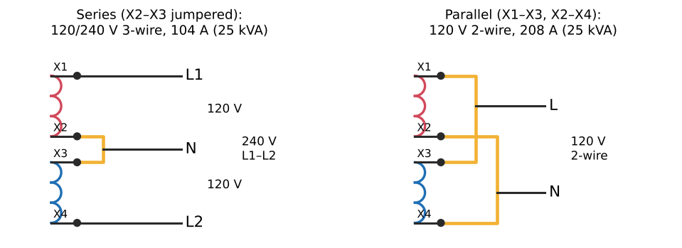  kVA is the same either way.  

<b>79.</b> Two secondary coils in series with one reversed: what happens?
 The voltages cancel: about 0 V instead of the sum. 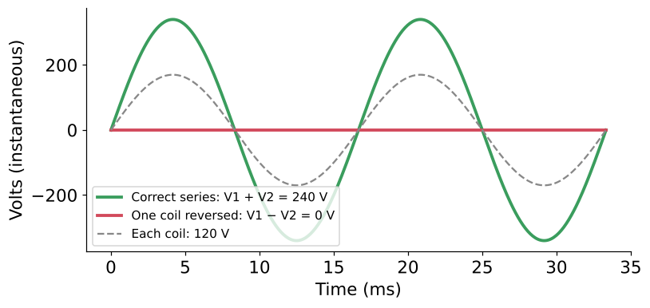  

<b>80.</b> Two secondary coils in parallel with one reversed: what happens?
 A dead short across both coils: huge current, blown fuse, damaged windings.  

<b>81.</b> Does paralleling secondaries increase available kVA?
 No. It only changes how the available current is delivered (more amps at lower voltage).  25 kVA ÷ 240 = 104 A; 25 kVA ÷ 120 = 208 A.  

<b>82.</b> Requirements for paralleling two transformers?
 Same voltage ratio (and tap), same/similar %Z, correct polarity; for 3Ø also same phase sequence and angular displacement.  Mismatched ratio → circulating current even at no load. Mismatched %Z → unequal sharing.  

<b>83.</b> 50 kVA and 100 kVA transformers in parallel share a 75 kVA load. How much does each carry?
 50 kVA unit: 75 × 50/150 = 25 kVA. 100 kVA unit: 75 × 100/150 = 50 kVA.  Assumes matched %Z.  

<b>84.</b> Test before making the final parallel connection?
 Read voltage across the open connection. ~0 V → connect. Voltage present (~double) → polarity wrong, DO NOT connect. 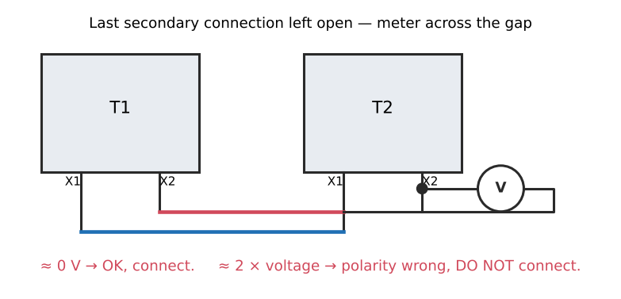  Connecting wrong = huge circulating current.  

<b>85.</b> In a paralleled bank, one transformer's primary fuse blows. Is its primary dead?
 No. The other unit backfeeds it through the paralleled secondaries. Its primary stays at full voltage. The good unit may also be overloaded.  Treat all primaries in a parallel bank as hot.  

<b>86.</b> Why is the center point of a 120/240 V 3-wire secondary grounded?
 To limit voltage to ground (120 V), provide a fault-current path, and limit voltages from lightning, surges or primary contact.  

<b>87.</b> If the 120/240 V neutral were NOT grounded and L1 faulted to ground, what would L2's voltage to ground be?
 240 V.  

<b>88.</b> What current does the neutral of a 120/240 V 3-wire system carry?
 The DIFFERENCE between L1 and L2 currents (the unbalance). Balanced = 0 A.  The slide's 'sum of the unbalanced load' wording is wrong.  

<b>89.</b> 25 kVA 120/240 V: side 1 = 167 A, side 2 = 42 A. How loaded is each half?
 Each half is rated 12.5 kVA = 104 A. Side 1: 167/104 = 160% (60% overloaded). Side 2: 42/104 = 40% loaded. 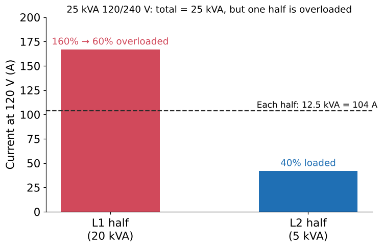  Total is exactly 25 kVA, yet one winding is overloaded. (Slide says '40% underloaded' — it's 40% loaded.)  

<b>90.</b> 75 kVA 12,500–120/240 V. Loads: 6 kVA @240 V, 3 kVA @120 V on L1 side, 3.6 kVA @120 V on L2 side. Find L1, L2, N and primary currents.
 240 V load 25 A; 3 kVA = 25 A; 3.6 kVA = 30 A. L1 = 50 A, L2 = 55 A, N = 5 A. Primary ≈ 12,600 ÷ 12,500 ≈ 1.0 A. Loaded 16.8%. 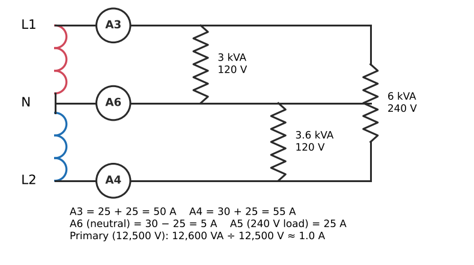  Slides 227–231.  

<b>91.</b> Open neutral on 120/240 V: what happens to the 120 V loads?
 Loads on opposite sides go in SERIES across 240 V. Voltage divides by resistance: the lighter load (higher R) gets the HIGHER voltage.  Lights going bright/dim when a load cycles = open neutral. Emergency.  

<b>92.</b> Open neutral: 3 kVA and 3.6 kVA 120 V loads on opposite sides. Voltage on each?
 R = 4.8 Ω and 4.0 Ω; I = 240 ÷ 8.8 = 27.3 A. 3 kVA load: 131 V. 3.6 kVA load: 109 V. 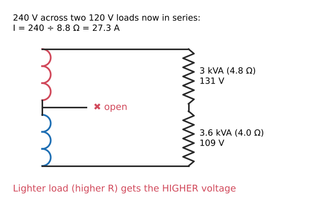  The slide figure has these reversed.  

<b>93.</b> What does %Z mean on a transformer nameplate?
 The percent of rated primary voltage needed to push full-load current through a shorted secondary.  Tells you fault current and voltage regulation.  

<b>94.</b> Why is transformer impedance given in percent instead of ohms?
 One number works for both sides. In ohms, HV and LV values differ (by the turns ratio squared).  

<b>95.</b> A 480 V transformer has 5 %Z. At what voltage does FLA flow with the secondary shorted, and what is the fault current at 480 V?
 0.05 × 480 = 24 V. At 480 V the fault current is 480/24 = 20 × FLA. 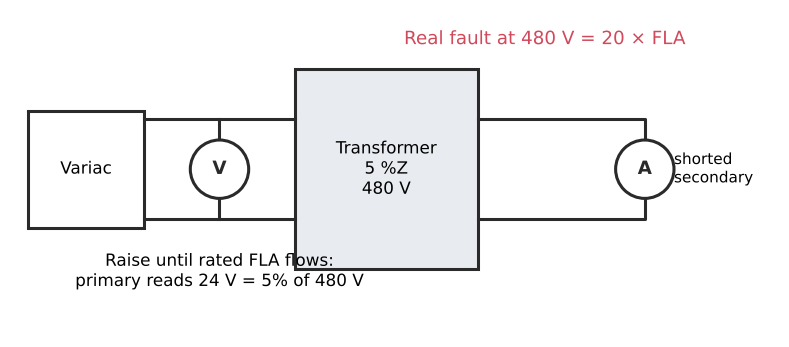  5% = 1/20.  

<b>96.</b> Maximum short-circuit current formula from %Z?
 ISC = IFL × 100 ÷ %Z (infinite source). 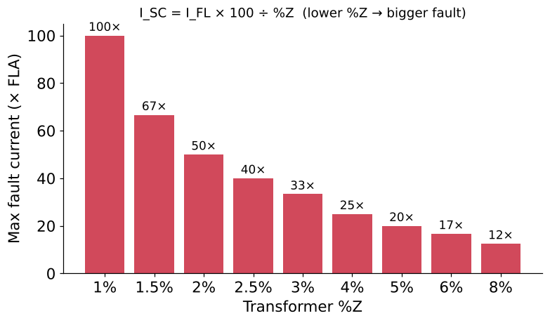  Real fault current is somewhat lower; this is the worst case.  

<b>97.</b> 25 kVA, 240 V, 2 %Z. Maximum fault current?
 FLC = 104.2 A. ISC = 104.2 × 100/2 = 5,208 A.  

<b>98.</b> How is %Z measured (short-circuit test)?
 Short the secondary (ammeter in series), voltmeter on the primary, raise primary voltage from a Variac until rated FLC flows. %Z = that primary voltage ÷ rated × 100.  Slides call this 'determining FLC' and say record the secondary voltage — it's %Z and the PRIMARY voltage.  

<b>99.</b> Low %Z vs high %Z: trade-offs?
 Low %Z: better voltage regulation, but higher fault current (higher AIC and arc-flash). High %Z: limits fault current, but more voltage drop/dip under load.  %Z is a design choice, not a quality grade (slide 196 overstates this).  

<b>100.</b> A transformer is replaced with one of lower %Z. What must you check downstream?
 Interrupting ratings / SCCR of breakers and fuses (NEC 110.9), the available fault current marking (110.24), and arc-flash labels.  

<b>101.</b> What is an isolation transformer?
 A 1:1 transformer used only for isolation: blocks spikes/noise, breaks ground loops, feeds sensitive equipment.  Often has a grounded electrostatic shield.  

<b>102.</b> What grounding does an isolation transformer secondary need?
 It's a separately derived system (NEC 250.30): system bonding jumper, grounding electrode conductor, supply-side bonding jumper.  Without it, a ground fault on the secondary won't trip anything.  

<b>103.</b> What is a buck-boost transformer?
 A small isolating transformer wired as an autotransformer with its LV winding in series with the line, to raise or lower voltage ~5–27%.  

<b>104.</b> Boost vs buck connection: 120 V supply, 24 V winding?
 Boost (additive): 120 + 24 = 144 V. Buck (subtractive): 120 − 24 = 96 V. 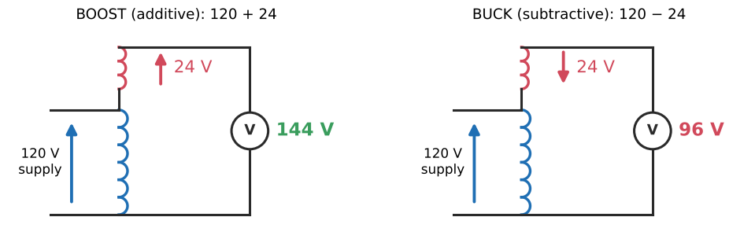  

<b>105.</b> Why is correct voltage important for motors?
 Low voltage raises motor current, lowers torque and raises temperature, shortening insulation life.  

<b>106.</b> A 1 kVA buck-boost unit (24 V secondary) boosts 120 V to 144 V. About how much load can it feed?
 Secondary current limit = 1,000 ÷ 24 = 41.7 A. Load ≈ 41.7 × 144 ≈ 6 kVA.  It only carries the 'difference' power. Size by load current.  

<b>107.</b> What is an autotransformer?
 A one-winding transformer: the same winding is both primary and secondary. 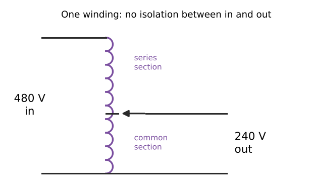  Most efficient type; the shared section carries only the difference current.  

<b>108.</b> Two disadvantages of autotransformers?
 1) No isolation between HV and LV sides. 2) If the common winding opens while stepping down, full line voltage appears at the load.  

<b>109.</b> What is a Variac?
 A variable autotransformer: a brush rides on the winding to give adjustable output from 0 to slightly above line voltage.  Used in the lab bench supplies.  

<b>110.</b> NEC-permitted uses of autotransformers (from the slides)?
 Systems with a grounded conductor common to both sides; motor starting; theater dimming; lighting ballasts; buck/boost under certain conditions.  NEC 210.9, 215.11, 450.4.  

<b>111.</b> What is a control transformer?
 Steps 240/480 V down to 120 V (or 24 V) for control circuits (coils, pilot lights, PLC I/O).  

<b>112.</b> Dual-primary control transformer (240 × 480): how are primaries connected for each voltage?
 480 V: primaries in SERIES (jumper H2–H3). 240 V: primaries in PARALLEL (H1–H3, H2–H4). 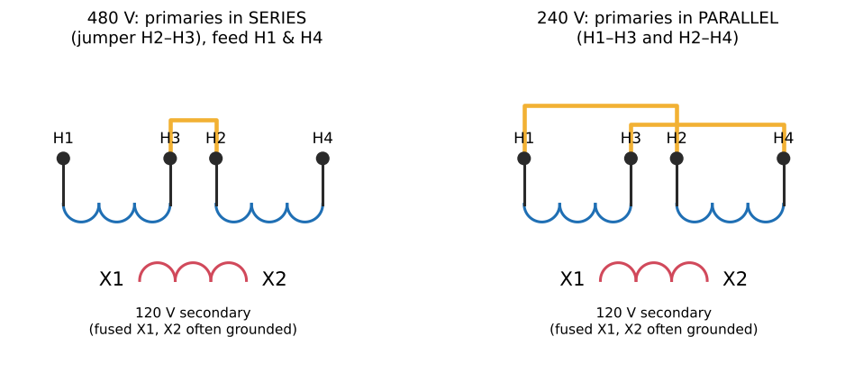  Slide 247 mislabels the parallel case.  

<b>113.</b> Why is one side (X2) of a control transformer secondary often grounded?
 So a ground fault in the control circuit blows the fuse instead of energizing a coil and starting a motor.  

<b>114.</b> Neon sign transformer voltages and currents?
 Primary 120/240 V; secondary 2,000–15,000 V; 30–120 mA. Self air-cooled, mounted in the sign.  Current-limiting by design. NEC Art. 600. Lethal despite mA rating.  

<b>115.</b> What does a constant-current transformer do, and where is it used?
 Holds secondary current constant (usually 6.6 A) as load changes. Used on series streetlights and airport runway lighting. 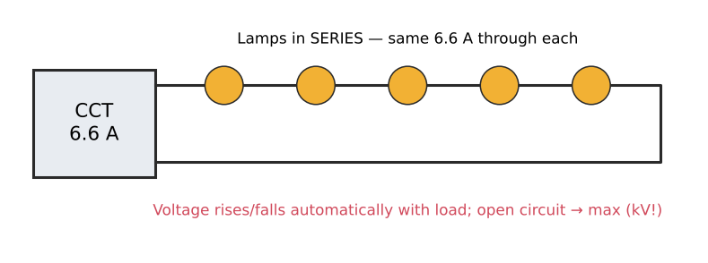  Primary typically 2,400 V.  

<b>116.</b> Why are series streetlights/runway lights fed from a CCT?
 Series wiring saves copper, and lamp brightness tracks current closely, so regulating current keeps brightness steady.  

<b>117.</b> How does a CCT regulate current mechanically?
 A movable coil floats; the windings' fields repel. More current pushes them apart, increasing leakage and reducing current. A counterweight and oil dashpot prevent 'hunting'.  

<b>118.</b> Why must you never open a live series lighting (CCT) circuit?
 The regulator drives voltage to maximum trying to keep current flowing: several kV across the opening.  

<b>119.</b> In a series lighting circuit, what keeps the circuit closed when a lamp fails?
 A film cutout or a reactor (reactance coil) at each lamp.  

<b>120.</b> What is a K-rated transformer?
 One built to withstand extra heating from harmonic currents drawn by non-linear loads. 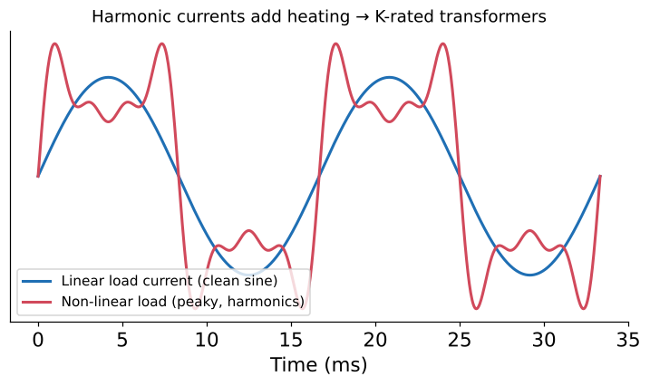  K-1 = linear loads only; common ratings K-4, K-13, K-20.  

<b>121.</b> Name 5 loads that produce harmonics.
 Any 5: switch-mode power supplies (PCs, TVs), VFDs, LED/fluorescent ballasts, UPSs, PV inverters, arc furnaces, welders, solid-state dimmers/heater controls, HVDC converters.  

<b>122.</b> Why can the neutral of a 4-wire wye carry more current than the phases?
 Triplen harmonics (3rd, 9th...) from non-linear loads add in the neutral instead of cancelling.  K-rated units often have a double-size neutral.  

<b>123.</b> How do you determine what K-rating is needed?
 Measure K-factor with a power-quality meter with the system fully loaded.  

<b>124.</b> What is a no-load tap changer (NLTC), and the key rule for using it?
 A switch that changes the turns ratio (taps usually in 2½% steps). It must only be moved with the transformer DE-ENERGIZED.  Substation load tap changers (LTCs) are different: they work under load.  

<b>125.</b> Secondary voltage is too low. Do you move to a higher or lower % primary tap?
 LOWER % tap (fewer primary turns) raises the output. Higher % tap lowers it. 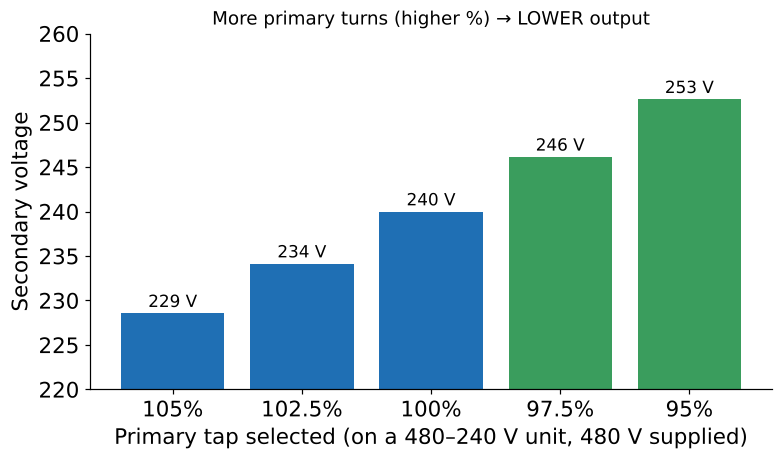  E.g., 95% tap raises output ~5%.  

<b>126.</b> What does a transformer pressure relief device do?
 A spring-loaded valve vents internal pressure from a fault or overheating so the tank doesn't rupture, then reseals. A flag stays up; often has alarm/trip contacts.  A tripped PRD means a serious internal event: test before re-energizing.  

<b>127.</b> Wye: relationship of line and phase voltage and current?
 EL = 1.732 × EP; IL = IP. 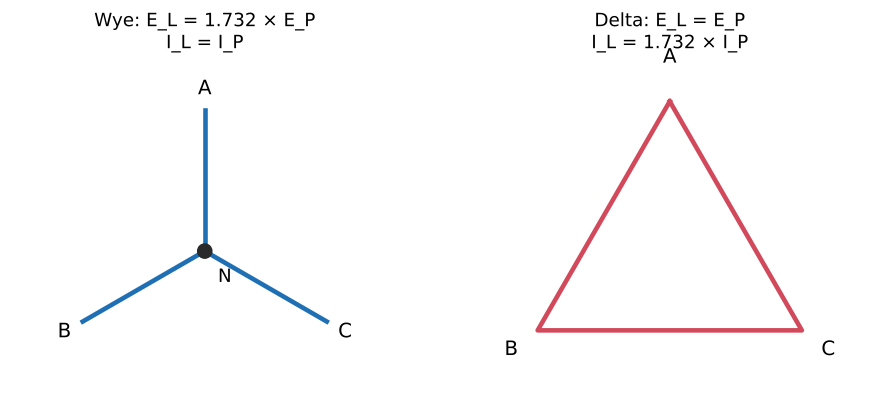  E.g., 208 V line → 120 V phase.  

<b>128.</b> Delta: relationship of line and phase voltage and current?
 EL = EP; IL = 1.732 × IP.  Phase current inside a delta can't be clamped from outside.  

<b>129.</b> Three-phase kVA formula?
 kVA = EL × IL × 1.732 ÷ 1,000.  

<b>130.</b> Forming a wye from three 1Ø cans: what gets connected together?
 The non-polarity terminals (H2s or X2s). That common point is the neutral; the polarity terminals become the lines.  

<b>131.</b> Forming a delta from three 1Ø cans?
 Polarity to non-polarity around the loop (X1 of A to X2 of B, etc.). No neutral.  

<b>132.</b> Advantages of three single-phase cans over one 3Ø tank?
 Replace one failed unit, keep one spare, run open-delta on two units (57.7% capacity).  A single 3Ø tank is smaller, cheaper and more efficient.  

<b>133.</b> Test before closing a delta?
 Read voltage across the open corner. ~0 V (small reading OK) → close. ~2× winding voltage → a winding is reversed; DO NOT close. 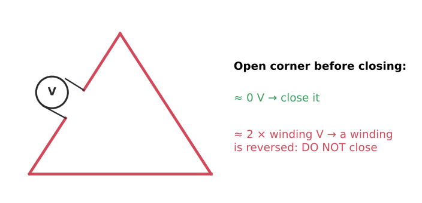  Use a meter rated for at least 2× winding voltage.  

<b>134.</b> The four basic 3Ø transformer connections?
 Delta–delta, delta–wye, wye–delta, wye–wye.  Delta–wye (e.g., 480 V → 208Y/120) is most common in buildings.  

<b>135.</b> What are instrument transformers for?
 Step high voltage/current down to safe standard values (120 V, 5 A) for meters, relays and SCADA, and isolate those devices from the primary.  Small VA, high accuracy.  

<b>136.</b> PT vs CT connection and secondary rating?
 PT: in PARALLEL, 120 V secondary (115 V older). CT: in SERIES, 5 A secondary. 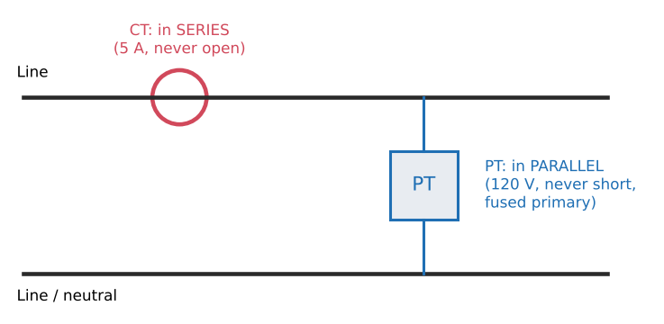  

<b>137.</b> The opposite safety rules for PTs and CTs?
 Never SHORT a PT secondary. Never OPEN a CT secondary.  

<b>138.</b> Why must you never short a PT secondary?
 A PT is a voltage source; a short draws destructive current (slides: primary current could rise ~200×).  PT primaries are fused; never remove a ground from an energized PT.  

<b>139.</b> Why must PT fuses/switches be opened when working on connected equipment?
 A PT can backfeed: voltage on its secondary steps up to full primary voltage.  

<b>140.</b> Why must you never open the secondary of an energized CT?
 The CT is driven by primary current. With nothing to oppose the flux, it acts as a step-up transformer: thousands of volts, shock, arcing, insulation and core damage. 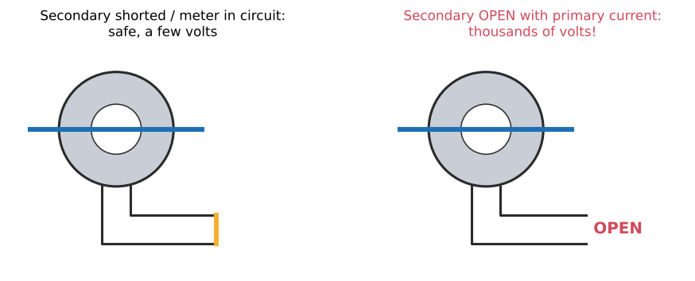  Short it at the shorting block or test switch first.  

<b>141.</b> Standard CT secondary current?
 5 A at rated primary current, regardless of primary rating.  1 A secondaries also exist (common outside N. America, long runs).  

<b>142.</b> Name 4 CT types.
 Window/donut/ring, split-core, bar type, wound type, bushing type.  Window CTs are less accurate at low ratios than wound CTs.  

<b>143.</b> A 600:5 CT has 300 A in the primary. Secondary current?
 600:5 = 120:1, so 300 ÷ 120 = 2.5 A.  

<b>144.</b> Shortcut for finding the ratio of an X:5 CT?
 Double the primary number and drop the last zero. 600:5 → 120:1; 2000:5 → 400:1.  Works because ÷5 = ×2 ÷10.  

<b>145.</b> CT current ratio vs turns ratio?
 IS/IP = NP/NS. A 600:5 window CT has 120 secondary turns.  

<b>146.</b> 600:5 multi-ratio CT (X1–X2 20, X2–X3 10, X3–X4 50, X4–X5 40 turns). Which taps give 150:5?
 150:5 = 30:1 → 20 + 10 → X1–X3. Leave other taps open. 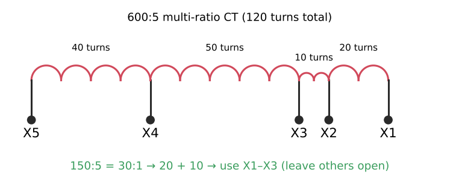  Slides 381–382.  

<b>147.</b> Tapped CT: X1–X2 = 40, X1–X3 = 60, X1–X4 = 160, X1–X5 = 240 turns. Which taps give 500:5?
 500:5 = 100:1 → 160 − 60 = 100 → X3–X4.  Slide 383.  

<b>148.</b> On a multi-ratio CT, what do you do with the unused taps?
 Leave them OPEN. Don't short them.  

<b>149.</b> How does passing the primary through a window CT twice change its ratio?
 It halves it: 200:5 becomes 100:5. New ratio = nameplate ratio ÷ number of passes. 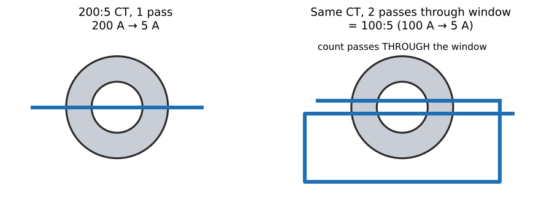  

<b>150.</b> How do you count 'turns' on a window CT?
 Count passes THROUGH the window, not loops around the outside. One loop around the housing = 2 passes.  

<b>151.</b> 200:5 CT with 3 and with 4 passes?
 3 passes: 66.7:5 (13.3:1). 4 passes: 50:5 (10:1).  

<b>152.</b> 2500/5 donut CT. How many passes for a 125:1 ratio?
 2500/5 = 500:1; 500 ÷ 125 = 4 passes.  Slide 394.  

<b>153.</b> What is CT burden?
 Everything connected to the secondary: meters, relays, transducers, and lead wire resistance (VA or ohms).  Excess burden reduces accuracy.  

<b>154.</b> What is CT saturation, and what is the knee point?
 Past a point, more primary current gives no more secondary current. The bend in the excitation curve is the knee point. 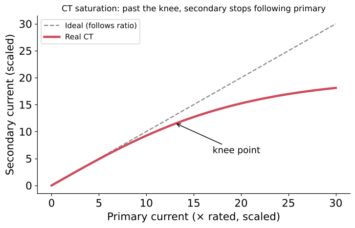  A saturated protection CT under-reports fault current; relay may not trip.  

<b>155.</b> Name 4 factors affecting CT accuracy.
 Burden, accuracy class, rating factor, load, external magnetic fields, temperature, physical configuration, tap selected.  

<b>156.</b> How many points should a CT secondary circuit be grounded at?
 One point only (IEEE C57.13.3). NEC Art. 250 Part X covers instrument transformer grounding.  

<b>157.</b> Should spare CTs be stored open or shorted?
 Shorted, including in storage and shipping.  

<b>158.</b> Can you megger a CT secondary with the primary energized?
 No — not even with no load.  

<b>159.</b> What is special about CT test switches?
 They're make-before-break: a shorting contact closes across the CT leads before the blade opens the meter circuit, so the CT is never open.  

<b>160.</b> How does a CT shorting terminal block work?
 A metal bar runs down the block. Screws through the bar tie terminals to it; one screw always ties it to ground. Screws on a CT's terminals short and ground that CT. 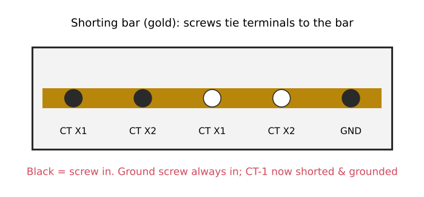  

<b>161.</b> CT polarity rule?
 Current IN on polarity (H1) means current OUT on polarity (X1) at the same instant. 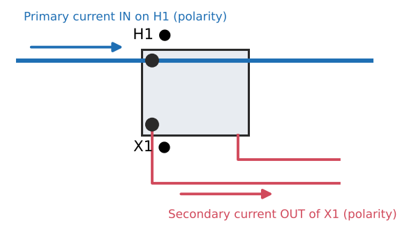  CT polarity is always subtractive. Marks: H1/X1 or a dot.  

<b>162.</b> What goes wrong if instrument transformer polarity is reversed?
 Meters read backward, revenue meters record power in the wrong direction, protective relays cover the wrong zone or misoperate.  

<b>163.</b> Two 800:5 CTs, 400 A primary, secondaries share a middle meter. When does the middle meter read 0 A?
 When the two CTs' 2.5 A secondary currents meet head-on in the shared meter: they cancel there and circulate through the outer meters (2.5 A each).  Trace current out of X1 and back to its own X2 by the lowest-impedance path.  

<b>164.</b> What is a transducer (in metering/SCADA)?
 A device that converts CT/PT signals (or other physical quantities) into a standard signal, often 4–20 mA or a voltage, for a PLC/RTU/SCADA.  

<b>165.</b> SCADA vs HMI?
 SCADA: the overall supervisory control and data acquisition system talking to RTUs/PLCs. HMI: the operator's graphical screen within it.  

<b>166.</b> What should you inspect before accepting a transformer shipment?
 On the truck: damaged bushings, oil leaks, bulged/dented tank, broken gauges, overheating/arc signs, lead condition. Note damage before signing.  

<b>167.</b> List the pre-energization field tests from the slides.
 Insulation resistance, turns ratio (TTR), polarity, winding resistance, power factor, CT saturation.  Plus oil tests (dielectric, moisture, DGA) on liquid-filled units.  

<b>168.</b> Insulation resistance test: what does it measure and how is it done?
 Leakage through insulation, with a DC megohmmeter: each winding to ground and winding to winding. Higher megohms = less leakage.  Record as a baseline; trend it, temperature-corrected. PI and DAR ratios show moisture.  

<b>169.</b> TTR test: what does it check?
 Low-voltage AC test confirming the HV-to-other-windings ratio at no load, on every tap of every winding.  Catches shorted turns and wrong tap position. NETA ATS tolerance ≈ 0.5%.  

<b>170.</b> Winding resistance test finds what?
 Loose connections, broken strands, poor tap-changer contacts. Low-resistance DC test; compare phases and factory data, temperature-corrected.  Discharge the winding afterward.  

<b>171.</b> What does an insulation power factor test measure?
 Ratio of resistive (loss) current to capacitive current under AC. Rising PF means insulation is degrading (moisture, contamination).  Good insulation is well under 1%. Compare to the same unit's history.  

<b>172.</b> Why are power factor readings compared to previous readings rather than other equipment?
 Trend on the same unit is what reveals deterioration; values vary between designs.  

<b>173.</b> Purpose of CT saturation testing?
 Confirms the CT won't saturate at its required burden; also verifies ratio and polarity vs manufacturer data.  

<b>174.</b> Name 5 periodic transformer maintenance items.
 Keep records; maintain oil level; keep moisture out; keep parts clean/rust-free; test winding insulation and oil; lubricate moving parts; keep enclosures tight; check fans, arresters, gauges, grounds.  

<b>175.</b> After disconnecting a transformer, why ground the windings?
 To discharge stored capacitive energy, especially after DC testing. Leave personal grounds on until all work is done.  

<b>176.</b> Steps to make a transformer safe to work on?
 Open both sides, LOTO all sources, test for absence of voltage on both sides, apply grounds, work between grounds.  NFPA 70E Art. 120.  

<b>177.</b> Safe energization practices?
 Verify grounds/tools removed, operate remotely if possible, know emergency shutoffs and first aid, wear required PPE, stand clear.  

<b>178.</b> Why must transformer cases and metal enclosures (and fences) be grounded?
 To limit touch voltage from insulation failure and provide a low-impedance fault path so the OCPD trips fast.  NEC 450.10, Art. 250.  

<b>179.</b> Three requirements of an effective ground-fault current path?
 Electrically continuous; able to safely carry any likely fault current for its duration; low impedance to trip the OCPD quickly.  NEC 250.4.  

<b>180.</b> How does fault current divide among paths?
 It uses all available paths, dividing inversely to their impedance, and returns to its source (the transformer secondary).  

<b>181.</b> Classic grounding mistake on a new building transformer?
 Missing system bonding jumper (no fault path), or bonding neutral to ground at both the transformer and downstream panel (neutral current on grounding conductors).  Bond at one location only (NEC 250.30).  

<b>182.</b> Liquid-filled transformers: name 4 liquids used today, and the liquid's two jobs.
 Mineral oil (combustible), silicone fluid, seed-oil (natural ester) coolants, other non-toxic high-dielectric liquids. Jobs: insulate HV from LV windings, and carry heat from core and coils to the tank/radiators/fans.  Textbook Ch. 13.  

<b>183.</b> Why did askarel disappear, even though it was nonflammable?
 It's a PCB mixture, found highly toxic. The Toxic Substances Control Act (1976) and EPA rules ended its use; old units were replaced or refilled.  Textbook Ch. 13.  

<b>184.</b> Advantages of dry-type over liquid-filled transformers?
 Lighter, simpler to install, no leak precautions or containment, no coolant replacement. Fans can be added to carry more load.  Textbook Ch. 13.  

<b>185.</b> What three sections make up a unit substation?
 High-voltage switch, dry-type transformer, secondary distribution section, all in one lineup.  Often owner-furnished; common in industrial plants. Textbook Ch. 13.  

<b>186.</b> NEC 450.3 overcurrent devices protect what?
 The transformer only. Conductors supplying or leaving it may need their own protection (Articles 240 and 310).  Textbook Ch. 13.  

<b>187.</b> NEC Table 450.3(A) vs 450.3(B)?
 (A): over 1,000 V, varies with %Z (≤6% or 6–10%), fuse vs breaker, and supervised vs any location. (B): 1,000 V or less (125/167/300% primary-only, or 250% primary with secondary protection).  Supervised locations get higher limits.  

<b>188.</b> Can a transformer with manufacturer's coordinated thermal overload protection skip primary protection?
 Yes, if the feeder overcurrent device is set at no more than 6× primary FLC (%Z ≤6%) or 4× (%Z 6–10%).  Textbook Fig. 13-2.  

<b>189.</b> 50 kVA, 480 V → 208Y/120 V 3Ø. Primary FLC, 125% primary fuse, and max primary fuse (with secondary protection)?
 FLC = 50,000 ÷ (480 × 1.732) = 60 A. 125% = 75 A → next standard 80 A dual-element fuses (100 A switch). Max = 60 × 250% = 150 A.  Textbook Fig. 13-3.  

<b>190.</b> Same 50 kVA, 480–208Y/120 V transformer: secondary FLC and overcurrent device?
 FLC = 50,000 ÷ (208 × 1.732) = 139 A. ×125% = 174 A → 175 A fuses or breaker. It also protects the panel (408.36) and secondary conductors (240.21(C)).  Textbook Fig. 13-3.  

<b>191.</b> Name the four grounding/bonding parts of a separately derived system (NEC 250.30(A)).
 System bonding jumper, supply-side bonding jumper, grounding electrode conductor, grounding electrode.  Primary EGC sized per 250.122. Textbook Fig. 13-3.  

<b>192.</b> What is an open-delta bank, and when is it used?
 Two transformers giving 3Ø (and 1Ø via a center tap on one). Used where the utility has only two primary phases nearby, for small 3Ø loads, or where a third unit will be added later.  Textbook Ch. 13.  

<b>193.</b> Two 100 kVA transformers in open delta: capacity?
 (100 + 100) × 0.866 = 173 kVA, or 300 × 0.577 = 173 kVA. 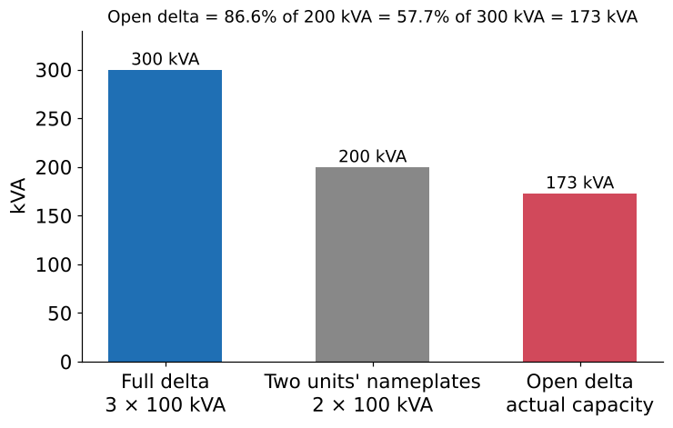  86.6% of the two nameplates, 57.7% of a full 3-unit delta.  

<b>194.</b> What is a corner-grounded delta?
 A 3-wire delta secondary with one phase grounded. Phase voltages are unchanged; overcurrent devices generally aren't allowed in the grounded phase.  Textbook Ch. 13.  

<b>195.</b> 120/240 V 4-wire (high-leg) delta: voltages A–N, C–N, B–N, and phase-to-phase?
 A–N and C–N = 120 V; B–N = 208 V (high leg); every phase-to-phase = 240 V. 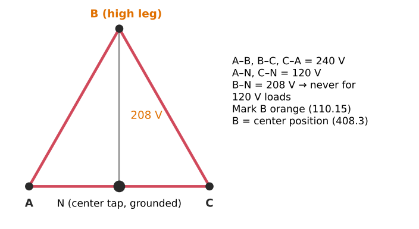  B can't serve line-to-neutral loads.  

<b>196.</b> High-leg identification and position rules?
 Mark it orange (or other effective means) wherever the neutral is present (110.15, 230.56). It's the B phase, in the center position (408.3(E)(1)). Panel warning: 'Caution ___ Phase Has ___ Volts to Ground' (408.3(F)).  Also called red leg or wild leg.  

<b>197.</b> High-leg meter-socket trap?
 Many utilities want the high leg on the RIGHT-hand (C) position in self-contained meter sockets ≤200 A, then back in the CENTER (B) at the service disconnect.  CT-metered services over 200 A avoid it. Textbook Ch. 13.  

<b>198.</b> Most common system in modern commercial buildings, and its usual voltages?
 3Ø 4-wire wye: 208Y/120, 480Y/277, 600Y/347 V. Line-to-neutral loads can go on any phase.  Primaries are usually delta (only 3 conductors). Textbook Ch. 13.  

<b>199.</b> NEC vs NESC: which applies to the utility's transformer?
 The NESC applies up to the service point (utility equipment); the NEC applies to premises wiring after it (90.2(D)(5)). The utility sets the service point.  Check who furnishes the service conductors before you bid.  

<b>200.</b> What is primary (high-voltage) metering?
 The utility meters on the transformer's HV side with PTs and CTs, often with 15-minute demand registers for kW and kVAR. High demand or low PF raises the rate.  Used for single-tenant buildings. Textbook Ch. 13.  

<b>201.</b> Up to what size is a service typically direct-metered (self-contained socket)?
 200 A. Larger: 320 A sockets (some utilities) or CT metering; the utility wires CTs to the meter.  Textbook Ch. 13.  

<b>202.</b> Panelboards fed through a transformer: where must overcurrent protection be?
 On the secondary side (408.36(B)). Exception: 2-wire to 2-wire, or 3-wire delta–delta, can be protected by the primary device through the ratio (240.21(C)(1)).  Textbook Ch. 12.  

<b>203.</b> What protects service conductors before the service disconnect?
 Only the utility's transformer primary fuses, which protect the utility transformer, not the conductors. Keep service conductors inside buildings short.  Textbook Ch. 13.  

<b>204.</b> Can harmonics overheat a transformer without tripping its overcurrent device?
 Yes (NEC 450.3 Informational Note 2). Fixes: oversize the transformer, use K-rated, run separate neutrals for non-linear loads.  IEEE C57.110. Textbook Ch. 8.  

<b>205.</b> Why does the textbook multiply the marked %Z by 0.9 in fault calculations?
 Listed transformers ≥25 kVA have ±10% impedance tolerance. Actual %Z may be 10% lower, which means more fault current: the worst case.  I_SC = I_FL × 100 ÷ (%Z × 0.9).  

<b>206.</b> 225 kVA, 208Y/120 V, 2 %Z (infinite primary, book method). Fault current at the terminals?
 FLC = 225,000 ÷ (208 × 1.732) = 625 A. Multiplier = 100 ÷ (2 × 0.9) = 55.56. I_SC = 625 × 55.56 = 34,725 A.  1% → 69,444 A; 4% → 17,363 A. Textbook Problem 1, Ch. 18.  

<b>207.</b> How do service conductors change the available fault current, and what method does the book use?
 Their impedance lowers it. Point-to-point method: f from length, conductor constant C and voltage; M = 1 ÷ (1 + f); I_end = I_start × M. Example: 34,725 A → about 30,558 A over 25 ft of 3 × 250 kcmil Cu in PVC.  Textbook Problem 2, Ch. 18.  

<b>208.</b> Besides the transformer, what else adds to or raises available fault current?
 Motor contribution (running motors act as generators briefly) and higher system voltage (+10% V → +10% fault current).  Book recommends interrupting ratings ≥25% above calculated. Textbook Ch. 18.  

<b>209.</b> What do NEC 110.24(A) and (B) require?
 (A) Non-dwelling service equipment field-marked with available fault current and the calculation date. (B) Recalculate and re-mark when changes (e.g., bigger or lower-%Z utility transformer) affect it.  110.16(B), new in 2023: arc-flash label on non-dwelling service/feeder equipment ≥1,000 A.  

<b>210.</b> How can a PV inverter or generator create a hazard on the utility primary?
 By backfeeding through the service transformer: 240 V can appear as 12,000 V or more on the primary. Hence listed transfer switches and utility-interactive (anti-islanding) inverters.  Textbook Ch. 16 and 22.  

<b>211.</b> Name 4 transformer-related causes of unbalanced voltage.
 Large single-phase loads, open connections at a transformer secondary, open-delta banks, unequal %Z of 1Ø transformers in a 3Ø bank (also unequal/open capacitor banks).  Small voltage unbalance = big extra heat in a motor. Textbook Ch. 7.  

