# Flashcards — ELECT 245: Chapter 12: Panelboard Selection and Installation

100 cards. Read the question, answer it in your head, then click it to check.

Study guide for these cards: [study-guide.md](../study-guide.md).

- **Study online:** [flashcard page](https://webnrrd2k.github.io/lbcc-electrical-study-materials/flashcards/?deck=e245-ch12): shuffle, flip, and mark the cards you know.
- **Download:** [Anki](chapter12.apkg) · [Quizlet import file](chapter12_quizlet.txt) (paste into Quizlet's Import box; images are not included) · [Emacs org-drill](chapter12.org) · [raw card data](chapter12.json)

## Contents

- [1. Big picture](#1-big-picture) (4)
- [2. Panelboard basics](#2-panelboard-basics) (7)
- [3. Construction, phase arrangement, numbering](#3-construction-phase-arrangement-numbering) (11)
- [4. Ratings & overcurrent](#4-ratings--overcurrent) (15)
- [5. Cabinets & wiring space](#5-cabinets--wiring-space) (3)
- [6. Directory & identification](#6-directory--identification) (18)
- [7. Working space: conditions, dimensions](#7-working-space-conditions-dimensions) (18)
- [8. Egress, doors, light, dedicated space](#8-egress-doors-light-dedicated-space) (12)
- [9. Safety, exceptions, pitfalls](#9-safety-exceptions-pitfalls) (12)

---

## 1. Big picture

<b>1.</b> What are the two big topics of Chapter 12?
 (1) Selecting and installing panelboards (NEC Art. 408, plus 110, 210, 215, 240, 312). (2) Working space and dedicated space around electrical equipment (NEC 110.26).  NEC Art. 408; 110.26  

<b>2.</b> Which NEC article governs panelboards, and which governs the cabinets they are installed in?
 Panelboards: Article 408. Cabinets, cutout boxes, and meter socket enclosures: Article 312.  NEC Art. 408; Art. 312  

<b>3.</b> Which NEC section is the core working-space rule?
 NEC 110.26: working space, access and egress, clear spaces, illumination, and dedicated equipment space for equipment at 1000 V or less.  NEC 110.26  

<b>4.</b> What is the purpose of working-space rules, in one phrase?
 Safe ACCESS TO and ESCAPE FROM the space in front of equipment that may be examined, adjusted, serviced, or maintained while energized. They exist mostly because of arc-flash and shock hazards.  NEC 110.26  

## 2. Panelboard basics

<b>5.</b> How does the NEC define a panelboard (key points)?
 A single panel or group of panel units with buses and automatic overcurrent devices (with or without switches), designed to be placed in a cabinet or cutout box in or against a wall, and ACCESSIBLE ONLY FROM THE FRONT.  NEC Art. 100  

<b>6.</b> Panelboard vs. switchboard: what distinguishes them?
 Panelboard: in a cabinet, usually wall-mounted, accessible only from the front. Switchboard: usually free-standing on the floor and may be accessible from the rear.  NEC Art. 100  

<b>7.</b> What is an MLO panelboard?
 Main-lug-only: branch breakers but no main overcurrent device. It&#x27;s protected by the feeder OCPD upstream, which must not exceed the panel&#x27;s rating. 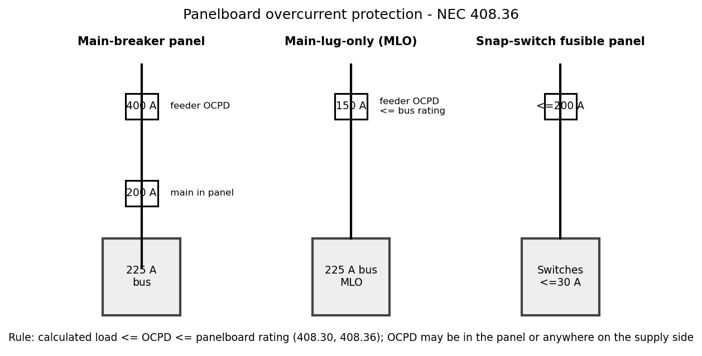  NEC 408.36  

<b>8.</b> Which NEC section requires panelboards to be dead front, and what does that mean?
 408.38. The panel is mounted in a cabinet, cutout box, or identified enclosure, with no current-carrying parts exposed to the person operating the devices.  NEC 408.38  

<b>9.</b> Is a panelboard still limited to 42 overcurrent devices?
 No. The 2008 NEC dropped the &#x27;lighting and appliance panelboard&#x27; 42-device limit. The design, rating, and listing of the panelboard now govern the maximum.  NEC 408.36; 408.54  

<b>10.</b> What are snap switches in a panelboard?
 Switches in old fusible panelboards, installed in addition to the fuses so a branch circuit could be turned off without pulling the fuse. Modern breakers do both jobs, so they&#x27;re not used in new panels.  NEC 408.36(A)  

<b>11.</b> Maximum OCP for a panelboard containing snap switches rated 30 A or less?
 200 A. The protection may be in the panel or upstream (for example, in the main switchboard).   NEC 408.36(A)  

## 3. Construction, phase arrangement, numbering

<b>12.</b> How are panelboard main bus bars typically arranged?
 Main bus bars run vertically for nearly the full height. Branch stabs connect to alternating main buses. 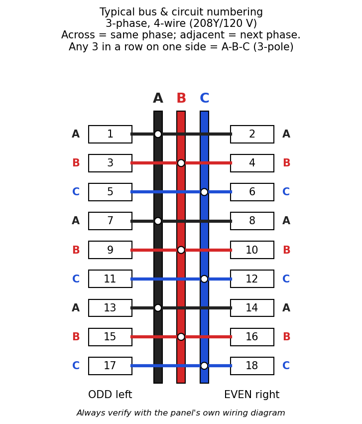  NEC 408.3  

<b>13.</b> In a typical panel, are breaker positions directly across from each other on the same phase or different phases?
 Same phase (for example, circuits 1 and 2 on A). Adjacent positions on the same side are on different phases. 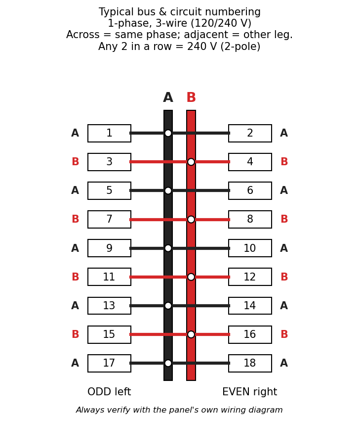  NEC 408.3  

<b>14.</b> 3-phase panel: circuits 1, 3, 5 are on which phases?
 A, B, C respectively. Then 7, 9, 11 = A, B, C again. Even side 2, 4, 6 = A, B, C.   NEC 408.3  

<b>15.</b> 1-phase, 3-wire panel: circuits 1-2 and 3-4 are on which legs?
 1 and 2 on A; 3 and 4 on B; 5 and 6 on A again, alternating down the panel.   NEC 408.3  

<b>16.</b> Circuit numbering convention in panelboards?
 Odd numbers on the left, even numbers on the right, regardless of 1-, 2-, or 3-pole breakers or handle ties.   

<b>17.</b> Why do 3-phase panels come in pole counts like 18, 24, 30, 36, 42?
 The incremental number is 6: one pole for each of the three phases on both sides of the panel.   

<b>18.</b> What should you always check before assuming a panel&#x27;s phase arrangement?
 The manufacturer&#x27;s wiring diagram furnished with the panelboard. Not every panel follows the typical pattern.  NEC 110.3(B)  

<b>19.</b> NEC 408.3(E)(1): required AC phase arrangement?
 A, B, C from front to back, top to bottom, or left to right, as viewed from the front of the switchboard or panelboard.  NEC 408.3(E)(1)  

<b>20.</b> NEC 408.3(E)(2): DC bus arrangement rules?
 DC ungrounded buses may be in any order, but the arrangement must be field marked for polarity, grounding system, and nominal voltage. This matters for PV (Art. 690) and battery systems.  NEC 408.3(E)(2)  

<b>21.</b> In a 4-wire delta panel, which bus must the high leg connect to?
 Phase B. Exception: equipment in the same section as the meter may match the meter&#x27;s arrangement (utilities often use C). 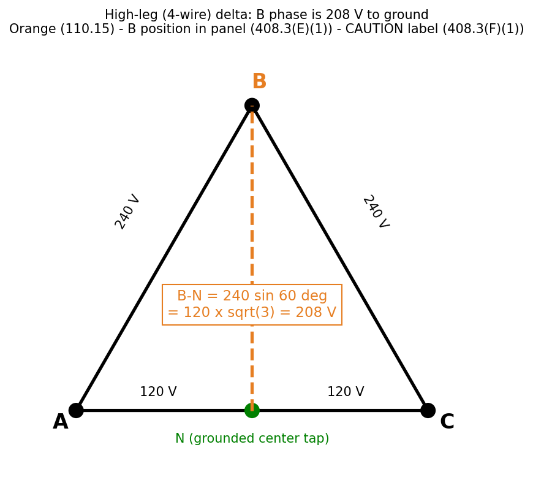  NEC 408.3(E)(1)  

<b>22.</b> Owner&#x27;s panel: nine 1-pole, two 2-pole, three 3-pole breakers. How many poles are used?
 9x1 + 2x2 + 3x3 = 22 poles. In the book&#x27;s 36-pole panel that leaves 14 poles.  

## 4. Ratings & overcurrent

<b>23.</b> What determines a panelboard&#x27;s ampere rating?
 The current-carrying capacity of its internal main bus. Common ratings: 60, 100, 200, 225, 400, 600 A and larger.  NEC 408.30  

<b>24.</b> NEC 408.30 requires a panelboard rating of at least what?
 Not less than the minimum feeder capacity calculated per Article 220.  NEC 408.30  

<b>25.</b> NEC 408.36: maximum rating of the overcurrent protection for a panelboard?
 Not greater than the rating of the panelboard.   NEC 408.36  

<b>26.</b> Where may a panelboard&#x27;s overcurrent protection be located?
 In the panelboard (a main) OR at any point on the supply side of the panelboard (for example, the feeder breaker).   NEC 408.36  

<b>27.</b> State the three-way inequality for panelboard protection.
 Calculated load &lt;= OCPD rating &lt;= panelboard rating, and the OCPD must also protect the feeder conductors (240.4).   NEC 408.30; 408.36; 240.4  

<b>28.</b> 150-A panel, 78-A calculated load: which OCPD ratings are acceptable among 70, 80, 90, 100, 125, 150, 175, 200, 225 A?
 80, 90, 100, 125, and 150 A. 70 A is below the load; 175 A and up exceed the panel rating (408.36).  NEC 408.36  

<b>29.</b> Same 150-A panel, but the 78-A load is all continuous. Now which OCPDs work?
 Minimum = 1.25 x 78 = 97.5 A, so 100, 125, or 150 A.  NEC 215.3; 408.36  

<b>30.</b> When can several panels on one feeder skip individual mains?
 When the feeder OCPD doesn&#x27;t exceed the rating of the lowest-rated panelboard supplied. 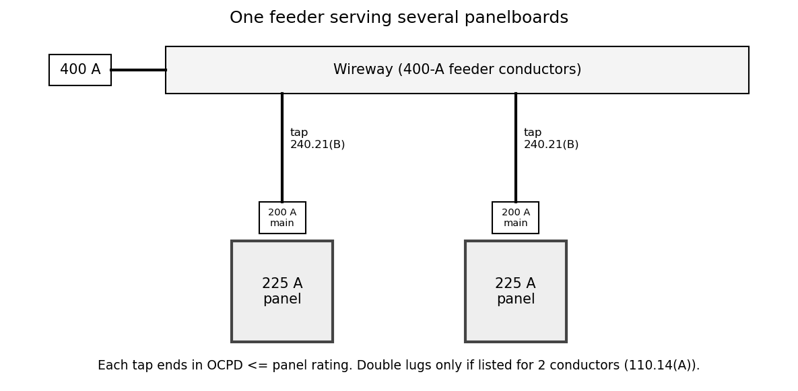  NEC 408.36  

<b>31.</b> A 400-A feeder supplies two 225-A panels through wireway taps. What protects each panel?
 Each tap terminates in a 200-A main (or OCPD) no larger than the 225-A panel rating. Taps must meet 240.21(B).   NEC 240.21(B); 408.36  

<b>32.</b> OCPD sizing rule for continuous loads (max current for 3 h or more) on a feeder?
 At least 125% of the continuous load plus 100% of the noncontinuous load. Equivalently, standard devices run at 80% max continuous. Exception: an assembly and OCPD listed for 100% operation.  NEC 215.3; 215.2(A)(1)  

<b>33.</b> Formula for 3-phase current from VA on a 208Y/120 V system?
 I = VA / (1.732 x 208) = VA / 360.3. Example: 52,000 VA -&gt; 144.3 A. 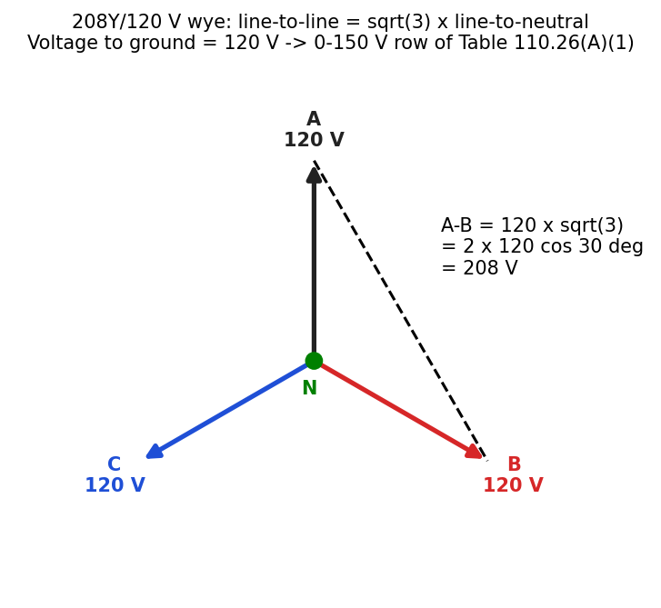  NEC Art. 220  

<b>34.</b> Load: 30,000 VA continuous + 22,000 VA noncontinuous, 208Y/120 3-phase. Minimum feeder OCPD?
 (1.25 x 30,000 + 22,000) / 360.3 = 165.2 A, so 175 A, the next standard size (240.6(A)). Panel bus must be &gt;= 175 A (a 200- or 225-A panel).  NEC 215.3; 240.6(A); 408.36  

<b>35.</b> Panel fed through a transformer: where must its overcurrent protection be?
 On the SECONDARY side of the transformer.  NEC 408.36(B)  

<b>36.</b> When may a transformer-fed panel rely on the transformer&#x27;s PRIMARY protection?
 Only for a 2-wire primary to 2-wire secondary, or a 3-wire delta-delta transformer, per 240.21(C)(1). The turns ratio lets the primary OCPD protect the secondary.  NEC 408.36(B) Ex.; 240.21(C)(1)  

<b>37.</b> Can a 480-V delta to 208Y/120-V wye dry-type rely on primary protection for its panel?
 No. Delta-wye (4-wire secondary) doesn&#x27;t qualify for the 240.21(C)(1) exception. The panel needs secondary protection (a main or a secondary OCPD within tap limits).  NEC 408.36(B); 240.21(C)  

## 5. Cabinets & wiring space

<b>38.</b> Why must panel cabinets be sized beyond just the interior?
 Wiring gutters need enough width for bending conductors, plus space for splices, taps, and feed-through conductors.  NEC 312.6-312.9; 408.3(G); 408.55  

<b>39.</b> Three ways to feed multiple panelboards from one feeder?
 (1) Junction box or wireway with taps; (2) feed-through lugs from the first panel to the next; (3) double lugs (only if listed for two conductors).   NEC 240.21(B); 110.14(A)  

<b>40.</b> Cabinet used for splices/taps: maximum fill?
 Conductors &lt;= 40% of the cross-sectional area at any point. Conductors plus splices and taps &lt;= 75%.  NEC 312.8  

## 6. Directory & identification

<b>41.</b> Which two NEC sections require a panelboard circuit directory?
 110.22(A) and 408.4(A). 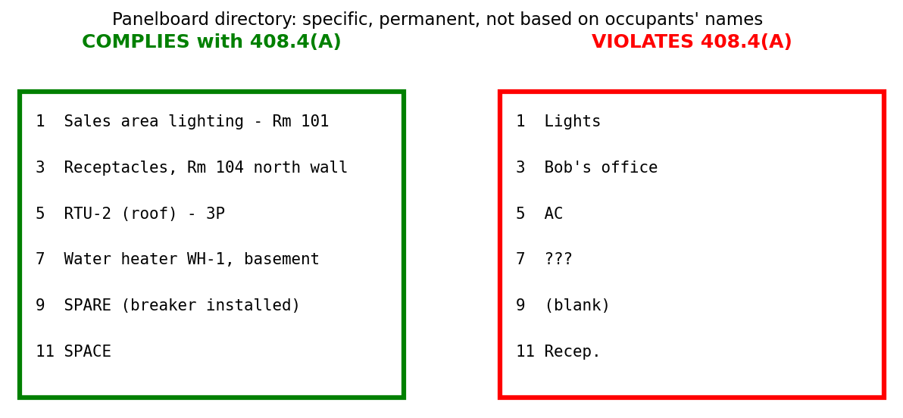  NEC 110.22(A); 408.4(A)  

<b>42.</b> List the 408.4(A) requirements for circuit identification.
 Legible and permanent; in a directory on the face, inside, or next to the panel door; clear and specific to each circuit (including spares with a breaker); detailed enough to avoid confusion; not dependent on transient occupancy; abbreviations and symbols explained.   NEC 408.4(A)  

<b>43.</b> Is &#x27;Tom Jones&#x27;s office&#x27; an acceptable directory entry? Why?
 No. It depends on transient occupancy, which 408.4(A) prohibits. Use a permanent room number or area name.   NEC 408.4(A)  

<b>44.</b> Best directory entry for a computer-room receptacle circuit?
 Specific and permanent, for example: &#x27;Receptacles, Computer Room 3, north wall.&#x27; Avoid &#x27;Computer room&#x27; alone or a person&#x27;s name.   NEC 408.4(A)  

<b>45.</b> &#x27;Spare&#x27; vs. &#x27;space&#x27; in a panel directory?
 Spare: a breaker is installed but unused (must still be identified). Space: an empty position with no breaker.  NEC 408.4(A)  

<b>46.</b> Does a circuit change require a directory update?
 Yes. 408.4(A) applies to &#x27;every circuit AND circuit modification.&#x27; Updating the directory is one of the final steps of any job.  NEC 408.4(A)  

<b>47.</b> NEC 408.4(B): what must a feeder-supplied panel be marked with (other than in one- and two-family dwellings)?
 The identification and physical location of where the power originates. The label must be permanently affixed, durable for the environment, and NOT handwritten.  NEC 408.4(B); 110.22(A)  

<b>48.</b> Why be careful drilling holes to attach a source label?
 Penetrating a listed enclosure, especially outdoors or in a wet location, can violate the listing, and you may hit live parts. See 312.10 for fasteners in cabinets.  NEC 312.10  

<b>49.</b> When do 210.5(C) and 215.12(C) require voltage and color-code identification at panels?
 When the premises have more than one nominal voltage system (or both AC and DC). Panels must be permanently marked with how each ungrounded conductor is identified. The method may be posted or documented. 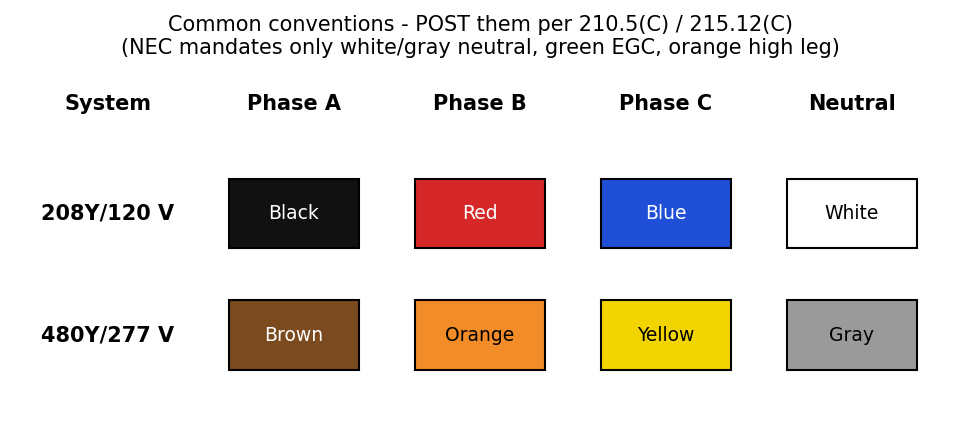  NEC 210.5(C); 215.12(C)  

<b>50.</b> Typical conductor colors for 208Y/120 V?
 Black (A), Red (B), Blue (C), White (neutral).   NEC 210.5(C)  

<b>51.</b> Typical conductor colors for 480Y/277 V?
 Brown (A), Orange (B), Yellow (C), Gray (neutral).   NEC 210.5(C)  

<b>52.</b> Which conductor colors does the NEC actually MANDATE?
 White or gray for the grounded (neutral) conductor; green or bare for the equipment grounding conductor; orange (or other effective means) for the high leg. Phase colors are conventions you must post.   NEC 200.6; 250.119; 110.15  

<b>53.</b> Exception: adding a new voltage system to an existing building with unmarked systems?
 Mark only the new system, and add a label stating &#x27;other unidentified systems exist on the premises.&#x27;  NEC 210.5(C)(1) Ex.  

<b>54.</b> NEC 408.7 / 110.12(A): rule on unused openings?
 Close unused openings (missing breaker knockouts, raceway knockouts) with protection substantially equivalent to the enclosure wall. Use listed filler plates and closures.  NEC 408.7; 110.12(A)  

<b>55.</b> High-leg delta: what label must be on the panelboard?
 A permanent field marking: &#x27;CAUTION: ___ PHASE HAS ___ VOLTS TO GROUND.&#x27;   NEC 408.3(F)(1)  

<b>56.</b> Required identification of the high-leg conductor?
 An outer finish that is orange, or other effective means, wherever the neutral is also present.   NEC 110.15; 230.56  

<b>57.</b> Calculate the B-to-ground voltage of a 120/240-V 4-wire delta (use trig).
 B is the apex of an equilateral triangle with 240-V sides; N is the midpoint of A-C. Height = 240 sin 60 deg = 240 x 0.866 = 207.8 V (approx. 208 V) = 120 x sqrt(3).   NEC 408.3(F)(1)  

<b>58.</b> Motors run backward after feeder conductors are re-terminated. Fix for all motors at once?
 Swap any two feeder phase conductors, then re-identify them with properly colored tape at both ends.  NEC 210.5(C); 215.12(C)  

## 7. Working space: conditions, dimensions

<b>59.</b> Define working-space Condition 1.
 Exposed live parts on one side; no live or grounded parts on the other side. Or live parts on both sides effectively guarded by insulating material. 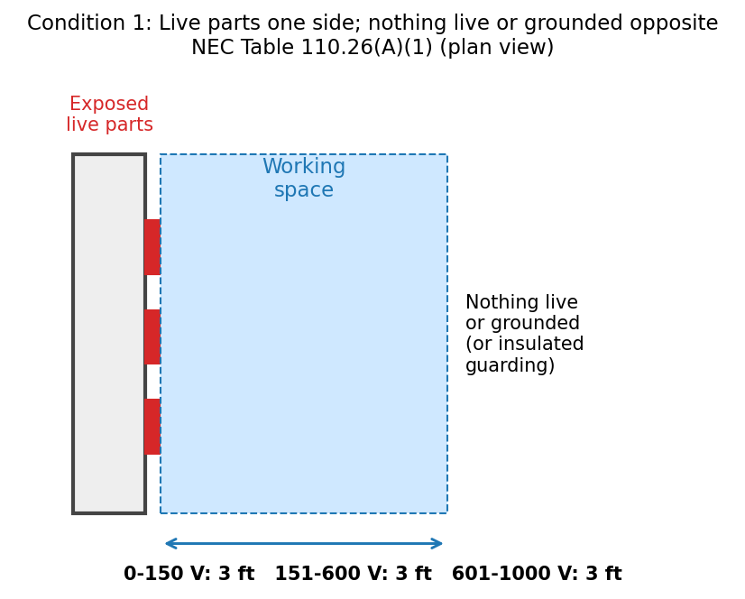  NEC Table 110.26(A)(1)  

<b>60.</b> Define working-space Condition 2.
 Exposed live parts on one side and GROUNDED parts on the other. Concrete, brick, and tile walls count as grounded. 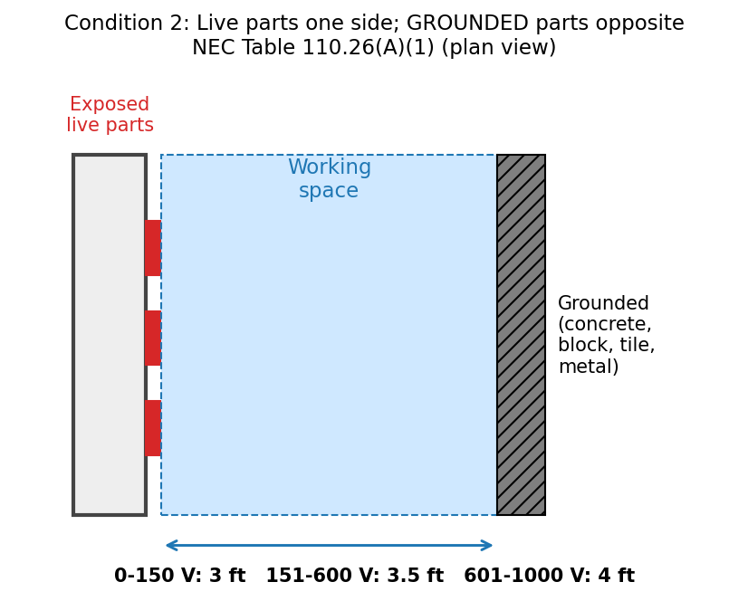  NEC Table 110.26(A)(1)  

<b>61.</b> Define working-space Condition 3.
 Exposed live parts on BOTH sides of the working space (for example, panels facing each other across an aisle). 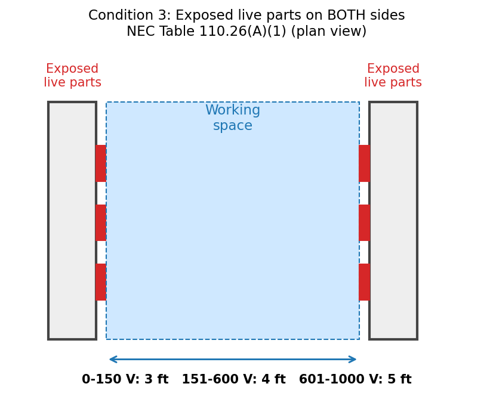  NEC Table 110.26(A)(1)  

<b>62.</b> Working-space depth for 0-150 V to ground?
 3 ft (900 mm) for ALL three conditions.   NEC Table 110.26(A)(1)  

<b>63.</b> Working-space depth for 151-600 V to ground, Conditions 1 / 2 / 3?
 3 ft / 3.5 ft / 4 ft (900 mm / 1.0 m / 1.2 m).   NEC Table 110.26(A)(1)  

<b>64.</b> Working-space depth for 601-1000 V to ground, Conditions 1 / 2 / 3 (new in 2023)?
 3 ft / 4 ft / 5 ft (900 mm / 1.2 m / 1.5 m).   NEC Table 110.26(A)(1)  

<b>65.</b> 480Y/277-V dead-front switchboard facing a concrete-block wall: required depth?
 3.5 ft (1.0 m). 277 V to ground = 151-600 V row; block wall = grounded = Condition 2.   NEC Table 110.26(A)(1)  

<b>66.</b> Is the Table 110.26(A)(1) voltage line-to-line or to ground?
 Nominal voltage TO GROUND. 208Y/120 = 120 V (0-150 row); 480Y/277 = 277 V (151-600 row).  NEC Table 110.26(A)(1)  

<b>67.</b> Where is working-space depth measured from?
 From exposed live parts, or from the enclosure front (dead front) if the equipment is enclosed. 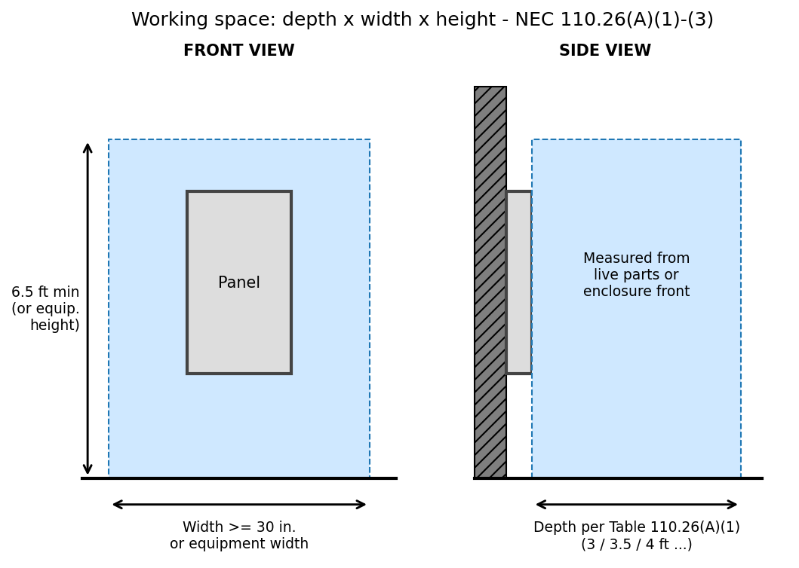  NEC 110.26(A)(1)  

<b>68.</b> Minimum working-space width?
 30 in. (762 mm) or the width of the equipment, whichever is greater. The space need not be centered, and working spaces may overlap. 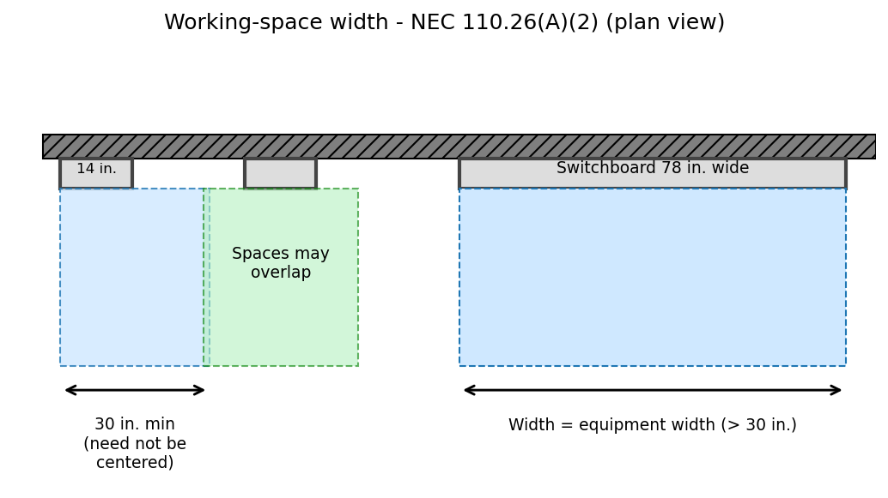  NEC 110.26(A)(2)  

<b>69.</b> Minimum working-space height (headroom)?
 6.5 ft (2.0 m), or the height of the equipment if taller.   NEC 110.26(A)(3)  

<b>70.</b> How far must equipment doors and hinged panels be able to open within the working space?
 At least 90 degrees. 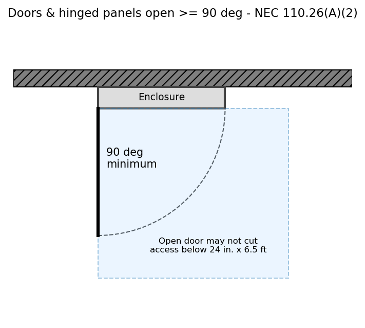  NEC 110.26(A)(2)  

<b>71.</b> Open equipment doors may not reduce the access path below what dimensions?
 24 in. wide by 6.5 ft high (110.26 introductory text, relocated there in 2023).   NEC 110.26  

<b>72.</b> How far may associated equipment or a housekeeping pad intrude into the working space?
 No more than 6 in. (150 mm). Meters in meter sockets are exempt, because the utility controls them. 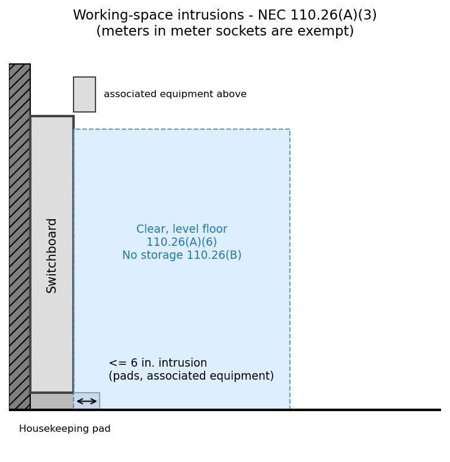  NEC 110.26(A)(3)  

<b>73.</b> What did the 2023 NEC add in 110.26(A)(6)?
 The grade, floor, or platform in the working space must be kept clear and be as level and flat as practical for its full depth and width.   NEC 110.26(A)(6)  

<b>74.</b> NEC 110.26(B): can working space be used for storage?
 No. Working space must be kept clear and never used for storage.  NEC 110.26(B)  

<b>75.</b> Is &#x27;working space&#x27; the same as the room?
 No. It&#x27;s the space at the equipment (front, plus sides or rear where access is needed). A large room can still violate the rule; a small room may be entirely working space.  NEC 110.26  

<b>76.</b> Minimum access opening for equipment above a lay-in ceiling? In a crawl space?
 Ceiling: 22 x 22 in. (559 x 559 mm). Crawl space: 22 x 30 in. (559 x 762 mm). 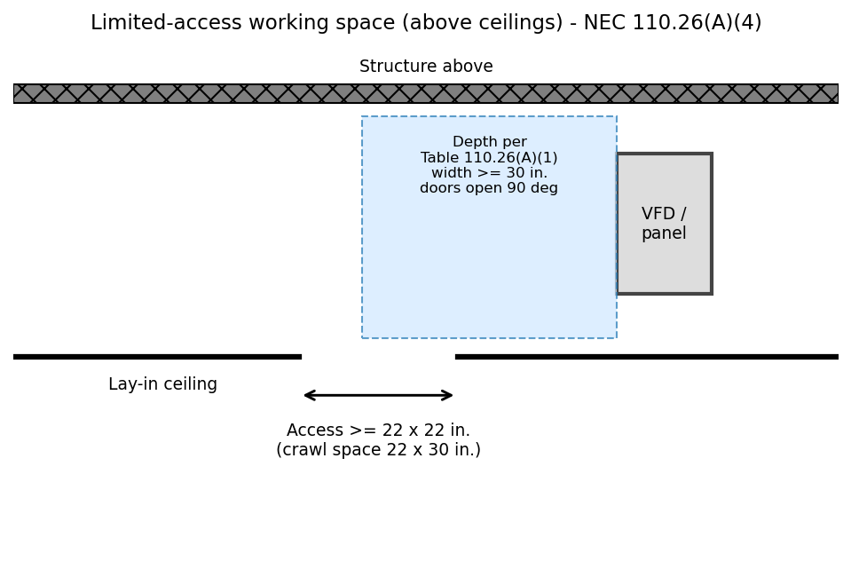  NEC 110.26(A)(4)  

## 8. Egress, doors, light, dedicated space

<b>77.</b> Entrance requirement for ordinary (not large) equipment?
 At least one entrance of sufficient area to the working space. A door is permitted but NOT required, and the NEC gives no dimensions.  NEC 110.26(C)(1)  

<b>78.</b> Define &#x27;large equipment&#x27; for access and egress (2023 NEC).
 Equipment rated 1200 A or more AND over 6 ft (1.8 m) wide, with OCPDs, switching, or control devices. Also grouped 230.71(B) service disconnects with a combined 1200 A or more and combined width over 6 ft. BOTH conditions must apply. 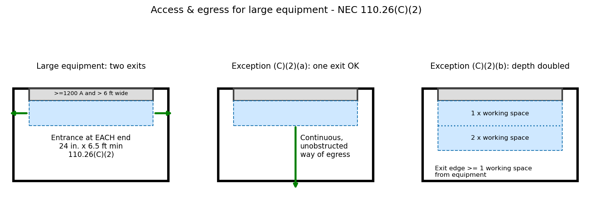  NEC 110.26(C)(2)  

<b>79.</b> Access requirement for large equipment?
 An entrance at EACH end of the working space, each at least 24 in. wide by 6.5 ft high.   NEC 110.26(C)(2)  

<b>80.</b> Two ways large equipment may have only ONE entrance?
 (a) A continuous, unobstructed way of egress travel; or (b) the working-space depth is doubled, with the entrance&#x27;s nearest edge at least one working-space depth from the equipment.   NEC 110.26(C)(2)(a), (b)  

<b>81.</b> Personnel-door rule for equipment rated 800 A or more?
 Doors less than 25 ft (7.6 m) from the nearest edge of the working space must open at least 90 deg in the direction of egress, with LISTED panic or fire-exit hardware, regardless of equipment width. 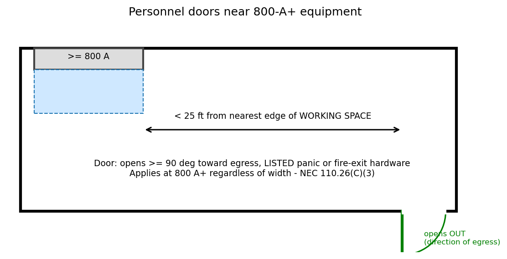  NEC 110.26(C)(3)  

<b>82.</b> Why does the code require push-to-open panic hardware near large equipment?
 Arc-flash victims may be burned, blinded, deafened, and breathing smoke and vaporized metal. They must be able to push their way out without working a door handle.   NEC 110.26(C)(3)  

<b>83.</b> NEC 110.26(D): illumination rule?
 Illumination is required for working spaces around service equipment, switchboards, panelboards, and MCCs indoors. It may not be controlled by automatic means only; some manual control is required.  NEC 110.26(D)  

<b>84.</b> Define the indoor dedicated electrical space.
 A zone equal to the width and depth of the equipment, from the floor to 6 ft above the equipment or to the structural ceiling, whichever is LOWER. No piping, ducts, leak protection, or other foreign equipment. 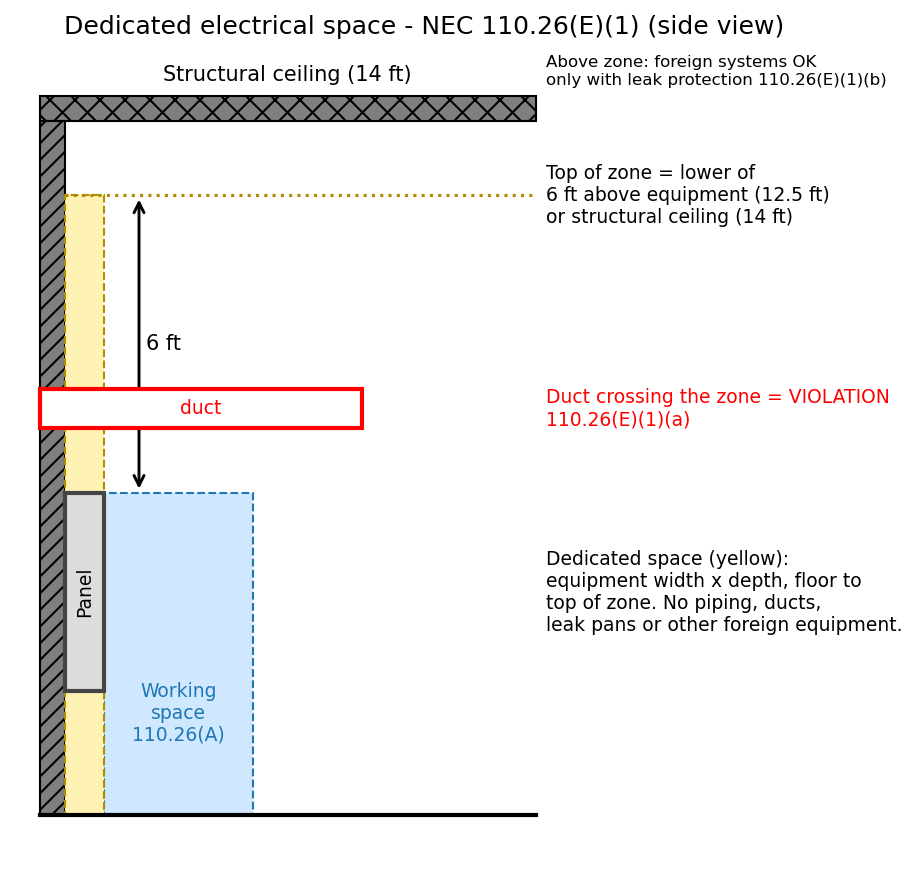  NEC 110.26(E)(1)(a)  

<b>85.</b> Can foreign systems (pipes, ducts) be installed above the dedicated space?
 Yes, above the zone, but only with protection so leaks, condensation, or breaks won&#x27;t damage the electrical equipment.   NEC 110.26(E)(1)(b)  

<b>86.</b> Panel top at 6 ft 7 in., deck at 14 ft. Where does the dedicated zone end?
 At 12 ft 7 in. (6 ft 7 in. + 6 ft), because that&#x27;s lower than the 14-ft deck. A duct below 12 ft 7 in. over the panel footprint violates the rule.   NEC 110.26(E)(1)  

<b>87.</b> Is a suspended ceiling the &#x27;structural ceiling&#x27; for the dedicated space?
 No. A suspended (lay-in) ceiling isn&#x27;t the structural ceiling. The zone is measured to the structure (or 6 ft above the equipment, if lower).  NEC 110.26(E)(1)  

<b>88.</b> Outdoor dedicated-space requirements?
 Identified enclosures; protected from accidental contact, vehicles, and piping leaks; the same working clearance as indoors; no architectural appurtenances in the working space; footprint dedicated from grade to 6 ft above the equipment.  NEC 110.26(E)(2)  

## 9. Safety, exceptions, pitfalls

<b>89.</b> Which standard governs safe work practices on panelboards, and what does it require first?
 NFPA 70E. Establish an electrically safe work condition (the textbook cites the eight steps in 120.5) before work: shut off, test, lock out. Energized work needs justification and a permit.  NEC NFPA 70E  

<b>90.</b> What is &#x27;live-dead-live&#x27; testing?
 Verify the tester on a known live source, test the circuit for absence of voltage (phase-phase and phase-ground), then re-verify the tester on the known source.  NEC NFPA 70E  

<b>91.</b> Main breaker OFF: is the panelboard dead?
 No. The line side of the main, the feeder lugs, and any feed-through lugs remain energized. Open and lock out the SOURCE named on the 408.4(B) label, then test.  NEC 408.4(B)  

<b>92.</b> Why must each neutral have its own terminal (408.41)?
 Loosening a shared terminal to remove one de-energized neutral also loosens a live circuit&#x27;s neutral. That causes shock hazard and load damage. 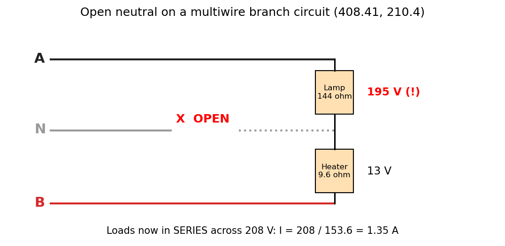  NEC 408.41  

<b>93.</b> Open neutral on a 208Y/120 MWBC: 100-W lamp (144 ohm) and 1500-W heater (9.6 ohm). What does the lamp see?
 Series across 208 V: I = 208 / 153.6 = 1.35 A. Lamp: 1.35 x 144 = 195 V (63% over its rating). Heater: 13 V.   NEC 408.41; 210.4  

<b>94.</b> Symptom of a lost shared neutral on a multiwire branch circuit?
 Loads on one leg dim while the other leg&#x27;s loads brighten, or a load works only when an unrelated load on the other leg is on (the textbook&#x27;s refrigerator and disposal example).   NEC 210.4  

<b>95.</b> What can happen if a 120-V branch circuit is landed on the high leg?
 The load gets 208 V to ground, which can cause equipment failure or fire. Only 3-phase or 240-V loads belong on phase B of a high-leg delta.   NEC 408.3(F)(1); 110.15  

<b>96.</b> Name two 110.26(A)(1) depth exceptions.
 Ex. 1: no rear or side working space for dead-front equipment with no renewable or adjustable parts there. Ex. 3: existing buildings may use Condition 2 between facing dead-front equipment under written procedures (not both open at once, qualified persons only).  NEC 110.26(A)(1) Ex.  

<b>97.</b> Common error: &#x27;large equipment&#x27; is 800 A. Correct it.
 Large equipment (two exits) = 1200 A or more AND over 6 ft wide. 800 A is the threshold for panic-hardware personnel doors, with any width. (Slide 25 mixes these up.)  NEC 110.26(C)(2); 110.26(C)(3)  

<b>98.</b> Breaker interrupting rating vs. available fault current: why check before adding a panel?
 A breaker with an interrupting rating below the available fault current can fail violently. Check the 110.24 marking against breaker AIC and panel SCCR; use only tested series ratings (240.86).  NEC 110.9; 110.10; 110.24; 240.86  

<b>99.</b> Feeder-supplied subpanel: what happens to the bonding screw or strap?
 Remove it. Neutrals stay isolated from the enclosure; EGCs go on a separate, bonded bar. Otherwise neutral current flows on raceways and the EGC.  NEC 250.24(A)(5); 250.142(B); 408.40  

<b>100.</b> Can you install any brand of breaker that physically fits a panel?
 No. Install only breakers the panel is listed for (the manufacturer&#x27;s own or UL-classified breakers named on the label). Terminations must be torqued to spec with an approved means.  NEC 110.3(B); 110.14(D)  

---

*Generated by `tools/flashcards/build_decks.py` from the JSON file. Edit the JSON, not this page.*
