# Flashcards — ELECT 245: Chapter 13: The Electric Service and Grounding

100 cards. Read the question, answer it in your head, then click it to check.

- **Study online:** [flashcard page](https://webnrrd2k.github.io/lbcc-electrical-study-materials/flashcards/?deck=e245-ch13): shuffle, flip, and mark the cards you know.
- **Download:** [Anki](chapter13.apkg) · [Quizlet import file](chapter13_quizlet.txt) (paste into Quizlet's Import box; images are not included) · [Emacs org-drill](chapter13.org) · [raw card data](chapter13.json)

## Contents

- [1. Big picture](#1-big-picture) (2)
- [2. Service types, service point, vocabulary](#2-service-types-service-point-vocabulary) (9)
- [3. Transformers](#3-transformers) (11)
- [4. Connections](#4-connections) (9)
- [5. Utility supply & metering](#5-utility-supply--metering) (7)
- [6. Service-entrance equipment](#6-service-entrance-equipment) (18)
- [7. Grounding / bonding concepts](#7-grounding--bonding-concepts) (12)
- [8. Electrodes & GEC](#8-electrodes--gec) (14)
- [9. Bonding jumpers & EGC sizing](#9-bonding-jumpers--egc-sizing) (5)
- [10. Bonding at service & piping](#10-bonding-at-service--piping) (4)
- [11. GFPE, safety, pitfalls](#11-gfpe-safety-pitfalls) (9)

---

## 1. Big picture

<b>1.</b> What are the main topics of Chapter 13?
 Transformers and their protection and connections; utility supply arrangements; metering; service definitions; service-entrance equipment; grounding and bonding; ground-fault protection of equipment (GFPE); workplace safety.  NEC Art. 230; 250; 450  

<b>2.</b> Which NEC articles govern services, transformers, and grounding?
 Services: Article 230. Transformers: Article 450. Grounding and bonding: Article 250. Definitions: Article 100.  NEC Art. 230; 450; 250; 100  

## 2. Service types, service point, vocabulary

<b>3.</b> What are the two broad types of service supply?
 (1) The utility provides high voltage and the transformer, and the owner is responsible from the service point on. (2) The owner buys power at primary (distribution) voltage and owns the substation, lines, and transformers. 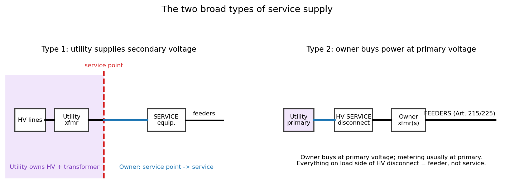  NEC Art. 100  

<b>4.</b> When the owner buys power at primary voltage, what are the conductors on the load side of the HV disconnect?
 FEEDERS, not service conductors. Articles 215 and 225 apply. The high-voltage switch is the service disconnect, and metering is usually at primary voltage.   NEC Art. 215; Art. 225  

<b>5.</b> Define &#x27;service point.&#x27;
 The point of connection between the facilities of the serving utility and the premises wiring. It&#x27;s the demarcation point, and the utility generally specifies its location. 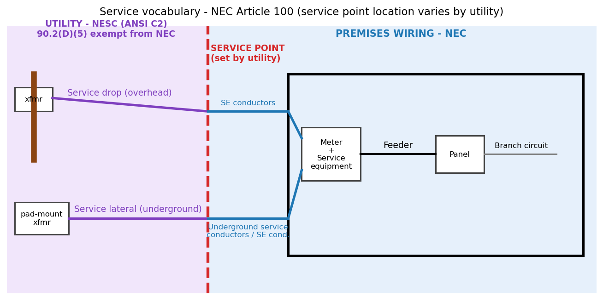  NEC Art. 100  

<b>6.</b> Define &#x27;service drop.&#x27;
 The OVERHEAD service conductors between the serving utility and the service point. Installed by the utility under the NESC.   NEC Art. 100  

<b>7.</b> Define &#x27;service lateral.&#x27;
 The UNDERGROUND conductors between the utility electric supply system and the service point. Installed by the utility under the NESC.   NEC Art. 100  

<b>8.</b> Define &#x27;service-entrance conductors.&#x27;
 The service conductors between the terminals of the service equipment and the service drop, overhead service conductors, service lateral, or underground service conductors. With outdoor service equipment there may be none.   NEC Art. 100  

<b>9.</b> Service lateral vs. underground service conductors: same thing?
 No (since the 2011 NEC). The service lateral is on the utility side of the service point (NESC). Underground service conductors are on the premises side (NEC). Slide 26&#x27;s &#x27;previously called service lateral&#x27; blurs this.   NEC Art. 100  

<b>10.</b> What does NEC 90.2(D)(5) exempt from the NEC?
 Installations under the exclusive control of an electric utility: service drops or laterals and their metering; utility-owned or leased property; legally established easements or rights-of-way; and certain installations under written agreements recognized by regulators.  NEC 90.2(D)(5)  

<b>11.</b> What should you confirm with the utility before bidding a service?
 Who furnishes and installs the secondary or underground service conductors, their size and insulation type, raceways, the CT cabinet, and the transformer pad. Missing this can be a very costly mistake.  

## 3. Transformers

<b>12.</b> What two jobs does the liquid in a liquid-filled transformer do?
 (1) It insulates the high-voltage windings from the low-voltage windings. (2) It acts as a coolant, carrying heat from the core and windings to the tank, radiators, or fans.  NEC Art. 450  

<b>13.</b> What was askarel, and why is it gone?
 A transformer fluid of PCBs (polychlorinated biphenyls) and trichlorobenzene. It was nonflammable but highly toxic, and was banned under the Toxic Substances Control Act of 1976 and EPA rules.  

<b>14.</b> Why are dry-type transformers widely used in buildings?
 They&#x27;re lighter than comparable liquid-filled units and need no leak precautions, containment, or coolant replacement. The open core and coil are air-cooled, and fans can raise capacity.  NEC Art. 450  

<b>15.</b> What are the three sections of a unit substation?
 (1) High-voltage switch (may be the service disconnect); (2) dry-type transformer; (3) secondary distribution section. All are in one overall enclosure. 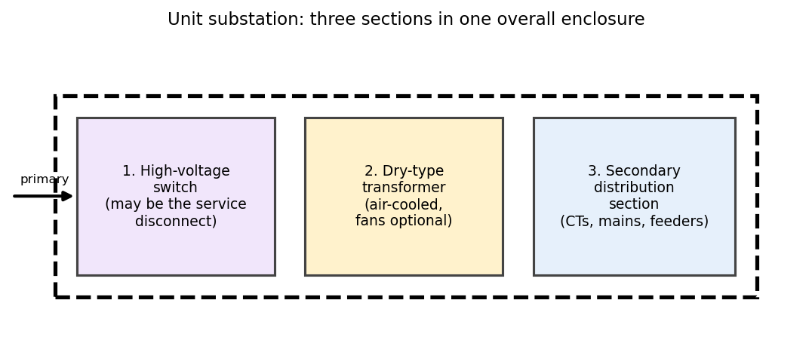  

<b>16.</b> Which tables give transformer overcurrent protection, and how are they divided?
 Table 450.3(A) for transformers over 1000 V; Table 450.3(B) for 1000 V or less. 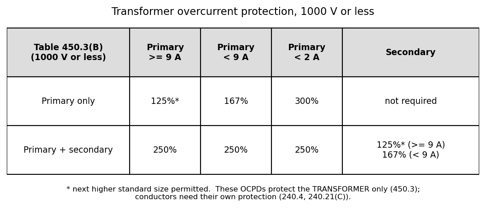  NEC 450.3  

<b>17.</b> What do transformer overcurrent devices under 450.3 protect?
 The TRANSFORMER only. The conductors supplying or leaving it may need separate protection under Articles 240 and 310.   NEC 450.3  

<b>18.</b> Table 450.3(B), primary-only protection: maximum primary OCPD?
 125% of rated primary current (9 A or more; the next higher standard size is allowed); 167% under 9 A; 300% under 2 A. No secondary protection is required by 450.3.   NEC Table 450.3(B)  

<b>19.</b> Table 450.3(B), primary AND secondary protection: maximums?
 Primary: 250% of rated primary current. Secondary: 125% (9 A or more; next size up allowed), or 167% under 9 A.   NEC Table 450.3(B)  

<b>20.</b> 50-kVA, 480-V to 208Y/120-V transformer: primary current and suggested primary fuse?
 50,000 / (480 x 1.732) = 60 A. 60 x 1.25 = 75 A, so 80-A dual-element fuses (in a 100-A switch). The maximum with secondary protection is 60 x 2.5 = 150 A. 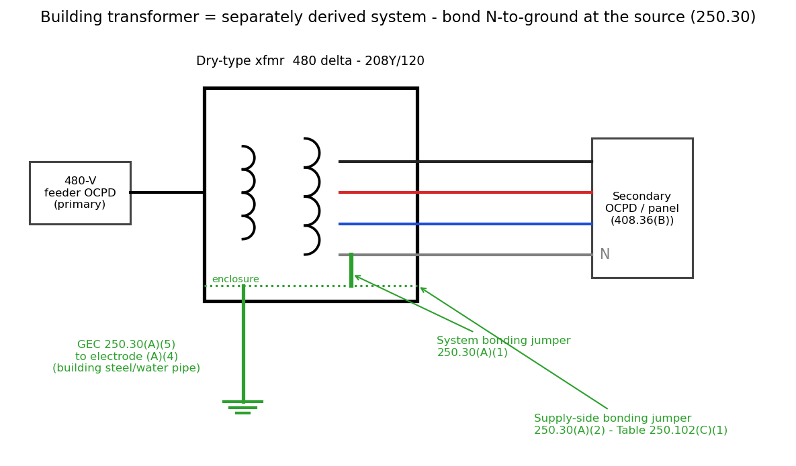  NEC Table 450.3(B)  

<b>21.</b> Same 50-kVA transformer: secondary current and OCPD?
 50,000 / (208 x 1.732) = 139 A. 139 x 1.25 = 174 A, so 175 A. It also protects the secondary conductors (240.21(C)) and the panelboard (408.36(B)).   NEC 450.3; 240.21(C)  

<b>22.</b> Is a building dry-type transformer a separately derived system? Which section governs its grounding?
 Yes. Grounding and bonding follow 250.30: system bonding jumper (A)(1), supply-side bonding jumper (A)(2), electrode (A)(4), and GEC (A)(5).   NEC 250.30  

## 4. Connections

<b>23.</b> Single-phase transformer connection: voltages, and what must be grounded?
 120 or 120/240 V, 2- or 3-wire. The center tap of the secondary must be grounded (Art. 250, Part II). 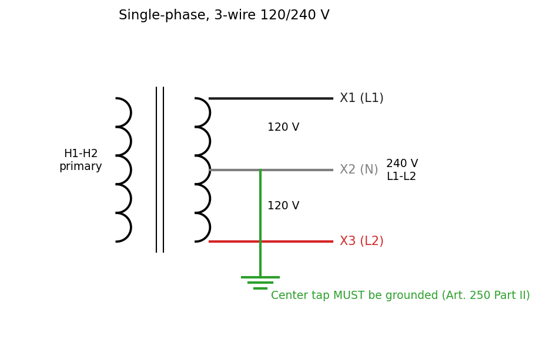  NEC 250.20(B)  

<b>24.</b> What is the advantage of an open-delta bank?
 It provides 3-phase, or 3-phase plus single-phase, power using only TWO transformers. Useful where the utility has only two primary phases nearby, or where load growth is expected (add the third unit later). 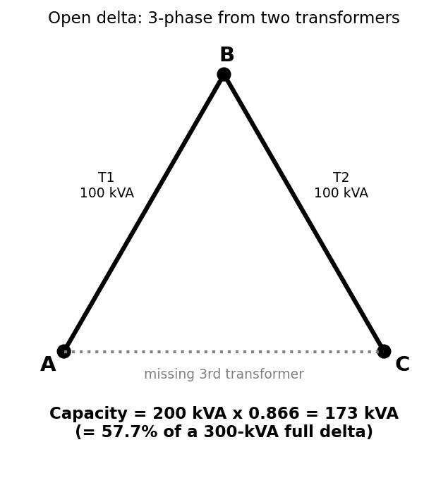  

<b>25.</b> What percentage of capacity is available in an open-delta bank?
 86.6% of the two transformers&#x27; combined rating, or 57.7% of a full three-transformer delta bank.   

<b>26.</b> Two 100-kVA transformers in open delta: capacity?
 200 kVA x 0.866 = 173 kVA (= 300 kVA x 0.577).   

<b>27.</b> What does a 3-wire delta secondary provide, and what is &#x27;corner-grounded delta&#x27;?
 3-phase power only. One phase may be grounded (corner-grounded delta). Line-to-line voltages are unchanged, and no overcurrent device may be placed in the grounded phase. 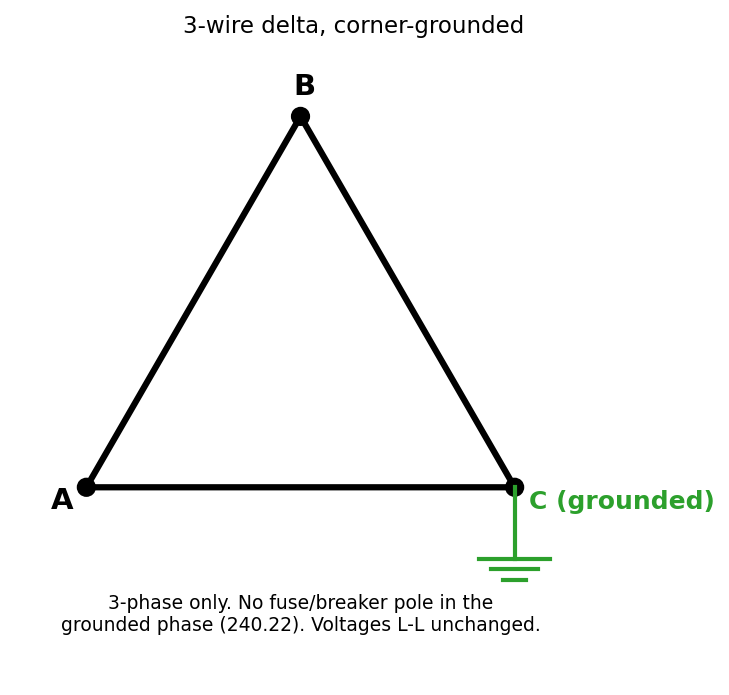  NEC 240.22  

<b>28.</b> 4-wire delta: what are the voltages A-N, C-N, B-N, and line-to-line?
 A-N and C-N = 120 V; B-N = 208 V (the high leg); A-B, B-C, C-A = 240 V. B is never used for line-to-neutral loads. 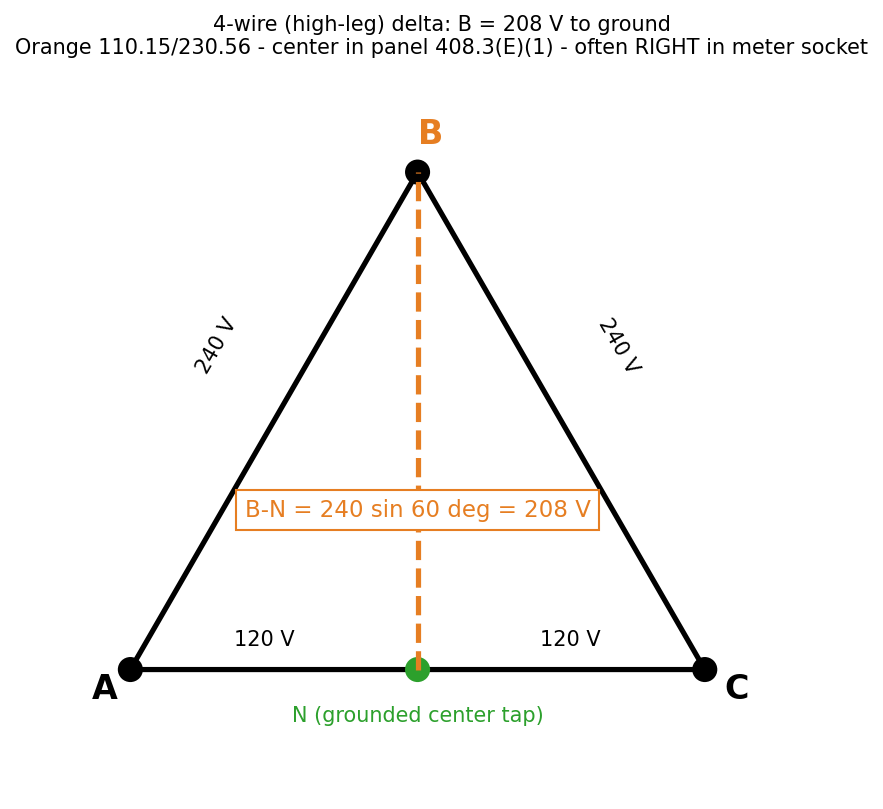  NEC 110.15  

<b>29.</b> High leg: required identification and position?
 Orange or other effective identification wherever the neutral is present (110.15, 230.56). B phase in the CENTER position of panels and switchboards (408.3(E)(1)). Caution label &#x27;Phase __ has __ volts to ground&#x27; (408.3(F)).   NEC 110.15; 230.56; 408.3(E)(1); 408.3(F)  

<b>30.</b> Where do many utilities want the high leg in a self-contained (200 A or less) meter socket?
 In the RIGHT-hand position. It then must move to the center position in the service disconnect. CT-metered services (over 200 A) avoid the issue.   NEC 408.3(E)(1)  

<b>31.</b> Most common system for modern commercial buildings? Typical voltages?
 3-phase, 4-wire wye. Line-to-neutral loads can go on any phase. Typical: 208Y/120, 480Y/277, 600Y/347 V (slide 11&#x27;s &#x27;460Y/265&#x27; is not a standard system voltage). 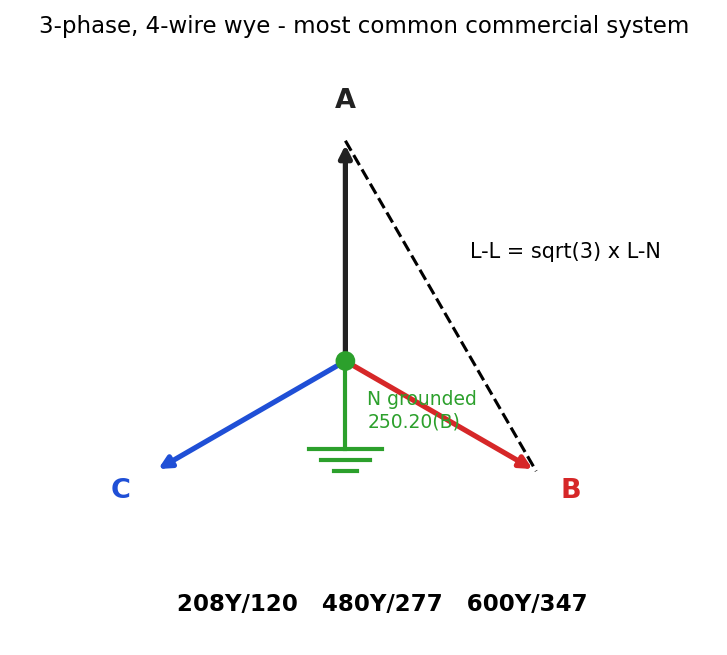  NEC 250.20(B)(2)  

## 5. Utility supply & metering

<b>32.</b> What is a pad-mounted enclosure (&#x27;transclosure&#x27;)?
 A weatherproof cabinet with the transformer and metering equipment (usually CTs), suited to smaller services. It must be kept locked if accessible to the public.  NEC 110.31(C); 450.22  

<b>33.</b> Which sections require sealing service raceways entering a building?
 230.8, 300.5(G), and 300.7(A) (300.50(E) for over 1000 V). Seals keep moisture, condensation, and gas from entering the service equipment.  NEC 230.8; 300.5(G); 300.7(A)  

<b>34.</b> What is primary (high-voltage) metering, and when is it used?
 The utility meters the primary side with potential transformers (PTs) and current transformers (CTs). It&#x27;s typically used for single-tenant buildings.  

<b>35.</b> Low-voltage metering for loads of 200 A or less?
 Self-contained meter socket. Service conductors from the transformer go to the socket&#x27;s line terminals, and the load terminals feed the service disconnect. 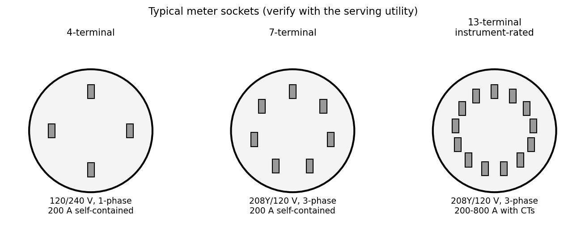  

<b>36.</b> Low-voltage metering for loads over 200 A: two common methods?
 (1) 320-A meter sockets (typically single-phase, 400-600-A services, if within equipment rating); (2) current-transformer (CT) metering.   

<b>37.</b> Match meter socket to service: 4-, 7-, and 13-terminal.
 4-terminal: 120/240 V 1-phase 200 A. 7-terminal: 208Y/120 V 3-phase 200 A. 13-terminal instrument-rated: 208Y/120 V 3-phase 200-800 A with CTs.   

<b>38.</b> Who typically wires CT secondaries to the meter?
 The utility. The electrician usually mounts the CT cabinet and CTs, bolts lugs, and connects the line-voltage conductors. 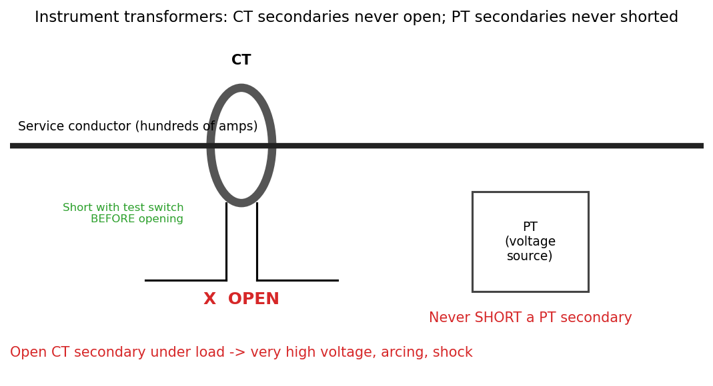  

## 6. Service-entrance equipment

<b>39.</b> What does service-entrance equipment consist of (transformer away from the building)?
 Service-entrance conductors, the main switch or switches, metering equipment, and secondary distribution switches. 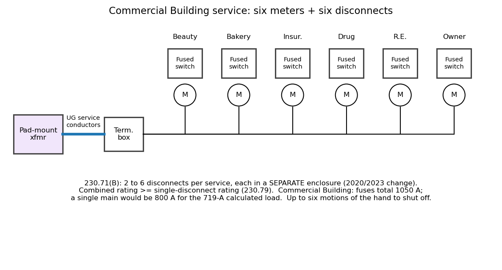  NEC Art. 230  

<b>40.</b> Underground service conductors must be sized by what?
 The calculated load per Article 220, Parts II-V (230.31(A)). For the Commercial Building: 719 A, with a 187-A neutral.  NEC 230.31(A)  

<b>41.</b> 230.42(A): minimum ampacity of service-entrance conductors?
 The larger of (a) the calculated load after correction and adjustment factors, or (b) 125% of continuous load plus 100% of noncontinuous load.  NEC 230.42(A)  

<b>42.</b> What is a termination box, and what must it be listed and marked for?
 A short busway-like tap box (busbars and terminals, no switching or OCPDs) connecting underground service conductors to the service-entrance conductors. It must be marked &#x27;Suitable for use on the line side of service equipment,&#x27; with a short-circuit current rating, and be rated for the wet location.   NEC UL Product iQ  

<b>43.</b> Wireway used at the service: fill limits and derating rule?
 Conductors no more than 20% of the cross-section; splices and taps no more than 75%. No ampacity adjustment unless more than 30 current-carrying conductors are at one cross-section.  NEC 376.22; 376.56  

<b>44.</b> Rules for power distribution blocks in a wireway on the line side of the service?
 Listed and marked &#x27;suitable for use on the line side of service equipment&#x27; (with an adequate SCCR), and no uninsulated live parts exposed, even with the cover off.  NEC 376.56(B)(1)  

<b>45.</b> Taps from paralleled service conductors: what does 300.3(B)(1) require?
 The tap must connect to ALL conductors of the parallel set (grounded and ungrounded). Split bolts (two conductors max) don&#x27;t work; use multi-port connectors or busbars listed for the line side.  NEC 300.3(B)(1)  

<b>46.</b> Where must the service disconnecting means be located?
 At a readily accessible location either outside the building or inside nearest the point of entrance of the service conductors.  NEC 230.70(A)(1)  

<b>47.</b> Why must service conductors inside a building be kept short?
 They have no short-circuit or ground-fault protection. The only OCPD is the utility&#x27;s transformer primary fuse, sized to protect the transformer. Conductors under 2 in. of concrete count as outside (230.6).  NEC 230.70(A)(1); 230.6  

<b>48.</b> Minimum rating of the service disconnecting means?
 Not less than the calculated load, determined per Article 220, Parts III, IV, or V.  NEC 230.79  

<b>49.</b> How many service disconnects are permitted, and how must they be enclosed (2023 NEC)?
 Two to six per service, each in a SEPARATE enclosure (or separate vertical section or compartment). Their combined rating must be at least the single-disconnect rating.   NEC 230.71(B)  

<b>50.</b> Commercial Building: the six service fuses total 1050 A, but the load is 719 A. Is that OK?
 Yes. Each feeder is sized for its own load (often oversized for spare capacity), so the sum may exceed what a single main would be (800 A for 719 A).   NEC 230.71(B); 230.79  

<b>51.</b> Service neutral (grounded conductor) minimum size?
 The larger of the 220.61 calculated neutral load or Table 250.102(C)(1), based on the ungrounded conductor size. 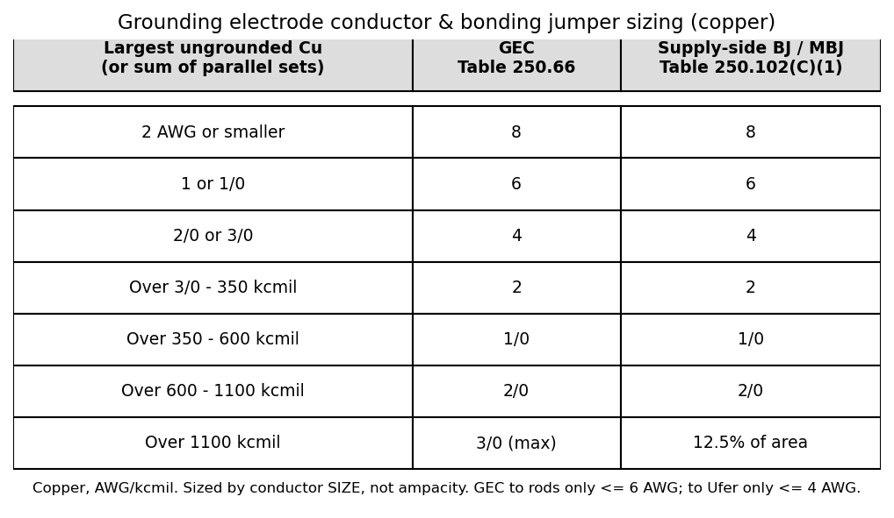  NEC 250.24(D); 220.61  

<b>52.</b> Parallel service conductors in separate raceways: minimum neutral per raceway?
 1/0 AWG, and at least Table 250.102(C)(1) based on the phase conductors in that raceway (250.24(D)(2), 310.10(G)).  NEC 250.24(D)(2); 310.10(G)  

<b>53.</b> 800-A service, 2 x 500 kcmil per phase in two conduits, calculated neutral 3 AWG, riser shows 1/0. Mistake?
 No. 500 kcmil per raceway requires a 1/0 neutral from Table 250.102(C)(1), and parallel conductors must be at least 1/0. The neutral must carry fault current back to the utility.  NEC 250.24(D); 310.10(G)  

<b>54.</b> Service-entrance conductors must be insulated. Which conductor may be bare?
 The grounded conductor: bare copper in a raceway or service cable; bare copper direct-buried where approved for the soil (or in a cable identified for underground use); aluminum or copper-clad aluminum in identified cable assemblies; bare in an auxiliary gutter.  NEC 230.41  

<b>55.</b> Optional 200-kW, 208-V 3-phase boiler: load current and minimum conductor and OCPD ampacity?
 200,000 / (208 x 1.732) = 555 A. x 1.25 (424.82) = 694 A. Use 2 x 500 kcmil per phase: 2 x 430 A x 0.91 = 783 A. Disconnect: an 800-A bolted-pressure switch with 700-A Class L fuses.  NEC 424.82; 310.16  

<b>56.</b> Rule for paralleled conductors?
 All conductors in a parallel set must be the same length, material, size, insulation type, and termination method. Lay them out together and cut them to match.  NEC 310.10(G)  

## 7. Grounding / bonding concepts

<b>57.</b> Define &#x27;grounded (grounding).&#x27;
 Connected (connecting) to ground or to a conductive body that extends the ground connection.  NEC Art. 100  

<b>58.</b> Define &#x27;bonded (bonding).&#x27;
 Connected to establish electrical continuity and conductivity.  NEC Art. 100  

<b>59.</b> Grounded conductor vs. equipment grounding conductor?
 Grounded conductor: a system or circuit conductor intentionally grounded (the neutral; white or gray). EGC: connects non-current-carrying metal parts together and to the grounded conductor and/or GEC. An EGC is grounded but is NOT a &#x27;grounded conductor.&#x27;  NEC Art. 100  

<b>60.</b> Define &#x27;effective ground-fault current path.&#x27;
 An intentionally constructed, low-impedance conductive path designed to carry ground-fault current from the fault point back to the source so the OCPD or ground-fault detector operates. 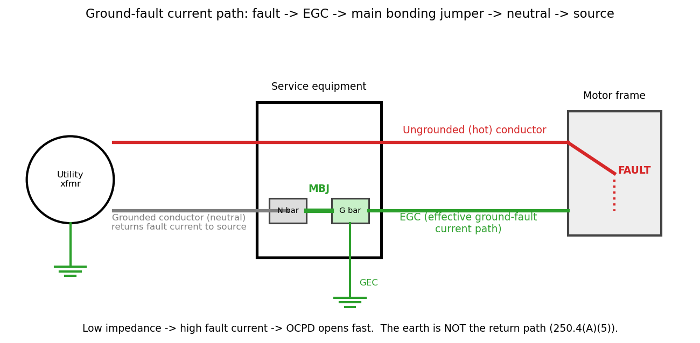  NEC Art. 100; 250.4(A)(5)  

<b>61.</b> &#x27;Electricity takes the path of least resistance.&#x27; True?
 Not exactly. It follows ALL available paths, in inverse proportion to their impedance. Fault current can flow on ducts, water pipe, and gas pipe, which is why the code demands a low-impedance electrical path.  NEC 250.4  

<b>62.</b> Relationship of impedance, fault current, and clearing time?
 Lower impedance gives higher fault current, and higher fault current makes the OCPD clear faster. Damage scales with I-squared-t (current squared x time).   NEC 250.4(A)(5)  

<b>63.</b> Why ground electrical SYSTEMS (250.4(A)(1))?
 To limit voltage imposed by lightning, line surges, or unintentional contact with higher-voltage lines, and to stabilize the voltage to earth during normal operation.  NEC 250.4(A)(1)  

<b>64.</b> Is the earth an effective ground-fault current path?
 No (250.4(A)(5)). A ground rod alone can&#x27;t pass enough current to trip a breaker: 120 V / 25 ohm is about 4.8 A, so a 20-A breaker never trips. Fault clearing needs the EGC back to the source. 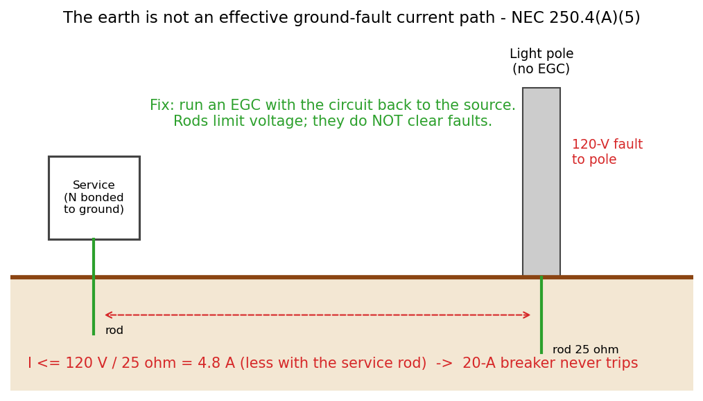  NEC 250.4(A)(5)  

<b>65.</b> Main bonding jumper vs. system bonding jumper?
 Both connect the grounded conductor to the EGC and enclosure. The MBJ does it at the SERVICE. The SBJ does it at a SEPARATELY DERIVED SYSTEM (transformer or generator). 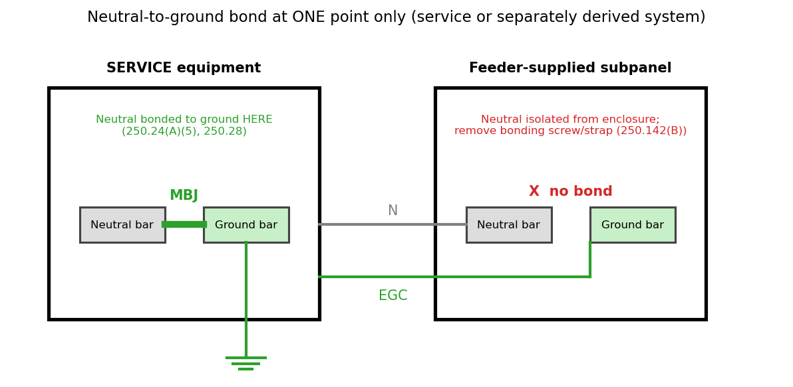  NEC 250.28; 250.30(A)(1)  

<b>66.</b> Where may the neutral be connected to the EGC and enclosures?
 Only at the service (or at a separately derived system&#x27;s source or first disconnect). Beyond that the neutral is isolated: feeder panels get separate neutral and ground bars, with no bonding screw.   NEC 250.24(A)(5); 250.24(B); 250.30; 250.142(B)  

<b>67.</b> What happens if neutral and EGC are bonded downstream of the service?
 Neutral current takes parallel paths over EGCs, raceways, and metal gas and water pipes and ducts. That creates fire and shock hazards, electromagnetic fields, and GFPE misoperation. It&#x27;s also &#x27;objectionable current&#x27; (250.6).   NEC 250.24(A)(5); 250.6  

<b>68.</b> When must an AC system (50-1000 V) be grounded (250.20(B))?
 (1) It can be grounded so the maximum voltage to ground is 150 V or less; (2) a 3-phase 4-wire wye uses the neutral as a circuit conductor; (3) a 3-phase 4-wire delta uses the midpoint of one phase.   NEC 250.20(B)  

## 8. Electrodes & GEC

<b>69.</b> 250.50: what must be bonded together to form the grounding electrode system?
 ALL of these, if present: metal underground water pipe; metal in-ground support structure; concrete-encased electrode; ground ring; rod and pipe electrodes; plate electrodes; other listed electrodes; other local metal underground systems. 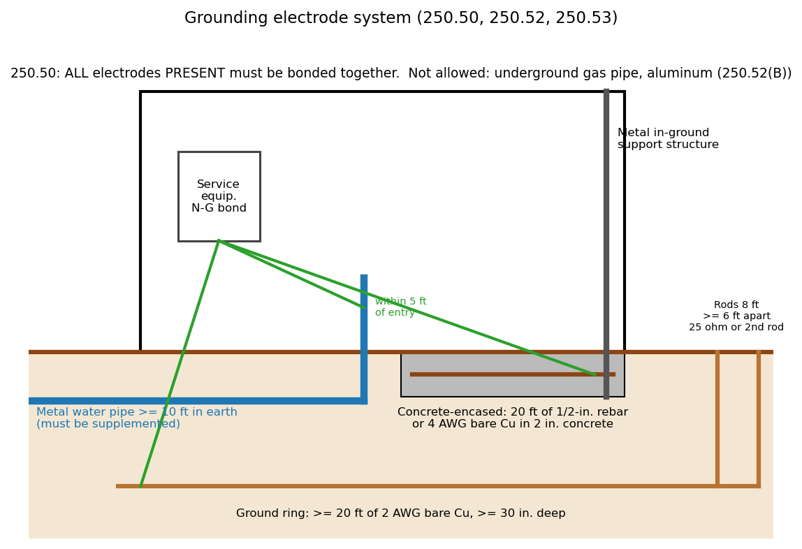  NEC 250.50; 250.52(A)  

<b>70.</b> Requirements for a metal water pipe to be a grounding electrode?
 At least 10 ft (3 m) in direct contact with earth (including a bonded metal well casing). It must always be supplemented by another electrode.   NEC 250.52(A)(1); 250.53(D)(2)  

<b>71.</b> Concrete-encased (&#x27;Ufer&#x27;) electrode specs?
 At least 20 ft of bare 1/2-in. or larger rebar, or bare 4 AWG or larger copper, encased in at least 2 in. of concrete in direct contact with earth, near the bottom of the foundation or footing.   NEC 250.52(A)(3)  

<b>72.</b> Why is &#x27;if present&#x27; critical for rebar electrodes?
 Rebar is present in the footings during construction. The electrician must coordinate with the concrete contractor to bring out an accessible rebar stub, or attach the GEC with a listed rebar clamp before the pour.   NEC 250.50  

<b>73.</b> Ground ring electrode specs?
 At least 20 ft of bare copper, 2 AWG or larger, encircling the building, buried at least 30 in. (750 mm) deep.   NEC 250.52(A)(4); 250.53(F)  

<b>74.</b> Ground rod rules: resistance and spacing?
 A single rod must be supplemented by a second electrode unless it tests at 25 ohm or less (use an earth-resistance tester, not an ohmmeter). Space multiple rods at least 6 ft apart.   NEC 250.53(A)(2), (A)(3)  

<b>75.</b> What may NOT be used as a grounding electrode?
 Metal underground gas piping, aluminum, and swimming-pool structures and structural rebar (680.26(B)).   NEC 250.52(B)  

<b>76.</b> Where must the GEC (or bonding conductor) connect to interior metal water piping?
 Within the first 5 ft (1.52 m) of where the pipe enters the building. Exception: commercial, industrial, or institutional buildings with exposed piping and qualified maintenance. 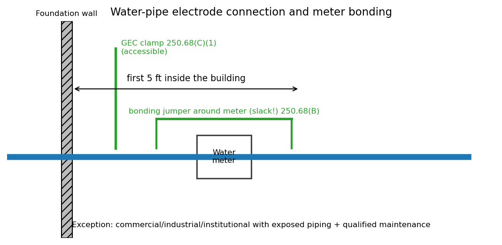  NEC 250.68(C)(1)  

<b>77.</b> Why bond around a water meter, and how long should the jumper be?
 Insulating joints and removable meters must be bonded around (250.68(B)). Leave the jumper long enough that the bond stays in place if the meter is removed.   NEC 250.68(B)  

<b>78.</b> How is the GEC sized?
 Table 250.66, based on the SIZE (not ampacity) of the largest ungrounded service conductor, or the sum of parallel sets. Maximum 3/0 Cu.   NEC 250.66  

<b>79.</b> GEC for 3/0 Cu service conductors (100-A service)?
 4 AWG copper (the 2/0-3/0 row of Table 250.66).   NEC Table 250.66  

<b>80.</b> GEC for three parallel sets of 350 kcmil Cu?
 3 x 350 = 1050 kcmil equivalent, in the &#x27;over 600-1100&#x27; row: 2/0 AWG copper.   NEC Table 250.66  

<b>81.</b> GEC size limits for rods, concrete-encased electrodes, and ground rings?
 The portion to rod, pipe, or plate electrodes only: need not exceed 6 AWG Cu. To a concrete-encased electrode only: 4 AWG Cu. To a ground ring: not larger than the ring conductor.   NEC 250.66(A)-(C)  

<b>82.</b> GEC installation rules (splices, enclosures, aluminum)?
 Unspliced, except by irreversible compression or exothermic welding (250.64(C)). Ferrous raceways bonded at both ends (250.64(E)). Aluminum or copper-clad aluminum not within 18 in. of earth outdoors (250.64(A)). No solder connections.  NEC 250.64; 250.70  

## 9. Bonding jumpers & EGC sizing

<b>83.</b> How is the main bonding jumper sized?
 Per 250.28(D), using Table 250.102(C)(1). For a single main on 3 x 250 kcmil (750 kcmil): 2/0 Cu. Listed service equipment comes with the MBJ (green screw, strap, or bus).   NEC 250.28(D)  

<b>84.</b> Why are supply-side bonding jumpers sized from Table 250.102(C)(1) instead of Table 250.122?
 They&#x27;re ahead of (on the supply side of) any overcurrent device, so there&#x27;s no OCPD rating to size from. They&#x27;re sized by the service conductor size. 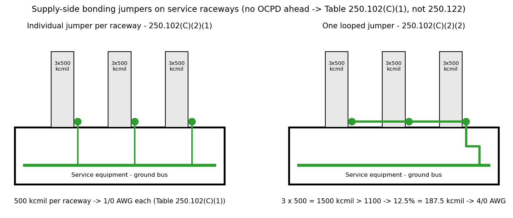  NEC 250.102(C)  

<b>85.</b> Three service conduits, each with 500 kcmil phases: individual supply-side bonding jumper size?
 1/0 AWG Cu for each raceway (500 kcmil is in the &#x27;over 350-600&#x27; row of Table 250.102(C)(1)).   NEC 250.102(C)(2)(1)  

<b>86.</b> Same three conduits, one jumper looped through all three bonding bushings?
 Sum = 1500 kcmil, which is over 1100, so use 12.5%: 187.5 kcmil, between 3/0 (167,800 cmil) and 4/0 (211,600 cmil). Use 4/0 AWG Cu.   NEC 250.102(C)(2)(2)  

<b>87.</b> How are equipment grounding conductors sized?
 Table 250.122, by the rating of the OCPD ahead of the circuit. A 700-A OCPD uses the 800-A row: 1/0 Cu. With parallel runs, a full-size EGC goes in each raceway (250.122(F)). 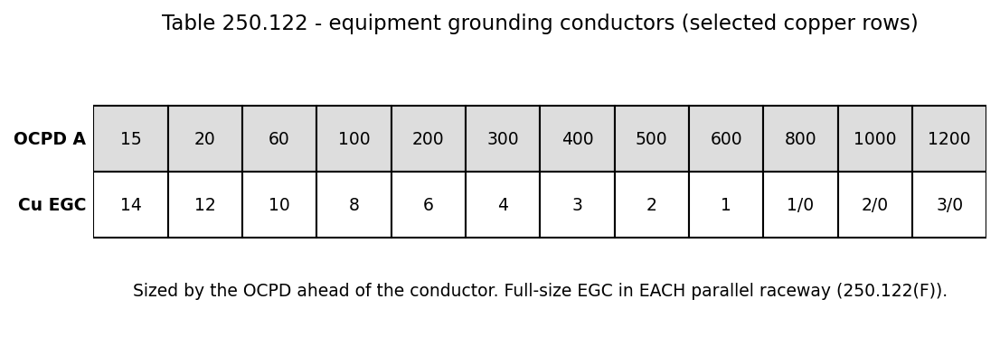  NEC 250.122  

## 10. Bonding at service & piping

<b>88.</b> Service raceways: how must they be bonded, and what about concentric knockouts?
 With bonding bushings, bonding locknuts, threaded hubs, or bonding jumpers. Bond around concentric and eccentric knockouts; standard locknuts aren&#x27;t enough at the service (250.92(B)).  NEC 250.92(B)  

<b>89.</b> Painted wireway or gutter joints: what is required?
 Remove nonconductive paint at contact points, or use bonding locknuts or bushings, to ensure continuity.  NEC 250.12; 250.96(A)  

<b>90.</b> Bonding of metal gas piping &#x27;likely to become energized&#x27;: where to, and how sized?
 To the EGC of the circuit likely to energize it, the service enclosure, the grounded conductor at the service, the GEC, or an electrode. Size with Table 250.122 using that circuit&#x27;s OCPD. 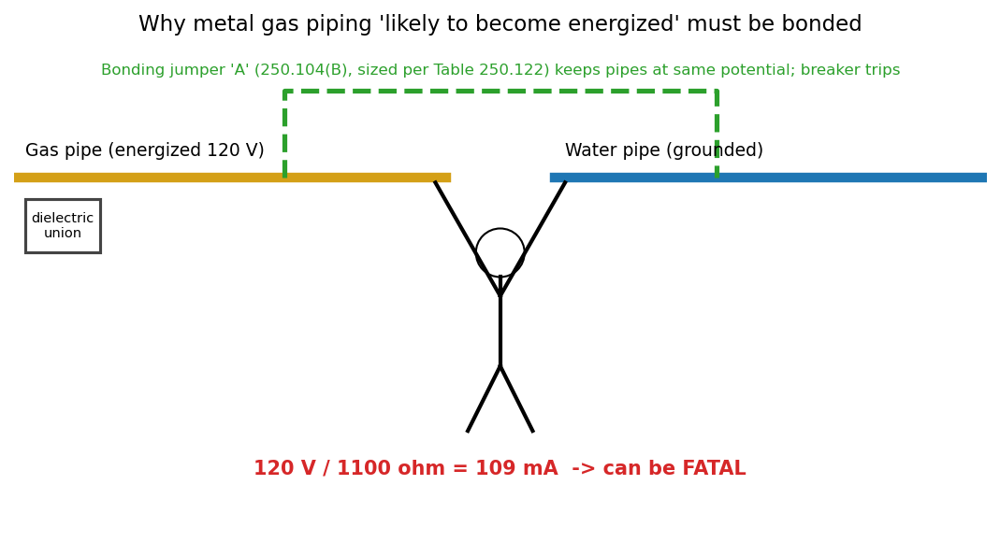  NEC 250.104(B)  

<b>91.</b> Unbonded gas pipe energized at 120 V; person touches it and a water pipe (1100 ohm). Current?
 120 / 1100 = 0.109 A (109 mA). That can cause ventricular fibrillation and death. The breaker doesn&#x27;t trip because the dielectric union leaves no return path.   NEC 250.104(B)  

## 11. GFPE, safety, pitfalls

<b>92.</b> When does 230.95 require ground-fault protection of equipment (GFPE)?
 Solidly grounded wye services over 150 V to ground but not over 600 V phase-to-phase, for each service disconnect rated 1000 A or more (for example, 480Y/277 V at 1000 A or more). 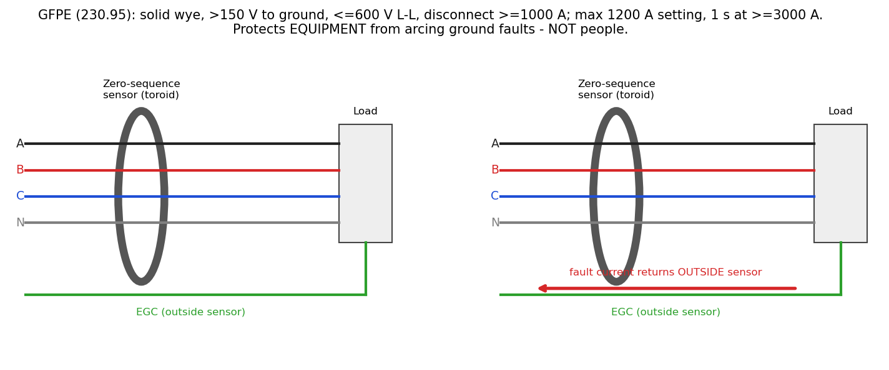  NEC 230.95  

<b>93.</b> GFPE maximum setting and maximum opening time?
 Maximum setting 1200 A. Maximum time delay 1 second for ground-fault currents of 3000 A or more.   NEC 230.95(A)  

<b>94.</b> Is GFPE required on the Commercial Building&#x27;s 208Y/120-V service? Why?
 No. 120 V to ground isn&#x27;t over 150 V, and it usually won&#x27;t sustain an arcing fault.  NEC 230.95  

<b>95.</b> How does a GFPE sensor work, and what faults can it NOT see?
 A zero-sequence (toroid) sensor surrounds all circuit conductors, which normally sum to zero. Ground-fault current returning on the EGC causes an imbalance and a trip. It can&#x27;t see phase-to-phase, 3-phase, or phase-to-neutral faults.   NEC 230.95  

<b>96.</b> Does GFPE protect people?
 NO. It protects equipment against low-level arcing ground faults (hundreds of amps). Personnel protection is GFCI (about 5 mA trip). Lawsuits have arisen from this misunderstanding.   NEC 230.95; 210.8(B)  

<b>97.</b> What must be done with a GFPE system when it is first installed?
 Performance test it on site per the manufacturer&#x27;s instructions, and keep a written record for the AHJ.  NEC 230.95(C)  

<b>98.</b> Why must you never open a current-transformer (CT) secondary under load?
 A CT acts as a current source. With the secondary open it can develop very high voltage, causing arcing, shock, and CT damage. Short the secondary first. (Never short a PT secondary.)   

<b>99.</b> OSHA sections for electrical safety-related work practices? Fundamental rule?
 OSHA 1910.331-1910.360 (general industry; 1926 for construction). The rule: NEVER work on equipment with the power on. Turn it off, lock it off, test it, and assume it&#x27;s live until proven otherwise.  NEC OSHA 1910.331-.360  

<b>100.</b> Arc-flash labeling: which NEC section, and what is required at 1000 A or more?
 110.16. (A): a warning on switchboards, switchgear, enclosed panelboards, industrial control panels, meter socket enclosures, and MCCs likely to be worked on energized (other than dwellings). (B): service and feeder-supplied equipment rated 1000 A or more gets a permanent label per industry practice (NFPA 70E), including the date applied.  NEC 110.16  

---

*Generated by `tools/flashcards/build_decks.py` from the JSON file. Edit the JSON, not this page.*
