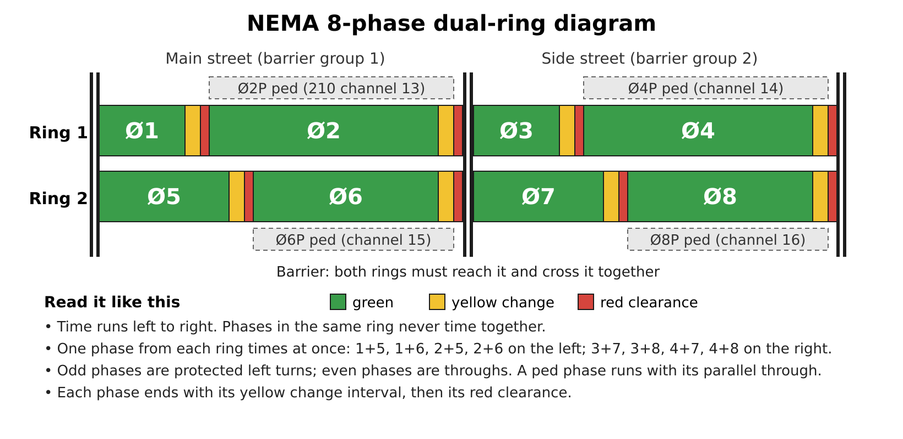
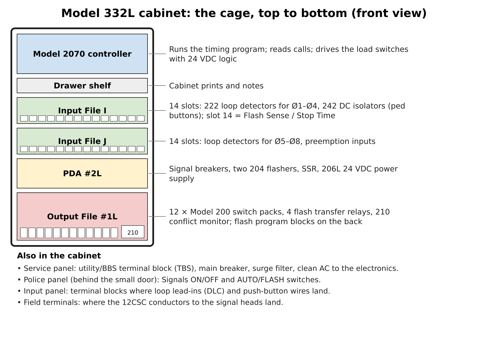

# ELECT 280 Traffic Signal Systems 1 — Cheat Sheet

## Course at a glance

ELECT 280 teaches you to read a Caltrans traffic signal plan and follow every movement on it from the street, through the conduit and cable, into the Model 332 cabinet, and back out to the signal heads. The course also covers the Caltrans Standard Plans legend, the 8-phase ring diagram, the 210 conflict monitor, and basic 2070 controller programming.

The course has three learning outcomes. You should be able to read an intersection plan and plan the work. You should be able to pick materials using Caltrans and NEC rules. You should be able to explain how the intersection runs through its timing sequence.

**The core skills, in the order the course builds them:**

1. **Phase numbering (NEMA 8-phase).** Odd phases are protected left turns and even phases are through movements. Ø2/Ø6 are usually the main street and Ø4/Ø8 the side street.
2. **Reading the plan and legend.** Decode symbols, poles, heads, pull boxes and conduit runs using Caltrans Standard Plans ES-1A to ES-1C and the plan's own schedules.
3. **Ring diagram and concurrency.** Ring 1 = 1-2 | 3-4, Ring 2 = 5-6 | 7-8. One phase from each ring times at once, and both rings must cross the barrier together.
4. **Ped heads and detectors on the plan.** Assign every ped head, push button and loop to its phase.
5. **The 332 cabinet.** Know each part: 2070 controller, Input Files I and J, PDA #2L, Output File #1L, 200 load switches, flash transfer relays (FTRs), 204 flashers and the 210 monitor.
6. **Vehicle detector designations (VDD).** Example: 2I2U = Phase 2, Input File I, Slot 2, Upper channel. Trace each loop to its terminal block (TB) and file pins.
7. **Power and output path.** Follow PDA breaker to switch pack to output file terminals to field wiring.
8. **210 diode card.** Each diode marks a conflict. Remove the diodes only for pairs that are allowed to run together.
9. **Conduit and conductor schedule.** Count the 12CSC, 3CSC, DLC, power, lighting and ground conductors in every conduit run.
10. **The controller.** Basic timing and programming on a 2070 running Swarco Omni eX.

**Course grading:** 95–100 A, 85–94 B, 75–84 C, 70–74 D. You can redo wrong homework answers as many times as you need. You may miss no more than 3 classes, and PPE is required in class and in the yard.

## Key numbers, terms and formulas

| Item | What to remember |
| --- | --- |
| Ring diagram | Ring 1: Ø1 Ø2 ‖ Ø3 Ø4. Ring 2: Ø5 Ø6 ‖ Ø7 Ø8. Compatible pairs on the left side of the barrier: 1+5, 1+6, 2+5, 2+6. On the right side: 3+7, 3+8, 4+7, 4+8. |
| Ped phases | Each ped phase is named for the through phase it runs with: Ø2P, Ø4P, Ø6P, Ø8P. On the 210 monitor they use channels 13, 14, 15 and 16. |
| Overlaps | 210 channels 9 and 10 = Overlap A and Overlap B. |
| Phase interval | Phase = Green + Yellow change + Red clearance. Ped = Walk + Flashing Don't Walk (ped clearance). |
| VDD format | Phase, File, Slot, Channel. 6J2L = Ø6, J file, slot 2, Lower. I file = Ø1–Ø4, J file = Ø5–Ø8. |
| Slot I14 | 242 DC isolator that gives the controller Flash Sense (FS) and Stop Time (ST). |
| 332 cage, top to bottom | 2070 controller, drawer shelf, Input File I, Input File J, PDA #2L with 206L power supply, Output File #1L. |
| Output File #1L | 12 × Model 200 switch packs, 4 FTRs, 1 × 210 monitor, flash program blocks on the back. |
| PDA breakers | Each signal circuit breaker (SCB) feeds a group of three switch packs: a left turn, a through and its ped. Look up the PDA terminal numbers in the 332L cabinet manual. |
| Flashers | Two 204 flashers in the PDA. Each flasher circuit carries a pair of compatible phases. The PDA has test terminals for reading flasher voltage. |
| Diode card | 16 channels give 16×15÷2 = 120 diodes. A diode in place means the pair conflicts. Remove a diode only for a pair that may run together. |
| Cables | 12CSC = signal heads, one per signal standard. 3CSC = push button, one per push-button location. DLC = loop lead-in, one per detector designation. SIC = signal interconnect. |
| Conduit count rule | A run carries one cable for every pole beyond it. The run that leaves the cabinet carries all of them. |
| Power, lighting, ground | Signal power runs from the service to the cabinet, lighting conductors follow the poles with luminaires, and a bonding or ground conductor goes in every run. Sizes come from the plan and the NEC. |
| Service | Typically a 120/240 V metered service with a main breaker, a PEC (photocell) breaker and a separate, often unmetered, lighting breaker. |

**Loop detector math (from the inductance unit):**

$$
X_L = 2\pi f L \approx 377\,L \text{ at } 60\text{ Hz}
$$

$$
Z = \sqrt{R^2 + X_L^2} \qquad \tau = \frac{L}{R} \qquad v = L\,\frac{\Delta i}{\Delta t}
$$

Never add R and X\_L directly. They combine like the sides of a right triangle. A car over a loop **lowers** the loop's inductance, and the detector card senses that change as a shift in frequency.

**Yellow change interval (ITE kinematic formula):**

$$
Y = t + \frac{v}{2a + 2gG}
$$

Here t = 1 s reaction time, v = approach speed in ft/s (mph × 1.47), a = 10 ft/s², g = 32.2 ft/s² and G = grade as a decimal. Example: 35 mph = 51.5 ft/s on a flat road gives Y = 1 + 51.5/20 ≈ 3.6 s, which matches CA MUTCD Table 4D-101(CA) for an 85th-percentile speed of 35 mph. If you only know the posted speed, the CA MUTCD has you add 7 mph first (10 mph at 25 mph or less), so a 35 mph posted street gets 4.1 s.

## Assignments

### 1 — Phases

Mark the correct Ø on every vehicle head and ped head of an intersection, and name the symbols, such as "signal head with backplate" and "southbound ped crossing".

- **Skills:** odd = left turn, even = through; Ø2/Ø6 are the main street, Ø4/Ø8 the side street; a left turn pairs with the through phase on the same approach (Ø1 with Ø6, Ø5 with Ø2, Ø3 with Ø8, Ø7 with Ø4).
- **Common mistakes:** Labeling a head by the corner it stands on instead of the traffic it faces. A far-side head on the NE corner faces south and serves **northbound** traffic. Mixing up which left turn goes with which through.

### 2 — Concurrency and Standard Plans

Draw the concurrency arrows on the A/B ring diagram and explain the yellow and red lines. Then find 32 plan items in the 2018 Caltrans Electrical Standard Plans.

- **Skills:** One phase from each ring runs at a time. Barriers are where both rings must finish together. Find a symbol in ES-1A to ES-1C, then check it against the plan's Standard and Equipment Schedule.
- **Common mistakes:** Calling the red line "just red". It is the **all-red clearance**, when every approach shows red. Drawing arrows across the barrier, for example Ø2 with Ø3. Forgetting the ped phases (13–16) and existing (E) versus new symbols. Standard Plans give the general case; the project plan's notes and schedules come first.

### 3 — Phases with Ped Heads and Vehicle Detector Designations

Mark the phases on a test print, now with ped heads and loops added.

- **Skills:** A ped head's phase matches the through phase parallel to the crosswalk. A loop's phase is the movement in the lane it sits in.
- **Common mistakes:** Giving a ped head the phase of the street being crossed (it is the parallel street's phase). Giving left-turn pocket loops the through phase.

### 4 — The 332 Controller Cabinet

Label the parts of the 332 cabinet and put the correct phase next to each slot symbol in the I file.

- **Skills:** Know what each part does. The 2070 makes decisions. Input files carry 222 loop detectors and 242 isolators. The PDA holds the breakers, two 204 flashers and the 206L 24 VDC supply. Model 200 load switches use a triac to send 120 VAC to the heads. FTRs move the heads to the flasher. The 210 watches for conflicts.
- **Common mistakes:** Calling the I file "loops" and the J file "detectors". Both hold detector cards: I = Ø1–Ø4, J = Ø5–Ø8. Thinking the controller powers the lamps directly. It only sends 24 VDC logic signals to the load switches.

### 5 — Quiz: phases

A timed version of Assignments 1 and 3 on a new print. Read the north arrow first, then work one approach at a time.

### 6 — Vehicle Detector Designations

On an intersection print, trace each VDD to its input panel terminal block (TB) and input file pins, using the 332L cabinet manual.

- **Skills:** Each detector channel has its own pair of TB positions and its own pair of file pins. Upper and lower channels of one slot use different pins. Read the input panel and input file drawings in the cabinet manual.
- **Common mistakes:** Marking loops that are drawn but carry no designation. The instructor marks those wrong. Copy errors, such as writing J5 pins for a J6 detector. Check every line twice.

### 7 — Quiz 2: Concurrency

The ring diagram again, from memory. Know the four compatible pairs on each side of the barrier and where the ped channels go.

### 8 — The PDA and Output File

Use the cabinet manual to find which switch packs each SCB feeds and where its output lands, then fill in what lands on each field terminal (FT) block terminal.

- **Skills:** Each breaker feeds a group of three switch packs (phase, phase, ped). Each switch pack has three outputs, R/Y/G or DW/(Y)/Walk.
- **Common mistakes:** Mixing up the output order. Ped switch pack outputs are Don't Walk, Yellow (unused), Walk. Reading the PDA from the front when the drawing shows the rear view.

### 9 — Quiz 3: I and J File callout

Place every VDD and ped isolator from a print in the correct I or J slot, using the input file layout in the 332L manual. Mark only what is on the print.

### 10 — 210 Diode Card

Start with all 120 diodes in place, which makes every channel conflict. Cut out the diodes for compatible pairs. Work from the ring diagram: check every vehicle, ped and overlap pair, and ask whether those movements can safely show green or walk at the same time.

- **Common mistakes:** Removing a diode for a pair that conflicts. That lets two conflicting greens show and the monitor will not catch it, which is the worst error in the course. Forgetting the ped and overlap channels. Forgetting to write the intersection name on the card.

### 11 — Quiz 4: Output file

A timed version of Assignment 8.

### 12 — Cable and Conductor Schedule

Fill in the 12CSC and 3CSC rows of a conduit and conductor schedule.

- **Skills:** One 12CSC for every pole with heads. One 3CSC for every push-button location. Signal cable runs unspliced from the cabinet to the pole. Check the conductor count for each pole: 3 per vehicle phase + 2 per ped phase + 1 common, which must fit in 12.
- **Common mistakes:** Counting a pole only in the last run to reach it instead of every run it passes through. Putting signal cable in SIC-only or service runs. Forgetting that a push-button-only post gets no 12CSC.

### 13 — DLCs and Conduit and Conductor Schedule

Add the DLC rows. There is one DLC per detector designation, and they build up toward the cabinet.

- **Common mistakes:** Treating a plan callout such as "INSTALL 4 DLC" as the total for the run. It is only what that leg adds. Missing a conduit that is not clearly labeled. Write down any assumption you make.

### 14 — Quiz 5: I and J File

Define each part of a VDD and fill in a full I and J file: loops, ped push-button isolators, FS and ST, and preemption inputs.

### 15 — Power, Street Lighting and Grounding

Add the signal power, lighting and ground rows to the schedule.

- **Skills:** Power runs only from service to CB to cabinet. Lighting follows the poles that have luminaires. Ground goes in **every** conduit.
- **Common mistakes:** Leaving out the ground in runs that carry only DLC or SIC. Putting lighting conductors in the cabinet feed. Not sizing the ground to the breaker (NEC 250.122).

### 16 — The Controller (Omni eX on the 2070)

Basic programming: phase timing (min green, passage, max, yellow, red clearance, walk, ped clearance), detector-to-phase mapping, and recall. Program carefully and know your timing units, because wrong values here cause problems at a real intersection.

## Safety and the biggest misunderstandings

**Safety points that come up throughout the course:**

- **Conflicting greens are the worst failure.** The 210 monitor and its diode card are the last thing that stops them. Never remove a diode, jumper a monitor or run without the monitor installed to "get it working".
- **Put the intersection into flash, under traffic control, before you pull a switch pack, FTR or monitor.** If you remove the 210, the cabinet is designed to go into flash.
- **120 VAC is live in the cabinet even with the signals off.** The Signals ON/OFF switch on the police panel only removes power from the heads. The PDA, service panel, and the controller's clean AC stay hot.
- **A battery backup system (BBS) can feed power back.** Opening the utility breaker does not make the cabinet dead when a BBS inverter is running. Turn it off and verify with a meter (NFPA 70E lockout/tagout).
- **The service and the 240 V lighting circuits are an arc-flash hazard.** Wear the right PPE (NFPA 70E) and test before you touch.
- **Knocked-down poles** can leave live 12CSC and lighting conductors in the street. Shut off the breakers at the service before you handle the wires.
- **Megger the loops only with the 222 card unplugged** and the lead-in lifted. The 500 V test voltage can damage the detector.
- **Working in the street:** set up traffic control per CA MUTCD Part 6 and wear high-visibility gear.

**Misunderstandings to fix first:**

1. A head's phase comes from the traffic it faces, not the corner it stands on.
2. A ped phase is named for the parallel through phase, not the street being crossed.
3. Concurrency happens only within one side of the barrier, and both rings cross the barrier together.
4. On the diode card, a diode means "conflict". Remove a diode = allow.
5. The controller makes 24 VDC logic. The load switches switch 120 VAC to the lamps.
6. A conduit run carries every cable bound for poles beyond it. Signal cable is not spliced along the way.
7. Only mark what is on the print. Assumed equipment is marked wrong, so write down any assumption you make.
8. The project plan and its notes come first, then the Standard Plans, then the Standard Specifications.
