# Flashcards — ELECT 280: Caltrans Legend Symbols

71 cards. Read the question, answer it in your head, then click it to check.

- **Study online:** [flashcard page](https://webnrrd2k.github.io/lbcc-electrical-study-materials/flashcards/?deck=e280-legend): shuffle, flip, and mark the cards you know.
- **Download:** [Anki](caltrans_legend_symbols.apkg) · [Quizlet import file](caltrans_legend_symbols_quizlet.txt) (paste into Quizlet's Import box; images are not included) · [Emacs org-drill](caltrans_legend_symbols.org) · [raw card data](caltrans_legend_symbols.json)

## Contents

- [Signal Equipment](#signal-equipment) (36)
- [Conduit](#conduit) (16)
- [Service Equipment](#service-equipment) (12)
- [Pole-Mounted Service Designation](#pole-mounted-service-designation) (1)
- [Flashing Beacon](#flashing-beacon) (6)

---

## Signal Equipment

<b>1.</b> What does this plan symbol show? 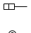
 New: Pedestrian signal head  

<b>2.</b> What does this plan symbol show? 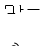
 Existing: Pedestrian signal head  

<b>3.</b> What does this plan symbol show? 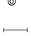
 New: Push button assembly post  

<b>4.</b> What does this plan symbol show? 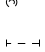
 Existing: Push button assembly post  

<b>5.</b> What does this plan symbol show? 
 New: Pedestrian barricade  

<b>6.</b> What does this plan symbol show? 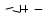
 Existing: Pedestrian barricade  

<b>7.</b> What does this plan symbol show? 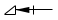
 New: Vehicle signal head (with backplate)  

<b>8.</b> What does this plan symbol show? 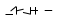
 Existing: Vehicle signal head (with backplate)  

<b>9.</b> What does this plan symbol show? 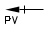
 New: Vehicle signal head with angle visor  

<b>10.</b> What does this plan symbol show? 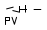
 Existing: Vehicle signal head with angle visor  

<b>11.</b> What does this plan symbol show? 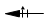
 New: Vehicle signal head (modifications)  

<b>12.</b> What does this plan symbol show? 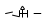
 Existing: Vehicle signal head (modifications)  

<b>13.</b> What does this plan symbol show? 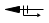
 New: Vehicle signal head consisting of red, yellow and green left arrow sections  

<b>14.</b> What does this plan symbol show? 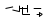
 Existing: Vehicle signal head consisting of red, yellow and green left arrow sections  

<b>15.</b> What does this plan symbol show? 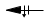
 New: Vehicle signal head consisting of red and yellow sections with an up green arrow section  

<b>16.</b> What does this plan symbol show? 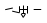
 Existing: Vehicle signal head consisting of red and yellow sections with an up green arrow section  

<b>17.</b> What does this plan symbol show? 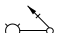
 New: Vehicle signal head (5 section) consisting of red, yellow and green sections with yellow and green right arrow sections  

<b>18.</b> What does this plan symbol show? 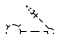
 Existing: Vehicle signal head (5 section) consisting of red, yellow and green sections with yellow and green right arrow sections  

<b>19.</b> What does this plan symbol show? 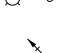
 New: Type 15TS standard with vehicle signal head and luminaire  

<b>20.</b> What does this plan symbol show? 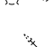
 Existing: Type 15TS standard with vehicle signal head and luminaire  

<b>21.</b> What does this plan symbol show? 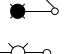
 New: Type 21TS standard with vehicle signal head and luminaire  

<b>22.</b> What does this plan symbol show? 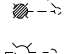
 Existing: Type 21TS standard with vehicle signal head and luminaire  

<b>23.</b> What does this plan symbol show? 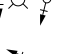
 New: Standard with luminaire and signal mast arms and attached vehicle signal heads  

<b>24.</b> What does this plan symbol show? 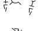
 Existing: Standard with luminaire and signal mast arms and attached vehicle signal heads  

<b>25.</b> What does this plan symbol show? 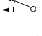
 New: Type 1 standard with attached vehicle signal heads  

<b>26.</b> What does this plan symbol show? 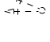
 Existing: Type 1 standard with attached vehicle signal heads  

<b>27.</b> What does this plan symbol show? 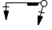
 New: Standard with a signal mast arm, attached vehicle signal heads and internally illuminated street name sign  

<b>28.</b> What does this plan symbol show? 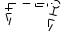
 Existing: Standard with a signal mast arm, attached vehicle signal heads and internally illuminated street name sign  

<b>29.</b> What does this plan symbol show? 
 New: Controller assembly. Door indicates front of cabinet  

<b>30.</b> What does this plan symbol show? 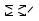
 Existing: Controller assembly. Door indicates front of cabinet  

<b>31.</b> What does this plan symbol show? 
 New: Guard post  

<b>32.</b> What does this plan symbol show? 
 Existing: Guard post  

<b>33.</b> What does this plan symbol show? 
 New: Type 1 standard with ramp metering sign  

<b>34.</b> What does this plan symbol show? 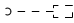
 Existing: Type 1 standard with ramp metering sign  

<b>35.</b> What does this plan symbol show? 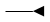
 New: Optical detector for emergency vehicle detection  

<b>36.</b> What does this plan symbol show? 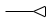
 Existing: Optical detector for emergency vehicle detection  

## Conduit

<b>37.</b> What does this plan symbol show? 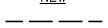
 New: Lighting conduit, unless otherwise indicated or noted  

<b>38.</b> What does this plan symbol show? 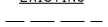
 Existing: Lighting conduit, unless otherwise indicated or noted  

<b>39.</b> What does this plan symbol show? 
 New: Traffic signal conduit  

<b>40.</b> What does this plan symbol show? 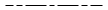
 Existing: Traffic signal conduit  

<b>41.</b> What does this plan symbol show? 
 New: Communication conduit  

<b>42.</b> What does this plan symbol show? 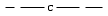
 Existing: Communication conduit  

<b>43.</b> What does this plan symbol show? 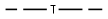
 New: Telephone conduit  

<b>44.</b> What does this plan symbol show? 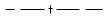
 Existing: Telephone conduit  

<b>45.</b> What does this plan symbol show? 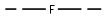
 New: Fire alarm conduit  

<b>46.</b> What does this plan symbol show? 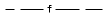
 Existing: Fire alarm conduit  

<b>47.</b> What does this plan symbol show? 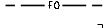
 New: Fiber optic conduit  

<b>48.</b> What does this plan symbol show? 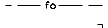
 Existing: Fiber optic conduit  

<b>49.</b> What does this plan symbol show? 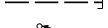
 New: Conduit termination  

<b>50.</b> What does this plan symbol show? 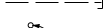
 Existing: Conduit termination  

<b>51.</b> What does this plan symbol show? 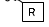
 New: Conduit riser attached to the structure or service pole  

<b>52.</b> What does this plan symbol show? 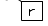
 Existing: Conduit riser attached to the structure or service pole  

## Service Equipment

<b>53.</b> What does this plan symbol show? 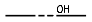
 New: Overhead lines  

<b>54.</b> What does this plan symbol show? 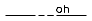
 Existing: Overhead lines  

<b>55.</b> What does this plan symbol show? 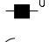
 New: Wood pole, &quot;U&quot; indicates utility owned  

<b>56.</b> What does this plan symbol show? 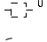
 Existing: Wood pole, &quot;U&quot; indicates utility owned  

<b>57.</b> What does this plan symbol show? 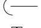
 New: Pole guy with anchor  

<b>58.</b> What does this plan symbol show? 
 Existing: Pole guy with anchor  

<b>59.</b> What does this plan symbol show? 
 New: Utility transformer - ground mounted  

<b>60.</b> What does this plan symbol show? 
 Existing: Utility transformer - ground mounted  

<b>61.</b> What does this plan symbol show? 
 New: Service equipment enclosure type. Door indicates front of enclosure  

<b>62.</b> What does this plan symbol show? 
 Existing: Service equipment enclosure type. Door indicates front of enclosure  

<b>63.</b> What does this plan symbol show? 
 New: Telephone demarcation cabinet  

<b>64.</b> What does this plan symbol show? 
 Existing: Telephone demarcation cabinet  

## Pole-Mounted Service Designation

<b>65.</b> What does this plan symbol show? 
 TYPE OF INSTALLATION AND POLE HEIGHT ABOVE GRADE:   

## Flashing Beacon

<b>66.</b> What does this plan symbol show? 
 New: Flashing beacon (one vehicle signal head with backplate and visor)  

<b>67.</b> What does this plan symbol show? 
 Existing: Flashing beacon (one vehicle signal head with backplate and visor)  

<b>68.</b> What does this plan symbol show? 
 New: Flashing beacon with type 15-FBS standard and a sign  

<b>69.</b> What does this plan symbol show? 
 Existing: Flashing beacon with type 15-FBS standard and a sign  

<b>70.</b> What does this plan symbol show? 
 New: Flashing beacon with types 9, 9A or 9B sign unless otherwise specified or indicated  

<b>71.</b> What does this plan symbol show? 
 Existing: Flashing beacon with types 9, 9A or 9B sign unless otherwise specified or indicated  

---

*Generated by `tools/flashcards/build_decks.py` from the JSON file. Edit the JSON, not this page.*
