#+TITLE: ELECT 280 — Caltrans Legend Symbols
#+FILETAGS: :drill:
#+STARTUP: overview

# Generated by tools/flashcards/build_decks.py. Study with M-x org-drill.

* Signal Equipment

** What does this plan symbol show?
   :PROPERTIES:
   :ID: e280-legend-001
   :END:
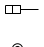
*** Answer
New: Pedestrian signal head

** What does this plan symbol show?
   :PROPERTIES:
   :ID: e280-legend-002
   :END:
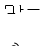
*** Answer
Existing: Pedestrian signal head

** What does this plan symbol show?
   :PROPERTIES:
   :ID: e280-legend-003
   :END:
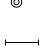
*** Answer
New: Push button assembly post

** What does this plan symbol show?
   :PROPERTIES:
   :ID: e280-legend-004
   :END:
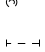
*** Answer
Existing: Push button assembly post

** What does this plan symbol show?
   :PROPERTIES:
   :ID: e280-legend-005
   :END:
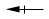
*** Answer
New: Pedestrian barricade

** What does this plan symbol show?
   :PROPERTIES:
   :ID: e280-legend-006
   :END:
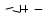
*** Answer
Existing: Pedestrian barricade

** What does this plan symbol show?
   :PROPERTIES:
   :ID: e280-legend-007
   :END:
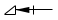
*** Answer
New: Vehicle signal head (with backplate)

** What does this plan symbol show?
   :PROPERTIES:
   :ID: e280-legend-008
   :END:
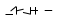
*** Answer
Existing: Vehicle signal head (with backplate)

** What does this plan symbol show?
   :PROPERTIES:
   :ID: e280-legend-009
   :END:
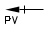
*** Answer
New: Vehicle signal head with angle visor

** What does this plan symbol show?
   :PROPERTIES:
   :ID: e280-legend-010
   :END:
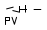
*** Answer
Existing: Vehicle signal head with angle visor

** What does this plan symbol show?
   :PROPERTIES:
   :ID: e280-legend-011
   :END:
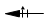
*** Answer
New: Vehicle signal head (modifications)

** What does this plan symbol show?
   :PROPERTIES:
   :ID: e280-legend-012
   :END:
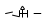
*** Answer
Existing: Vehicle signal head (modifications)

** What does this plan symbol show?
   :PROPERTIES:
   :ID: e280-legend-013
   :END:
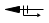
*** Answer
New: Vehicle signal head consisting of red, yellow and green left arrow sections

** What does this plan symbol show?
   :PROPERTIES:
   :ID: e280-legend-014
   :END:
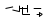
*** Answer
Existing: Vehicle signal head consisting of red, yellow and green left arrow sections

** What does this plan symbol show?
   :PROPERTIES:
   :ID: e280-legend-015
   :END:
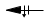
*** Answer
New: Vehicle signal head consisting of red and yellow sections with an up green arrow section

** What does this plan symbol show?
   :PROPERTIES:
   :ID: e280-legend-016
   :END:
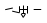
*** Answer
Existing: Vehicle signal head consisting of red and yellow sections with an up green arrow section

** What does this plan symbol show?
   :PROPERTIES:
   :ID: e280-legend-017
   :END:
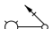
*** Answer
New: Vehicle signal head (5 section) consisting of red, yellow and green sections with yellow and green right arrow sections

** What does this plan symbol show?
   :PROPERTIES:
   :ID: e280-legend-018
   :END:
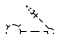
*** Answer
Existing: Vehicle signal head (5 section) consisting of red, yellow and green sections with yellow and green right arrow sections

** What does this plan symbol show?
   :PROPERTIES:
   :ID: e280-legend-019
   :END:
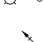
*** Answer
New: Type 15TS standard with vehicle signal head and luminaire

** What does this plan symbol show?
   :PROPERTIES:
   :ID: e280-legend-020
   :END:
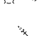
*** Answer
Existing: Type 15TS standard with vehicle signal head and luminaire

** What does this plan symbol show?
   :PROPERTIES:
   :ID: e280-legend-021
   :END:
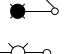
*** Answer
New: Type 21TS standard with vehicle signal head and luminaire

** What does this plan symbol show?
   :PROPERTIES:
   :ID: e280-legend-022
   :END:
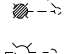
*** Answer
Existing: Type 21TS standard with vehicle signal head and luminaire

** What does this plan symbol show?
   :PROPERTIES:
   :ID: e280-legend-023
   :END:
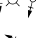
*** Answer
New: Standard with luminaire and signal mast arms and attached vehicle signal heads

** What does this plan symbol show?
   :PROPERTIES:
   :ID: e280-legend-024
   :END:
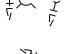
*** Answer
Existing: Standard with luminaire and signal mast arms and attached vehicle signal heads

** What does this plan symbol show?
   :PROPERTIES:
   :ID: e280-legend-025
   :END:
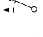
*** Answer
New: Type 1 standard with attached vehicle signal heads

** What does this plan symbol show?
   :PROPERTIES:
   :ID: e280-legend-026
   :END:
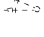
*** Answer
Existing: Type 1 standard with attached vehicle signal heads

** What does this plan symbol show?
   :PROPERTIES:
   :ID: e280-legend-027
   :END:
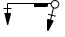
*** Answer
New: Standard with a signal mast arm, attached vehicle signal heads and internally illuminated street name sign

** What does this plan symbol show?
   :PROPERTIES:
   :ID: e280-legend-028
   :END:
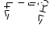
*** Answer
Existing: Standard with a signal mast arm, attached vehicle signal heads and internally illuminated street name sign

** What does this plan symbol show?
   :PROPERTIES:
   :ID: e280-legend-029
   :END:

*** Answer
New: Controller assembly. Door indicates front of cabinet

** What does this plan symbol show?
   :PROPERTIES:
   :ID: e280-legend-030
   :END:
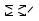
*** Answer
Existing: Controller assembly. Door indicates front of cabinet

** What does this plan symbol show?
   :PROPERTIES:
   :ID: e280-legend-066
   :END:

*** Answer
New: Guard post

** What does this plan symbol show?
   :PROPERTIES:
   :ID: e280-legend-067
   :END:

*** Answer
Existing: Guard post

** What does this plan symbol show?
   :PROPERTIES:
   :ID: e280-legend-068
   :END:

*** Answer
New: Type 1 standard with ramp metering sign

** What does this plan symbol show?
   :PROPERTIES:
   :ID: e280-legend-069
   :END:
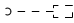
*** Answer
Existing: Type 1 standard with ramp metering sign

** What does this plan symbol show?
   :PROPERTIES:
   :ID: e280-legend-070
   :END:
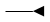
*** Answer
New: Optical detector for emergency vehicle detection

** What does this plan symbol show?
   :PROPERTIES:
   :ID: e280-legend-071
   :END:
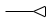
*** Answer
Existing: Optical detector for emergency vehicle detection

* Conduit

** What does this plan symbol show?
   :PROPERTIES:
   :ID: e280-legend-031
   :END:
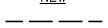
*** Answer
New: Lighting conduit, unless otherwise indicated or noted

** What does this plan symbol show?
   :PROPERTIES:
   :ID: e280-legend-032
   :END:
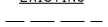
*** Answer
Existing: Lighting conduit, unless otherwise indicated or noted

** What does this plan symbol show?
   :PROPERTIES:
   :ID: e280-legend-033
   :END:

*** Answer
New: Traffic signal conduit

** What does this plan symbol show?
   :PROPERTIES:
   :ID: e280-legend-034
   :END:
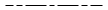
*** Answer
Existing: Traffic signal conduit

** What does this plan symbol show?
   :PROPERTIES:
   :ID: e280-legend-035
   :END:
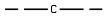
*** Answer
New: Communication conduit

** What does this plan symbol show?
   :PROPERTIES:
   :ID: e280-legend-036
   :END:
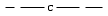
*** Answer
Existing: Communication conduit

** What does this plan symbol show?
   :PROPERTIES:
   :ID: e280-legend-037
   :END:
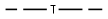
*** Answer
New: Telephone conduit

** What does this plan symbol show?
   :PROPERTIES:
   :ID: e280-legend-038
   :END:
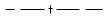
*** Answer
Existing: Telephone conduit

** What does this plan symbol show?
   :PROPERTIES:
   :ID: e280-legend-039
   :END:
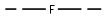
*** Answer
New: Fire alarm conduit

** What does this plan symbol show?
   :PROPERTIES:
   :ID: e280-legend-040
   :END:
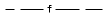
*** Answer
Existing: Fire alarm conduit

** What does this plan symbol show?
   :PROPERTIES:
   :ID: e280-legend-041
   :END:
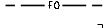
*** Answer
New: Fiber optic conduit

** What does this plan symbol show?
   :PROPERTIES:
   :ID: e280-legend-042
   :END:
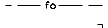
*** Answer
Existing: Fiber optic conduit

** What does this plan symbol show?
   :PROPERTIES:
   :ID: e280-legend-043
   :END:
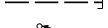
*** Answer
New: Conduit termination

** What does this plan symbol show?
   :PROPERTIES:
   :ID: e280-legend-044
   :END:
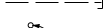
*** Answer
Existing: Conduit termination

** What does this plan symbol show?
   :PROPERTIES:
   :ID: e280-legend-045
   :END:
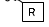
*** Answer
New: Conduit riser attached to the structure or service pole

** What does this plan symbol show?
   :PROPERTIES:
   :ID: e280-legend-046
   :END:
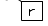
*** Answer
Existing: Conduit riser attached to the structure or service pole

* Service Equipment

** What does this plan symbol show?
   :PROPERTIES:
   :ID: e280-legend-047
   :END:
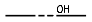
*** Answer
New: Overhead lines

** What does this plan symbol show?
   :PROPERTIES:
   :ID: e280-legend-048
   :END:
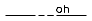
*** Answer
Existing: Overhead lines

** What does this plan symbol show?
   :PROPERTIES:
   :ID: e280-legend-049
   :END:
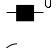
*** Answer
New: Wood pole, "U" indicates utility owned

** What does this plan symbol show?
   :PROPERTIES:
   :ID: e280-legend-050
   :END:

*** Answer
Existing: Wood pole, "U" indicates utility owned

** What does this plan symbol show?
   :PROPERTIES:
   :ID: e280-legend-051
   :END:

*** Answer
New: Pole guy with anchor

** What does this plan symbol show?
   :PROPERTIES:
   :ID: e280-legend-052
   :END:

*** Answer
Existing: Pole guy with anchor

** What does this plan symbol show?
   :PROPERTIES:
   :ID: e280-legend-053
   :END:

*** Answer
New: Utility transformer - ground mounted

** What does this plan symbol show?
   :PROPERTIES:
   :ID: e280-legend-054
   :END:

*** Answer
Existing: Utility transformer - ground mounted

** What does this plan symbol show?
   :PROPERTIES:
   :ID: e280-legend-055
   :END:

*** Answer
New: Service equipment enclosure type. Door indicates front of enclosure

** What does this plan symbol show?
   :PROPERTIES:
   :ID: e280-legend-056
   :END:

*** Answer
Existing: Service equipment enclosure type. Door indicates front of enclosure

** What does this plan symbol show?
   :PROPERTIES:
   :ID: e280-legend-057
   :END:

*** Answer
New: Telephone demarcation cabinet

** What does this plan symbol show?
   :PROPERTIES:
   :ID: e280-legend-058
   :END:

*** Answer
Existing: Telephone demarcation cabinet

* Pole-Mounted Service Designation

** What does this plan symbol show?
   :PROPERTIES:
   :ID: e280-legend-059
   :END:

*** Answer
TYPE OF INSTALLATION AND POLE HEIGHT ABOVE GRADE:

* Flashing Beacon

** What does this plan symbol show?
   :PROPERTIES:
   :ID: e280-legend-060
   :END:

*** Answer
New: Flashing beacon (one vehicle signal head with backplate and visor)

** What does this plan symbol show?
   :PROPERTIES:
   :ID: e280-legend-061
   :END:

*** Answer
Existing: Flashing beacon (one vehicle signal head with backplate and visor)

** What does this plan symbol show?
   :PROPERTIES:
   :ID: e280-legend-062
   :END:

*** Answer
New: Flashing beacon with type 15-FBS standard and a sign

** What does this plan symbol show?
   :PROPERTIES:
   :ID: e280-legend-063
   :END:

*** Answer
Existing: Flashing beacon with type 15-FBS standard and a sign

** What does this plan symbol show?
   :PROPERTIES:
   :ID: e280-legend-064
   :END:

*** Answer
New: Flashing beacon with types 9, 9A or 9B sign unless otherwise specified or indicated

** What does this plan symbol show?
   :PROPERTIES:
   :ID: e280-legend-065
   :END:

*** Answer
Existing: Flashing beacon with types 9, 9A or 9B sign unless otherwise specified or indicated

