#+TITLE: Caltrans Traffic Signals & Electrical Plan Symbols
#+FILETAGS: :electrical:caltrans:plans:symbols:

* Signal Equipment - New - PEDESTRIAN SIGNAL HEAD :drill:
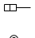

** Answer
Signal Equipment
New - PEDESTRIAN SIGNAL HEAD

* Signal Equipment - Existing - PEDESTRIAN SIGNAL HEAD :drill:
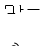

** Answer
Signal Equipment
Existing - PEDESTRIAN SIGNAL HEAD

* Signal Equipment - New - PUSH BUTTON ASSEMBLY POST :drill:
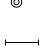

** Answer
Signal Equipment
New - PUSH BUTTON ASSEMBLY POST

* Signal Equipment - Existing - PUSH BUTTON ASSEMBLY POST :drill:
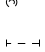

** Answer
Signal Equipment
Existing - PUSH BUTTON ASSEMBLY POST

* Signal Equipment - New - PEDESTRIAN BARRICADE :drill:

** Answer
Signal Equipment
New - PEDESTRIAN BARRICADE

* Signal Equipment - Existing - PEDESTRIAN BARRICADE :drill:
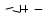

** Answer
Signal Equipment
Existing - PEDESTRIAN BARRICADE

* Signal Equipment - New - VEHICLE SIGNAL HEAD (WITH BACKPLATE) :drill:
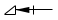

** Answer
Signal Equipment
New - VEHICLE SIGNAL HEAD (WITH BACKPLATE)

* Signal Equipment - Existing - VEHICLE SIGNAL HEAD (WITH BACKPLATE) :drill:
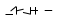

** Answer
Signal Equipment
Existing - VEHICLE SIGNAL HEAD (WITH BACKPLATE)

* Signal Equipment - New - VEHICLE SIGNAL HEAD WITH ANGLE VISOR :drill:
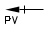

** Answer
Signal Equipment
New - VEHICLE SIGNAL HEAD WITH ANGLE VISOR

* Signal Equipment - Existing - VEHICLE SIGNAL HEAD WITH ANGLE VISOR :drill:
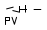

** Answer
Signal Equipment
Existing - VEHICLE SIGNAL HEAD WITH ANGLE VISOR

* Signal Equipment - New - VEHICLE SIGNAL HEAD (MODIFICATIONS) :drill:
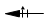

** Answer
Signal Equipment
New - VEHICLE SIGNAL HEAD (MODIFICATIONS)
/MODIFICATIONS OF BASIC SYMBOL:
"L" INDICATES ALL NON-ARROW SECTIONS LOUVERED
"LG" INDICATES LOUVERED GREEN SECTION ONLY
"PV" INDICATES ALL 12" SECTIONS PROGRAMMED VISIBILITY
"8" INDICATES ALL 8" SECTIONS (ONLY WHEN SPECIFIED)/

* Signal Equipment - Existing - VEHICLE SIGNAL HEAD (MODIFICATIONS) :drill:
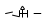

** Answer
Signal Equipment
Existing - VEHICLE SIGNAL HEAD (MODIFICATIONS)
/MODIFICATIONS OF BASIC SYMBOL:
"L" INDICATES ALL NON-ARROW SECTIONS LOUVERED
"LG" INDICATES LOUVERED GREEN SECTION ONLY
"PV" INDICATES ALL 12" SECTIONS PROGRAMMED VISIBILITY
"8" INDICATES ALL 8" SECTIONS (ONLY WHEN SPECIFIED)/

* Signal Equipment - New - VEHICLE SIGNAL HEAD CONSISTING OF RED, YELLOW AND GREEN LEFT ARROW SECTIONS :drill:
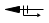

** Answer
Signal Equipment
New - VEHICLE SIGNAL HEAD CONSISTING OF RED, YELLOW AND GREEN LEFT ARROW SECTIONS

* Signal Equipment - Existing - VEHICLE SIGNAL HEAD CONSISTING OF RED, YELLOW AND GREEN LEFT ARROW SECTIONS :drill:
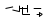

** Answer
Signal Equipment
Existing - VEHICLE SIGNAL HEAD CONSISTING OF RED, YELLOW AND GREEN LEFT ARROW SECTIONS

* Signal Equipment - New - VEHICLE SIGNAL HEAD CONSISTING OF RED AND YELLOW SECTIONS WITH AN UP GREEN ARROW SECTION :drill:
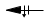

** Answer
Signal Equipment
New - VEHICLE SIGNAL HEAD CONSISTING OF RED AND YELLOW SECTIONS WITH AN UP GREEN ARROW SECTION

* Signal Equipment - Existing - VEHICLE SIGNAL HEAD CONSISTING OF RED AND YELLOW SECTIONS WITH AN UP GREEN ARROW SECTION :drill:
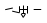

** Answer
Signal Equipment
Existing - VEHICLE SIGNAL HEAD CONSISTING OF RED AND YELLOW SECTIONS WITH AN UP GREEN ARROW SECTION

* Signal Equipment - New - VEHICLE SIGNAL HEAD (5 SECTION) CONSISTING OF RED, YELLOW AND GREEN SECTIONS WITH YELLOW AND GREEN RIGHT ARROW SECTIONS :drill:
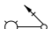

** Answer
Signal Equipment
New - VEHICLE SIGNAL HEAD (5 SECTION) CONSISTING OF RED, YELLOW AND GREEN SECTIONS WITH YELLOW AND GREEN RIGHT ARROW SECTIONS

* Signal Equipment - Existing - VEHICLE SIGNAL HEAD (5 SECTION) CONSISTING OF RED, YELLOW AND GREEN SECTIONS WITH YELLOW AND GREEN RIGHT ARROW SECTIONS :drill:
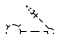

** Answer
Signal Equipment
Existing - VEHICLE SIGNAL HEAD (5 SECTION) CONSISTING OF RED, YELLOW AND GREEN SECTIONS WITH YELLOW AND GREEN RIGHT ARROW SECTIONS

* Signal Equipment - New - TYPE 15TS STANDARD WITH VEHICLE SIGNAL HEAD AND LUMINAIRE :drill:
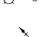

** Answer
Signal Equipment
New - TYPE 15TS STANDARD WITH VEHICLE SIGNAL HEAD AND LUMINAIRE

* Signal Equipment - Existing - TYPE 15TS STANDARD WITH VEHICLE SIGNAL HEAD AND LUMINAIRE :drill:
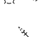

** Answer
Signal Equipment
Existing - TYPE 15TS STANDARD WITH VEHICLE SIGNAL HEAD AND LUMINAIRE

* Signal Equipment - New - TYPE 21TS STANDARD WITH VEHICLE SIGNAL HEAD AND LUMINAIRE :drill:
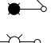

** Answer
Signal Equipment
New - TYPE 21TS STANDARD WITH VEHICLE SIGNAL HEAD AND LUMINAIRE

* Signal Equipment - Existing - TYPE 21TS STANDARD WITH VEHICLE SIGNAL HEAD AND LUMINAIRE :drill:
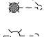

** Answer
Signal Equipment
Existing - TYPE 21TS STANDARD WITH VEHICLE SIGNAL HEAD AND LUMINAIRE

* Signal Equipment - New - STANDARD WITH LUMINAIRE AND SIGNAL MAST ARMS AND ATTACHED VEHICLE SIGNAL HEADS :drill:
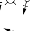

** Answer
Signal Equipment
New - STANDARD WITH LUMINAIRE AND SIGNAL MAST ARMS AND ATTACHED VEHICLE SIGNAL HEADS

* Signal Equipment - Existing - STANDARD WITH LUMINAIRE AND SIGNAL MAST ARMS AND ATTACHED VEHICLE SIGNAL HEADS :drill:
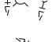

** Answer
Signal Equipment
Existing - STANDARD WITH LUMINAIRE AND SIGNAL MAST ARMS AND ATTACHED VEHICLE SIGNAL HEADS

* Signal Equipment - New - TYPE 1 STANDARD WITH ATTACHED VEHICLE SIGNAL HEADS :drill:
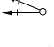

** Answer
Signal Equipment
New - TYPE 1 STANDARD WITH ATTACHED VEHICLE SIGNAL HEADS

* Signal Equipment - Existing - TYPE 1 STANDARD WITH ATTACHED VEHICLE SIGNAL HEADS :drill:
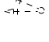

** Answer
Signal Equipment
Existing - TYPE 1 STANDARD WITH ATTACHED VEHICLE SIGNAL HEADS

* Signal Equipment - New - STANDARD WITH A SIGNAL MAST ARM, ATTACHED VEHICLE SIGNAL HEADS AND INTERNALLY ILLUMINATED STREET NAME SIGN :drill:
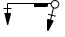

** Answer
Signal Equipment
New - STANDARD WITH A SIGNAL MAST ARM, ATTACHED VEHICLE SIGNAL HEADS AND INTERNALLY ILLUMINATED STREET NAME SIGN

* Signal Equipment - Existing - STANDARD WITH A SIGNAL MAST ARM, ATTACHED VEHICLE SIGNAL HEADS AND INTERNALLY ILLUMINATED STREET NAME SIGN :drill:
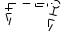

** Answer
Signal Equipment
Existing - STANDARD WITH A SIGNAL MAST ARM, ATTACHED VEHICLE SIGNAL HEADS AND INTERNALLY ILLUMINATED STREET NAME SIGN

* Signal Equipment - New - CONTROLLER ASSEMBLY. DOOR INDICATES FRONT OF CABINET :drill:

** Answer
Signal Equipment
New - CONTROLLER ASSEMBLY. DOOR INDICATES FRONT OF CABINET

* Signal Equipment - Existing - CONTROLLER ASSEMBLY. DOOR INDICATES FRONT OF CABINET :drill:
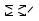

** Answer
Signal Equipment
Existing - CONTROLLER ASSEMBLY. DOOR INDICATES FRONT OF CABINET

* Conduit - New - LIGHTING CONDUIT, UNLESS OTHERWISE INDICATED OR NOTED :drill:
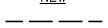

** Answer
Conduit
New - LIGHTING CONDUIT, UNLESS OTHERWISE INDICATED OR NOTED

* Conduit - Existing - LIGHTING CONDUIT, UNLESS OTHERWISE INDICATED OR NOTED :drill:
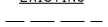

** Answer
Conduit
Existing - LIGHTING CONDUIT, UNLESS OTHERWISE INDICATED OR NOTED

* Conduit - New - TRAFFIC SIGNAL CONDUIT :drill:

** Answer
Conduit
New - TRAFFIC SIGNAL CONDUIT

* Conduit - Existing - TRAFFIC SIGNAL CONDUIT :drill:
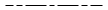

** Answer
Conduit
Existing - TRAFFIC SIGNAL CONDUIT

* Conduit - New - COMMUNICATION CONDUIT :drill:
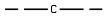

** Answer
Conduit
New - COMMUNICATION CONDUIT

* Conduit - Existing - COMMUNICATION CONDUIT :drill:
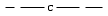

** Answer
Conduit
Existing - COMMUNICATION CONDUIT

* Conduit - New - TELEPHONE CONDUIT :drill:
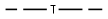

** Answer
Conduit
New - TELEPHONE CONDUIT

* Conduit - Existing - TELEPHONE CONDUIT :drill:
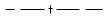

** Answer
Conduit
Existing - TELEPHONE CONDUIT

* Conduit - New - FIRE ALARM CONDUIT :drill:

** Answer
Conduit
New - FIRE ALARM CONDUIT

* Conduit - Existing - FIRE ALARM CONDUIT :drill:
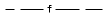

** Answer
Conduit
Existing - FIRE ALARM CONDUIT

* Conduit - New - FIBER OPTIC CONDUIT :drill:
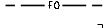

** Answer
Conduit
New - FIBER OPTIC CONDUIT

* Conduit - Existing - FIBER OPTIC CONDUIT :drill:
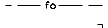

** Answer
Conduit
Existing - FIBER OPTIC CONDUIT

* Conduit - New - CONDUIT TERMINATION :drill:
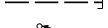

** Answer
Conduit
New - CONDUIT TERMINATION

* Conduit - Existing - CONDUIT TERMINATION :drill:
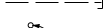

** Answer
Conduit
Existing - CONDUIT TERMINATION

* Conduit - New - CONDUIT RISER ATTACHED TO THE STRUCTURE OR SERVICE POLE :drill:
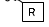

** Answer
Conduit
New - CONDUIT RISER ATTACHED TO THE STRUCTURE OR SERVICE POLE

* Conduit - Existing - CONDUIT RISER ATTACHED TO THE STRUCTURE OR SERVICE POLE :drill:
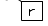

** Answer
Conduit
Existing - CONDUIT RISER ATTACHED TO THE STRUCTURE OR SERVICE POLE

* Service Equipment - New - OVERHEAD LINES :drill:

** Answer
Service Equipment
New - OVERHEAD LINES

* Service Equipment - Existing - OVERHEAD LINES :drill:

** Answer
Service Equipment
Existing - OVERHEAD LINES

* Service Equipment - New - WOOD POLE, "U" INDICATES UTILITY OWNED :drill:
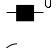

** Answer
Service Equipment
New - WOOD POLE, "U" INDICATES UTILITY OWNED

* Service Equipment - Existing - WOOD POLE, "U" INDICATES UTILITY OWNED :drill:
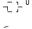

** Answer
Service Equipment
Existing - WOOD POLE, "U" INDICATES UTILITY OWNED

* Service Equipment - New - POLE GUY WITH ANCHOR :drill:
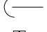

** Answer
Service Equipment
New - POLE GUY WITH ANCHOR

* Service Equipment - Existing - POLE GUY WITH ANCHOR :drill:

** Answer
Service Equipment
Existing - POLE GUY WITH ANCHOR

* Service Equipment - New - UTILITY TRANSFORMER - GROUND MOUNTED :drill:
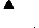

** Answer
Service Equipment
New - UTILITY TRANSFORMER - GROUND MOUNTED

* Service Equipment - Existing - UTILITY TRANSFORMER - GROUND MOUNTED :drill:
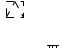

** Answer
Service Equipment
Existing - UTILITY TRANSFORMER - GROUND MOUNTED

* Service Equipment - New - SERVICE EQUIPMENT ENCLOSURE TYPE. DOOR INDICATES FRONT OF ENCLOSURE :drill:
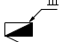

** Answer
Service Equipment
New - SERVICE EQUIPMENT ENCLOSURE TYPE. DOOR INDICATES FRONT OF ENCLOSURE

* Service Equipment - Existing - SERVICE EQUIPMENT ENCLOSURE TYPE. DOOR INDICATES FRONT OF ENCLOSURE :drill:
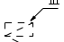

** Answer
Service Equipment
Existing - SERVICE EQUIPMENT ENCLOSURE TYPE. DOOR INDICATES FRONT OF ENCLOSURE

* Service Equipment - New - TELEPHONE DEMARCATION CABINET :drill:
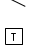

** Answer
Service Equipment
New - TELEPHONE DEMARCATION CABINET

* Service Equipment - Existing - TELEPHONE DEMARCATION CABINET :drill:

** Answer
Service Equipment
Existing - TELEPHONE DEMARCATION CABINET

* Pole-Mounted Service Designation - TYPE OF INSTALLATION AND POLE HEIGHT ABOVE GRADE :drill:

** Answer
Pole-Mounted Service Designation
TYPE OF INSTALLATION AND POLE HEIGHT ABOVE GRADE
/Example: TYPE H SERVICE, 28'-10"/

* Flashing Beacon - New - FLASHING BEACON (ONE VEHICLE SIGNAL HEAD WITH BACKPLATE AND VISOR) :drill:

** Answer
Flashing Beacon
New - FLASHING BEACON (ONE VEHICLE SIGNAL HEAD WITH BACKPLATE AND VISOR)
/"R" INDICATES RED INDICATION, "Y" INDICATES YELLOW INDICATION/

* Flashing Beacon - Existing - FLASHING BEACON (ONE VEHICLE SIGNAL HEAD WITH BACKPLATE AND VISOR) :drill:

** Answer
Flashing Beacon
Existing - FLASHING BEACON (ONE VEHICLE SIGNAL HEAD WITH BACKPLATE AND VISOR)
/"R" INDICATES RED INDICATION, "Y" INDICATES YELLOW INDICATION/

* Flashing Beacon - New - FLASHING BEACON WITH TYPE 15-FBS STANDARD AND A SIGN :drill:

** Answer
Flashing Beacon
New - FLASHING BEACON WITH TYPE 15-FBS STANDARD AND A SIGN

* Flashing Beacon - Existing - FLASHING BEACON WITH TYPE 15-FBS STANDARD AND A SIGN :drill:

** Answer
Flashing Beacon
Existing - FLASHING BEACON WITH TYPE 15-FBS STANDARD AND A SIGN

* Flashing Beacon - New - FLASHING BEACON WITH TYPES 9, 9A OR 9B SIGN UNLESS OTHERWISE SPECIFIED OR INDICATED :drill:

** Answer
Flashing Beacon
New - FLASHING BEACON WITH TYPES 9, 9A OR 9B SIGN UNLESS OTHERWISE SPECIFIED OR INDICATED

* Flashing Beacon - Existing - FLASHING BEACON WITH TYPES 9, 9A OR 9B SIGN UNLESS OTHERWISE SPECIFIED OR INDICATED :drill:

** Answer
Flashing Beacon
Existing - FLASHING BEACON WITH TYPES 9, 9A OR 9B SIGN UNLESS OTHERWISE SPECIFIED OR INDICATED

* Signal Equipment Cont - New - GUARD POST :drill:

** Answer
Signal Equipment Cont
New - GUARD POST

* Signal Equipment Cont - Existing - GUARD POST :drill:

** Answer
Signal Equipment Cont
Existing - GUARD POST

* Signal Equipment Cont - New - TYPE 1 STANDARD WITH RAMP METERING SIGN :drill:

** Answer
Signal Equipment Cont
New - TYPE 1 STANDARD WITH RAMP METERING SIGN

* Signal Equipment Cont - Existing - TYPE 1 STANDARD WITH RAMP METERING SIGN :drill:

** Answer
Signal Equipment Cont
Existing - TYPE 1 STANDARD WITH RAMP METERING SIGN

* Signal Equipment Cont - New - OPTICAL DETECTOR FOR THE EMERGENCY VEHICLE DETECTION :drill:

** Answer
Signal Equipment Cont
New - OPTICAL DETECTOR FOR THE EMERGENCY VEHICLE DETECTION

* Signal Equipment Cont - Existing - OPTICAL DETECTOR FOR THE EMERGENCY VEHICLE DETECTION :drill:

** Answer
Signal Equipment Cont
Existing - OPTICAL DETECTOR FOR THE EMERGENCY VEHICLE DETECTION

