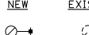
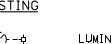
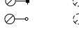
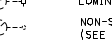
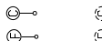
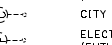
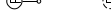
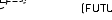

# Flashcards — ELECT 280: Miscellaneous Electroliers

8 cards. Read the question, answer it in your head, then click it to check.

- **Study online:** [flashcard page](https://webnrrd2k.github.io/lbcc-electrical-study-materials/flashcards/?deck=e280-misc-electrolier): shuffle, flip, and mark the cards you know.
- **Download:** [Anki](misc_electroliers.apkg) · [Quizlet import file](misc_electroliers_quizlet.txt) (paste into Quizlet's Import box; images are not included) · [Emacs org-drill](misc_electroliers.org) · [raw card data](misc_electroliers.json)

---

<b>1.</b> What does this plan symbol show? 
 New: Luminaire on wood pole  

<b>2.</b> What does this plan symbol show? 
 Existing: Luminaire on wood pole  

<b>3.</b> What does this plan symbol show? 
 New: Non-standard electrolier (see project legend)  

<b>4.</b> What does this plan symbol show? 
 Existing: Non-standard electrolier (see project legend)  

<b>5.</b> What does this plan symbol show? 
 New: City electrolier  

<b>6.</b> What does this plan symbol show? 
 Existing: City electrolier  

<b>7.</b> What does this plan symbol show? 
 New: Electrolier foundation (future installation)  

<b>8.</b> What does this plan symbol show? 
 Existing: Electrolier foundation (future installation)  

---

*Generated by `tools/flashcards/build_decks.py` from the JSON file. Edit the JSON, not this page.*
