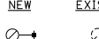
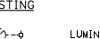
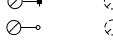
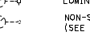
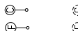
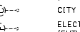
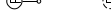
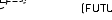

#+TITLE: Miscellaneous Electroliers Symbols
#+FILETAGS: :electrical:caltrans:symbols:electrolier:

* Miscellaneous Electrolier (New) - LUMINAIRE ON WOOD POLE :drill:

** Answer
Miscellaneous Electrolier
New - LUMINAIRE ON WOOD POLE

* Miscellaneous Electrolier (Existing) - LUMINAIRE ON WOOD POLE :drill:

** Answer
Miscellaneous Electrolier
Existing - LUMINAIRE ON WOOD POLE

* Miscellaneous Electrolier (New) - NON-STANDARD ELECTROLIER (SEE PROJECT LEGEND) :drill:

** Answer
Miscellaneous Electrolier
New - NON-STANDARD ELECTROLIER (SEE PROJECT LEGEND)

* Miscellaneous Electrolier (Existing) - NON-STANDARD ELECTROLIER (SEE PROJECT LEGEND) :drill:

** Answer
Miscellaneous Electrolier
Existing - NON-STANDARD ELECTROLIER (SEE PROJECT LEGEND)

* Miscellaneous Electrolier (New) - CITY ELECTROLIER :drill:

** Answer
Miscellaneous Electrolier
New - CITY ELECTROLIER

* Miscellaneous Electrolier (Existing) - CITY ELECTROLIER :drill:

** Answer
Miscellaneous Electrolier
Existing - CITY ELECTROLIER

* Miscellaneous Electrolier (New) - ELECTROLIER FOUNDATION (FUTURE INSTALLATION) :drill:

** Answer
Miscellaneous Electrolier
New - ELECTROLIER FOUNDATION (FUTURE INSTALLATION)

* Miscellaneous Electrolier (Existing) - ELECTROLIER FOUNDATION (FUTURE INSTALLATION) :drill:

** Answer
Miscellaneous Electrolier
Existing - ELECTROLIER FOUNDATION (FUTURE INSTALLATION)

