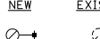
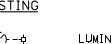
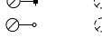
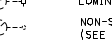
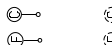
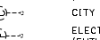
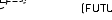

#+TITLE: ELECT 280 — Miscellaneous Electroliers
#+FILETAGS: :drill:
#+STARTUP: overview

# Generated by tools/flashcards/build_decks.py. Study with M-x org-drill.

* Miscellaneous Electrolier

** What does this plan symbol show?
   :PROPERTIES:
   :ID: e280-misc-electrolier-001
   :END:

*** Answer
New: Luminaire on wood pole

** What does this plan symbol show?
   :PROPERTIES:
   :ID: e280-misc-electrolier-002
   :END:

*** Answer
Existing: Luminaire on wood pole

** What does this plan symbol show?
   :PROPERTIES:
   :ID: e280-misc-electrolier-003
   :END:

*** Answer
New: Non-standard electrolier (see project legend)

** What does this plan symbol show?
   :PROPERTIES:
   :ID: e280-misc-electrolier-004
   :END:

*** Answer
Existing: Non-standard electrolier (see project legend)

** What does this plan symbol show?
   :PROPERTIES:
   :ID: e280-misc-electrolier-005
   :END:

*** Answer
New: City electrolier

** What does this plan symbol show?
   :PROPERTIES:
   :ID: e280-misc-electrolier-006
   :END:

*** Answer
Existing: City electrolier

** What does this plan symbol show?
   :PROPERTIES:
   :ID: e280-misc-electrolier-007
   :END:

*** Answer
New: Electrolier foundation (future installation)

** What does this plan symbol show?
   :PROPERTIES:
   :ID: e280-misc-electrolier-008
   :END:

*** Answer
Existing: Electrolier foundation (future installation)

