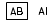
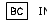
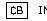
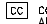
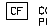
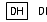
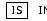
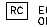

# Flashcards — ELECT 280: Plan Abbreviations

20 cards. Read the question, answer it in your head, then click it to check.

- **Study online:** [flashcard page](https://webnrrd2k.github.io/lbcc-electrical-study-materials/flashcards/?deck=e280-abbrev): shuffle, flip, and mark the cards you know.
- **Download:** [Anki](plan_abbreviations.apkg) · [Quizlet import file](plan_abbreviations_quizlet.txt) (paste into Quizlet's Import box; images are not included) · [Emacs org-drill](plan_abbreviations.org) · [raw card data](plan_abbreviations.json)

---

<b>1.</b> What does this plan abbreviation mean? 
 Abandon. If applied to conduit, remove conductors.  Abbreviation: AB  

<b>2.</b> What does this plan abbreviation mean? 
 Install pull box in existing conduit run.  Abbreviation: BC  

<b>3.</b> What does this plan abbreviation mean? 
 Pedestrian barricade, type as indicated on plan.  Abbreviation: BP  

<b>4.</b> What does this plan abbreviation mean? 
 Install conduit into existing pull box.  Abbreviation: CB  

<b>5.</b> What does this plan abbreviation mean? 
 Connect new and existing conduit. Remove existing conductors and install conductors as indicated.  Abbreviation: CC  

<b>6.</b> What does this plan abbreviation mean? 
 Conduit to remain for future use. Remove conductors. Install pull tape.  Abbreviation: CF  

<b>7.</b> What does this plan abbreviation mean? 
 Detector handhole.  Abbreviation: DH  

<b>8.</b> What does this plan abbreviation mean? 
 Foundation to be abandoned.  Abbreviation: FA  

<b>9.</b> What does this plan abbreviation mean? 
 Install sign on signal mast arm.  Abbreviation: IS  

<b>10.</b> What does this plan abbreviation mean? 
 No slip base on standard.  Abbreviation: NS  

<b>11.</b> What does this plan abbreviation mean? 
 Photoelectric control.  Abbreviation: PEC  

<b>12.</b> What does this plan abbreviation mean? 
 Photoelectric unit.  Abbreviation: PEU  

<b>13.</b> What does this plan abbreviation mean? 
 Equipment or material to be removed and become the property of the contractor.  Abbreviation: RC  

<b>14.</b> What does this plan abbreviation mean? 
 Remove electrolier, fuses and ballast. Tape ends of conductors.  Abbreviation: RE  

<b>15.</b> What does this plan abbreviation mean? 
 Relocate equipment.  Abbreviation: RL  

<b>16.</b> What does this plan abbreviation mean? 
 Remove and reuse equipment.  Abbreviation: RR  

<b>17.</b> What does this plan abbreviation mean? 
 Remove and salvage equipment.  Abbreviation: RS  

<b>18.</b> What does this plan abbreviation mean? 
 Splice new to existing conductors.  Abbreviation: SC  

<b>19.</b> What does this plan abbreviation mean? 
 Service disconnect.  Abbreviation: SD  

<b>20.</b> What does this plan abbreviation mean? 
 Telephone service point.  Abbreviation: TSP  

---

*Generated by `tools/flashcards/build_decks.py` from the JSON file. Edit the JSON, not this page.*
