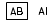
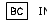
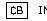
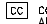
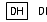
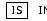
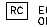

#+TITLE: Traffic Signal & Electrical Legend Flashcards
#+FILETAGS: :legend:electrical:
* Symbol: AB :drill:

** Answer
ABANDON. IF APPLIED TO CONDUIT, REMOVE CONDUCTORS

* Symbol: BC :drill:

** Answer
INSTALL PULL BOX IN EXISTING CONDUIT RUN

* Symbol: BP :drill:

** Answer
PEDESTRIAN BARRICADE, TYPE AS INDICATED ON PLAN

* Symbol: CB :drill:

** Answer
INSTALL CONDUIT INTO EXISTING PULL BOX

* Symbol: CC :drill:

** Answer
CONNECT NEW AND EXISTING CONDUIT. REMOVE EXISTING CONDUCTORS AND INSTALL CONDUCTORS AS INDICATED

* Symbol: CF :drill:

** Answer
CONDUIT TO REMAIN FOR FUTURE USE. REMOVE CONDUCTORS. INSTALL PULL TAPE

* Symbol: DH :drill:

** Answer
DETECTOR HANDHOLE

* Symbol: FA :drill:

** Answer
FOUNDATION TO BE ABANDONED

* Symbol: IS :drill:

** Answer
INSTALL SIGN ON SIGNAL MAST ARM

* Symbol: NS :drill:

** Answer
NO SLIP BASE ON STANDARD

* Symbol: PEC :drill:

** Answer
PHOTOELECTRIC CONTROL

* Symbol: PEU :drill:

** Answer
PHOTOELECTRIC UNIT

* Symbol: RC :drill:

** Answer
EQUIPMENT OR MATERIAL TO BE REMOVED AND BECOME THE PROPERTY OF THE CONTRACTOR

* Symbol: RE :drill:

** Answer
REMOVE ELECTROLIER, FUSES AND BALLAST. TAPE ENDS OF CONDUCTORS

* Symbol: RL :drill:

** Answer
RELOCATE EQUIPMENT

* Symbol: RR :drill:

** Answer
REMOVE AND REUSE EQUIPMENT

* Symbol: RS :drill:

** Answer
REMOVE AND SALVAGE EQUIPMENT

* Symbol: SC :drill:

** Answer
SPLICE NEW TO EXISTING CONDUCTORS

* Symbol: SD :drill:

** Answer
SERVICE DISCONNECT

* Symbol: TSP :drill:

** Answer
TELEPHONE SERVICE POINT

