#+TITLE: ELECT 280 — Plan Abbreviations
#+FILETAGS: :drill:
#+STARTUP: overview

# Generated by tools/flashcards/build_decks.py. Study with M-x org-drill.

* What does this plan abbreviation mean?
   :PROPERTIES:
   :ID: e280-abbrev-001
   :END:
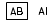
** Answer
Abandon. If applied to conduit, remove conductors. Abbreviation: AB

* What does this plan abbreviation mean?
   :PROPERTIES:
   :ID: e280-abbrev-002
   :END:
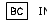
** Answer
Install pull box in existing conduit run. Abbreviation: BC

* What does this plan abbreviation mean?
   :PROPERTIES:
   :ID: e280-abbrev-003
   :END:
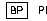
** Answer
Pedestrian barricade, type as indicated on plan. Abbreviation: BP

* What does this plan abbreviation mean?
   :PROPERTIES:
   :ID: e280-abbrev-004
   :END:
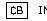
** Answer
Install conduit into existing pull box. Abbreviation: CB

* What does this plan abbreviation mean?
   :PROPERTIES:
   :ID: e280-abbrev-005
   :END:
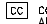
** Answer
Connect new and existing conduit. Remove existing conductors and install conductors as indicated. Abbreviation: CC

* What does this plan abbreviation mean?
   :PROPERTIES:
   :ID: e280-abbrev-006
   :END:
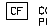
** Answer
Conduit to remain for future use. Remove conductors. Install pull tape. Abbreviation: CF

* What does this plan abbreviation mean?
   :PROPERTIES:
   :ID: e280-abbrev-007
   :END:
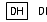
** Answer
Detector handhole. Abbreviation: DH

* What does this plan abbreviation mean?
   :PROPERTIES:
   :ID: e280-abbrev-008
   :END:
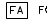
** Answer
Foundation to be abandoned. Abbreviation: FA

* What does this plan abbreviation mean?
   :PROPERTIES:
   :ID: e280-abbrev-009
   :END:
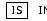
** Answer
Install sign on signal mast arm. Abbreviation: IS

* What does this plan abbreviation mean?
   :PROPERTIES:
   :ID: e280-abbrev-010
   :END:

** Answer
No slip base on standard. Abbreviation: NS

* What does this plan abbreviation mean?
   :PROPERTIES:
   :ID: e280-abbrev-011
   :END:

** Answer
Photoelectric control. Abbreviation: PEC

* What does this plan abbreviation mean?
   :PROPERTIES:
   :ID: e280-abbrev-012
   :END:
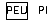
** Answer
Photoelectric unit. Abbreviation: PEU

* What does this plan abbreviation mean?
   :PROPERTIES:
   :ID: e280-abbrev-013
   :END:
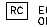
** Answer
Equipment or material to be removed and become the property of the contractor. Abbreviation: RC

* What does this plan abbreviation mean?
   :PROPERTIES:
   :ID: e280-abbrev-014
   :END:
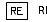
** Answer
Remove electrolier, fuses and ballast. Tape ends of conductors. Abbreviation: RE

* What does this plan abbreviation mean?
   :PROPERTIES:
   :ID: e280-abbrev-015
   :END:
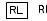
** Answer
Relocate equipment. Abbreviation: RL

* What does this plan abbreviation mean?
   :PROPERTIES:
   :ID: e280-abbrev-016
   :END:
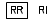
** Answer
Remove and reuse equipment. Abbreviation: RR

* What does this plan abbreviation mean?
   :PROPERTIES:
   :ID: e280-abbrev-017
   :END:

** Answer
Remove and salvage equipment. Abbreviation: RS

* What does this plan abbreviation mean?
   :PROPERTIES:
   :ID: e280-abbrev-018
   :END:

** Answer
Splice new to existing conductors. Abbreviation: SC

* What does this plan abbreviation mean?
   :PROPERTIES:
   :ID: e280-abbrev-019
   :END:

** Answer
Service disconnect. Abbreviation: SD

* What does this plan abbreviation mean?
   :PROPERTIES:
   :ID: e280-abbrev-020
   :END:

** Answer
Telephone service point. Abbreviation: TSP

