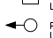
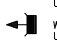
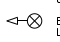
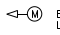

# Flashcards — ELECT 280: Soffit and Wall-Mounted Luminaires

5 cards. Read the question, answer it in your head, then click it to check.

- **Study online:** [flashcard page](https://webnrrd2k.github.io/lbcc-electrical-study-materials/flashcards/?deck=e280-soffit): shuffle, flip, and mark the cards you know.
- **Download:** [Anki](soffit_luminaires.apkg) · [Quizlet import file](soffit_luminaires_quizlet.txt) (paste into Quizlet's Import box; images are not included) · [Emacs org-drill](soffit_luminaires.org) · [raw card data](soffit_luminaires.json)

---

<b>1.</b> What does this plan symbol show? 
 New: Pendant soffit luminaire, 70 W HPS unless otherwise specified  Arrow indicates &quot;street side&quot; of luminaire.  

<b>2.</b> What does this plan symbol show? 
 New: Flush-mounted soffit luminaire, 70 W HPS unless otherwise specified  Arrow indicates &quot;street side&quot; of luminaire.  

<b>3.</b> What does this plan symbol show? 
 New: Wall-mounted luminaire, 70 W HPS unless otherwise specified  Arrow indicates &quot;street side&quot; of luminaire.  

<b>4.</b> What does this plan symbol show? 
 Existing: Soffit or wall-mounted luminaire to remain unmodified  Arrow indicates &quot;street side&quot; of luminaire.  

<b>5.</b> What does this plan symbol show? 
 Existing: Soffit or wall-mounted luminaire to be modified as specified  Arrow indicates &quot;street side&quot; of luminaire.  

---

*Generated by `tools/flashcards/build_decks.py` from the JSON file. Edit the JSON, not this page.*
