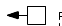
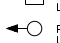
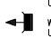
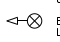
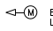

#+TITLE: Soffit and Wall-Mounted Luminaires
#+FILETAGS: :electrical:caltrans:symbols:lighting:

* Luminaire: Pendant Soffit :drill:

** Answer
Soffit and Wall-Mounted Luminaire
New - PENDANT SOFFIT LUMINAIRE, 70 W HPS UNLESS OTHERWISE SPECIFIED

/NOTE: Arrow indicates "street side" of luminaire./

* Luminaire: Flush Mounted Soffit :drill:

** Answer
Soffit and Wall-Mounted Luminaire
New - FLUSH-MOUNTED SOFFIT LUMINAIRE, 70 W HPS UNLESS OTHERWISE SPECIFIED

/NOTE: Arrow indicates "street side" of luminaire./

* Luminaire: Wall Mounted :drill:

** Answer
Soffit and Wall-Mounted Luminaire
New - WALL-MOUNTED LUMINAIRE, 70 W HPS UNLESS OTHERWISE SPECIFIED

/NOTE: Arrow indicates "street side" of luminaire./

* Luminaire: Existing Remain Unmodified :drill:

** Answer
Soffit and Wall-Mounted Luminaire
Existing - EXISTING SOFFIT OR WALL-MOUNTED LUMINAIRE TO REMAIN UNMODIFIED

/NOTE: Arrow indicates "street side" of luminaire./

* Luminaire: Existing To Be Modified :drill:

** Answer
Soffit and Wall-Mounted Luminaire
Existing - EXISTING SOFFIT OR WALL-MOUNTED LUMINAIRE TO BE MODIFIED AS SPECIFIED

/NOTE: Arrow indicates "street side" of luminaire./

