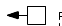
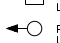
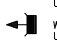
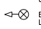
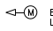

#+TITLE: ELECT 280 — Soffit and Wall-Mounted Luminaires
#+FILETAGS: :drill:
#+STARTUP: overview

# Generated by tools/flashcards/build_decks.py. Study with M-x org-drill.

* Soffit and Wall-Mounted Luminaire

** What does this plan symbol show?
   :PROPERTIES:
   :ID: e280-soffit-001
   :END:

*** Answer
New: Pendant soffit luminaire, 70 W HPS unless otherwise specified Arrow indicates "street side" of luminaire.

** What does this plan symbol show?
   :PROPERTIES:
   :ID: e280-soffit-002
   :END:

*** Answer
New: Flush-mounted soffit luminaire, 70 W HPS unless otherwise specified Arrow indicates "street side" of luminaire.

** What does this plan symbol show?
   :PROPERTIES:
   :ID: e280-soffit-003
   :END:

*** Answer
New: Wall-mounted luminaire, 70 W HPS unless otherwise specified Arrow indicates "street side" of luminaire.

** What does this plan symbol show?
   :PROPERTIES:
   :ID: e280-soffit-004
   :END:

*** Answer
Existing: Soffit or wall-mounted luminaire to remain unmodified Arrow indicates "street side" of luminaire.

** What does this plan symbol show?
   :PROPERTIES:
   :ID: e280-soffit-005
   :END:

*** Answer
Existing: Soffit or wall-mounted luminaire to be modified as specified Arrow indicates "street side" of luminaire.

