# Flashcards — ELECT 280: Standard Electroliers

22 cards. Read the question, answer it in your head, then click it to check.

- **Study online:** [flashcard page](https://webnrrd2k.github.io/lbcc-electrical-study-materials/flashcards/?deck=e280-electrolier): shuffle, flip, and mark the cards you know.
- **Download:** [Anki](standard_electroliers.apkg) · [Quizlet import file](standard_electroliers_quizlet.txt) (paste into Quizlet's Import box; images are not included) · [Emacs org-drill](standard_electroliers.org) · [raw card data](standard_electroliers.json)

---

<b>1.</b> What does this plan symbol show? 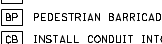
 New: Type 15  

<b>2.</b> What does this plan symbol show? 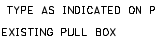
 Existing: Type 15  

<b>3.</b> What does this plan symbol show? 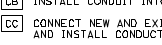
 New: Type 15D  

<b>4.</b> What does this plan symbol show? 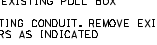
 Existing: Type 15D  

<b>5.</b> What does this plan symbol show? 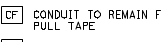
 New: Type 15 structure  

<b>6.</b> What does this plan symbol show? 
 Existing: Type 15 structure  

<b>7.</b> What does this plan symbol show? 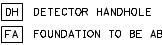
 New: Type 15D structure  

<b>8.</b> What does this plan symbol show? 
 Existing: Type 15D structure  

<b>9.</b> What does this plan symbol show? 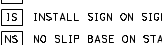
 New: Type 21  

<b>10.</b> What does this plan symbol show? 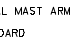
 Existing: Type 21  

<b>11.</b> What does this plan symbol show? 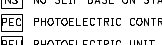
 New: Type 21D  

<b>12.</b> What does this plan symbol show? 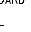
 Existing: Type 21D  

<b>13.</b> What does this plan symbol show? 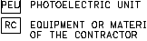
 New: Type 21 structure  

<b>14.</b> What does this plan symbol show? 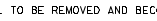
 Existing: Type 21 structure  

<b>15.</b> What does this plan symbol show? 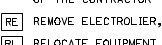
 New: Type 21D structure  

<b>16.</b> What does this plan symbol show? 
 Existing: Type 21D structure  

<b>17.</b> What does this plan symbol show? 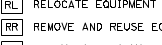
 New: Type 30  

<b>18.</b> What does this plan symbol show? 
 Existing: Type 30  

<b>19.</b> What does this plan symbol show? 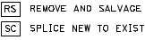
 New: Type 31  

<b>20.</b> What does this plan symbol show? 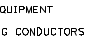
 Existing: Type 31  

<b>21.</b> What does this plan symbol show? 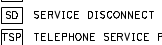
 New: Type 32  

<b>22.</b> What does this plan symbol show? 
 Existing: Type 32  

---

*Generated by `tools/flashcards/build_decks.py` from the JSON file. Edit the JSON, not this page.*
