#+TITLE: Standard Electrolier Symbols
#+FILETAGS: :electrical:caltrans:symbols:

* Standard Electrolier (New) - Type 15 :drill:
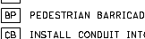

** Answer
Standard Electrolier
New - Standard Type: 15

* Standard Electrolier (Existing) - Type 15 :drill:
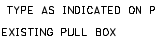

** Answer
Standard Electrolier
Existing - Standard Type: 15

* Standard Electrolier (New) - Type 15D :drill:
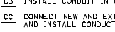

** Answer
Standard Electrolier
New - Standard Type: 15D

* Standard Electrolier (Existing) - Type 15D :drill:
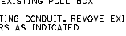

** Answer
Standard Electrolier
Existing - Standard Type: 15D

* Standard Electrolier (New) - Type 15 STRUCTURE :drill:
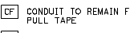

** Answer
Standard Electrolier
New - Standard Type: 15 STRUCTURE

* Standard Electrolier (Existing) - Type 15 STRUCTURE :drill:

** Answer
Standard Electrolier
Existing - Standard Type: 15 STRUCTURE

* Standard Electrolier (New) - Type 15D STRUCTURE :drill:
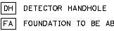

** Answer
Standard Electrolier
New - Standard Type: 15D STRUCTURE

* Standard Electrolier (Existing) - Type 15D STRUCTURE :drill:

** Answer
Standard Electrolier
Existing - Standard Type: 15D STRUCTURE

* Standard Electrolier (New) - Type 21 :drill:
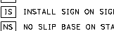

** Answer
Standard Electrolier
New - Standard Type: 21

* Standard Electrolier (Existing) - Type 21 :drill:
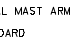

** Answer
Standard Electrolier
Existing - Standard Type: 21

* Standard Electrolier (New) - Type 21D :drill:
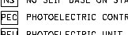

** Answer
Standard Electrolier
New - Standard Type: 21D

* Standard Electrolier (Existing) - Type 21D :drill:
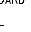

** Answer
Standard Electrolier
Existing - Standard Type: 21D

* Standard Electrolier (New) - Type 21 STRUCTURE :drill:
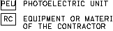

** Answer
Standard Electrolier
New - Standard Type: 21 STRUCTURE

* Standard Electrolier (Existing) - Type 21 STRUCTURE :drill:
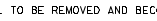

** Answer
Standard Electrolier
Existing - Standard Type: 21 STRUCTURE

* Standard Electrolier (New) - Type 21D STRUCTURE :drill:
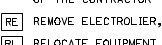

** Answer
Standard Electrolier
New - Standard Type: 21D STRUCTURE

* Standard Electrolier (Existing) - Type 21D STRUCTURE :drill:
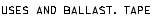

** Answer
Standard Electrolier
Existing - Standard Type: 21D STRUCTURE

* Standard Electrolier (New) - Type 30 :drill:
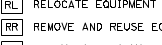

** Answer
Standard Electrolier
New - Standard Type: 30

* Standard Electrolier (Existing) - Type 30 :drill:

** Answer
Standard Electrolier
Existing - Standard Type: 30

* Standard Electrolier (New) - Type 31 :drill:
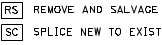

** Answer
Standard Electrolier
New - Standard Type: 31

* Standard Electrolier (Existing) - Type 31 :drill:
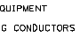

** Answer
Standard Electrolier
Existing - Standard Type: 31

* Standard Electrolier (New) - Type 32 :drill:
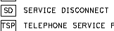

** Answer
Standard Electrolier
New - Standard Type: 32

* Standard Electrolier (Existing) - Type 32 :drill:

** Answer
Standard Electrolier
Existing - Standard Type: 32

