#+TITLE: ELECT 280 — Standard Electroliers
#+FILETAGS: :drill:
#+STARTUP: overview

# Generated by tools/flashcards/build_decks.py. Study with M-x org-drill.

* Standard Electrolier

** What does this plan symbol show?
   :PROPERTIES:
   :ID: e280-electrolier-001
   :END:
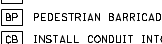
*** Answer
New: Type 15

** What does this plan symbol show?
   :PROPERTIES:
   :ID: e280-electrolier-002
   :END:
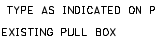
*** Answer
Existing: Type 15

** What does this plan symbol show?
   :PROPERTIES:
   :ID: e280-electrolier-003
   :END:
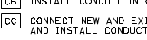
*** Answer
New: Type 15D

** What does this plan symbol show?
   :PROPERTIES:
   :ID: e280-electrolier-004
   :END:
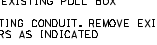
*** Answer
Existing: Type 15D

** What does this plan symbol show?
   :PROPERTIES:
   :ID: e280-electrolier-005
   :END:
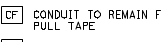
*** Answer
New: Type 15 structure

** What does this plan symbol show?
   :PROPERTIES:
   :ID: e280-electrolier-006
   :END:

*** Answer
Existing: Type 15 structure

** What does this plan symbol show?
   :PROPERTIES:
   :ID: e280-electrolier-007
   :END:
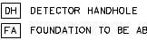
*** Answer
New: Type 15D structure

** What does this plan symbol show?
   :PROPERTIES:
   :ID: e280-electrolier-008
   :END:

*** Answer
Existing: Type 15D structure

** What does this plan symbol show?
   :PROPERTIES:
   :ID: e280-electrolier-009
   :END:
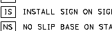
*** Answer
New: Type 21

** What does this plan symbol show?
   :PROPERTIES:
   :ID: e280-electrolier-010
   :END:
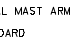
*** Answer
Existing: Type 21

** What does this plan symbol show?
   :PROPERTIES:
   :ID: e280-electrolier-011
   :END:
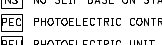
*** Answer
New: Type 21D

** What does this plan symbol show?
   :PROPERTIES:
   :ID: e280-electrolier-012
   :END:
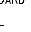
*** Answer
Existing: Type 21D

** What does this plan symbol show?
   :PROPERTIES:
   :ID: e280-electrolier-013
   :END:
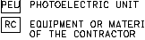
*** Answer
New: Type 21 structure

** What does this plan symbol show?
   :PROPERTIES:
   :ID: e280-electrolier-014
   :END:
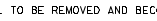
*** Answer
Existing: Type 21 structure

** What does this plan symbol show?
   :PROPERTIES:
   :ID: e280-electrolier-015
   :END:
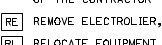
*** Answer
New: Type 21D structure

** What does this plan symbol show?
   :PROPERTIES:
   :ID: e280-electrolier-016
   :END:
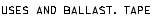
*** Answer
Existing: Type 21D structure

** What does this plan symbol show?
   :PROPERTIES:
   :ID: e280-electrolier-017
   :END:
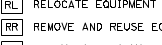
*** Answer
New: Type 30

** What does this plan symbol show?
   :PROPERTIES:
   :ID: e280-electrolier-018
   :END:

*** Answer
Existing: Type 30

** What does this plan symbol show?
   :PROPERTIES:
   :ID: e280-electrolier-019
   :END:
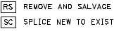
*** Answer
New: Type 31

** What does this plan symbol show?
   :PROPERTIES:
   :ID: e280-electrolier-020
   :END:
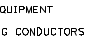
*** Answer
Existing: Type 31

** What does this plan symbol show?
   :PROPERTIES:
   :ID: e280-electrolier-021
   :END:
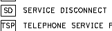
*** Answer
New: Type 32

** What does this plan symbol show?
   :PROPERTIES:
   :ID: e280-electrolier-022
   :END:

*** Answer
Existing: Type 32

